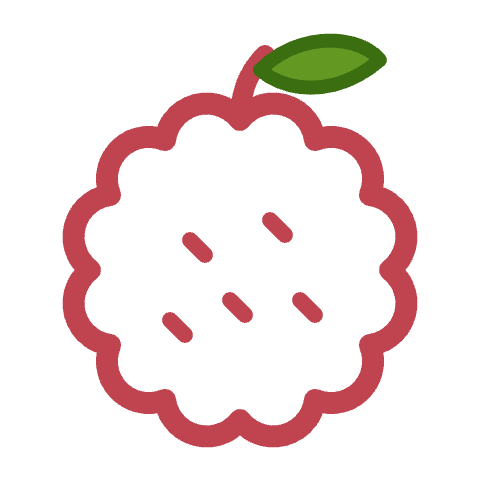
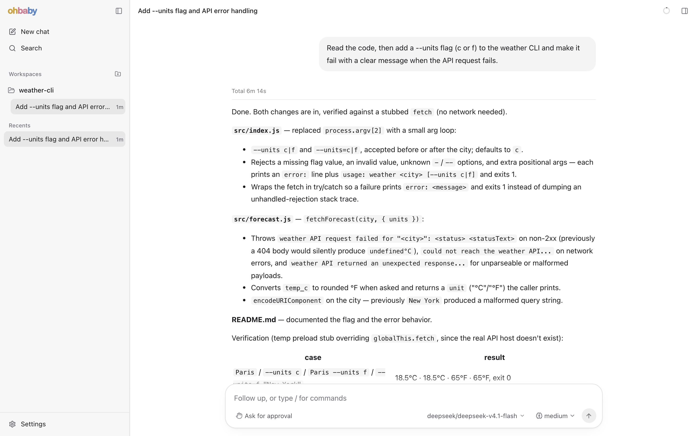
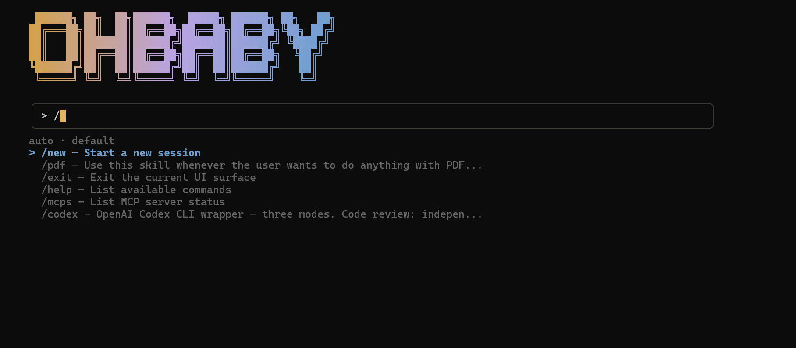

<div align="center">



# ohbaby-agent

<p>An open-source AI coding agent with a terminal TUI and a local web UI.<br>Use your own model API, and plug in MCP servers or skills when you need more tools.</p>

<a href="https://github.com/diverHansun/ohbaby-agent/actions/workflows/ci.yml"></a>
<a href="https://www.npmjs.com/package/ohbaby-cli"></a>
<a href="./LICENSE"></a>


**[Install](#install)** &nbsp;·&nbsp; **[Quick start](#quick-start)** &nbsp;·&nbsp; **[Web UI](#web-ui)** &nbsp;·&nbsp; **[Docs](docs/)** &nbsp;·&nbsp; **English** · [简体中文](README.zh.md)

<br>



</div>

## Features

- **Multi-protocol model support**: speaks `openai-compatible`, `openai-responses`, and `anthropic`, so it works with major API providers as well as local model servers.
- **Terminal + local web UI**: run `ohbaby` for an [Ink](https://github.com/vadimdemedes/ink) terminal interface, or `ohbaby serve` to work in your browser. Both talk to the same runtime and share session history.
- **Built-in tools**: file read/edit, code search, shell execution, web search, and a todo list.
- **Permission control**: risky actions pause for confirmation by default, and `/permission` switches a session to Full access when you don't want prompts.
- **MCP and skills**: connect [MCP](https://modelcontextprotocol.io) servers for external tools, and load skills as `/` slash commands.
- **Subagents**: hand off multi-step searches or subtasks to separate subagents.

## Install

**macOS and Linux**

```sh
curl -fsSL https://cdn.jsdelivr.net/npm/ohbaby-cli/install.sh | sh
```

**Windows (PowerShell)**

```powershell
irm https://cdn.jsdelivr.net/npm/ohbaby-cli/install.ps1 | iex
```

The install script sets up its own Node.js runtime, so you don't need Node installed ahead of time.

**npm** (requires **Node.js 24** or later)

```bash
npm install -g ohbaby-cli
```

Once installed, the CLI is available as `ohbaby`. Use `ohbaby update` to upgrade and `ohbaby uninstall` to remove it.

## Quick start

Start `ohbaby` in your project directory:

```bash
ohbaby
```

1. Run `/connect`, fill in your provider, base URL, and model name, then save.
2. Enter your task in the prompt, or run a one-off prompt from the shell with `ohbaby run "..."`.

<p align="center">
  
</p>

<details>
<summary><b>/connect fields and CLI flags</b></summary>

<br>

| Field | Description |
| --- | --- |
| Provider | `openai`, `anthropic`, `zhipu`, etc. |
| Base URL | SDK base URL without the `/chat/completions` suffix |
| API key env | Optional. Environment variable that holds the key, e.g. `OPENAI_API_KEY` |
| API key value | Optional. Leave empty for local endpoints without auth (such as LM Studio) |
| Model name | Model ID from your provider, e.g. `gpt-6.2-sol`, `claude-opus-5-5`, `glm-5.3` |
| Context window / Max output tokens | Optional |

API keys entered in the panel are saved to `~/.ohbaby/.env`.

You can also skip the panel and pass flags directly to `/connect`. In flag mode, the key is read from an environment variable rather than passed inline:

```bash
/connect --provider openai --base-url https://api.openai.com/v1 --model gpt-6.2-sol --api-key-env OPENAI_API_KEY --interface-provider openai-responses
```

`--interface-provider` accepts `openai-compatible`, `openai-responses`, or `anthropic`. When omitted, ohbaby infers it from the URL (OpenAI URLs default to Chat Completions).

</details>

## Web UI

From your project directory, run:

```bash
ohbaby serve
```

This starts a local daemon and opens the web UI in your browser (default: `http://127.0.0.1:4096`).

```bash
ohbaby serve status  # check daemon status and URL
ohbaby serve stop    # stop the daemon
```

<details>
<summary><b>Ports</b></summary>

<br>

`ohbaby serve` uses port `4096` by default. If `4096` is already in use, it picks a free port and prints the actual URL. Passing `--port` explicitly disables fallback, so `ohbaby serve --port 4096` exits with an error if that port is busy.

</details>

## Configuration

<details>
<summary><b>Web search</b></summary>

<br>

Built-in web search uses [Tavily](https://app.tavily.com). Get a free API key, then run `/connect-search` in the TUI or paste it under Settings → Web search in the web UI. ohbaby saves it as `TAVILY_API_KEY` in `~/.ohbaby/.env`.

You can also set it manually in `~/.ohbaby/.env` (global) or `<your-project>/.env` (project):

```dotenv
TAVILY_API_KEY=tvly-...
```

Precedence: shell environment variables > project `.env` > global `.env`.

If you want to use a different search provider, connect it through MCP or a skill.

</details>

<details>
<summary><b>MCP and skills</b></summary>

<br>

MCP servers are configured in `~/.ohbaby/mcp/settings.json` (global) or `<project>/.ohbaby/mcp/settings.json` (project). Skills are loaded from `.ohbaby/skills/` as well as compatible `.claude/skills/` and `.agents/skills/` directories, and register as `/` slash commands. Run `/mcps` to check server status and `/skills` to list loaded skills.

</details>

<details>
<summary><b>Instruction files</b></summary>

<br>

ohbaby reads both `AGENTS.md` and `CLAUDE.md` from `~/.ohbaby/` and the project root. The main agent and subagents receive the same file instructions in a low-priority reminder. Project rules take precedence over global rules. Edits take effect on the next model request.

</details>

<details>
<summary><b>Config and data locations</b></summary>

<br>

Configuration is stored in `~/.ohbaby` (`%USERPROFILE%\.ohbaby` on Windows), including models, keys, MCP, skills, subagents, tool settings, and daemon state. Set `OHBABY_HOME` to an absolute path to relocate it. Project-level configuration lives in `<project>/.ohbaby`.

Runtime data (such as sessions and SQLite storage) lives in the platform data directory:

- Linux: `${XDG_DATA_HOME:-~/.local/share}/ohbaby`
- macOS: `~/Library/Application Support/ohbaby`
- Windows: `%LOCALAPPDATA%\ohbaby`

</details>

## Development

```bash
git clone https://github.com/diverHansun/ohbaby-agent.git
cd ohbaby-agent
pnpm install
pnpm build
pnpm start       # run the built CLI
pnpm test        # run tests
pnpm preflight   # format + lint + typecheck + test + build
```

| Package | Description |
| --- | --- |
| `packages/ohbaby-cli` | Terminal UI and CLI entry point (`ohbaby`), bundling the built web assets |
| `apps/ohbaby-web` | Browser frontend served by `ohbaby serve` |
| `packages/ohbaby-agent` | Core runtime: agent loop, tools, sessions, permissions, MCP, skills, subagents |
| `packages/ohbaby-llm` | Multi-protocol LLM clients and streaming |
| `packages/ohbaby-server` | Local daemon server and client transport |
| `packages/ohbaby-sdk` | Shared TypeScript types and RPC contracts across runtime and UIs |

Architecture notes and module docs are in [`docs/`](docs/).

## License

[MIT](./LICENSE)
