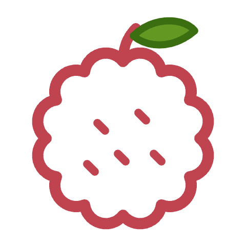
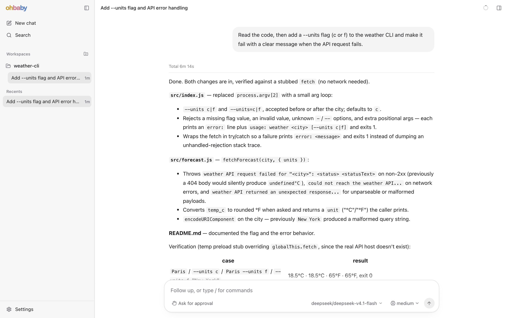
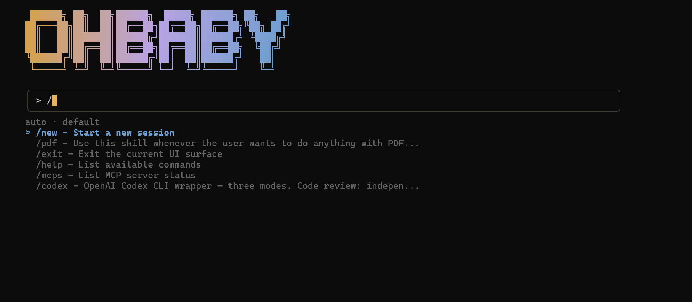

<div align="center">



# ohbaby-agent

<p>一个开源的 AI 编程 Agent，带终端 TUI 和本地 Web 界面。<br>接上自己的模型 API 就能用，支持接入 MCP 和 skills。</p>

<a href="https://github.com/diverHansun/ohbaby-agent/actions/workflows/ci.yml"></a>
<a href="https://www.npmjs.com/package/ohbaby-cli"></a>
<a href="./LICENSE"></a>


**[安装](#安装)** &nbsp;·&nbsp; **[快速开始](#快速开始)** &nbsp;·&nbsp; **[Web UI](#web-ui)** &nbsp;·&nbsp; **[文档](docs/)** &nbsp;·&nbsp; [English](README.md) · **简体中文**

<br>



</div>

## 主要功能

- **多协议接入**：支持 `openai-compatible`、`openai-responses` 和 `anthropic` 三种协议，主流厂商 API 或本地跑的模型都能接。
- **终端 + 本地 Web**：终端界面基于 [Ink](https://github.com/vadimdemedes/ink)，习惯浏览器的也可以运行 `ohbaby serve` 打开本地 Web UI，两边共用同一套运行时和会话记录。
- **内置工具**：包含文件读写、代码检索、Shell 命令执行、联网搜索和待办列表。
- **权限控制**：有风险的操作默认会先询问确认，放心的任务可以用 `/permission` 切到 Full access。
- **MCP 与 skills**：可以连接 [MCP](https://modelcontextprotocol.io) server 引入外部工具，本地配好的 skill 会注册成 `/` 斜杠命令。
- **子 Agent**：遇到耗时的代码搜索或多步任务，可以拆给独立的子 Agent 去跑。

## 安装

**macOS 和 Linux**

```sh
curl -fsSL https://cdn.jsdelivr.net/npm/ohbaby-cli/install.sh | sh
```

**Windows（PowerShell）**

```powershell
irm https://cdn.jsdelivr.net/npm/ohbaby-cli/install.ps1 | iex
```

安装脚本会自动拉取独立的 Node.js 运行时，不需要提前安装 Node。

**npm**（需要 **Node.js 24** 及以上版本）

```bash
npm install -g ohbaby-cli
```

装好后直接用 `ohbaby` 命令启动，后续可用 `ohbaby update` 更新、`ohbaby uninstall` 卸载。

## 快速开始

在项目目录下运行：

```bash
ohbaby
```

1. 输入 `/connect`，填好 provider、base URL 和模型名称后保存。
2. 直接输入你的需求开始对话，也可以在命令行用 `ohbaby run "..."` 单次执行。

<p align="center">
  
</p>

<details>
<summary><b>/connect 字段说明与命令行参数</b></summary>

<br>

| 字段 | 说明 |
| --- | --- |
| Provider | `openai`、`anthropic`、`zhipu` 等 |
| Base URL | SDK 的 base URL，不要带 `/chat/completions` 后缀 |
| API key env | 可选。存放 API Key 的环境变量名，如 `OPENAI_API_KEY` |
| API key value | 可选。连接 LM Studio 这类免鉴权的本地服务时可留空 |
| Model name | 服务商提供的模型 ID，如 `gpt-6.2-sol`、`claude-opus-5-5`、`glm-5.3` |
| Context window / Max output tokens | 可选 |

在面板里填写的 API Key 会保存到 `~/.ohbaby/.env`。

不想打开面板的话，也可以直接带参数执行 `/connect`。参数模式只从环境变量读取密钥，不支持把明文 Key 直接写在命令里：

```bash
/connect --provider openai --base-url https://api.openai.com/v1 --model gpt-6.2-sol --api-key-env OPENAI_API_KEY --interface-provider openai-responses
```

`--interface-provider` 可选 `openai-compatible`、`openai-responses` 或 `anthropic`。不传时会按 URL 自动判断，OpenAI 官方地址默认走 Chat Completions。

</details>

## Web UI

在项目目录下执行：

```bash
ohbaby serve
```

启动本地 daemon 后，浏览器会自动打开 Web 界面（默认地址是 `http://127.0.0.1:4096`）。

```bash
ohbaby serve status  # 查看 daemon 状态和地址
ohbaby serve stop    # 停止 daemon
```

<details>
<summary><b>端口说明</b></summary>

<br>

默认使用 `4096` 端口。如果该端口已被占用，ohbaby 会自动换一个空闲端口并打印实际地址。显式传入 `--port` 时不做自动切换，`ohbaby serve --port 4096` 遇到端口占用会直接报错退出。

</details>

## 配置

<details>
<summary><b>联网搜索</b></summary>

<br>

内置联网搜索用的是 [Tavily](https://app.tavily.com)。申请免费 API Key 后，可以在终端输入 `/connect-search` 粘贴保存，也可以在 Web 界面的 Settings → Web search 中填写，Key 会以 `TAVILY_API_KEY` 写入 `~/.ohbaby/.env`。

也可以直接写进 `~/.ohbaby/.env`（全局）或 `<你的项目>/.env`（项目）：

```dotenv
TAVILY_API_KEY=tvly-...
```

读取优先级：Shell 环境变量 > 项目 `.env` > 全局 `.env`。

如果想换其他搜索服务，可以通过 MCP 或 skill 接入。

</details>

<details>
<summary><b>MCP 与 skills</b></summary>

<br>

MCP server 配置文件放在全局的 `~/.ohbaby/mcp/settings.json` 或项目的 `.ohbaby/mcp/settings.json`。Skills 会从 `.ohbaby/skills/` 以及兼容的 `.claude/skills/`、`.agents/skills/` 目录加载，加载后直接通过 `/` 斜杠命令调用。可以用 `/mcps` 查看连接状态，用 `/skills` 查看已加载的列表。

</details>

<details>
<summary><b>说明文件</b></summary>

<br>

ohbaby 会从全局 `~/.ohbaby/` 和项目根目录（未找到时回退到 `<project>/.ohbaby/`）各读取一份说明文件，按 `OHBABY.md`、`AGENTS.md`、`CLAUDE.md` 的顺序取第一个存在的文件。主 Agent 和子 Agent 都会加载这两份文件，冲突时以项目级为准。这里放的是固定指令，不会当作长期记忆自动改写。

</details>

<details>
<summary><b>配置与数据目录</b></summary>

<br>

配置文件统一放在 `~/.ohbaby`（Windows 上为 `%USERPROFILE%\.ohbaby`），包含模型、密钥、MCP、skills、子 Agent、工具设置和 daemon 状态。想换位置可以把 `OHBABY_HOME` 设为绝对路径。项目级配置放在 `<project>/.ohbaby`。

会话等运行数据存放在系统数据目录：

- Linux：`${XDG_DATA_HOME:-~/.local/share}/ohbaby`
- macOS：`~/Library/Application Support/ohbaby`
- Windows：`%LOCALAPPDATA%\ohbaby`

</details>

## 开发

```bash
git clone https://github.com/diverHansun/ohbaby-agent.git
cd ohbaby-agent
pnpm install
pnpm build
pnpm start       # 运行构建后的 CLI
pnpm test        # 运行测试
pnpm preflight   # format + lint + typecheck + test + build
```

| 包 / 目录 | 说明 |
| --- | --- |
| `packages/ohbaby-cli` | 终端 TUI 与 CLI 入口，提供 `ohbaby` 命令并内置打包后的 Web 静态资源 |
| `apps/ohbaby-web` | `ohbaby serve` 托管的浏览器前端界面 |
| `packages/ohbaby-agent` | 核心运行时：Agent 循环、工具、会话、权限策略、MCP、skills、子 Agent |
| `packages/ohbaby-llm` | 多协议 LLM 客户端与流式解析 |
| `packages/ohbaby-server` | 本地 daemon 服务端与客户端通信层 |
| `packages/ohbaby-sdk` | 运行时与各端界面共用的 TypeScript 类型和 RPC 契约 |

各模块的设计文档见 [`docs/`](docs/)。

## 许可证

[MIT](./LICENSE)
