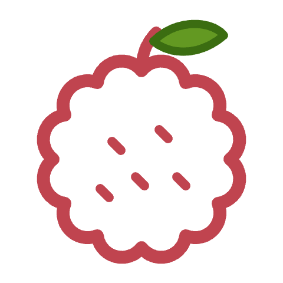
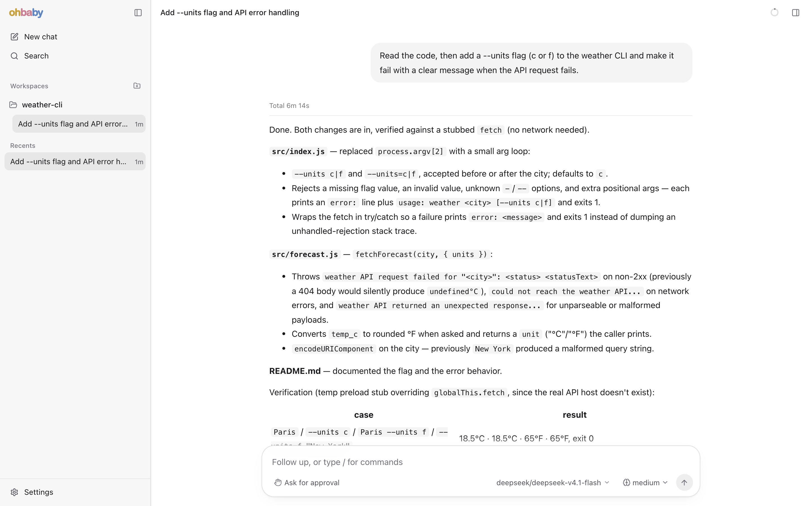
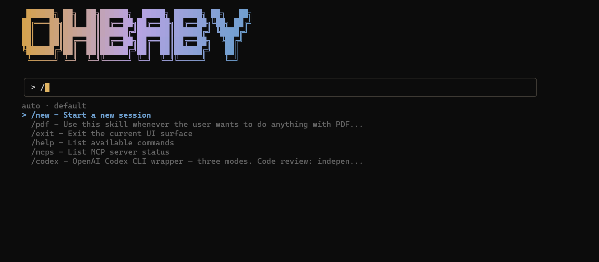

<div align="center">



# ohbaby-agent

### 开源 AI 编程 Agent，终端和浏览器里都能用。

**模型自己选，能力靠 MCP 和 skills 扩展，危险操作先问你。**

<a href="https://github.com/diverHansun/ohbaby-agent/actions/workflows/ci.yml"></a>
<a href="https://www.npmjs.com/package/ohbaby-cli"></a>
<a href="./LICENSE"></a>


**[安装](#安装)** &nbsp;·&nbsp; **[快速开始](#快速开始)** &nbsp;·&nbsp; **[Web UI](#web-ui)** &nbsp;·&nbsp; **[文档](docs/)** &nbsp;·&nbsp; [English](README.md) · **简体中文**

<br>



</div>

## 亮点

- **模型随你选**：OpenAI、Anthropic、智谱、DeepSeek、通义千问/DashScope，或任何 OpenAI 兼容的端点，本地模型也行。
- **两个界面，同一个 Agent**：基于 [Ink](https://github.com/vadimdemedes/ink) 的终端界面，加上 `ohbaby serve` 启动的本地 Web UI。
- **内置工具**：读写文件、执行 Shell 命令、联网搜索、管理待办。
- **权限控制**：危险操作先等你批准；信得过的任务可以用 `/permission` 切到 Full access。
- **MCP 与 skills**：接入 [MCP](https://modelcontextprotocol.io) server；添加的 skill 会变成 slash 命令。
- **子 Agent**：把复杂的多步任务交给专注的子 Agent。

## 安装

需要 **Node.js 24** 及以上版本。

```bash
npm install -g ohbaby-cli
```

安装后会得到 `ohbaby` 命令。

## 快速开始

```bash
ohbaby
```

1. 输入 `/connect`，填好 provider、base URL 和模型名，保存。
2. 说出你想做的事，就这么简单。

<p align="center">
  
</p>

<details>
<summary><b>/connect 字段与参数模式</b></summary>

<br>

| 字段 | 说明 |
| --- | --- |
| Provider | `openai`、`anthropic`、`zhipu` 等 |
| Base URL | SDK 的 base URL，不要带 `/chat/completions` 后缀 |
| API key env | 可选。存放 API Key 的环境变量名，如 `OPENAI_API_KEY` |
| API key value | 可选。LM Studio 这类无需鉴权的本地端点可以留空 |
| Model name | 如 `gpt-5.5`、`claude-sonnet-4-5`、`glm-5.1`，或你的 provider 提供的模型 ID |
| Context window / Max output tokens | 可选 |

在这里填的 API Key 会保存到 `~/.ohbaby/.env`。

参数模式不打开面板。它从环境变量读取 API Key，不接受直接写在命令里的 Key：

```bash
/connect --provider openai --base-url https://api.openai.com/v1 --model gpt-5.5 --api-key-env OPENAI_API_KEY --interface-provider openai-responses
```

`--interface-provider` 可选 `openai-compatible`、`openai-responses` 或 `anthropic`。不传时按 URL 推断，OpenAI 的 URL 默认走 Chat Completions。

</details>

## Web UI

在项目根目录执行：

```bash
ohbaby serve
```

它会启动本地 daemon，并打开它打印出的地址，通常是 `http://127.0.0.1:4096`。

```bash
ohbaby serve status  # 查看 daemon 状态和地址
ohbaby serve stop    # 停止 daemon
```

<details>
<summary><b>端口</b></summary>

<br>

默认使用 `4096` 端口。被占用时，ohbaby 会自动换一个空闲端口并打印地址。显式传入 `--port` 时不会自动换：`ohbaby serve --port 4096` 在端口被占用时直接报错。

</details>

## 配置

<details>
<summary><b>联网搜索</b></summary>

<br>

先去 [Tavily](https://tavily.com) 申请一个免费 API Key，然后输入 `/connect-search` 并粘贴进去。ohbaby 会把它作为 `TAVILY_API_KEY` 保存到 `~/.ohbaby/.env`。

也可以手动写进 `~/.ohbaby/.env`（全局）或 `<你的项目>/.env`（项目）：

```dotenv
TAVILY_API_KEY=tvly-...
```

优先级：Shell 环境变量 > 项目 `.env` > 全局 `.env`。

</details>

<details>
<summary><b>MCP 与 skills</b></summary>

<br>

MCP server 可以在全局或项目的 `.ohbaby/mcp/` 下配置。Skills 从 ohbaby 兼容的 skill 目录中发现，并作为 slash 命令出现。用 `/mcps` 查看已连接的 server，用 `/skills` 列出可用 skill。

</details>

<details>
<summary><b>说明文件</b></summary>

<br>

ohbaby 会读取两份说明文件：全局的放在 `~/.ohbaby/`，项目的放在项目根目录（或 `<project>/.ohbaby/`）。两处各按 `OHBABY.md`、`AGENTS.md`、`CLAUDE.md` 的顺序取第一个找到的文件。主 Agent 和子 Agent 都会读取它们，冲突时以项目文件为准。这些文件是给 Agent 的说明，不是长期记忆。

</details>

<details>
<summary><b>配置与数据目录</b></summary>

<br>

配置放在 `~/.ohbaby`（Windows 上是 `%USERPROFILE%\.ohbaby`），包括模型、密钥、MCP、skills、子 Agent、工具配置和 daemon 状态。想整体换位置，把 `OHBABY_HOME` 设为一个绝对路径即可。项目级配置放在 `<project>/.ohbaby`。

运行数据放在系统的数据目录：

- Linux：`${XDG_DATA_HOME:-~/.local/share}/ohbaby`
- macOS：`~/Library/Application Support/ohbaby`
- Windows：`%LOCALAPPDATA%\ohbaby`

首次启动时，ohbaby 会把旧的 `.ohbaby-agent` 配置和 `ohbaby-agent` 数据复制到新位置，旧文件原样保留。新旧冲突时以新路径为准，旧路径在一个 minor 版本内仍可读取。如果运行中的 daemon 挡住了 SQLite 迁移，先执行 `ohbaby serve stop` 再重新启动。

</details>

## 开发

```bash
git clone https://github.com/diverHansun/ohbaby-agent.git
cd ohbaby-agent
pnpm install
pnpm build
pnpm start       # 运行构建后的 CLI
pnpm test        # 运行测试
pnpm preflight   # format + lint + typecheck + test + build
```

| 包 | 作用 |
| --- | --- |
| `ohbaby-cli` | 终端界面和内置的 Web UI，安装后提供 `ohbaby` 命令 |
| `ohbaby-agent` | 运行时：适配器、工具、会话、策略、MCP、skills |
| `ohbaby-llm` | 不绑定厂商的 LLM 客户端、流式输出与配置 |
| `ohbaby-server` | 本地服务端，以及远程客户端的传输层 |
| `ohbaby-sdk` | 运行时与各个界面共享的稳定 TypeScript 契约 |

设计文档和模块说明都在 [`docs/`](docs/) 下。

## 许可证

[MIT](./LICENSE)
