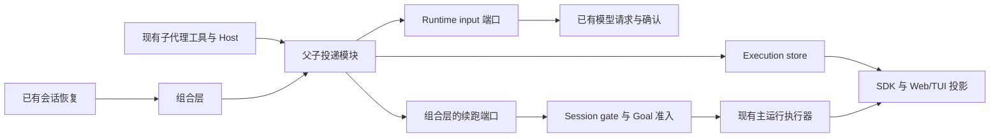

# 模块架构

## Overview

在现有 `agents/subagents` 内收拢一个轻量内部投递入口，暂名 `delivery.ts`。它组合已有消息通道、结果协调器和 supervisor，不拥有第二份队列。持久事实仍在 execution store、runtime input、run ledger 和请求记录中。

图中箭头表示调用或投影关系，不是新建消息总线。恢复入口由组合层接线，底层 runtime 不新增对整个投递服务的依赖。

## Pattern and Rationale

采用已有存储上的应用服务组合。这里需要统一的是身份、接收、确认与恢复规则；主到子消息和子到主结果仍有不同生命周期，不强行用一个泛型 envelope 或统一调度状态机表达。

事件用于尽快唤醒检查，持久记录用于决定还有什么未完成。丢失内存事件后，在现有会话监督或恢复入口核对即可；不靠每隔几分钟让模型醒来检查。

## Module Structure and File Layout

路径均相对 `packages/ohbaby-agent/src/`，名称是实施建议，不要求为符合目录图拆出空文件。

| 位置 | 职责 |
| --- | --- |
| `agents/subagents/delivery.ts`（新增） | 组合入口、对调用方提供接收／终态／核对能力，复用下列实现 |
| `agents/subagents/execution-message-channel.ts` | 主到子消息幂等接收、已关闭目标的明确结果 |
| `agents/subagents/continuation-coordinator.ts` | 子到主结果输入、成功请求确认和跨 run 核对 |
| `agents/subagents/session-supervisor.ts` | 事件与有限定时检查，请求续跑，不调用模型 |
| `agents/subagents/execution-store.ts` | 执行终态、delivery 元数据与条件更新 |
| `adapters/ui-inprocess/subagent-wakeup.ts` | 接 gate/Goal 和现有提交入口，返回有类型的运行结果 |
| `adapters/ui-runtime/composition.ts` | 接运行 ID、runtime input、确认和恢复端口 |

先修直接故障，再在相同改动中整理调用方向。已有职责清楚的文件保留，不为建立“服务层”把所有文件搬迁、重命名或重复包装。

## Constraints and Tradeoffs

1. 同一会话仍只有现有 gate 决定谁能执行；delivery 的 CAS 决定同一结果是否已被本次启动认领。两者不互相替代，不新增分布式锁。
2. 接收事务、请求持久化和消费确认各有真实边界。用稳定身份与恢复核对连接它们，不声称覆盖整个 LLM 调用的原子事务。
3. 仅允许已知未进入请求、且没有用户 Stop 的启动故障有限重试。剩余额度持久化、退避留在 supervisor；不另建错误分类框架。Stop 将触发结果的额度置 0，不新增账本行。已尝试请求或不可判定的外部调用，不由后台检查无限重开。
4. 归档、删除、目录切换／迁移、Rewind、owner 冲突、Goal 暂停及预算限制仍由现有准入执行。execution 在接收时保存 goalId（普通任务明确为 null），避免依赖重启即丢失的 ownedRuns。旧记录归属不明时，不得把它当普通结果绕过 Goal；只保留该条等待核对，不拦住已知普通结果。
5. 恢复入口是实际取得会话运行所有权的时机。历史列表、monitor、浏览器刷新和 SSE 重连不产生模型调用；也不扫描并唤醒数据库里全部旧会话。
6. UI 使用现有投影。子代理 Completed 保持执行含义，主运行失败另行展示；新字段只表达必要的待处理／失败原因，不暴露存储实现。

代价是新增少量 execution delivery 元数据、一个 Goal 归属字段、恢复核对及几处端到端接线。终止原因沿用受控 reason，不再复制原因类别。相比新信箱，这避免了两套待处理状态的同步；相比只改 UUID，这覆盖了已经确认的中断通知与静默失败问题。
