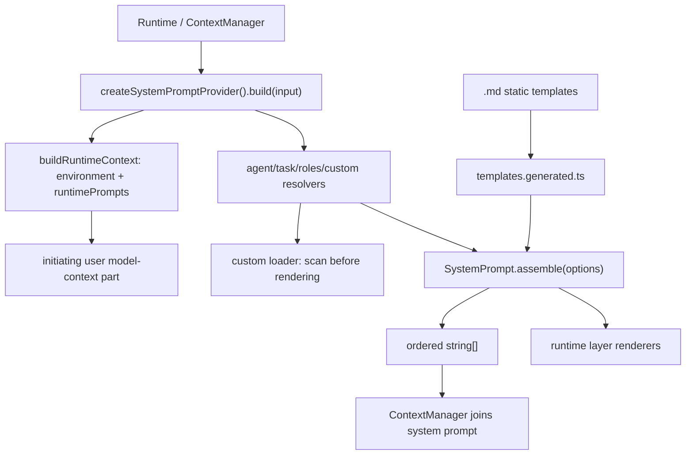

# system-prompt 模块 dfd-interface.md

本文档描述 `system-prompt` 模块的数据流与接口。

---

## 一、数据流概览



---

## 二、主要接口

### 2.1 SystemPrompt.assemble()

```ts
SystemPrompt.assemble(options: AssembleOptions): string[]
```

输入：

- `agentName`: 当前 agent 名称，不能为空。
- `isSubagent`: primary/subagent 边界，必须显式传入。
- `taskKind`: 可选任务类型。
- `agentPromptAddon`: 可选代理附加提示。
- `availableSubagentRoles`: 可选子代理角色列表，仅 primary 使用。
- `customInstructions`: 带 scope 的全局／项目说明，primary 与 subagent 共用。

输出：

- 有序、非空的 prompt layer 数组。

### 2.2 createSystemPromptProvider()

```ts
createSystemPromptProvider(options?: SystemPromptProviderOptions): SystemPromptProvider
```

数据流：

1. 解析 agent name。
2. 并发获取 taskKind 和主代理可用 subagent roles。
3. 获取 agent prompt addon。
4. 两类代理共用 loader，按 `projectRoot ?? directory` 加载说明。
5. 调用 `SystemPrompt.assemble()`。
6. 使用空行 join 为最终 system prompt 字符串。

`buildRuntimeContext()` 另行按执行 `directory` 检测环境，并合入 `runtimePromptsProvider`。Context 只在新 run 提供 initiating user message 时把它幂等附着为 model-context part；有 snapshot 的后续步骤不会重建这段内容。

### 2.3 loadCustomInstructions()

```ts
SystemPrompt.loadCustomInstructions(options): Promise<readonly CustomInstruction[]>
```

职责：

- 每个范围只读取首个可用文件，返回 `{ scope, text }`。项目以会话项目根为边界；全局保留 `OHBABY_HOME` 和既有旧路径回退。
- 支持 `OHBABY.md`、`AGENTS.md`、`CLAUDE.md` fallback。
- 保留每文件 50 × 1024 个 UTF-16 编码单元限制。无文件、空文件或普通读取失败时继续回退，无可用内容就跳过。
- 扫描 prompt-like 内容并上报 finding。

实现位于 `services/custom-instruction-loader.ts`。`layers/custom.ts` 只负责把已加载内容渲染为 `<custom_instructions>` prompt 片段。

---

## 三、primary 组装流

```text
input
  -> resolve primary task kind (default: agent)
  -> render base from prompts/primary/base.md
  -> render primary task from prompts/primary/tasks/*.md
  -> wrap agent addon
  -> render subagent roles when roles exist
  -> render custom instructions
  -> compact empty layers
```

---

## 四、subagent 组装流

```text
input
  -> resolve subagent task kind (taskKind > agentName > generic)
  -> render subagent base from prompts/subagents/base.md
  -> render subagent task from prompts/subagents/tasks/*.md
  -> wrap agent addon
  -> render custom instructions (Global -> Project)
  -> compact empty layers
```

subagent 读取相同项目／全局说明，保留自己的 base、task 与委派边界；不因此获得 primary 身份、角色目录或额外权限。

---

## 五、安全流

custom instructions 与 MCP metadata 都可能来自外部来源：

- custom instructions 在 loader 中扫描、截断并上报 warning/finding。
- MCP 工具在注册前检查名称、description、schema 的 JSON 结构、深度、大小和 prompt-like 内容；失败即拒绝。
- runtime MCP 菜单仅接收已准入的精确本地名和固定说明，description/schema 只在显式 `select_tools` 后作为原生工具定义下发。

---

## 六、外部边界

| 输入来源 | 进入点 | 说明 |
| --- | --- | --- |
| agents | `agentNameResolver`, `agentPromptResolver`, `availableSubagentRolesProvider` | 提供 agent 名称、addon 和 primary 可委派角色 |
| ui-runtime | `taskKindResolver`, `runtimePromptsProvider` | 提供 task kind 与 scoped runtime 文本 |
| filesystem | `loadCustomInstructions()` | 读取 custom instruction 文件 |
| environment | `detectEnvironment()` | 读取 cwd、platform、date、git 状态 |

| 输出去向 | 输出 | 说明 |
| --- | --- | --- |
| context manager | `build()` 的 system prompt | 固定 run system 快照 |
| context manager | `buildRuntimeContext()` 的文本 | 新 run initiating user 的 model-context part |
| tests/debug | `string[]` layer array | 便于断言层顺序 |
