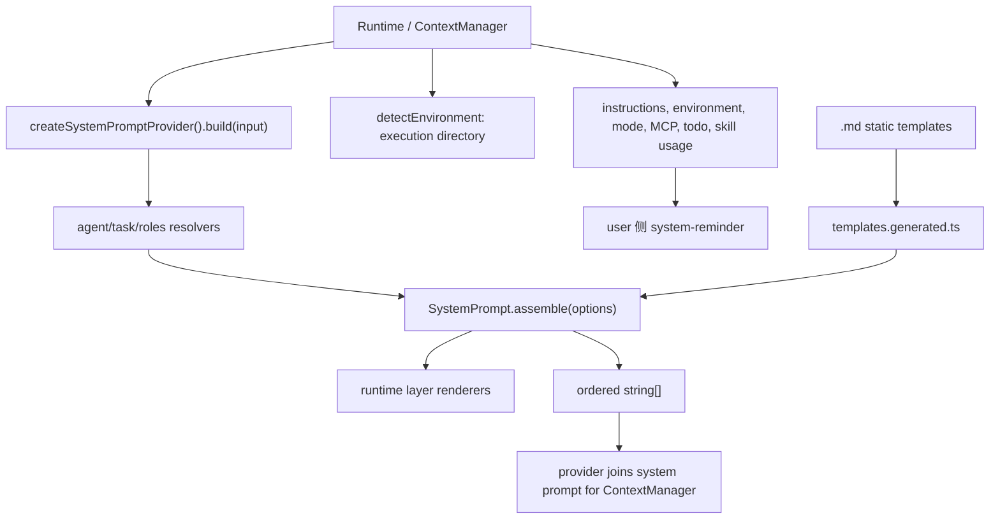

# system-prompt 模块 dfd-interface.md

本文档描述 `system-prompt` 模块的数据流与接口。

---

## 一、数据流概览



---

## 二、主要接口

### 2.1 SystemPrompt.assemble()

```ts
SystemPrompt.assemble(options: AssembleOptions): string[]
```

输入：

- `agentName`: 当前 agent 名称，不能为空。
- `isSubagent`: primary/subagent 边界，必须显式传入。
- `taskKind`: 可选任务类型。
- `agentPromptAddon`: 可选代理附加提示。
- `availableSubagentRoles`: 可选子代理角色列表，仅 primary 使用。

输出：

- 有序、非空的 prompt layer 数组。

### 2.2 createSystemPromptProvider()

```ts
createSystemPromptProvider(options?: SystemPromptProviderOptions): SystemPromptProvider
```

数据流：

1. 解析 agent name。
2. 并发获取 task kind、代理 addon 和主代理可用的 subagent roles。
3. 调用 `SystemPrompt.assemble()`。
4. 使用空行 join 为最终 system prompt 字符串。

`detectEnvironment()` 另行按执行 `directory` 检测环境。Context 在创建 run 快照时保存成功检测的环境，供 environment reminder 使用。

### 2.3 文件指令的接入点

每次 `ContextManager.prepareTurn()` 通过 reminder collector 收集文件指令。主、子代理使用 `projectRoot ?? directory` 查找项目指令，同时加载全局配置目录中的指令。最新有效文件集合的 key 与当前活跃历史一致时，本步零追加。变化时追加新快照，所有来源失效时可追加一次清空声明。加载、渲染和诊断接口见[指令数据流](../../services/instructions/dfd-interface.md)。

---

## 三、primary 组装流

```text
input
  -> use the stable primary agent task
  -> render base from prompts/primary/base.md
  -> render prompts/primary/tasks/agent.md
  -> wrap agent addon
  -> render subagent roles when roles exist
  -> compact empty layers
```

---

## 四、subagent 组装流

```text
input
  -> resolve subagent task kind (taskKind > agentName > generic)
  -> render subagent base from prompts/subagents/base.md
  -> render subagent task from prompts/subagents/tasks/*.md
  -> wrap agent addon
  -> compact empty layers
```

subagent 保留自己的 base、task 与委派边界。文件指令快照追加到它自己的会话历史。

---

## 五、安全流

custom instructions 与 MCP metadata 都可能来自外部来源：

- `services/instructions` 在渲染前调用本模块的 prompt-security 扫描器，并将 finding 交给通知管道。
- MCP 工具在注册前检查名称、description、schema 的 JSON 结构、深度、大小和 prompt-like 内容；失败即拒绝。
- MCP catalog reminder 仅接收已准入的精确本地名和固定说明，description/schema 只在显式 `select_tools` 后作为原生工具定义下发。

---

## 六、外部边界

| 输入来源 | 进入点 | 说明 |
| --- | --- | --- |
| agents | `agentNameResolver`, `agentPromptResolver`, `availableSubagentRolesProvider` | 提供 agent 名称、addon 和 primary 可委派角色 |
| ui-runtime | `taskKindResolver` | 提供当前任务类型 |
| environment | `detectEnvironment()` | 读取 cwd、platform、date、git 状态 |

| 输出去向 | 输出 | 说明 |
| --- | --- | --- |
| context manager | `build()` 的 system prompt | 固定 run system 快照 |
| context manager | `detectEnvironment()` 的结果 | run 快照中的可选 environment 字段 |
| tests/debug | `string[]` layer array | 便于断言层顺序 |
