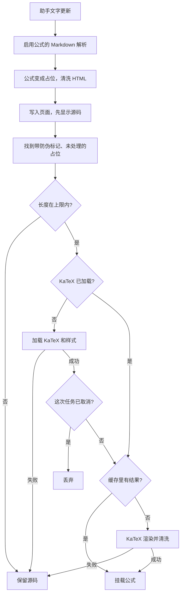

# LaTeX 公式：数据流与接口

> 前置：[architecture.md](architecture.md)。

## 1. Context & Scope（上下文与范围）

| 方向 | 对象 | 内容 |
|---|---|---|
| 输入 | 消息视图 | 文本，以及“是否启用公式” |
| 输入 | Markdown 渲染器 | 带防伪标记和源码的占位 HTML |
| 输入 | 复制事件 | 用户在消息里的文字选区 |
| 外部依赖 | KaTeX | 把 LaTeX 转成 HTML 和 MathML |
| 外部依赖 | DOMPurify | 清洗 KaTeX 的输出 |
| 输出 | 当前消息的 DOM | 渲染好的公式，或保留的源码 |
| 输出 | 剪贴板 | 选区里的公式变成 LaTeX 源码 |

本模块不访问业务接口，不读写 store，也不写浏览器存储。KaTeX 代码、样式和字体由 daemon 同源提供。

## 2. Data Flow Description（数据流）

### 2.1 主流程



1. `MessageRow` 给助手文字打开 `math`。输出中走 `StreamingMarkdown`，完成后走 `MarkdownBlock`。
2. 启用公式的 `Marked` 实例先识别公式，再处理其他行内语法，所以公式里的 `_` 和 `*` 不会变成斜体。
3. 占位元素的文字就是原始写法，LaTeX 源码放在 `data-tex`。
4. 组件在 `useLayoutEffect` 里调用增强。KaTeX 已加载时同步完成，用户看不到占位闪动。
5. 第一次遇到公式时异步加载 KaTeX 和样式，两者都到位才开始替换。
6. 消息完成后 `MarkdownBlock` 全量渲染一次。相同公式命中缓存，不用重新计算。

### 2.2 分支流程

| 场景 | 处理 |
|---|---|
| 公式还没闭合 | 按普通文字显示，闭合后才进入占位 |
| 文本刚好以单个 `$` 结尾 | 流式结尾先不显示这个字符，下一次更新再判断。结尾块是代码或 HTML 时不处理 |
| 公式中有空行 | 输出时可能先按段落显示，消息完成后的全量渲染修正 |
| `math` 代码块未闭合 | 显示为普通代码块，闭合后才渲染 |
| 语法错误或不支持的命令 | 保留原文，状态记为 `error` |
| 安全模式禁用的命令（如 `\href`） | KaTeX 显示命令原文，颜色跟随正文，不生成链接 |
| 公式超过 5,000 字符 | 不调用 KaTeX，保留原文 |
| KaTeX 加载失败 | 本次页面生命周期内不再重试，所有公式显示原文 |
| 内容没变的 React 重渲染 | HTML 字符串相同，React 不重写 DOM，已有公式保留 |
| 内容变化 | React 替换 HTML，旧任务取消，新内容重新增强 |
| 组件卸载 | 取消任务，晚到的加载结果不写 DOM |
| 模型手写带假标记的占位 | 标记值对不上，被忽略 |
| 选中公式的一部分再复制 | 复制内容扩展到完整公式，页面上的选区不变 |
| 选区里没有已渲染的公式 | 不接管浏览器默认复制 |
| 点击消息级 Copy | 复制原始 Markdown，不受公式影响 |
| 点击 `math` 代码块的 Copy | 读取隐藏的 `<pre>`，得到 LaTeX 源码 |

## 3. Interface Definition（接口定义）

### 3.1 模块内接口

| 接口 | 所在文件 | 同步/异步 | 语义 |
|---|---|---|---|
| `createMathExtension(token)` | `markdown-math-syntax.ts` | 同步 | 返回 `mathBlock`、`mathInline` 两个 `marked` 分词扩展 |
| `isMathLang(lang)` | `markdown-math-syntax.ts` | 同步 | 取语言信息第一个词，忽略大小写，判断是否为 `math` 或 `latex` |
| `isClosedFence(raw)` | `markdown-math-syntax.ts` | 同步 | 判断代码块 token 是否有结束围栏 |
| `renderMarkdown(text, { math })` | `markdown-renderer.ts` | 同步 | `math` 默认关闭，打开后使用公式实例 |
| `createMarkdownStream({ math })` | `markdown-stream.ts` | 同步 | 打开后使用公式实例，并启用结尾 `$` 暂缓 |
| `enhanceMath(root, token, { trackOverflow })` | `markdown-math.ts` | 已加载时同步，否则异步 | 增强未处理的占位，返回 `{ cancel }`。不抛错 |
| `copyMathAsTex(event, root, token)` | `markdown-math.ts` | 同步 | 选区含已渲染公式时写入 LaTeX 文本和 HTML，否则不处理 |
| `MarkdownBlock` 的 `math` 属性 | `MarkdownBlock.tsx` | 同步 | 默认关闭。打开后解析公式、启动增强，并跟踪宽公式 |
| `StreamingMarkdown` 的 `math` 属性 | `MarkdownBlock.tsx` | 同步 | 打开后每次 DOM 更新都增强，不跟踪宽公式 |

### 3.2 分词规则

下面的规则已在 `marked` 15.0.12 上验证。

```ts
const INLINE_RULES = [
  // $$...$$ 写在一行中间，按行内显示
  /^\$\$(?=\S)((?:\\.|[^\\\n$])*?(?:\\\S|[^\s\\$]))\$\$/u,
  // $...$：内侧不能有空格，结尾 $ 后不能接字母、数字、( 或 {
  /^\$(?=[^\s$])((?:\\.|[^\\\n$])*?(?:\\\S|[^\s\\$]))\$(?![\w({])/u,
  // \(...\)
  /^\\\(((?:\\.|[^\\\n])+?)\\\)/u,
];

// 独占一行或多行的 $$...$$ 和 \[...\]
const BLOCK_RULE =
  /^ {0,3}(?:\$\$((?:(?!\$\$)[\s\S])+?)\$\$|\\\[((?:(?!\\\])[\s\S])+?)\\\])[ \t]*(?:\n+|$)/u;
```

块级扩展的 `start` 只返回行首的 `$$` 或 `\[`，不能截断一行中间的文字。行内扩展的 `start` 返回第一个 `$` 或 `\(`。

结束围栏的判断：

```ts
function isClosedFence(raw: string): boolean {
  const lines = raw.replace(/\n+$/u, "").split("\n");
  return lines.length >= 2 && /^ {0,3}(?:`{3,}|~{3,})[ \t]*$/u.test(lines.at(-1)!);
}
```

### 3.3 调用 KaTeX

通过动态导入同时加载代码和样式：

```ts
const [{ default: katex }] = await Promise.all([
  import("katex"),
  import("katex/dist/katex.min.css"),
]);
```

| 选项 | 值 | 原因 |
|---|---|---|
| `displayMode` | 占位上的 `data-display` | 区分行内和独立成行 |
| `throwOnError` | `true` | 语法错误时保留源码 |
| `strict` | `"ignore"` | 允许中文直接写在公式里 |
| `trust` | `false` | 禁用 `\href`、`\includegraphics` 和 HTML 扩展 |
| `errorColor` | `"currentColor"` | 被禁用的命令不显示红色 |
| `maxSize` | `10` | 限制 `\rule` 这类命令的尺寸 |
| `maxExpand` | `1000` | 防止宏无限展开 |

### 3.4 DOM 结果

行内公式：

```html
<span class="ohb-math" data-math="<本页标记>" data-display="0"
      data-tex="x^2" data-math-state="ready">
  <span class="katex"><!-- KaTeX --></span>
</span>
```

独立公式：

```html
<div class="ohb-math" data-math="<本页标记>" data-display="1"
     data-tex="E=mc^2" data-math-state="ready">
  <div class="ohb-math-display"><span class="katex-display"><!-- KaTeX --></span></div>
</div>
```

公式代码块：

```html
<div class="ohb-code-block" data-math="<本页标记>" data-display="1"
     data-tex="x^2" data-math-state="ready">
  <button class="ohb-code-copy">Copy</button>
  <div class="ohb-math-display"><!-- KaTeX --></div>
  <pre hidden><code class="language-math">x^2</code></pre>
</div>
```

`data-math-state` 取值为 `ready` 或 `error`。宽公式的 `.ohb-math-display` 溢出时另外带上 `tabindex="0"`、`role="region"` 和 `aria-label="Scrollable formula"`，由共用的 `ResizeObserver` 随宽度变化更新。

### 3.5 样式约定

```css
.ohb-markdown .katex { font-size: 1.1em; }

.ohb-markdown :is(p, h1, h2, h3, h4, h5, h6, ul, ol):has(.ohb-math) {
  overflow-x: auto;
  overflow-y: hidden;
  padding-bottom: 2px;
}

.ohb-math-display {
  margin: 0 0 12px;
  overflow-x: auto;
  overflow-y: hidden;
  padding: 6px 0;
}

.ohb-math-display .katex-display { margin: 0; }
```

2px 和 6px 是实测值，比这更小时，分式或大括号的下缘会被裁掉一点。公式代码块隐藏 `<pre>` 时，使用统一排版议题的 `.ohb-code-block [hidden]`。

## 4. Data Ownership & Responsibility（数据归属）

| 数据 | 归属 | 本模块的权限 |
|---|---|---|
| 消息文本和状态 | 会话 store | 只读 |
| Markdown HTML | `MarkdownBlock`、`StreamingMarkdown` | 只替换带标记的占位内容 |
| 防伪标记 | Markdown 渲染层，每次页面加载随机生成 | 只读 |
| 公式缓存 | 增强层的内存 | 本模块维护，刷新页面后消失 |
| 公式 DOM、状态 | 当前 DOM | 本模块创建和修改，不持久化 |
