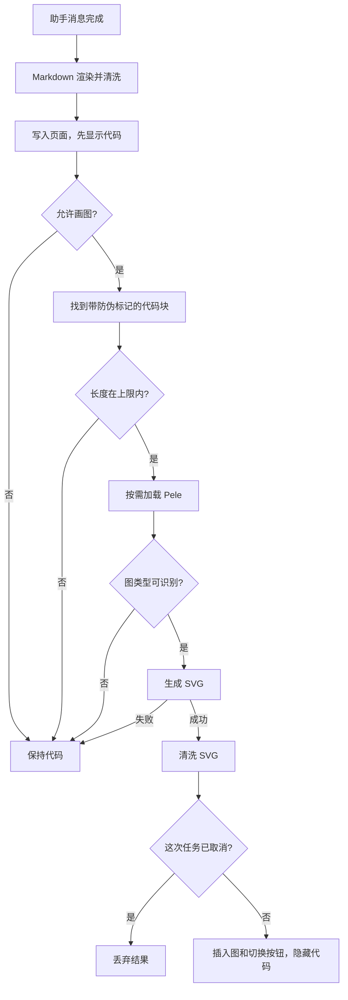

# Mermaid 图表：数据流与接口

> 前置：[architecture.md](architecture.md)。

## 1. Context & Scope（上下文与范围）

| 方向 | 对象 | 内容 |
|---|---|---|
| 输入 | 消息视图 | 文本，以及“是否允许画图” |
| 输入 | Markdown 渲染器 | 带防伪标记的代码块 HTML |
| 输入 | 设计 token | 字体和颜色变量 |
| 外部依赖 | Pele | 把 Mermaid 文本转成 SVG |
| 外部依赖 | DOMPurify | 清洗 SVG |
| 输出 | 当前消息的 DOM | 图、切换按钮、隐藏的代码 |

本模块不访问网络接口，不读写 store，也不写浏览器存储。Pele 的代码包由 daemon 同源提供。

## 2. Data Flow Description（数据流）

### 2.1 主流程



1. 消息状态离开 `streaming` 后，`MessageRow` 用 `MarkdownBlock` 全量渲染，并为助手文字打开画图开关。
2. 渲染器看到 `mermaid` 或 `mmd` 语言的代码块，在外层写入本页随机的防伪标记。
3. `MarkdownBlock` 写入 HTML 后启动增强，增强层按文档顺序逐块处理。
4. 每块从 `<pre>` 取源码，去掉 Markdown 补上的末尾换行，交给 Pele。
5. SVG 清洗后插到 `<pre>` 前面，`<pre>` 设为隐藏但留在 DOM 里。
6. 图比容器宽时，容器变成键盘可聚焦的滚动区，做法和宽表格一致。共用的 `markdown-scroll-region.ts` 用 `ResizeObserver` 跟踪宽度，消息折叠后再展开或窗口变化时都会更新。
7. 图的高度变化由 `ConversationStream` 现有的 `ResizeObserver` 接住。跟随底部不需要新逻辑；读者停在长回答中段时，靠[流式议题 Stage 4](../../problem-lists/2026-11-23-markdown-streaming/improve-1/02-optimization-plan-and-change-scope.md)的块级阅读位置保持不动。

### 2.2 分支流程

| 场景 | 处理 |
|---|---|
| 消息还在输出 | 不启动增强，显示代码 |
| 输出被中断或失败 | 消息结束后同样尝试绘制；半截语法通常解析失败，保留代码 |
| 内容没变的 React 重渲染 | HTML 字符串相同，React 不重写 DOM，已有的图和切换状态保留 |
| 内容变化 | React 替换 HTML，旧任务取消，新内容重新增强 |
| StrictMode 或快速连续变化 | 旧任务被取消，已处理的代码块不重复挂载 |
| 组件卸载 | 取消任务，晚到的结果不写 DOM |
| 模型写了带假标记的 HTML | 标记值对不上，被忽略 |
| Pele 代码包加载失败 | 当作绘制失败，保留代码 |
| 点击切换按钮 | 只切换图和 `<pre>` 的显示，不重新绘制 |
| 点击 Copy | 现有逻辑读取隐藏 `<pre>` 的文字，得到 Mermaid 源码 |

## 3. Interface Definition（接口定义）

### 3.1 模块内接口

| 接口 | 同步/异步 | 语义 | 对应流程 |
|---|---|---|---|
| `isMermaidLang(lang)` | 同步 | 取语言信息的第一个词，忽略大小写，判断是否为 `mermaid` 或 `mmd` | 2.1 第 2 步 |
| 代码块标记 `data-mermaid` | DOM 约定 | 值等于本页随机标记的代码块才算真实的 Mermaid 代码块 | 2.1 第 2、3 步 |
| `renderDiagram(source)` | 异步 | 返回清洗后的 SVG。超长或类型未知返回空；语法错误或加载失败时拒绝 | 2.1 第 4、5 步 |
| `enhanceMermaidBlocks(root, token)` | 启动同步，绘制异步 | `MarkdownBlock` 传入 `COPY_TOKEN`。增强 `root` 下未处理的真实代码块，返回 `{ cancel, done }`。`done` 不会因单块失败而拒绝；`cancel` 同时断开宽度跟踪 | 2.1 第 3 到 6 步 |
| `MarkdownBlock` 的 `diagrams` 属性 | 同步 | 可选布尔值，默认关闭。打开后在内容写入页面后启动增强，内容变化或卸载时取消 | 2.1 第 1、3 步 |

### 3.2 调用 Pele

使用 `pele/lazy` 的 `detectType` 和 `renderAsync`。

| 选项 | 值 | 原因 |
|---|---|---|
| `idPrefix` | 每次绘制唯一 | 同页多张图的内部 ID 不冲突 |
| `fontFamily` | 读取 `--font-ui` 的计算值 | 按真实字体估算文字宽度 |
| `fontSize` | `14` | 和正文一致 |
| `responsive` | `false` | 保持原始大小，宽图走滚动 |
| `links` | `false` | 不生成可点击链接 |
| `images` | `false` | 不加载外部图片 |

### 3.3 DOM 结果

```html
<div class="ohb-code-block" data-mermaid="<本页标记>" data-mermaid-state="ready">
  <button class="ohb-code-copy">Copy</button>
  <button class="ohb-mermaid-toggle" aria-label="Show code"><!-- 图标 --></button>
  <div class="ohb-mermaid-diagram">
    <svg role="img" aria-label="Mermaid diagram"><!-- 图 --></svg>
  </div>
  <pre hidden><code class="language-mermaid">源码</code></pre>
</div>
```

图比容器宽时，`.ohb-mermaid-diagram` 另外带上 `tabindex="0"`、`role="region"` 和 `aria-label="Scrollable Mermaid diagram"`。这些属性由共用的 `ResizeObserver` 随实际溢出增删。

### 3.4 样式约定

下面的数值已在原型里验证。隐藏 `<pre>` 用统一排版议题的 `.ohb-code-block [hidden]`。

```css
.ohb-mermaid-diagram {
  --pele-bg: var(--bg);
  --pele-fg: var(--text);
  --pele-muted: var(--text-muted);
  --pele-line: var(--text-dim);
  --pele-surface: var(--bg-panel);
  --pele-surface-alt: var(--bg-selected);
  --pele-border: var(--border-strong);
  --pele-accent: var(--text-muted);
  --pele-font: var(--font-ui);
  overflow-x: auto;
  padding: 4px 0;
}

.ohb-mermaid-diagram[hidden] { display: none; }
.ohb-mermaid-diagram svg { display: block; margin: 0 auto; max-width: none; }

/* 切换按钮沿用 Copy 的定位和显隐方式。 */
.ohb-mermaid-toggle { height: 22px; position: absolute; right: 6px; top: 6px; width: 24px; }
.ohb-code-block[data-mermaid-state] .ohb-code-copy { right: 34px; z-index: 1; }

@media (hover: none), (pointer: coarse) {
  .ohb-mermaid-toggle { opacity: 1; }
  .ohb-mermaid-toggle::after { content: ""; inset: -12px -11px; position: absolute; }
  .ohb-code-block[data-mermaid-state] .ohb-code-copy { right: 44px; }
  .ohb-mermaid-diagram { padding-top: 34px; }
}
```

## 4. Data Ownership & Responsibility（数据归属）

| 数据 | 归属 | 本模块的权限 |
|---|---|---|
| 消息文本和状态 | 会话 store | 只读 |
| Markdown HTML | `MarkdownBlock` 和 React | 只增强带标记的代码块，不改写其他内容 |
| 防伪标记 | Markdown 渲染层，每次页面加载随机生成 | 只读 |
| SVG、切换状态 | 当前 DOM | 本模块创建和修改，不持久化 |
| 设计 token | 全局样式 | 只读 |
