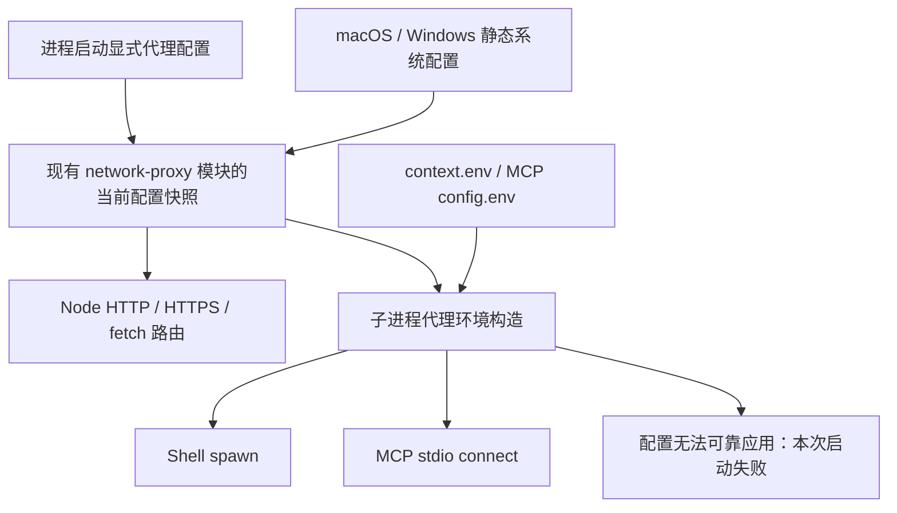

# 网络优化方案与改动面

> 实施契约；用户确认见 [00](00-discussion.md)，问题 N1–N5 见 [01](01-problem-analysis-and-current-state.md)，验证见 [04](04-test-and-acceptance.md)。本文件不记录实施进度。

## 2.1 目标、职责与总体结构

目标是让主进程和新启动的 Shell / MCP stdio 使用同一来源的代理配置；无法可靠构造子进程环境时，该次启动失败。保留现有系统读取、Node 路由、5 秒串行刷新与安装生命周期。

| 模块                                          | 职责                                          | 不负责                           |
| --------------------------------------------- | --------------------------------------------- | -------------------------------- |
| `network-proxy/system.ts`                     | 读取当前用户静态系统代理                      | 执行 PAC、修改系统配置           |
| `network-proxy/index.ts`                      | 唯一安装所有权、刷新、当前只读快照、Node 路由 | 子进程生命周期                   |
| 建议新增 `network-proxy/child-environment.ts` | 纯代理环境构造与转换能力检查                  | 运行命令、代理探活、改全局 env   |
| Bash / MCP transport                          | 启动时取得快照并消费构造结果                  | 再次发现系统代理、重新发明优先级 |

## 2.2 设计决策

| 决策             | 选择与原因                                                                 | 不采用及代价                                         |
| ---------------- | -------------------------------------------------------------------------- | ---------------------------------------------------- |
| N1 / N5 配置共享 | 现有单安装模块维护窄的只读快照 accessor；构造函数可显式注入快照测试        | 不增加跨 CLI → runtime → subagent 的多层重复配置字段 |
| N2 / N3 启动衔接 | 仅在 Shell / MCP stdio 的启动边界调用 helper                               | 不封装全项目 spawn；内部 rg / 系统读取器不受影响     |
| 自动发现         | macOS / Windows 沿用原读取器；Linux 使用显式 env 与 OS 路由                | 不在本批实现 Linux 桌面代理发现                      |
| 无法应用         | 拒绝当前子进程启动，错误脱敏；主进程仍按自己的可用 policy 工作             | 不删除规则、不悄悄直连、不沿用过期配置               |
| 生命周期         | 新进程读当前已完成刷新快照；已有进程保留原环境                             | 不热改 env，不自动重启，不每次 spawn 执行 scutil     |
| 网络范围         | 支持的 HTTP / HTTPS 变量语义与真实 curl 验证；显式配置保留外部程序自身语义 | 不承诺所有可执行程序的实际网络行为完全相同           |

## 2.3 数据流与接口契约

### 配置快照

现有 `refresh()` 完成后，原子替换同一份只读配置事实：安装时的显式代理变量、系统读取结果或脱敏失败状态。Node policy 与子进程构造均从这些事实出发，不从 `policy.route(url)` 反推配置。不引入持久化、事件总线或新的版本数据库。

系统关闭代理时替换为“已读取、未配置”；读取失败时替换为失败状态，不能继续用上次成功值启动新进程。刷新期间消费者使用上一份已完成快照；不存在半更新的 HTTP / HTTPS 组合。首次安装等待初次读取完成。

卸载清空该安装拥有的快照，保留已有 transport 的卸载语义。模块导入不安装网络拦截器。程序化嵌入方未调用 `installSystemProxy()` 时，仅继承显式环境，不自动发现系统代理，不能宣称系统跟随；CLI 本地 / TUI / serve 必须继续在 host 初始化前完成显式安装。

### 子进程环境构造

建议逻辑接口为 `buildChildProxyEnvironment(snapshot, overrides)`：输入当前配置事实及该次调用的 env 覆盖；同步返回完整的规范化代理键集合，或抛出现有脱敏配置错误。具体导出名称可随实现收敛，不增加 provider / service / adapter 层。

优先级按逻辑键处理，不能先盲目 spread 再让大小写决定结果：

1. 进程显式代理键作为基础，非空 `context.env` / `config.env` 的同名逻辑键覆盖它。覆盖层的大写键也要高于下层的小写键。
2. 同层沿用小写非空值优先大写；`ALL_PROXY` 是 HTTP / HTTPS 缺失时的后备。
3. 合并后存在任意显式 HTTP / HTTPS / ALL 代理，就使用环境配置整组，不再从系统补齐另一协议。只有 `NO_PROXY` 时继续系统跟随，作为额外绕过。
4. 空白代理值沿用“未配置”的语义，不新增 null/delete 开关；删除覆盖项恢复继承。显式全部绕过使用已有 `NO_PROXY=*`。普通非代理 env 空字符串不变。
5. 在 POSIX 上生成同值大小写兼容别名，保证 curl 获得小写 `http_proxy`；Windows 按平台不区分大小写语义生成单一逻辑键，避免冲突。读取 Windows `process.env` 时保留现有按名称取值方式。
6. 系统发现值只进入本次构造结果，不回写全局 `process.env`。显式环境中的外部客户端专用协议按原生环境配置继承；本批不新增 Node 的 SOCKS 支持，也不以 Node 的协议限制截断已有外部程序能力。明显非法的受支持 HTTP / HTTPS 代理 URL 继续复用现有校验。

最终装配时，先从基础环境和覆盖层移除全部受管理代理键，再放入 helper 的完整规范化结果；Windows 按大小写不敏感方式移除所有别名。普通环境变量保持原有合并规则，之后不得再次合入未经规范化的代理键。这样缺少某个输出键才表示该协议没有代理，而不是留下旧值。MCP 同样处理 config.env，但仍不继承父进程无关变量。

### 自动系统 bypass 的支持边界

不能把系统 bypass 原样拼进 `NO_PROXY`，也不能擅自修改主进程现有匹配规则来迁就子进程。已被固定 loopback 表达覆盖的 `localhost` 与环回字面地址只去重，不因重复规则拒绝。

| 系统规则                                                       | 自动桥接处理                                                                                      |
| -------------------------------------------------------------- | ------------------------------------------------------------------------------------------------- |
| 没有代理，或已明确全部绕过                                     | 使用 OS 路由；清除本 helper 生成的旧代理值，不进行转换失败判断                                    |
| IPv4 / IPv6 字面地址、可规范化 IPv4 CIDR                       | 使用已验证的 NO_PROXY 表达；IPv4 CIDR 的 curl 验收基线为 7.86+；不承诺任意客户端支持              |
| IPv6 CIDR                                                      | 本轮不支持自动桥接，明确失败；本机 curl 8.7.1 实测 `::1/128` 并不绕过代理，不能仅靠版本号推定支持 |
| macOS 缩写 CIDR，如 `169.254/16`                               | 规范化为 `169.254.0.0/16` 后按上项验证                                                            |
| 裸域精确匹配、仅子域规则、任意位置通配、`host:port`、`<local>` | 当前主 policy 与通用 NO_PROXY 不能保证等价，本次自动桥接明确失败                                  |
| 用户显式 NO_PROXY                                              | 保留用户原生配置语义；不假装所有客户端匹配方式相同                                                |

主进程的 localhost / 127 网段 / IPv6 loopback 保护保持原样。子进程 env 包含 `localhost`、`127.0.0.1`、`::1`，127/8 以规范 IPv4 CIDR 在声明支持的客户端上做真实验证；映射 IPv6、特殊客户端版本等不能被三个常见地址的测试冒充完全等价。若自动系统规则遇到已知无法表达的项，按表失败。

该限制有直接的可用性代价：2026-10-11 核对本机系统配置，静态代理已开启，bypass 含 `*.local`、其他通配域及 `<local>`。**没有显式代理覆盖、依赖这份系统配置时，Shell / MCP 自动桥接必然启动失败**；不是“偶尔可能失败”。Windows 启用本地主机绕过等常见设置也会遇到同类限制，不能宣传为这些配置下开箱即用。

本方案保留用户已明确接受的严格失败，未采纳评审提出的“扩大域名绕过 / 丢弃 `<local>`”近似转换，因为那会改变已确认的路由意图。失败说明应指出不可表达的规则类型，并提示可显式设置所需协议的 `HTTP_PROXY` / `HTTPS_PROXY`（可附加 `NO_PROXY`），或由用户明确选择 `NO_PROXY=*` 全部绕过。只设置普通 `NO_PROXY` 仍会跟随系统代理，不能绕开系统规则转换失败；不自动替用户生成语义不同的规则。这不影响有效显式 env 路径，也不影响主 Node 原本能处理的系统 policy。

本批不为消除这个限制引入本地代理转发服务。成功的环境构造表示配置符合已声明的变量契约，不表示 OS 已强制接管任何后代进程。

### 失败、覆盖与清理

- 无代理是合法配置，不是故障。代理端口不可达由实际联网命令返回失败，不增加启动探活或自动重试。
- 系统读取失败 / PAC / 无法转换时，依赖系统跟随的本次 Shell / stdio 启动失败。沿用 01 所述平台判断：Windows 无 PAC URL 且 discovery error 为 12180 时继续，HTTP / HTTPS 齐备时不因同时启用 SOCKS 而拒绝。有效的完整显式代理覆盖不依赖失败的系统发现；`NO_PROXY=*` 明确全部绕过也不能被无关系统错误阻止。
- Shell 在 `registry.start()` 前取得并验证当前代理环境；失败不生成 running job、不 spawn，已取得的 environment retain 必须释放。取消、并发和 cleanup 仍走既有机制。
- MCP 的 SDK client / transport 构造进入 `connect()` 的现有 try/catch；构造失败时状态为 failed，关闭已创建资源，server 级错误不影响其他 server。
- MCP 只传代理白名单及 `config.env`，保留 SDK 默认安全环境列表；不 spread 全部 `process.env`。HTTP / SSE transport 仍走主进程路由。
- 诊断复用现有错误链，说明“配置读取 / 配置不支持 / 子进程启动 / 命令联网失败”；不输出代理凭证、完整 URL 或环境转储。

## 2.4 分阶段实施

| Stage | 修改范围                                   | 完成定义                                                                                       |
| ----- | ------------------------------------------ | ---------------------------------------------------------------------------------------------- |
| 1     | 网络模块快照、纯 env 构造、边界测试        | N1 / N4 / N5 对应优先级、失败、刷新、清理用例通过；主路由无回归                                |
| 2     | Bash 启动、MCP transport / client 失败处理 | 主 / 子代理 Shell 与 stdio 启动用同源配置；无关 secret 不泄漏；失败无残留进程                  |
| 3     | 跨平台真实出口与安装入口验证、权威文档同步 | macOS / Windows 静态系统模式与 Linux env 模式验证；真实 curl / MCP fixture 和现有 SDK 回归通过 |

## 2.5 API、兼容与改动面

不新增模型工具参数，不改 MCP 配置格式，不新增全局配置层。允许在 network-proxy 内新增一个环境构造文件；复用或提取现有 env 解析纯函数，避免两套优先级。

Shell 在未支持配置下会从“可能使用错误网络启动”变成明确失败，这是确认过的行为变化。MCP 连接错误必须对现有状态消费者可见。刷新仍有现有轮询间隔，不宣传即时热更新。

## 2.6 风险与回滚

高风险为 bypass 不等价、大小写覆盖、卸载后残留快照、MCP try 范围遗漏。以 04 的边界与真实出口测试约束。回滚按本批代码提交整体撤销；不留运行时新旧代理双开关。回滚恢复旧子进程继承边界，需明确说明能力退回，不修改已有系统配置。

## 2.7 与确认边界对齐

只扩展静态代理配置传递；不执行 PAC；不接管所有 spawn；子进程 bridge 失败不破坏主 Node 原本能处理的规则；Glob / Grep 等纯本地工具继续可用。

## 2.8 不在本批

Shell 解释器 / 分析器及 Glob 引擎属于已明确指定的 improve-2。任意子程序网络强制隔离、PAC、通用 SOCKS 新增支持、企业证书/认证自动配置、后台任务重启不在本议题。

## 2.9 关键改动清单

> 行号为 `24c70034` 快照，以符号定位。本表不是进度表；实施中不勾选、不回写。

| ID  | 文件 / 符号                                                                                                                            | 行号            | 改动及承重原因                                  |
| --- | -------------------------------------------------------------------------------------------------------------------------------------- | --------------- | ----------------------------------------------- |
| C1  | [network-proxy/index.ts](../../../../packages/ohbaby-agent/src/utils/network-proxy/index.ts)，`installSystemProxy / refresh / dispose` | 36 / 66 / 132   | 快照归属、刷新与卸载；保持单一来源              |
| C2  | [network-proxy/policy.ts](../../../../packages/ohbaby-agent/src/utils/network-proxy/policy.ts)，`proxyEnvironment / createProxyPolicy` | 29 / 129        | 提取必要纯解析，保留主程序路由语义              |
| C3  | `packages/ohbaby-agent/src/utils/network-proxy/child-environment.ts`，建议新增                                                         | 新文件          | 薄 env 构造及可表达性判断；不构建通用网络框架   |
| C4  | [tools/bash.ts](../../../../packages/ohbaby-agent/src/tools/bash.ts)，`stateEnvironment / createBashTool / spawn`                      | 63 / 95 / 197   | spawn 前应用；失败不得留下 job / retain         |
| C5  | [mcp/core/transport.ts](../../../../packages/ohbaby-agent/src/mcp/core/transport.ts)，`createTransport`                                | 13              | stdio 只补代理键，保留 config.env               |
| C6  | [mcp/core/client.ts](../../../../packages/ohbaby-agent/src/mcp/core/client.ts)，`connect`                                              | 90              | 把 transport 构造失败纳入 failed 状态和 cleanup |
| C7  | [ohbaby-cli/src/bin.ts](../../../../packages/ohbaby-cli/src/bin.ts)，`initializeProxy / createCoreHost / startDaemonServer`            | 624 / 644 / 690 | 核对安装顺序与共享所有权；无需重做 runtime 装配 |
| D1  | [MCP 接口](../../../mcp/dfd-interface.md)、[MCP 测试](../../../mcp/test.md)、[MCP 配置接口](../../../config/mcp/dfd-interface.md)      | 以小节定位      | 同步 env 优先级、stdio 失败、重连契约           |
| D2  | [MCP 配置历史决策](../../../mcp/CONFIG_FORMAT_DECISION.md)                                                                             | 144             | 修正已与实现不符的全量 `process.env` 示例       |
| D3  | [Shell 接口](../../../shell/dfd-interface.md)、[Shell 测试](../../../shell/test.md)                                                    | 以小节定位      | 同步启动环境和失败边界                          |

连带影响面：network-proxy / Bash / MCP / CLI 的现有测试；`docs/config/mcp/data-model.md`；原系统代理议题 README 增加本议题链接。历史 05 验收记录保留原范围，不改写为本批成果。包公开导出仅在嵌入方确有需要时增加窄类型，不导出内部框架。
