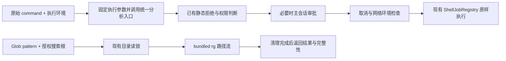

# Shell / Glob 优化方案与改动面

> 用户确认见 [00](00-discussion.md)，问题 S1–S5 / G1–G3 见 [01](01-problem-analysis-and-current-state.md)。先实施并验收 improve-1，再接入本批。

## 2.1 目标、职责与架构

Shell 使用统一分析结果判断权限，并在执行前固定原始命令与解释器；分析不完整不再等同语法错误。Glob 用现有 bundled rg 代替手写匹配和遍历，保持已确认搜索范围。



| 位置                            | 负责                                     | 不负责                                  |
| ------------------------------- | ---------------------------------------- | --------------------------------------- |
| `shell/detector` 与 `shellArgs` | 可用解释器、真实方言、启动参数           | 命令失败后换解释器重试                  |
| `shell/analysis`                | AST 与可靠字面事实、完整性               | 执行变量 / 命令替换，证明脚本所有副作用 |
| preflight / permission          | 已知拒绝、路径检查、权限模式、一次审批   | 再调用旧 parser 产生另一份解释          |
| scheduler / Bash                | 准备结果传递、取消、owner、调用 registry | 新建通用进程平台                        |
| Glob                            | 兼容参数、rg 启停、路径帧、结果完整性    | Grep 的 JSON match 协议、网络代理检查   |

## 2.2 Shell 设计决策

### 平台选择与工具说明（S5）

现有 Windows 顺序是有效显式 `SHELL` → 自动探测 Git Bash → `COMSPEC / cmd`。本批明确取消未配置时的 Git Bash 自动探测，改为 PowerShell 默认；Git Bash 仍可用原生完整路径显式选择。同步修改既有优先级测试，不能保留“已安装 Git 就默认用 Bash”的旧断言。

沿用现有 `SHELL` 环境入口，不凭空增加 `shellPath` 配置系统。区分继承的登录环境偏好与可用的原生解释器路径，避免把 fish 用户或从 Git Bash 启动的用户整体挡住：

| SHELL 输入                                                                   | 初次选择行为                                                                           |
| ---------------------------------------------------------------------------- | -------------------------------------------------------------------------------------- |
| 本平台支持的原生名称 / 路径且可用                                            | 优先使用；Windows 原生 Git Bash 路径与 cmd 也可显式选择                                |
| 支持的原生类型，但明确路径不存在或名称无法解析                               | 配置错误，不自动换 shell                                                               |
| 继承的 fish / nu 等不支持的登录 Shell 偏好                                   | 按没有可用配置选择平台默认，工具说明显示实际解释器                                     |
| Windows 下继承的 `/usr/bin/bash`、`/bin/bash` 等 MSYS 环境路径，无法原生解析 | 不把它当作 Windows 原生路径要求，使用平台默认；需要 Git Bash 时提供可用原生路径        |
| 未配置                                                                       | Windows `pwsh.exe` → Windows PowerShell；macOS `/bin/zsh`；Linux 可用 bash → `/bin/sh` |

这些都是执行前的初次选择规则；命令一旦准备就固定解释器，执行失败不能改选后重跑。此处只是明确继承环境偏好的含义，不新增另一套配置格式或 MSYS 路径映射框架。Windows 工具说明应提示 Git Bash 使用可用的原生完整路径；裸名称解析若命中系统 WSL 启动器，不得把它当作 Git Bash，应明确报告不支持该启动器。本批不增加 WSL 运行环境适配。

保留 `bash` 工具名，工具说明标明实际解释器与平台，并使模型可获得准确环境信息。未配置时选择默认与执行失败后改选不同：只允许前者。不增加单次 tool call 的 shell 参数。

保留非交互启动：PowerShell `-NoLogo -NoProfile -NonInteractive -Command`；POSIX 沿用既有登录参数约定，明确用户启动文件可能自行改变环境。代理构造不修改命令文本，也不增加 `-i` 来模拟终端。真实执行参数与分析所指方言一致。

### 成熟解析与明确错误（S1）

采用 OpenCode 已验证方向：`web-tree-sitter` 与 Bash / PowerShell grammar WASM。依赖版本和资源定位在 Stage 1 的已安装包验证后锁定；不引入 native binding 或解析器插件管理器。

保留 `bash / zsh / sh / powershell / cmd` 的实际方言。Bash grammar 可用于提取 zsh 的可靠共同语法，但不能据此宣判 zsh 专有语法无效。cmd 等没有可靠完整分析的分支走明确的 incomplete，不假装 Bash。

| 状态                  | 产生依据                                              | 行为                                                |
| --------------------- | ----------------------------------------------------- | --------------------------------------------------- |
| `analysis_incomplete` | 动态展开、无法确定路径 / 命令、方言差异、AST 恢复节点 | 保留可靠事实，default 整条一次审批，通过后原样执行  |
| `permission_denied`   | 已知静态拒绝或权限规则拒绝                            | 不启动，说明拒绝依据                                |
| `execution_failed`    | 命令已经运行并失败                                    | 保留真实退出码和 stderr，不把任意 exit 2 当语法错误 |
| 准备失败              | 解释器不存在、parser / WASM 加载失败、内部准备错误    | 明确工具不可用；不静默回旧 parser 或换 shell        |

分析 complete 只表示本次所需调用结构与已抽取事实可靠，不表示知道程序所有副作用。命令名无法静态确定、未支持 AST 节点、变量 / 通配路径、命令替换、分支或循环中的 `cd`，只保留可证明事实，不能按文本顺序臆造后续 cwd。静态命令名的自定义 CLI 不因缺少程序知识自动变成 incomplete；其风险分类仍保守为 mutating / unknown-risk，不宣称只读，也不建立庞大的程序知识库。

本批不合成独立 `syntax_error` 状态：实际 Shell 报告的语法诊断保留在执行失败的原始 stderr 中，让模型和用户看到它与“分析器无法确定”不同。AST 怀疑错误时归入 incomplete，获批后执行；不得根据 exit 2 或模糊 stderr 文本自动猜测。不会声称命令在执行前已被系统判为语法错误，也不新增 native syntax-check 子进程链。这里区分的是错误来源和用户可见诊断，不新增没有可靠来源的协议字段。

旧 preflight 的迁移必须区分能力限制和政策拒绝：

| 旧判断                                                           | 本批处理                                                                                   |
| ---------------------------------------------------------------- | ------------------------------------------------------------------------------------------ |
| hasError、动态路径 / cd、嵌套 `-c` 等仅因无法分析而拒绝          | 改为 incomplete，获批后可原样执行；移除 `assertNoNestedShellEvaluation` 这类能力限制硬拒绝 |
| 已识别的破坏根目录、系统关机、下载内容直接执行等既有明确拒绝     | 保留政策拒绝，归入 permission_denied；不借 parser 迁移偷偷放宽                             |
| 路径 canonicalization 真正 I/O 失败、parser 资产损坏、解释器缺失 | 准备失败，保留诊断，不冒充权限或语法错误                                                   |

### 共用分析入口，固定执行参数（S2 / S3）

内置 Bash 实例在准备阶段固定 `command / shell / args / cwd / commandPrefix`，完成 grammar 加载和命令分析。scheduler 与直接工具调用共用该入口及工具注入的解释器；不增加所有工具通用的准备框架。

权限函数直接消费现有 `ShellAnalysisResult` 的引用，字段统一称为 `shellAnalysis`。删除上一版的 `ShellPermissionFacts` 包装，不重复保存 command，不增加逐层缺失 / 一致性验证。只在 `PermissionCall / PermissionAskInput / PermissionPatternInput` 和现有 `PermissionPort.ask` 上补这个可选输入；非 Shell 不使用，Bash 未提供分析时保守按 incomplete 处理，不猜测方言或回旧 parser。实际分析来源是服务端准备入口，不读取 params / metadata 里的同名内容。

分析结果沿现有权限调用传递：分类与模式生成、manager 的 ask / 自动批准 / 回复复核、scheduler 排队后的复核都使用它。`permission-source` 已有的 `...input` 继续透传，不新增 adapter、注册表、专用消息或持久化字段。权限模块不接收完整 AST、执行环境或 env。

不为减少这一个输入字段引入全局记忆化缓存。当前权限输入没有真实 shellKind，权限函数同步而 grammar 首次加载异步；改成“各层自行分析”仍需传方言，并额外处理初始化与缓存。这里直接传已经算出的结果更简单。验收关注审批、规则与执行行为，不要求引用身份相同或解析计数恰好一次。

`ShellAnalysisResult` 同时供应 `sandbox/preflight` 的路径检查和 `shell/preflight` 的政策判断，复用 `preflightSandboxShellAnalysis()`；移除 `environment.preflight(command)` 对旧 parser 的重复调用。完整性及原因替代含糊的 `parseError`；加载、I/O 等真正准备错误照常失败。已知政策拒绝和 denylist 在用户审批前处理。

真正穿透执行层的仅是固定执行参数，经已有 `ToolExecutionContext` 传入；`contextFor` 与实际构造 context 的 `executeToolWithTimeout` 都要接到。Bash 执行时校验一次原始 command 与准备值一致，随后直接使用已固定的解释器、参数、cwd 和前缀，不重新选择。取消检查、执行前读取 improve-1 最新代理环境、registry 生命周期保留。受支持的直接内部调用没有执行绑定时走同一准备入口，不绕开已有 owner 要求。

迁移 `permission/classifier`、`matcher`、`shell/preflight` 和轻量分析消费者。`shell/command-classifier.ts` 与 `shell/path-args.ts` 还依赖旧 `ParsedCommand / CommandDetail`，也必须转为成熟分析得到的最小命令事实。允许按 AST 重写、合并或删除 `path-args.ts`，不逐行翻译旧 token 启发式，也不为维持旧函数形状保留代码。AST 负责结构；仅保留有行为测试支撑的必要参数语义，例如 Git 路径选项、下载输出、脚本路径，以及避免把 rg 搜索词、chmod mode 当路径。遇到未覆盖且不能可靠解释的结构标记 incomplete，不扩建命令知识库。权限通用字符串匹配可保留独立纯函数，不能连带删除非 Shell 使用的 `matchesPattern`。

权限分类汇总 `analysis.commands[].danger`，不完整结果保持保守；`bashCommandPattern` 改为消费 analysis，`generatePermissionPattern` 和 `matchesPermissionRule` 共用这一纯函数。保留当前模式粒度：仅单条 git / docker 使用已有 arityKey；其他完整命令仍用完整规范化文本，多命令 allow 仍要求整体匹配。不能把所有命令都缩成 arityKey，使 `npm run test` 的授权意外扩大成 `npm *`。不完整调用展示原始命令，不能生成可长期保存的模式。

### default 不完整分析的审批（S4）

按“已知 deny / 不可覆盖拒绝 → default incomplete 整条 ask → 其他既有规则”的次序决定。`rememberable:false` 只控制保存还不够：历史 `bash *` 等 allow 不能跳过 default incomplete 的一次询问。

首次 evaluator、scheduler 排队后的再评估、manager.ask 的二次规则判断、autoApproveMatching 和 manager.respond 的回复时复核都使用同一完整性事实。已有宽 allow 不自动放行该请求；另一请求的 Always 回复不应解除它。UI 不提供长期批准；若旧前端仍提交 Always，复用服务端现有验证拒绝该非法回复并保留待审状态，用户仍可 Once / Reject。

完整且可可靠形成模式的命令继续现有授权体验；其他权限模式保留现有意图与 deny 优先级，不把本批扩为权限体系重做。长期规则仍在用户审批时保存，不新建“执行成功才保存”的权限事务。

主代理 / subagent 使用同一路径。根会话归属、TUI / Web 主会话审批位置保持不变，补贯通回归，不另做子代理审批窗口。

静态分析不是 OS 隔离。当前 host-local 可以执行用户批准的任意命令，本批不新增 Shell 全文件写锁或递归证明嵌套脚本安全。已有资源调度、取消、scope 清理保持；避免将不完整事实当作只读依据。

## 2.3 Glob 设计（G1–G3）

保留 `pattern / path / limit` 参数和默认 100；路径必须是搜索根相对模式，使用 `/` 作为统一分隔符。Windows 兼容输入分隔符按明确规则规范化；在启动 rg 前拒绝绝对 / 根外 `..` 模式，不能把 pattern 当作改变搜索根的入口。尤其是用户输入前导 `/`，不能再直接拼根锚定：`/x.ts` 拼成 `//x.ts` 后，rg 会正常返回无匹配而非语法错误；此类输入应明确报参数错误，且不启动 rg。支持 rg glob 的 `* ? ** {a,b} [ab]`，非法模式明确失败，不承诺 Bash extglob。`[]` 现在表示字符类，这会改变旧版把方括号当字面字符的行为。工具说明给出字面目录写法：`app/[id]/*.tsx` 应写为 `app/[[]id]/*.tsx`；不靠猜测自动尝试第二种模式。

在已授权 / 解析的搜索根作为 cwd，以 argv 启动已有 rg，不经过 shell：

```text
rg --no-config --files --no-ignore --hidden --null
   --sort=path --path-separator=/
   --glob /<根相对 pattern>
   --glob !.git --glob !dist --glob !node_modules --glob !out --glob !target
   -- .
```

固定排除放在用户正向模式之后。`/` 锚定保持 `*.ts` 只查根层；去除无意义的前导 `./` 后再锚定。前导 `!` 作为文件名字符处理，不允许借用户 pattern 注入额外排除语义或 rg 参数。包含隐藏普通文件，不跟随内部 symlink；用户显式选择的搜索根沿既有路径授权与 canonicalization 处理。

输出先按 NUL 分帧，仅移除 rg 生成的前导 `./`，统一返回根相对 `/` 路径；跨 chunk 增量解码，避免空格 / 换行文件名被切坏。若路径无法可靠表示为 UTF-8，明确失败，不能返回替换字符组成的错误路径。展示含换行 / 控制字符的路径时使用可辨认转义，普通路径仍逐行输出。

保留确定的路径排序；采用 rg 顺序，不额外收集全树 JS 排序，也不承诺与旧 localeCompare 对大小写 / 标点的顺序逐项相同。`--sort=path` 会影响 rg 遍历 / 并行特征，不宣称靠流式输出消除了全部扫描成本。

读取最多 `limit + 1` 个匹配用于判定：恰好 limit 且正常结束为完整；观察到第 limit+1 条则展示前 limit 条并标记 match-limit。复用现有有界采集做法，分别约束原始路径流、单条路径/诊断及最终展示，不能先收集整树再截断。展示预算沿用现有 `DEFAULT_OUTPUT_TOKEN_LIMIT = 8_000`；采集另设有限字节上限，直接复用现有 Grep 上限起步：stdout 16 MiB、单条记录 4 MiB、stderr 64 KiB；Glob 单路径帧同样有界，不能用 token 数冒充字节预算。移除旧 10,000 个已访问文件预算和 visitedFileCount；rg 不提供的统计不伪造。

rg 正常无匹配的退出状态按实际 `--files` 契约处理（0 / 1 与输出组合），不能把 1 一概视为执行故障；2 或异常信号须保留遍历/进程错误。主动因 limit / output 终止的状态单独记录，不能冒充未知崩溃。

完成性契约：

| 情况                         | 正文与 metadata                                                                      |
| ---------------------------- | ------------------------------------------------------------------------------------ |
| 正常结束、零匹配             | 才能写 `No files matched.`；scanComplete=true                                        |
| 正常结束、有匹配且未超限     | count=返回路径数，truncated=false，scanComplete=true                                 |
| 第 limit+1 条 / 输出预算停止 | 明示不完整及缩小范围；truncated=true，scanComplete=false，stopReason 对应数量 / 输出 |
| 遍历错误 / 子进程异常        | 明确失败或部分结果加错误，不伪装完整；保留 stopReason                                |
| 取消                         | 沿既有取消状态返回，不把已有部分匹配冒充成功                                         |

`displayLimited` 表示展示是否少于已采集结果；模型 metadata 投影同步保留 `count / truncated / scanComplete / displayLimited / stopReason`。Glob 与 list 分支可拆开，不顺带改变 list。

`withFileAccess(..., "tree")` 保留目录读锁。AbortSignal 传到 rg；截断 / 取消都终止进程，等待 close 与必要 killTree 清理完成，才释放锁。无法完成清理时走既有 cleanup 报告，不用无限等待或提前假装结束。复用 Grep 的二进制定位和生命周期模式，不建立通用进程 DSL。

## 2.4 分阶段实施

| Stage | 改动                                                          | 完成定义                                                                           |
| ----- | ------------------------------------------------------------- | ---------------------------------------------------------------------------------- |
| 1     | detector、方言、成熟 parser 与 WASM 资源交付                  | 先验证安装包可加载两个 grammar，再继续消费者迁移；三平台选择与原文执行语义有测试   |
| 2     | 共用分析结果、preflight / permission 消费者迁移、固定执行参数 | S1–S4 全链路通过；default incomplete 无历史 allow 绕过；前后台与子代理清理回归通过 |
| 3     | Glob rg 执行、兼容范围、完成性、模型投影                      | G1–G3 用真实临时文件树和真实 rg 验证；取消清理后释放锁                             |
| 4     | 删除失效旧实现、文档同步、平台及发布包验收                    | 单一路径；实际 Windows/macOS/Linux 与已安装产物验证；网络 improve-1 无回归         |

## 2.5 删除、兼容与 API

不改变 Bash / Glob 的工具名和必填字段。内部结构允许收缩；旧 `parseCommand`、light-parser、tokenizer / paths / roots helpers 在全部生产消费者迁移后删除。保留其他权限匹配需要的通用函数，必要时移入已有合适工具文件。旧类型消费者包含 `shell/command-classifier.ts` 与 `shell/path-args.ts`，不能为保住其旧签名而保留第二套 parser。旧 parser helpers 还经包根 `index.ts` 的 `export *` 暴露，移除会改变公开 API；需同步清理 barrel / 类型、核对仓内各包消费者并在发布说明标明。按用户允许删除失效代码的要求，不为维持旧同步 parser API 保留第二套实现；需要继续公开的能力只导出新的真实契约，不将执行绑定或权限包装作为新公开模块。四个旧契约测试的迁移清单见 04：其中只有 `src/index.unit.test.ts` 直接锁定包根 API，其余三个锁定旧 parser 或消费者接口。

删除或收缩的边界明确如下：旧 parser / light-parser 及仅服务它们的 tokenizer、路径猜测和拆命令辅助函数，在迁移后删除；`path-args.ts` 和旧 preflight 允许按最终职责合并，不能保留无人使用的兼容壳。保留仍被调用的 `matchesPattern`、必要程序参数语义和已有安全政策。计划中的 `ShellPermissionFacts` 包装、缓存服务、专用 facts 校验层不创建。

删除 Glob 旧 `createGlobMatcher / scanFiles / walkFiles` 及仅为它们存在的预算 / 类型 / 测试；保留 `ensureWritableParent` 等写入依赖。先检索生产 / 导出使用者，不能直接删除整个 `files.ts` 或 command-parser 目录。

WASM 选择运行时依赖资源定位或随 dist 复制一种方式；按最终方式同步 package files / tsup / CLI 打包及公开 barrel。禁止开发目录读取成功、发布包漏资源。新依赖进 lockfile，资产来源和许可随依赖保留。

## 2.6 风险与回滚

主要风险为规则匹配语义改变、解析后不完整事实被丢失、Windows 默认方言改变、Glob 搜索范围扩大、WASM 漏包。按 Stage 提交并保留行为测试；回滚撤销对应变更，不长期保留两套 parser / Glob 开关。Windows 默认切换需发布说明，写明取消 Git Bash 自动探测、保留显式配置、默认 pwsh → Windows PowerShell；这属于有意的默认行为变更。

## 2.7 与 00 对齐

系统执行原文、平台默认、同入口审批、Glob 既有范围全部落入上述契约。Read / Write / Edit 不重写；网络复用 improve-1；清理机制保留。

## 2.8 不在本批

PTY、交互 stdin、新的通用进程服务、OS 沙箱、命令自动改写、执行失败自动换 shell、Glob 分页 / mtime 排序 / ignore 文件模式、完整输出日志重做。

## 2.9 关键改动清单

> 行号为 `24c70034` 快照，符号优先；不是实施进度表。

| ID  | 文件 / 符号                                                                                                                                                                                                                                                                     | 行号                       | 要改什么                                                                           |
| --- | ------------------------------------------------------------------------------------------------------------------------------------------------------------------------------------------------------------------------------------------------------------------------------- | -------------------------- | ---------------------------------------------------------------------------------- |
| C1  | [shell/detector.ts](../../../../packages/ohbaby-agent/src/shell/detector.ts)，`resolveAcceptableShell`                                                                                                                                                                          | 123                        | 三平台选择、配置错误与默认区别                                                     |
| C2  | [shell/analysis/index.ts](../../../../packages/ohbaby-agent/src/shell/analysis/index.ts)，`analyzeShellCommand`；analysis types                                                                                                                                                 | 7                          | 成熟分析与完整性单一入口                                                           |
| C3  | [shell/preflight.ts](../../../../packages/ohbaby-agent/src/shell/preflight.ts)，`ShellKind / shellArgs / preflightShellCommand`                                                                                                                                                 | 15 / 95 / 516              | 方言保真、删除重复拆分，复用可信事实                                               |
| C4  | [scheduler.ts](../../../../packages/ohbaby-agent/src/core/tool-scheduler/scheduler.ts)，`createPermissionContext`                                                                                                                                                               | 1814                       | 实例绑定的准备入口；首次/排队后复核共用 analysis，执行 context 只传固定参数        |
| C4a | [sandbox/preflight.ts](../../../../packages/ohbaby-agent/src/sandbox/preflight.ts)，`preflightSandboxShellAnalysis / preflightSandboxCommand`                                                                                                                                   | 78 / 164                   | 直接消费同一分析结果，保留 external / sensitive / denylist 事实，不重跑轻量 parser |
| C4b | [sandbox/types.ts](../../../../packages/ohbaby-agent/src/sandbox/types.ts)，`PreflightResult / SandboxShellAnalysisPreflightInput`                                                                                                                                              | 51 / 69                    | 完整性和真实准备错误分开；adapter context 同步                                     |
| C4c | [scheduler.ts](../../../../packages/ohbaby-agent/src/core/tool-scheduler/scheduler.ts)，`denylistRejection / confirmExternalPreflightPermissions` 及 external / sensitive 循环                                                                                                  | 1194 / 1242 / 1269 / 1336  | 所有路径审批消费同份事实；政策拒绝前移到审批之前                                   |
| C5  | [bash.ts](../../../../packages/ohbaby-agent/src/tools/bash.ts)，`createBashTool`                                                                                                                                                                                                | 95 / 143 / 160             | 消除旧 parser gate 和第二次 shell 选择；保留 registry                              |
| C6  | [classifier.ts](../../../../packages/ohbaby-agent/src/permission/classifier.ts)、[matcher.ts](../../../../packages/ohbaby-agent/src/permission/matcher.ts)                                                                                                                      | 74 / 46 / 256              | 消费 shellAnalysis；保留 git/docker arity 与多命令整体匹配                         |
| C6a | [command-classifier.ts](../../../../packages/ohbaby-agent/src/shell/command-classifier.ts)，旧类型、classifyShellCommandDetail / classifyShellCommand                                                                                                                           | 1 / 121 / 160              | 迁移旧类型，风险分类消费成熟事实；不保留旧 tokenizer                               |
| C6b | [path-args.ts](../../../../packages/ohbaby-agent/src/shell/path-args.ts)，extractShellPathFacts / extractShellPathArgs                                                                                                                                                          | 1 / 422 / 484              | 按 AST 和必要参数语义收缩；允许合并/删文件，不逐行搬旧启发式                       |
| C7  | [evaluator.ts](../../../../packages/ohbaby-agent/src/permission/evaluator.ts)、[manager.ts](../../../../packages/ohbaby-agent/src/permission/manager.ts)                                                                                                                        | 111 / 71 / 383 / 436 / 525 | deny 优先；模式生成、二次判断、自动批准与回复复核使用共用 analysis                 |
| C7a | [permission/types.ts](../../../../packages/ohbaby-agent/src/permission/types.ts)，PermissionCall / PermissionAskInput / PermissionPatternInput；[scheduler/types.ts](../../../../packages/ohbaby-agent/src/core/tool-scheduler/types.ts)，ToolExecutionContext / PermissionPort | 96 / 154 / 192；93 / 245   | 仅补 shellAnalysis 可选输入与执行绑定；不新增包装类型/逐层校验                     |
| C8  | [glob.ts](../../../../packages/ohbaby-agent/src/tools/glob.ts)，`createGlobTool`                                                                                                                                                                                                | 20                         | rg 路径流、范围兼容、取消、完成性                                                  |
| C9  | [ripgrep-search.ts](../../../../packages/ohbaby-agent/src/tools/utils/ripgrep-search.ts)，`resolveBundledRipgrepPath`                                                                                                                                                           | 45                         | 复用/提取二进制定位和必要清理函数；Glob 路径协议独立                               |
| C10 | [files.ts](../../../../packages/ohbaby-agent/src/tools/utils/files.ts)，旧 matcher / walkers；[text-files.ts](../../../../packages/ohbaby-agent/src/tools/utils/text-files.ts) 的 MAX_SEARCH_VISITED_FILES                                                                      | 45 / 149 / 199；18         | 删除失效实现，保留写入 helpers                                                     |
| C11 | [tool-metadata-projection.ts](../../../../packages/ohbaby-agent/src/core/context/tool-metadata-projection.ts)，Glob 分支                                                                                                                                                        | 132                        | 模型可见完整性与 stopReason                                                        |
| C12 | [agent package.json](../../../../packages/ohbaby-agent/package.json)、agent / CLI tsup 配置、lockfile                                                                                                                                                                           | files:20                   | grammar 依赖与安装产物资源可用性                                                   |
| D1  | [Shell 架构](../../../shell/architecture.md)、[接口](../../../shell/dfd-interface.md)、[测试](../../../shell/test.md)                                                                                                                                                           | 以小节定位                 | 新平台默认、准备与执行职责；相关 goals-duty / data-model 同步                      |
| D2  | [权限接口](../../../permission/dfd-interface.md)、[权限测试](../../../permission/test.md)                                                                                                                                                                                       | 以小节定位                 | incomplete 与已有 allow / once / Always 的关系；data-model 同步                    |
| D3  | [工具接口](../../../tools/dfd-interface.md)、[工具测试](../../../tools/test.md)                                                                                                                                                                                                 | 以小节定位                 | Glob 模式、错误与完成性；data-model 同步                                           |

连带影响面：sandbox adapter / context 的接口接线、内部 tool context 类型、工具说明生成、TUI / Web 审批展示测试。历史 Shell improve-1 相关章节添加承接链接，不改写原验收记录；Shell improve-3 任务生命周期仅回归，不重做。
