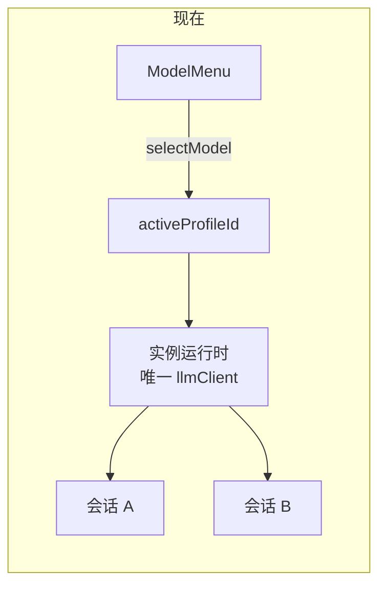

# 1. 现状与问题分析

> 时间口径：`main` 分支 `18eb1f04`（2026-10-25）。本文只描述现状，方案见 [02](02-optimization-plan-and-change-scope.md)。下文路径中 `agent/` 指 `packages/ohbaby-agent/src/`，`web/` 指 `apps/ohbaby-web/src/`，`cli/` 指 `packages/ohbaby-cli/src/`。

## 1.1 问题陈述

1. **模型只有一个全局开关。** Web 输入框旁的模型菜单调用的是“设置全局默认”，选一次，所有会话的下一轮都换模型。用户无法让两个会话分别用不同模型。
2. **运行时一个实例只认一个模型。** 工作区实例组装运行时时只拿到一个模型客户端，上下文预算、压缩摘要、请求发送、子代理都从它取配置。哪怕在会话上记下模型，运行时也没有地方按会话换客户端。
3. **生成参数全局共用。** 输出上限和默认 reasoning 偏好存在 `model.json` 顶层的 `llmParams`，所有模型共用。Settings 编辑器里每个模型的 Max output 实际不生效；换默认模型时，后端会删掉新模型不支持的全局 reasoning 偏好。
4. **reasoning 档位按全局模型校验。** 会话已经能保存自己的 reasoning 档位，但校验和展示用的都是全局默认模型的能力。会话换了模型以后，这套校验就对不上了。
5. **Settings 模型页有几处信息缺口。** 后端已经能检测每个模型的 reasoning 能力，界面看不到；Default 的含义只说了一半；删除模型时不会提示对会话的影响。

## 1.2 已确认的分界

见 [00 §2](00-discussion.md)。核心是：会话上不写模型就跟随全局默认（D1）；会话里切换不改全局默认（D2）；会话的模型被删就清掉字段并提示（D10）；输出上限和默认 reasoning 挂到每个模型上（D12）。

## 1.3 模型库与配置加载（agent/config/llm、packages/ohbaby-llm）

### 1.3.1 职责与数据

- `model.json` 的磁盘结构由 `ModelDocument` 描述（`agent/config/llm/model-document.ts:23`）：`activeProfileId`、`models[]`，以及顶层的 `provider`、`defaultModel`、`apiConfig`、`llmParams`。
- 顶层的 `provider`、`defaultModel`、`apiConfig` 和 `llmParams.contextWindowTokens` 是默认模型的冗余快照，每次写入时由 `synchronizeModelSnapshot` 从默认条目同步一遍（`model-document.ts:42`）。
- `llmParams` 其余字段（`maxTokens`、`temperature`、`reasoning`）**没有对应条目**，是所有模型共用的一份（`packages/ohbaby-llm/src/config/types.ts:66`）。

### 1.3.2 加载链路只投影默认模型

- `projectModelDocument` 只找 `activeProfileId` 那一条，把它和全局 `llmParams` 拼成 LLM 包需要的 `ModelJsonConfig`（`model-document.ts:69-104`）。
- `loadProjectedModelJson` → `LLMConfigManager.performLoad` 生成 `LLMConfig`，`maxTokens` 和 `reasoning` 直接取全局 `llmParams`（`agent/config/llm/manager.ts:160-215`）。
- `LLMConfigManager` 是单例，只缓存一份配置，缓存键里没有条目 id（`manager.ts:46-93`）。

结论：现在没有办法“按某个条目 id 拿到它的 LLM 配置”。

### 1.3.3 生成参数的实际取值

| 字段 | 存在哪 | 谁在写 | 实际怎么用 | 问题 |
|---|---|---|---|---|
| 输出上限 | 全局 `llmParams.maxTokens`；条目上也有 `maxOutputTokens` | `/connect` 带了输出上限时两处一起写（`agent/config/llm/apply-active-model-config.ts:299-305`）；Settings 编辑器只写条目 | 请求和预算都用全局值，`activeModelBudgetProfiles` 会用全局值覆盖条目值（`packages/ohbaby-llm/src/config/model-profile.ts:31-55`） | 编辑器里的 Max output 不生效 |
| 温度 | 全局 `llmParams.temperature` | `/connect` 每次都清掉（`apply-active-model-config.ts:307`） | 只有手改文件才会有值 | 没有界面入口 |
| 默认 reasoning | 全局 `llmParams.reasoning` | `setActiveLLMConfig` 收到 `reasoning` 时写入（`agent/config/llm/writer.ts:97-131`），现有界面不再传这个值 | 会话没选档位时用它 | 换默认模型时，`clearIncompatibleReasoningPreference` 会删掉它（`writer.ts:210-221`），在会话级模型下会误伤其他会话 |

产品代码里读取 `llmParams` 的地方都在 `agent/config/llm/` 下的 manager、writer、model-document、apply-active-model-config，以及 `agent/adapters/ui-inprocess.ts` 的三个当前模型投影函数（`:2566`、`:2595`、`:2618`），它们都是先投影、再读取。LLM 包自己只校验投影结果（`packages/ohbaby-llm/src/config/validation.ts:227-272`），不读磁盘。所以产品代码里磁盘上的 `llmParams` 可以去掉，只要投影时改成从条目取值。

仓库自带的工具有例外：`tests/smoke/agent-loop-workspace.ts:53-58`、`tests/smoke/connect-protocol.real.e2e.test.ts:211-215` 读顶层 `apiConfig`，`scripts/run-improve4-remote-footer-recheck.mjs:54-56` 改顶层 `apiConfig.baseUrl`；另有约 10 个脚本和夹具写最老的单模型格式。

温度的迁移有一个限制：LLM 包在条目能力不支持温度时会拒绝带温度的请求（`packages/ohbaby-llm/src/providers/reasoning.ts:293-308`），所以全局温度不能原样复制给所有条目。

### 1.3.4 删除与切换

- 删除默认模型会按列表顺延（`writer.ts:475-506`），这是 D9 沿用的规则。
- 删除时不会碰任何会话。会话现在本来就不引用模型条目，所以不需要；有了 `Session.modelId` 之后就需要处理（D10）。

## 1.4 运行时（agent/adapters/ui-runtime、agent/core）

### 1.4.1 一个运行时一个客户端

`createUiRuntimeComposition` 接收一个必填的 `llmClient`（`agent/adapters/ui-runtime/composition.ts:179`），之后都从它取配置：

| 位置 | 用途 |
|---|---|
| `composition.ts:673` | `createContextSummaryClient(options.llmClient)`，压缩摘要的客户端整个运行时只绑一次（实现见 `agent/adapters/ui-runtime/prompt-context.ts:67-92`） |
| `composition.ts:688-693` | `createHeuristicTokenCounter`，上下文窗口、输出上限、预算档案都取自默认模型，只建一次 |
| `composition.ts:698` | `new Lifecycle({ llmClient })` |
| `composition.ts:786-790` | `AgentService` 的 `modelId` 和 `getReasoning` |
| `composition.ts:887-894` | `SessionSubagentHost` 的 `modelId` 和父会话 reasoning 的兜底值 |
| `composition.ts:1254-1283` | `compactSession` 的请求设置和 `modelOrigin` |
| `composition.ts:1305-1321` | `getContextUsage` 的 `modelOrigin` |

`Lifecycle` 里同样直接读依赖里的客户端：默认 reasoning（`agent/core/lifecycle/lifecycle.ts:522-527`）、请求客户端（`:1393-1394`）、助手消息的 `providerId`（`:1422`）、准备请求时的设置和来源（`:1812-1820`）。上下文管理器把 `llmClient` 和 `tokenCounter` 当作固定的构造参数（`agent/core/context/types.ts:266-278`，摘要调用在 `agent/core/context/context-manager.ts:851`）。

### 1.4.2 已经按轮传递的 `modelId` 不是条目 id

运行链路里已经有一个按轮传递的 `modelId`：`AgentService` → 实例工厂 → run manager → worker → `LifecycleSessionParams.modelId`（`agent/core/lifecycle/types.ts:74`）。但它是**服务商的模型名**（`llmClient.config.model`），`Lifecycle` 只用它替换请求里的 `model` 字段（`lifecycle.ts:1393-1394`），地址、协议、key 仍来自共享客户端。只传一个新的条目 id 不够，每一轮需要拿到自己的完整客户端。

### 1.4.3 切模型靠重建运行时

- `settingsConfigVersion` 对整个 `model.json` 取哈希（`agent/config/llm/config-coordination.ts:97-137`），哪怕只改了一个非默认条目，也算 `model` 域变了。
- `InProcessRuntimeController.acquireRuntime` 发现有域变化，就等实例空闲后整体重建运行时（`agent/adapters/ui-inprocess/runtime-controller.ts:65-118`）。重建时 `prepareRuntime` 重新加载 LLM 配置，`createRuntime` 重新取客户端（`agent/adapters/ui-inprocess.ts:1035-1110`）。
- 结果是改一下模型库就要等整个实例空闲，并重建 MCP 之外的整套运行时。按会话取客户端以后，`model` 域的变化只需要让客户端缓存失效。
- 重建还顺带做了三件没写在明处的事，去掉重建时要保留下来：
  - `onRuntimeReplaced` 清空上下文用量缓存（`agent/adapters/ui-inprocess.ts:1032-1033`），Web 顶栏的模型名和窗口来自这份缓存；
  - 新建的上下文管理器带来空的校准系数和压缩下限（`agent/core/context/context-manager.ts:278-330`）；
  - 配置在协调锁内重新加载，版本快照也在同一步取（`agent/adapters/ui-inprocess/runtime-controller.ts:226-236`）。
- 运行时启动依赖默认模型：`createRuntime` 里取不到客户端就失败（`ui-inprocess.ts:1070`）。

### 1.4.4 标题与摘要

- 标题生成调用 `resolveLLMClient(projectRoot)`，拿的是全局默认模型（`agent/adapters/ui-inprocess.ts:3116-3140`，客户端解析在 `:2502-2515`）。
- 压缩摘要用的是运行时绑定的客户端，也是全局默认（见 1.4.1）。

### 1.4.5 子代理

`SessionSubagentHost` 的 `modelId` 在组装时固定（`agent/agents/subagent-host.ts:109`、`:1559`）。父会话的 reasoning 通过 `runManager.getActiveReasoning` 取当前运行的值（`agent/runtime/run-manager/manager.ts:334`），模型没有对应的取法。今天所有会话都用同一个模型，所以“子代理继承父会话模型”在结果上成立，但代码里没有这条路径。

## 1.5 会话与提交记录

| 位置 | 现状 |
|---|---|
| `agent/services/session/types.ts:12`、`:57` | `Session.reasoning?` 和 `UpdateSessionPatch.reasoning?`，没有模型字段 |
| `agent/services/session/database-store.ts:41-45` | `reasoning` 存在会话行的 JSON `data` 列里，加字段不需要 SQL 迁移 |
| `agent/adapters/ui-state/persistent-store.ts:301`、`agent/adapters/ui-inprocess/session-controller.ts:42-50` | 把 `reasoning` 投影进 `UiSession` |
| `agent/runtime/prompt-scheduler/types.ts:21`、`database-store.ts:47` | 每条提交记录保存 `reasoning`（`reasoning_data` 列，迁移 `016_prompt_submission_reasoning`），排队的消息按提交时的档位执行 |
| `agent/adapters/ui-inprocess.ts:1581-1608` | 新会话第一次提交时，把提交带的 reasoning 写到会话上 |
| `agent/adapters/ui-inprocess.ts:2622-2675` | `sessionReasoningPreference` 和 `updateSessionReasoningInternal` 都拿全局模型的能力校验 |
| `agent/core/lifecycle/lifecycle.ts:1422` | 每条助手消息已经记录 `providerId` 和 `modelId`（服务商模型名） |

SDK 和服务端已有一套会话 reasoning 的接口：`UiSession.reasoning`（`packages/ohbaby-sdk/src/contract/snapshot.ts:101`）、`SubmitPromptOptions.reasoning`（`client.ts:65`）、`updateSessionReasoning`（`client.ts:212-215`）、`PATCH /v1/sessions/:id/reasoning`（`packages/ohbaby-server/src/protocols/web/routes/sessions.ts:104-128`）和对应的 JSON-RPC 方法（`packages/ohbaby-server/src/protocols/jsonrpc/protocol.ts:35`）。会话模型可以照这一套加。

## 1.6 Web（apps/ohbaby-web）

### 1.6.1 输入框模型菜单

- `ModelMenu` 不接收会话信息（`web/ui/composer/ModelMenu.tsx:26`），勾选项取 `models.active.id`（`:52`），选择时调用 `settings.selectModel(id)` 改全局默认（`:62-77`）。“Manage models…” 入口已经有了（`:160-170`）。
- 挂载点在 `web/ui/session/SessionScreen.tsx:278-287`，同一层已有 `view.activeSession`，只是没传给菜单。

### 1.6.2 reasoning 控件

- `useReasoning` 的能力来自 `getCurrentModel()`，也就是全局模型（`web/ui/composer/useReasoning.ts:88-121`）；偏好来自 `session.reasoning`，保存走 `updateSessionReasoning`（`:133`）。
- 设置列表里每个模型已经带了 `reasoning` 能力视图（`packages/ohbaby-sdk/src/contract/settings.ts:180`），可以直接按模型取，不必再请求一次 `/v1/model`。
- 新会话还没创建时，选的档位放在 `Composer` 的 ref 里，随第一次提交带上（`web/ui/composer/Composer.tsx:107-110`、`:237`；`web/ui/session/usePromptSubmission.ts:209-215`）。新会话预选的模型可以走同一条路。

### 1.6.3 Settings 模型页

- 列表：按服务商分组，默认模型标 `Default`（`web/ui/settings/ModelsSection.tsx:260-261`），行菜单有 Set as default 和 Delete（`:308-336`），服务商菜单可整组删除（`:339-351`）。删除确认文案只说默认模型会怎么变（`:375-401`）。
- 编辑器：服务商、模型、地址、协议、key、备注，More options 里有 key 变量名、上下文窗口、输出上限、prompt cache（`web/ui/settings/ModelEditor.tsx:252-384`）。**没有 reasoning 能力展示，也没有重新检测入口。**
- 后端已有 `POST /v1/settings/models/probe`（`packages/ohbaby-server/src/protocols/web/routes/global-settings.ts:128-136`），Web 的 `SettingsApi` 没有对应方法（`web/api/daemon/settings-client.ts:22-44`）。
- SDK 的 `UiSettingsModels.params` 仍返回全局 `{maxTokens, temperature, contextWindowTokens, reasoning}`（`settings.ts:188-197`）。

### 1.6.4 其他显示模型的地方

`selectors.ts` 的 `modelLabel` 优先取上下文用量里的 `modelId`，否则取全局模型（`web/ui/session/selectors.ts:307-327`）；`/status` 命令结果里的 Model 行同理（`web/ui/commands/slashCommands.ts:186-192`）。mock 用 `dev/mock-runtime.ts:146-170` 把设置里的默认模型同步成当前模型。

## 1.7 TUI（packages/ohbaby-cli）

- 没有 `/model` 命令，只有 `/models`，面板只读，显示当前模型和列表（`cli/tui/components/dialog/command-panel-manager.tsx:420-470`）。后端 `CommandModelProvider.switchModel` 从未实现，`listModels` 只返回当前一个模型（`agent/adapters/ui-inprocess.ts:2680`、`:4069-4072`；`agent/commands/builtin.ts:344-358`）。
- `cli/tui/dialogs/model-dialog.tsx` 只在 `subject === "model"` 的交互里使用，没找到产生这种交互的地方，可能是死代码（待核实）。
- `/connect` 调用 `connectModel`，写全局默认（`cli/tui/components/dialog/connect-panel.tsx:165` → `agent/adapters/ui-inprocess.ts:3868-3900`）。
- `/effort` 和底栏的能力都来自 `getCurrentModel()`，也就是全局模型（`cli/tui/components/dialog/effort-panel.tsx:63-80`、`cli/tui/use-footer-model.ts:10-51`）。没有会话时，选的档位暂存在 `pendingReasoning`（`cli/tui/app.tsx:141`、`:1165-1176`）。

## 1.8 跨模块一致性

| 概念 | 后端 | Web | TUI | gap |
|---|---|---|---|---|
| 当前模型 | 实例唯一客户端 | `models.active`、`getCurrentModel()` | `getCurrentModel()` | 三处都是全局，没有“这个会话的模型” |
| 默认 reasoning | 全局 `llmParams.reasoning` | 能力取全局模型 | 能力取全局模型 | 会话换模型后校验失准 |
| 输出上限 | 全局 `maxTokens` | 编辑器写条目值 | `/connect` 两处一起写 | 界面写的值不生效 |
| `modelId` 一词 | 运行链路里是服务商模型名 | 设置接口里是条目 id | 同 Web | 同名不同义，02 需区分命名 |

## 1.9 改动影响面（现状视角）

- **agent**：模型配置投影与缓存、运行时组装、Lifecycle、上下文管理器、子代理、会话与提交记录、in-process 适配器里的 reasoning 校验、标题生成、命令目录的 `/models`。
- **ohbaby-llm**：`ModelJsonConfig` 作为投影结果的类型保留；`activeModelBudgetProfiles` 的覆盖逻辑要随之调整。
- **sdk / server**：会话模型的读写接口、提交选项、设置接口里的 `params` 和条目字段、JSON-RPC 方法。
- **web**：`ModelMenu`、`useReasoning`、Settings 模型页、显示模型名的选择器、mock。
- **cli**：`/models` 切换、`/effort` 与底栏的能力来源。

## 1.10 SWE 原则审视

- **耦合方向不对。** 运行时组装把“用哪个模型”这个按会话变化的事实当成了实例级常量，`llmClient` 被 25 处左右直接引用。这是承重问题，不解决就做不了会话级模型。
- **信息不一致。** 输出上限有两个来源，界面写的那个不生效，属于“看起来能配、实际没用”，比没有这个输入框更糟。
- **冗余快照增加维护成本。** 顶层的 `provider`、`defaultModel`、`apiConfig` 和 `llmParams` 是默认模型的副本，每次写入都要同步。读取时已经统一走条目，这份副本只对旧版本程序有意义。
- **可以复用的现成结构很多**：会话 reasoning 的存储和接口、提交记录的快照、设置列表里的每模型能力视图。会话模型照抄这些，不需要新设计数据层。
- **不可逆点**：去掉磁盘上的 `llmParams` 和顶层快照后，旧版本 ohbaby 读不了新的 `model.json`，见 02 §2.6。

## 1.11 与既有文档的关系

| 文档 | 文档说 | 代码做 | 本议题 |
|---|---|---|---|
| [improve-2 00 §3、§4](../../2026-10-20-workspaceless-sessions-and-settings/improve-2/00-discussion.md) | 切换只改全局当前项；按会话保存模型不做 | 一致 | 本议题接着做，D2 改变了“切换作用于谁” |
| `docs/ohbaby-web/redesign-2026-10/05-components.md` §ModelMenu | 菜单用来选择全局默认模型 | 一致 | 改为选择当前会话的模型，需同步 |
| `docs/ohbaby-web/redesign-2026-10/06-data-api-and-state.md` §全局层 | ModelMenu 调用 `POST /v1/settings/models/active` | 一致 | 改为会话模型接口，需同步 |
| `docs/config/llm/data-model.md` | `model.json` 只有单模型结构 | 已落后于代码（没写 `models[]`） | 本议题按新结构重写 |
