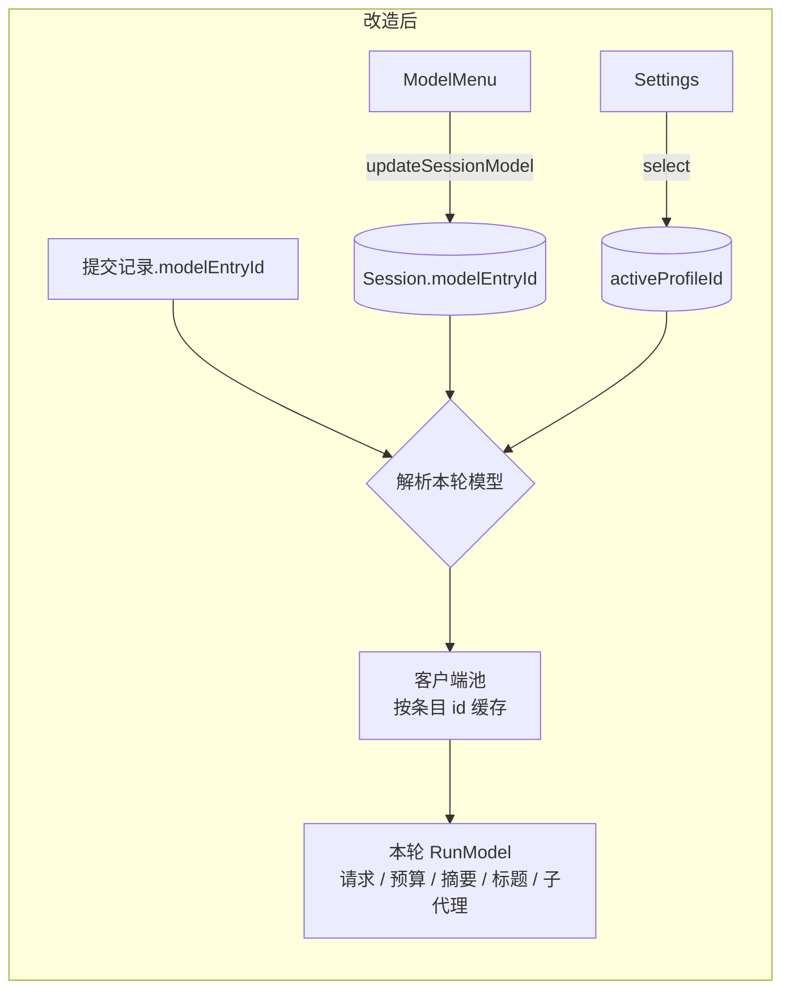

# 2. 方案与改动面

> 依据 [00](00-discussion.md) 的 D1 至 D15 和 [01](01-problem-analysis-and-current-state.md) 的现状。本文是交给实施会话的契约，规划会话不写代码。路径缩写同 01：`agent/` 指 `packages/ohbaby-agent/src/`，`web/` 指 `apps/ohbaby-web/src/`，`cli/` 指 `packages/ohbaby-cli/src/`。

## 2.1 方案总览

会话上加一个可选的 `modelEntryId`，指向 `model.json` 里 `models[]` 的某一条。不写就跟随全局默认（`activeProfileId`）。提交消息时，后端把“会话当时选的条目，或者跟随默认”记进提交记录；执行这一轮时按记录解析出条目，从客户端池里取它的客户端，这一轮的请求、上下文预算、压缩摘要、标题生成和子代理都用这个客户端。运行时不再持有固定的模型客户端，改模型库也不用重建运行时。

生成参数（输出上限、默认 reasoning、温度）从全局 `llmParams` 搬到每个条目上，磁盘上的 `llmParams` 和顶层快照删除，读旧文件时迁移。



**命名约定。** 运行链路里已有的 `modelId` 是服务商的模型名（如 `deepseek-v4.1-flash`），本文不改它的含义。新字段一律叫 `modelEntryId`，表示 `models[]` 条目的 `id`，与 Settings 接口里的 `id` 是同一个值。00 里写的 `modelId` 指的就是 `modelEntryId`。

## 2.2 设计决策表

| 编号 | 决策项 | 选择 | 理由 | 放弃的选项 | 代价 |
|---|---|---|---|---|---|
| P1 | 会话模型存哪 | `Session.modelEntryId?`，放在会话行的 JSON `data` 里，与 `reasoning` 并列 | 照抄 reasoning，不需要 SQL 迁移（01 §1.5） | 事件日志（pi、kimi） | 不记录切换历史；助手消息上已有服务商模型名，够用 |
| P2 | 解析顺序 | **提交时**：提交选项的 `modelEntryId` → 会话的 `modelEntryId` → 都没有就记为“跟随默认”（记录里留空）。**执行时**：记录有 id 就用它，留空就用当时的 `activeProfileId`，**不再回头读会话**；没有默认模型时拒绝执行。没有提交记录的路径（goal 自动续跑、手动压缩、上下文用量）按“会话 → 默认”现取 | D1、D14：排队消息按提交那一刻的选择执行。如果执行时再回头读会话，跟随默认时提交的排队消息会被之后的切换改掉 | 执行时按“记录 → 会话 → 默认”解析 | 无；旧记录留空，即跟随默认，与旧行为一致 |
| P3 | 被删条目怎么处理 | **解析时**发现条目不存在：这一轮用默认模型；若会话的 `modelEntryId` 仍是这个被删的 id，用带条件的会话更新清掉（`expectedModelEntryId`，照现有的 `expectedTitle`），并发提示 | D10；解析时处理能覆盖所有实例和数据库里的会话，不用在删除时扫描会话 | 删除时批量清理会话 | 被删后第一次运行才会清字段；在此之前 Web 按“跟随默认”显示（2.5.6） |
| P4 | 运行时怎么换模型 | 组装运行时时传入 `resolveRunModel`，每轮得到一个 `RunModel`（客户端、token 计数器、摘要客户端、`modelOrigin`），沿已有的按轮参数传下去。上下文管理器的**所有**方法都按调用接收这份模型上下文 | 01 §1.4.2 已有按轮传递的链路，改动集中 | 每个模型组装一套运行时 | 要改 Lifecycle 和上下文管理器的接口 |
| P5 | 客户端缓存 | 客户端池按**内容**缓存：键为“投影后的条目配置 + 解析出的 key 值 + 项目目录”的哈希，在 `coordinateModelConfig` 里读取。条目一改，哈希就变，自动用新客户端 | 参考 opencode（`core/src/aisdk.ts:318-361`）。比“比对版本再读文件”少一个读写间隙；`.env` 按项目目录解析，键里必须带目录 | 按条目 id 缓存加版本比对 | 每次取客户端要投影一次并算哈希，开销可以忽略 |
| P6 | `model` 域还要不要重建运行时 | **不要**。`changedDomains` 去掉 `model`；`env` 域照旧。重建原本附带的三件事改为显式处理：清会话的上下文用量缓存、重置上下文校准、重置 prompt cache 统计（见 1d） | 运行中的轮次本来就持有自己的客户端，下一轮自然用新配置 | 保留重建 | 要把隐性的重置写成显式代码 |
| P7 | 生成参数 | 条目上的 `maxOutputTokens`、`reasoning`、`temperature`；投影时拼成 LLM 包要的 `llmParams` | D12；LLM 包的入参类型不用改 | 保留全局兜底 | 旧版本 ohbaby 读不了新文件（2.6） |
| P8 | 顶层快照 `provider`、`defaultModel`、`apiConfig` | **随 `llmParams` 一起删除**，磁盘只留 `activeProfileId` 和 `models` | 去掉 `llmParams` 后旧版本本来就读不了，留着快照只剩同步成本（01 §1.10） | 保留快照 | 同 P7。用户已确认（00 D16） |
| P9 | 子代理的模型 | 继承父会话当前运行的 `RunModel`，取法照 `getActiveReasoning`，按 `(sessionId, contextScopeId)` 查 | D14 | 子代理自己解析 | 无 |
| P10 | 会话切换时的 reasoning | 新条目能力已识别且不支持会话的档位时，同一次更新里清掉会话的 `reasoning` | D14 | 保留后在请求时丢弃 | 用户的档位被清掉，需要重选 |
| P10b | 执行时的 reasoning 兜底 | 执行时再按本轮 `RunModel` 的能力过滤一次：不兼容就丢掉、改用条目默认档位并发提示，**不让请求报错** | 跟随默认的会话在默认模型变化后、被删条目回退后，提交时冻结的档位都可能不兼容；LLM 包遇到不支持的档位会直接抛错（`packages/ohbaby-llm/src/providers/reasoning.ts:318-340`） | 只在切换时清理 | 多一处过滤 |
| P10c | 插话（steer） | 插话并入正在运行的轮次，用这一轮的模型；插话记录上的 `modelEntryId` 不参与选择 | 插话本来就是往当前轮里补一句话，换模型没有意义 | 模型不同时改为排队 | 无 |
| P11 | Web 的 reasoning 能力来源 | 设置列表里条目的 `reasoning` 视图，按“会话的条目 → 默认条目”取 | 01 §1.6.2；新会话预选模型时还没有会话，也能取到 | 每个会话请求一次 `/v1/model` | 设置列表要保持新鲜（现有 30 秒缓存加 watch） |
| P12 | TUI 的能力来源 | `getCurrentModel({ sessionId })` | TUI 没有设置列表缓存 | 让 TUI 也读设置列表 | 接口多一个可选参数 |
| P13 | 删除模型的确认 | 删除单个模型一律弹确认，文案说明“正在用它的会话会改用默认模型” | D13；删除现在会影响会话 | 只在删默认模型时确认（Web 重设计 D17） | 修改 D17，需同步 Web 文档 |
| P14 | 菜单怎么表示默认 | 不加额外菜单项。菜单只列模型，默认条目旁加一个不显眼的 `default` 标记；选任何条目（包括默认条目）都把它写进会话 | 00 D17；界面最简单，没有隐藏规则 | 顶部加 “Use default” 项；或选默认条目时发 `null` | 会话选过模型后回不到“跟随默认”，想跟随默认就新开会话。后端的 `updateSessionModel` 仍接受 `null`，给内部回退和以后用 |
| P16 | 只有一个模型时 | 没有默认模型（`activeProfileId` 为空或指向不存在的条目）时，创建或修改后配置完整的条目自动成为默认。默认条目还在、只是变得不完整（例如 key 被清掉）时不触发，和删除时的顺延规则一致（`writer.ts:494-496`） | 00 D18；现在 `createModelEntry` 不设默认（`writer.ts:390-410`），Settings 里从零添加第一个模型后会出现“有模型但没默认”，按 D10 新会话会被拒绝执行 | 让用户手动点 Set default | 无 |
| P15 | 测试注入 | 主注入点改为 `createLLMClient(config: LLMConfig)` 工厂，每个条目调用一次。保留 `llmClient` 选项作为测试捷径：设置后所有条目都映射到这一个客户端；没有 `model.json` 时用这个客户端的配置合成一个条目（id 为 `injected`） | 现有约 70 个测试文件靠 `llmClient` 注入（`agent/adapters/ui-inprocess.ts:309-314`）；T8 需要每个条目一个假客户端 | 删除 `llmClient` 选项 | 合成条目是测试专用路径，生产代码不会走到 |

## 2.3 分阶段实施

全部 Stage 都属于 improve-1。分工按 README：Stage 1、2 由 agent 实施并测试、安排子代理审查；用户检查后端后实施 Stage 3；Stage 4 在 Stage 3 之后；Stage 5 跟随各 Stage 同步。

### Stage 1：后端核心（agent、ohbaby-llm）

**1a. 每模型生成参数与文件迁移**

- `ModelEntry` 增加 `reasoning?: ReasoningConfig`、`temperature?: number`；`maxOutputTokens` 成为请求实际使用的输出上限。
- `ModelDocument` 去掉 `provider`、`defaultModel`、`apiConfig`、`llmParams`（P8）。
- `normalizeModelDocument` 读旧文件时迁移（只在内存里，首次写入才落盘）：
  - 条目没有 `maxOutputTokens` 时取旧 `llmParams.maxTokens`；条目已有就保留条目值。
  - 旧 `llmParams.temperature` 只迁到原默认条目。`/connect` 每次都会清掉温度，残留值只可能属于当时的默认模型；迁到其他条目反而可能让请求报错（`packages/ohbaby-llm/src/providers/reasoning.ts:293-308` 会拒绝不支持温度的配置）。
  - 旧 `llmParams.reasoning` 只迁到原默认条目，且该条目能力已识别时要兼容，否则丢弃。
  - 只有顶层字段、没有 `models[]` 的最老格式，沿用现有转换成一个条目的逻辑。这条路径要长期保留并有测试：仓库里约 10 个脚本和 smoke 夹具仍写这种格式（见 2.9 连带影响面）。
  - LLM 包里提示“remove temperature from llmParams”的报错文案改为指向条目。
- 第一次把旧字段写掉之前，把原文件复制到 `~/.ohbaby/backups/model-json-<UTC 时间戳>/model.json`，只做一次。
- 删除 `synchronizeModelSnapshot` 和 `buildLLMParams`；`setActiveLLMConfig`（`/connect` 和旧 `POST /v1/model` 共用）改为把输出上限、reasoning 写进目标条目。
- `projectModelDocument(document, entryId?)`：不传就用 `activeProfileId`。投影出的 `llmParams` 为 `{ maxTokens: entry.maxOutputTokens ?? 8192, temperature: entry.temperature, reasoning: entry.reasoning, contextWindowTokens: entry.contextWindowTokens }`。
- `activeModelBudgetProfiles` 不再需要用全局值覆盖条目的 `maxOutputTokens`；投影后两者相等，覆盖逻辑可以删掉或保留为恒等（实施时二选一，04 T3 验证结果）。
- `clearIncompatibleReasoningPreference` 改为作用于**被修改或被重新检测的那个条目**；切换默认模型时不再动 reasoning。
- 设置写接口：创建和修改条目时接受 `reasoning`（修改时 `null` 表示清除）；能力已识别时校验兼容，未识别时原样保存，由请求时映射决定（与会话 reasoning 现在的规则一致）。校验时同时检查与条目自己的输出上限是否冲突（Anthropic 预算模式要求思考预算小于 `maxTokens`，`reasoning.ts:341-350`）。
- 自动默认（P16）：`createModelEntry`、`updateModelEntry` 写盘前检查，没有有效默认且当前条目配置完整时，把 `activeProfileId` 设为它。只在写入时做，读取不改文件；删除时的顺延规则沿用 improve-2。

**1b. 按条目取配置与客户端**

- `loadProjectedModelJson(options, entryId?)`。按条目加载时**绕过** `LLMConfigManager` 的单槽缓存（`agent/config/llm/manager.ts:79-87`），否则两个会话用不同条目会来回把缓存冲掉；`LLMConfigManager` 只留给仍要“默认模型”的旧调用方。
- 新增模型解析：给定 `modelEntryId?`，返回 `{ entry, source: "explicit" | "default", removedEntryId? }`。规则见 P2、P3；条目存在但配置不完整时报 `MODEL_CONFIG_INCOMPLETE`；没有默认模型时报现有的“没有可用模型”错误。**会话有自己的有效条目时，没有默认模型也照常执行。**
- 新增客户端池（放在 in-process 适配器里），按 P5 的内容哈希缓存，在 `coordinateModelConfig` 里读取投影和 key。
- 运行时启动不再依赖默认模型：现在 `createRuntime` 里 `resolveLLMClient` 失败会让运行时起不来（`agent/adapters/ui-inprocess.ts:1070`）；改造后没有默认模型也能起，只有真正要用默认模型的那一轮才报错。
- 测试注入按 P15 调整：`InProcessOptions.llmClient`、`createLLMClient` 选项（`ui-inprocess.ts:309-314`）以及 `agent/adapters/ui-persistent.ts:819-826` 的同类选项。
- `currentDiscoveryState` 和 `startModelEntryDiscovery` 已按条目 id 工作，`currentDiscoveryState` 去掉只取 `activeProfileId` 的限制（`agent/config/llm/apply-active-model-config.ts:500`）。

**1c. 会话与提交记录**

- `Session.modelEntryId?`、`UpdateSessionPatch.modelEntryId?`（显式 `undefined` 表示清除，与 reasoning 相同）；投影到 `UiSession`。
- `PromptSubmissionRecord.modelEntryId?`：迁移 `027_prompt_submission_model_entry` 给提交表加 `model_entry_id` 列（可空，`ALTER TABLE ... ADD COLUMN` 即可）；内存实现同步。留空表示“跟随默认”，旧记录自然属于这一类。
- 幂等比较只在客户端**显式**传了 `modelEntryId` 时比较，从会话推出来的快照不参与，做法与 reasoning 跳过函数形式相同（`agent/runtime/prompt-scheduler/scheduler.ts:266-270`），避免无害的重试被判成冲突。
- 提交时的快照：`submitOptions.modelEntryId ?? session.modelEntryId`，都没有就留空。执行时按 P2，不再回头读会话。
- 新会话第一次提交带了 `modelEntryId` 时写到会话上，与 reasoning 在 `ui-inprocess.ts:1581-1608` 的做法相同。那里“是否首条提交”的判断现在只看 reasoning，要补上 `modelEntryId` 的分支。
- 新增 `updateSessionModel({ sessionId, modelEntryId | null })`：
  - 非 `null` 时，条目必须存在且配置完整，否则报 `MODEL_NOT_FOUND` 或 `MODEL_CONFIG_INCOMPLETE`。
  - 会话归属检查与 `updateSessionReasoningInternal` 相同。
  - 按 P10 处理会话的 `reasoning`，与 `modelEntryId` 在同一次更新里写入。
  - 发布 `session.updated`。运行中也允许调用，当前轮不受影响。

**1d. 运行时按轮取模型**

- `createUiRuntimeComposition` 去掉 `llmClient` 选项，改为 `resolveRunModel(input: { sessionId; modelEntryId? }) => Promise<RunModel>`。`RunModel` 包含：`entryId`、`client`、`tokenCounter`（用这个条目的窗口和输出上限建）、`summaryClient`、`modelOrigin`。由一个小工厂函数从客户端构造，按客户端实例缓存。
- **在 `submitPromptInternal` 里解析一次 `RunModel`**，同时交给 `runtime.startSession` 和标题生成。现在标题是在 `startSession` 之前排期的（`agent/adapters/ui-inprocess.ts:3678` 早于 `:3593`），所以解析点必须提前到这里，不能放在运行时内部。goal 自动续跑直接调用 `submitPromptInternal`、没有提交记录（`:1426`），按“会话 → 默认”解析。
- `RunModel` 沿 `AgentService` → 实例工厂 → run manager → worker → `LifecycleSessionParams` 传下去。`LifecycleSessionParams` 和 `ModelStepParams` 携带 `RunModel`，替换 `deps.llmClient` 的四处用法（01 §1.4.1）。
- 上下文管理器：`llmClient`、`tokenCounter` 从构造参数移除，**所有**对外方法（`prepareTurn`、`compact`、`assemble`、`getUsage`、`createRunPromptSnapshot`，见 `agent/core/context/types.ts:240-263`）都按调用接收 `{ tokenCounter, summaryClient }`。每个 `tokenCounter` 只含本条目的预算档案，按模型名查档案时不会和另一个同名不同窗口的条目混在一起。
- 上下文校准：`calibrationFactors`、`compactionFloors`（`agent/core/context/context-manager.ts:278-330`）现在随重建运行时一起清空。改造后在每个作用域记下上次用的 `entryId`，本轮条目不同就先重置这两项。
- `compactSession`、`getContextUsage`：按会话解析（不经过提交记录）。
- 子代理：run manager 记录每个运行的 `RunModel`，提供 `getActiveRunModel(sessionId, contextScopeId)`；`SessionSubagentHost` 用它代替组装时固定的 `modelId`。取不到时（例如续跑已结束的子代理）按父会话解析。
- 解析结果带 `removedEntryId` 时，按 P3 清会话字段并发提示，`key` 为 `model:entry-removed:<sessionId>`，内容写明原条目的服务商与模型名（取不到就只说“原模型已删除”）和改用的默认模型。
- 标题生成用这一轮的 `RunModel.client`（D11）。
- 插话按 P10c 处理，沿用正在运行的轮次的模型。
- `InProcessRuntimeController`：从 `changedDomains` 里去掉 `model`（`runtime-controller.ts:65-71`），否则仍会重建；`prepareRuntime` 里 `model` 域的 `reloadLLMConfig` 删除（客户端池按内容缓存，不需要主动清）。
- 重建运行时原来顺带做的事改为显式处理（P6）：
  - 上下文用量缓存：`onRuntimeReplaced` 里的 `contextWindowUsage.clear()`（`ui-inprocess.ts:1032-1033`）不会再触发。`updateSessionModel` 成功后，以及模型库变化后，清掉受影响会话的缓存并发布刷新后的 `context.window.updated`，否则 Web 顶栏会一直显示旧模型和旧窗口。
  - prompt cache 统计按会话记录（`ui-inprocess.ts:564`、`:1114`），会话换条目后重置这个会话的统计。
- 窗口变小的兜底：D14 依赖估算阈值触发自动压缩。估算可能偏差，此时依靠现有的上下文溢出检测与压缩重试（`context-manager.ts:781`、`:889`）兜底，不新增流程。

**1e. reasoning 校验改按会话的条目**

- `sessionReasoningPreference`、`updateSessionReasoningInternal`、`currentReasoningOptions`、`currentConnectModelFromOptions`、`currentModelFromOptions`（`/status` 等命令用，`ui-inprocess.ts:2518`、`:4070`）都改为接收会话 id（或条目 id），用解析出的条目能力校验和展示。
- 提交时的过滤改按提交快照里的条目（跟随默认时按当时的默认条目）。执行时再按 P10b 用本轮 `RunModel` 软过滤一次。
- 运行时的默认 reasoning 从 `RunModel.client.config.reasoning` 取，也就是条目自己的默认档位。
- `updateSessionModel` 不校验 key 是否已配置：key 本来就允许为空（见 `2026-06-29-connect-optional-api-key`），缺 key 的问题在请求时报出。

**1f. 仓库内依赖旧格式的工具**

- 读顶层字段的要改：`tests/smoke/agent-loop-workspace.ts:53-58`（读 `apiConfig.apiKeyEnv`，缺失就抛 `UNSAFE_INLINE_CREDENTIAL_CONFIG`）、`tests/smoke/connect-protocol.real.e2e.test.ts:211-215`（读 `apiConfig.interfaceProvider`）、`scripts/run-improve4-remote-footer-recheck.mjs:54-56`（改顶层 `apiConfig.baseUrl`，新读取方式下会被静默忽略）。
- 只写旧格式的脚本和夹具可以不改，依赖 1a 保留的最老格式转换路径。

**Stage 1 完成定义**：04 的 T1 至 T14b、T18b 通过；现有 reasoning、压缩、子代理、提交调度的测试不回退。

### Stage 2：SDK、服务端、JSON-RPC

- `UiSession.modelEntryId?: string`。
- `SubmitPromptOptions.modelEntryId?: string`，语义同 reasoning：只作用于这一条提交；如果是新会话的第一条，同时写到会话上。
- `UiBackendClient.updateSessionModel({ sessionId, modelEntryId: string | null }): Promise<UiSession>`；HTTP `PATCH /v1/sessions/:id/model`，请求体 `{ modelEntryId: string | null }`；JSON-RPC 方法 `updateSessionModel`。错误码复用 `MODEL_NOT_FOUND`、`MODEL_CONFIG_INCOMPLETE`，会话不存在和跨工作区与 reasoning 接口一致。
- `getCurrentModel({ sessionId? })`；HTTP `GET /v1/model?sessionId=`。返回值 `UiCurrentModelConfig` 增加 `id`（条目 id）和 `source: "explicit" | "default"`。不传 `sessionId` 时返回全局默认。
- 设置接口：`UiSettingsModel` 增加 `reasoningDefault?: UiReasoningConfig`；`UiSettingsModelCreate`、`UiSettingsModelPatch` 增加 `reasoning?`（修改时允许 `null`）；`UiSettingsModels` 删除 `params`。`openapi.ts` 同步。
- `ui-persistent.ts`、`host/ui-command-gateway.ts`、`host/command-record.ts` 等实现 `UiBackendClient` 的地方补齐新方法。

**Stage 2 完成定义**：04 的 T15 至 T18 通过；`pnpm` 的类型检查、单元与集成测试全部通过。

### Stage 3：Web

- **ModelMenu**（P2、D2、P14）：接收当前会话的 `modelEntryId` 和一个选择回调。
  - 菜单只列条目，不加额外项。勾打在本轮实际会用的条目上：会话选过模型就勾它，没选过（或选的已被删除）就勾默认条目。
  - 默认条目旁加一个不显眼的 `default` 标记（弱化文字色、小字号），不加说明文字。
  - 现在 `select` 开头的“点的就是当前勾选项就直接返回”（`ModelMenu.tsx:63`）改为和会话显式保存的 `modelEntryId` 比较：跟随默认的会话点勾着的默认条目，仍要写进会话（P14）。
  - 模型多时列表区域限高、内部滚动（大约 8 行高，同时不超过视口高度的一半），过滤框和 “Manage models…” 固定不随列表滚动。限高加在 `.ohb-model-menu` 里的列表容器上，不改共用的 `.ohb-menu`；只针对桌面端的锚定菜单，手机上的底部抽屉已经整体滚动（`shared.css:222-235`，`max-height: 80dvh`），保持不变；打开菜单时滚到勾选的条目。现在的 `.ohb-menu` 没有限高（`shared/shared.css:71-86`），模型一多菜单会超出屏幕。9 个以上显示过滤框的现有规则（`ModelMenu.tsx:18`）保留。
  - 已有会话时选择调用 `updateSessionModel`；还没有会话时把选择存在 Composer 里，随第一次提交带上 `modelEntryId`，做法与 `selectedReasoning` 相同。
  - 按钮上的标签显示实际使用的模型名。
- **useReasoning**（P11）：能力改为从设置列表的条目取，条目按“会话或待提交的 `modelEntryId` → 默认条目”确定。
- **显示模型名**：`selectors.ts` 的 `modelLabel`、`/status` 的 Model 行改按会话的条目显示；会话条目不存在时显示默认条目。
- **Settings 列表**（D13）：Default 标记保留，列表顶部加一行说明“New chats and chats that haven't picked a model use the default.”。删除单个模型一律确认（P13），确认文案加上“Chats using this model will switch to the default model.”，删除默认模型时再加现有的默认模型变化说明；删除服务商的确认同理。
- **Settings 编辑器**（D13）：
  - 新增 Reasoning 行：显示检测状态（检测中、支持的档位、未知及原因），旁边一个 “Detect again” 按钮调用 `POST /v1/settings/models/probe`。`SettingsApi`、`settings-layer` 补 `probeModel(id)`，成功后刷新列表。
  - 能力已识别时显示 Default effort 选择，写条目的 `reasoning`。
  - Max output 加一句说明“Used for every request with this model.”。
- **mock**：`dev/mock-settings.ts` 增加 `reasoningDefault`、probe；`dev/mock-runtime.ts` 增加会话模型状态和 `updateSessionModel`。

**Stage 3 完成定义**：04 的 T19 至 T24 通过，并做原生浏览器走查。

### Stage 4：TUI

- 调用路径：TUI 直接走 `UiBackendClient`，不经过 `CommandModelProvider.switchModel`（它的入参是服务商、模型名、地址，不是条目 id，`agent/commands/types.ts:70-76`）。回车调用 Stage 2 的 `updateSessionModel`；`d` 调用新增的 `UiBackendClient.selectDefaultModel(entryId)`，后端转给 `selectModelEntry`，JSON-RPC 同步加这个方法。`listModels` 返回所有配置完整的条目（带 id），标出默认和当前会话的条目。未实现的 `switchModel` 删除。
- `/models` 面板改成可选择（上下键移动、回车选中），列出所有配置完整的条目（去掉只显示 8 个的上限），超出面板高度时按窗口滚动，复用 Skills 面板的 `selectedIndex`、`visibleLines` 做法（`command-panel-manager.tsx:370-390`）；现在只显示前 8 个（`:454`）。配置不完整的条目不列出，所以 `d` 不会落到这种条目上。默认条目旁标 `default`，不加额外项；有会话时调用会话模型接口，没有会话时暂存，随第一次提交带上，与 `pendingReasoning` 相同。
- `/models` 面板里按 `d` 把光标所在的条目设为默认（调用 `selectModelEntry`，与 Settings 的 Set default 相同），回车仍只改当前会话；按 `d` 后面板不关，`default` 标记移到新条目上；面板底部一行按键提示 `↑↓ move · enter use in this chat · d set default · esc close`。面板要做成 interactive 模式（同 `EffortPanel`，`command-panel-manager.tsx:156`），现在的 display 模式只处理 Esc 和 Skills 的上下键（`:112-148`），不能接收选择。
- 底栏和 `/effort` 改用 `getCurrentModel({ sessionId })`。
- `/connect` 保持 improve-2 规则（保存条目并设为默认），不改会话。
- 核实 `cli/tui/dialogs/model-dialog.tsx` 是否死代码，是则删除。

**Stage 4 完成定义**：04 的 T25 至 T27 通过。

### Stage 5：权威文档同步

随对应 Stage 完成时同步，见 2.9 的文档项 D1 至 D4。

## 2.4 按包的改动面

| 包 | 新增 | 修改 | 删除 |
|---|---|---|---|
| `packages/ohbaby-agent` | 模型解析、客户端池、`RunModel` 工厂、迁移 027 | 模型文档与写入、配置管理器、运行时组装、Lifecycle、上下文管理器、子代理、run manager、会话与提交记录、in-process 适配器、命令目录 | `synchronizeModelSnapshot`、`buildLLMParams` |
| `packages/ohbaby-llm` | 无 | `ModelJsonConfig` 注释说明它是投影结果；`activeModelBudgetProfiles` | 无 |
| `packages/ohbaby-sdk` | `updateSessionModel` | `UiSession`、`SubmitPromptOptions`、`UiCurrentModelConfig`、设置契约 | `UiSettingsModels.params` |
| `packages/ohbaby-server` | 会话模型路由、JSON-RPC 方法 | `/v1/model` 查询参数、`openapi.ts`、提交校验 | 无 |
| `apps/ohbaby-web` | probe 调用 | ModelMenu、Composer、useReasoning、selectors、Settings 列表与编辑器、mock | 无 |
| `packages/ohbaby-cli` | 无 | `/models` 面板、底栏、`/effort` | 可能删除 `model-dialog.tsx` |

## 2.5 接口、迁移与兼容

### 2.5.1 新的 `model.json`

```jsonc
{
  "activeProfileId": "profile-2f9d1b868de20b1f",
  "models": [
    {
      "id": "profile-2f9d1b868de20b1f",
      "provider": "zenmux",
      "model": "deepseek/deepseek-v4.1-flash",
      "baseUrl": "https://zenmux.ai/api/v1",
      "interfaceProvider": "openai-compatible",
      "apiKeyEnv": "ZENMUX_API_KEY",
      "contextWindowTokens": 1000000,
      "maxOutputTokens": 8192,
      "reasoning": { "effort": "high" },     // 新增，可选
      "temperature": 0.7,                    // 新增，可选，仅迁移或手改
      "reasoningCapabilities": { "...": "..." },
      "reasoningCapabilitySource": "active-probe"
    }
  ]
}
```

### 2.5.2 会话与提交记录

- `Session.data` JSON 增加 `modelEntryId`，旧会话读出来没有这个字段，即跟随默认。
- 提交表增加可空列 `model_entry_id`，旧记录为空，即执行时取默认，与旧行为一致。

### 2.5.3 HTTP 与 JSON-RPC

| 接口 | 变化 |
|---|---|
| `PATCH /v1/sessions/:id/model` | 新增，`{ modelEntryId: string \| null }`，返回 `UiSession` |
| JSON-RPC `updateSessionModel` | 新增，参数同上 |
| 提交 prompt | 可带 `modelEntryId` |
| `GET /v1/model` | 可带 `sessionId`；返回值增加 `id`、`source` |
| `GET /v1/settings/models` 及写接口 | 条目增加 `reasoningDefault`；响应去掉 `params`；创建、修改可带 `reasoning` |

### 2.5.4 旧客户端

- 旧版 Web 和 TUI 不传 `modelEntryId`，所有会话跟随默认，与现在一致。
- 旧版 Web 的 ModelMenu 仍调用 `POST /v1/settings/models/active`，效果仍是改全局默认，不会出错。
- 旧版 Web 读不到 `params` 字段：只有 mock 和类型用到，无运行时依赖（实施时 grep 确认）。

### 2.5.5 事件

不新增事件类型。会话模型变化走 `session.updated`；模型库变化继续走现有的 `model.invalidated` 和设置失效通知。

### 2.5.6 被删条目在界面上的表现

会话的 `modelEntryId` 指向已删条目、还没运行过下一轮时，Web 和 TUI 都按“跟随默认”显示；下一轮运行时后端清字段并发提示（P3）。

## 2.6 风险与回滚

| 风险 | 影响 | 应对 |
|---|---|---|
| **不可逆：新 `model.json` 旧版本读不了** | 降级 ohbaby 后无法加载模型 | 首次重写前备份原文件（1a）；回滚时把备份拷回。发布说明里写明 |
| 运行时去掉 `llmClient` 后有漏改的引用 | 某条路径仍用默认模型 | 类型层面去掉 `llmClient` 选项，编译器会找出所有引用；04 T8 至 T12 覆盖请求、预算、摘要、标题、子代理 |
| 客户端池在配置变化后用旧客户端 | 改 key 后请求仍用旧 key | 按内容哈希缓存，键里含 key 值和项目目录（P5）；04 T6 |
| 解析时清字段与用户同时切换模型发生竞争 | 用户刚选的新模型被清掉 | 带 `expectedModelEntryId` 的条件更新（P3）；04 T5 |
| 排队消息的条目在执行前被删 | 执行时找不到条目 | 走同一套回退规则（P3）；04 T5b |
| 冻结的 reasoning 与执行时的模型不兼容 | 请求直接报错 | P10b 执行时软过滤；04 T13b |
| 去掉 `model` 域重建后，丢掉重建附带的重置 | 顶栏显示旧模型、校准和压缩下限沿用旧模型、prompt cache 统计混在一起 | 1d 把三项重置写成显式代码；04 T7、T9b、T19 |
| 切到窗口更小的模型时估算偏差 | 第一轮请求超窗口 | 现有溢出检测与压缩重试兜底；04 T9b |

回滚：Stage 1、2 在同一组提交里落地；回退代码后，把备份的 `model.json` 拷回即可。会话 JSON 里多出的 `modelEntryId` 和提交表的新列对旧代码无害。

## 2.7 与 00 的对齐

| 00 | 02 中的位置 |
|---|---|
| D1 跟随默认 | P2、1c 快照规则 |
| D2 不改全局 | Stage 3 ModelMenu |
| D3、D10 被删回退 | P3、1d |
| D4 配置修改不处理 | P5（客户端池失效后下一轮自然生效） |
| D5 TUI 分批 | Stage 4 |
| D6、D13 Settings | Stage 3、P13 |
| D9 默认模型 | P2 |
| D11 标题和摘要 | 1d |
| D12 每模型参数 | 1a、P7、P8 |
| D16 文件格式 | P8、1a、1f |
| D17 菜单 | P14、Stage 3、Stage 4 |
| D18 单模型即默认 | P16、1a |
| D19 Web 会话选模型 | Stage 3 ModelMenu、T19c |
| D20 TUI 选模型与设默认 | Stage 4、T25、T25b |
| D14 实现规则 | P2、P9、P10、P10b、P10c、1d |
| D15 文档形式 | 2.9；无模块级文档 |

## 2.8 不在本轮

与 00 §3 一致：温度编辑入口、单条消息选模型、最近使用列表、切换前压缩、远程拉取模型列表、Agent 配置里的模型字段。另外：

- `/connect` 改为作用于当前会话：TUI 适配时如果发现体验问题，登记为下一轮候选。
- 运行链路里 `modelId`（服务商模型名）的改名：本轮只新增 `modelEntryId`，不改旧名。

## 2.9 关键改动清单

> 行号为 `18eb1f04` 的快照，定位以符号为准。本表不是进度表，实施中不勾选、不回写。

| ID | 类型 | 路径 | 符号 | 行号快照 | 要改什么 | 为何承重 |
|---|---|---|---|---|---|---|
| C1 | 代码 | `agent/config/llm/model-document.ts` | `ModelDocument`、`synchronizeModelSnapshot`、`projectModelDocument`、`normalizeModelDocument`、`loadProjectedModelJson` | L23-30、L42-67、L69-104、L106-275、L314-321 | 去掉顶层快照与 `llmParams`；按条目投影；读旧文件迁移 | 文件格式与投影的唯一入口 |
| C2 | 代码 | `agent/config/llm/writer.ts` | `buildLLMParams`、`clearIncompatibleReasoningPreference`、`projectSettings`、`createModelEntry`、`updateModelEntry`、`selectModelEntry`、`deleteEntries`、`setActiveLLMConfig`、`ModelEntryCreateSchema` | L97-131、L210-221、L223-276、L390-441、L443-457、L475-506、L522-621、L162-170 | 参数写进条目；切默认不动 reasoning；设置响应去掉 `params`、加 `reasoningDefault`；创建和修改接受 `reasoning`；没有默认时把配置完整的条目设为默认（P16） | 所有模型写入都经过这里 |
| C3 | 代码 | `agent/config/llm/manager.ts` | `LLMConfigManager`、`performLoad` | L46-93、L160-215 | 按条目读取绕过单槽缓存；按条目投影 | 按条目取配置 |
| C4 | 代码 | `agent/config/llm/apply-active-model-config.ts` | `applyActiveModelConfig`、`currentDiscoveryState` | L250-353、L492-512 | `/connect` 写条目参数；能力状态按任意条目取 | `/connect` 与能力视图 |
| C5 | 代码 | `agent/adapters/ui-runtime/composition.ts` | `createUiRuntimeComposition` 选项 `llmClient` 及全部引用 | L179、L673、L688-698、L786-790、L887-894、L1254-1283、L1305-1321 | 改为 `resolveRunModel`，各处取本轮 `RunModel` | 运行时只认一个模型的根源 |
| C6 | 代码 | `agent/core/lifecycle/lifecycle.ts` | `runTurn`、`runModelStep`、`prepareTurnWithProgress` | L522-527、L1383-1422、L1812-1820 | 用参数里的 `RunModel` 替换 `deps.llmClient` | 请求实际发往哪个模型 |
| C7 | 代码 | `agent/core/context/types.ts`、`context-manager.ts` | `ContextManager` 接口、`ContextManagerOptions`、`calibrationFactors`、`compactionFloors`、摘要调用 | types L240-278；manager L278-330、L851 | `llmClient`、`tokenCounter` 改为所有方法按调用传入；条目变化时重置校准与压缩下限 | 预算与摘要按会话模型 |
| C8 | 代码 | `agent/core/lifecycle/types.ts`、`agent/core/agents/types.ts`、`agent/agents/service.ts` | `LifecycleSessionParams`、`AgentRunInput`、`AgentService` | lifecycle/types L74；agents/types L39、L149；service L20、L52 | 携带 `RunModel` | 按轮传递的链路 |
| C9 | 代码 | `agent/agents/subagent-host.ts`、`agent/runtime/run-manager/manager.ts` | `SessionSubagentHost` 的 `modelId`、`getActiveReasoning` | host L109、L1559；manager L334 | 增加 `getActiveRunModel`，子代理继承 | D14 子代理继承 |
| C10 | 代码 | `agent/adapters/ui-inprocess.ts` | `InProcessOptions`、`onRuntimeReplaced`、`prepareRuntime`、`createRuntime`、`resolveLLMClient`、`currentModelFromOptions`、`resolveSubmissionSession`、`submitPromptAcceptedWork`、`submitPromptInternal`、`sessionReasoningPreference`、`updateSessionReasoningInternal`、`currentConnectModelFromOptions`、`currentReasoningOptions`、`scheduleSessionTitleGeneration` | L309-314、L1028-1110、L2502-2530、L1581-1608、L1643、L2577-2675、L3116-3140、L3590-3680 | 客户端池与测试注入；提交快照；在 `submitPromptInternal` 解析 `RunModel`；新会话写入模型；新增 `updateSessionModel`；reasoning 按会话条目校验；标题用本轮客户端；显式清上下文用量和 prompt cache 统计 | 后端行为的集中处 |
| C11 | 代码 | `agent/adapters/ui-inprocess/runtime-controller.ts` | `changedDomains`、`acquireRuntime` | L65-118 | `model` 域不再触发重建 | P6 |
| C12 | 代码 | `agent/services/session/types.ts`、`database-store.ts` | `Session`、`UpdateSessionPatch`、`SessionData` | types L12、L57；store L41-45、L175-181 | 加 `modelEntryId` | 会话模型的存储 |
| C13 | 代码 | `agent/runtime/prompt-scheduler/types.ts`、`scheduler.ts`、`database-store.ts`、`in-memory-store.ts`；`agent/services/database/migrations.ts` | `PromptSubmissionRecord`、`accept`、新迁移 027 | types L21、L50；scheduler L268-315；store L47、L138、L210、L247-257 | 提交记录快照 `modelEntryId` | D14 排队规则 |
| C14 | 代码 | `packages/ohbaby-sdk/src/contract/snapshot.ts`、`client.ts`、`settings.ts`、`connect-model.ts` | `UiSession`、`SubmitPromptOptions`、`UiBackendClient`、`UiSettingsModel`、`UiSettingsModels`、`UiCurrentModelConfig` | snapshot L99-107；client L65、L212-215；settings L161-197 | 新字段与新方法；去掉 `params` | 前后端契约 |
| C15 | 代码 | `packages/ohbaby-server/src/protocols/web/routes/sessions.ts`、`model.ts`、`jsonrpc/protocol.ts`、`rpc-route.ts` | reasoning 路由、`GET /v1/model` | sessions L104-128；model L16-30；protocol L35 | 会话模型路由与 RPC；`sessionId` 查询参数 | 对外接口 |
| C16 | 代码 | `web/ui/composer/ModelMenu.tsx`、`useReasoning.ts`、`Composer.tsx`；`web/ui/session/SessionScreen.tsx` | `ModelMenu`、`useReasoning` | ModelMenu L26-77、L130；useReasoning L88-121；SessionScreen L278-287 | 会话级选择与能力来源 | D2 的用户入口 |
| C17 | 代码 | `web/ui/settings/ModelsSection.tsx`、`ModelEditor.tsx`；`web/api/daemon/settings-client.ts`；`web/runtime/settings-layer.ts` | 删除确认、编辑器 More options、`SettingsApi` | Section L308-336、L375-401；Editor L252-384；client L22-44 | D13 各项与 probe | D13 |
| C18 | 代码 | `packages/ohbaby-cli/src/tui/components/dialog/command-panel-manager.tsx`、`agent/commands/types.ts`；SDK `client.ts`、server JSON-RPC | `ModelsPanel`、`CommandModelProvider.switchModel`、`UiBackendClient` | panel L112-148、L420-470；types L70-76 | `/models` 改为可交互面板；回车走 `updateSessionModel`，`d` 走新增的 `selectDefaultModel`；删除未实现的 `switchModel` | D20 的 TUI 入口 |
| D1 | 文档 | `docs/ohbaby-web/redesign-2026-10/05-components.md` | §ModelMenu | L130 起 | Purpose 改为选择当前会话的模型 | Web 权威组件文档 |
| D2 | 文档 | `docs/ohbaby-web/redesign-2026-10/06-data-api-and-state.md` | §全局层表格 | L42-47 | ModelMenu 改用会话模型接口；补 probe | Web 权威接口文档 |
| D3 | 文档 | `docs/ohbaby-web/redesign-2026-10/README.md` | 决策表 D17 | L27 | 删除单个模型一律确认 | P13 改了 D17 |
| D4 | 文档 | `docs/config/llm/data-model.md` | 全文 | 全文 | 按新 `model.json` 结构重写 | LLM 配置权威文档 |

### 连带影响面（不逐行列出）

- `agent/adapters/ui-persistent.ts`（含 L819-826 的客户端注入）、`agent/host/ui-command-gateway.ts`、`agent/host/command-record.ts`：补 `updateSessionModel` 和 `getCurrentModel` 参数。
- `agent/services/session/manager.ts`、`database-store.ts` 的 `update`：增加 `expectedModelEntryId` 条件，照现有 `expectedTitle`。
- `packages/ohbaby-llm/src/providers/reasoning.ts`：温度报错文案。
- `tests/smoke/agent-loop-workspace.ts`、`tests/smoke/connect-protocol.real.e2e.test.ts`、`scripts/run-improve4-remote-footer-recheck.mjs`：读写顶层字段的地方（1f）。
- `tests/smoke/formal-cache-session.ts`、`real-web-dev.ts` 等用 `llmClient` 注入的测试工具：按 P15 调整。
- `agent/adapters/ui-state/persistent-store.ts`、`agent/adapters/ui-inprocess/session-controller.ts`：`UiSession` 投影加字段。
- `agent/services/session/title-generator.ts`：签名不变，调用方改传本轮客户端。
- `agent/commands/builtin.ts`、`agent/commands/types.ts`：Stage 4 的 `switchModel`、`listModels`。
- `packages/ohbaby-server/src/app/openapi.ts`：同步新接口。
- `web/ui/session/selectors.ts`、`web/ui/commands/slashCommands.ts`、`web/dev/mock-*.ts`：显示与 mock。
- `cli/tui/components/dialog/command-panel-manager.tsx`、`effort-panel.tsx`、`cli/tui/use-footer-model.ts`、`cli/tui/app.tsx`：Stage 4。
- 各包现有测试里构造 `llmClient` 选项、读 `params` 的地方。
