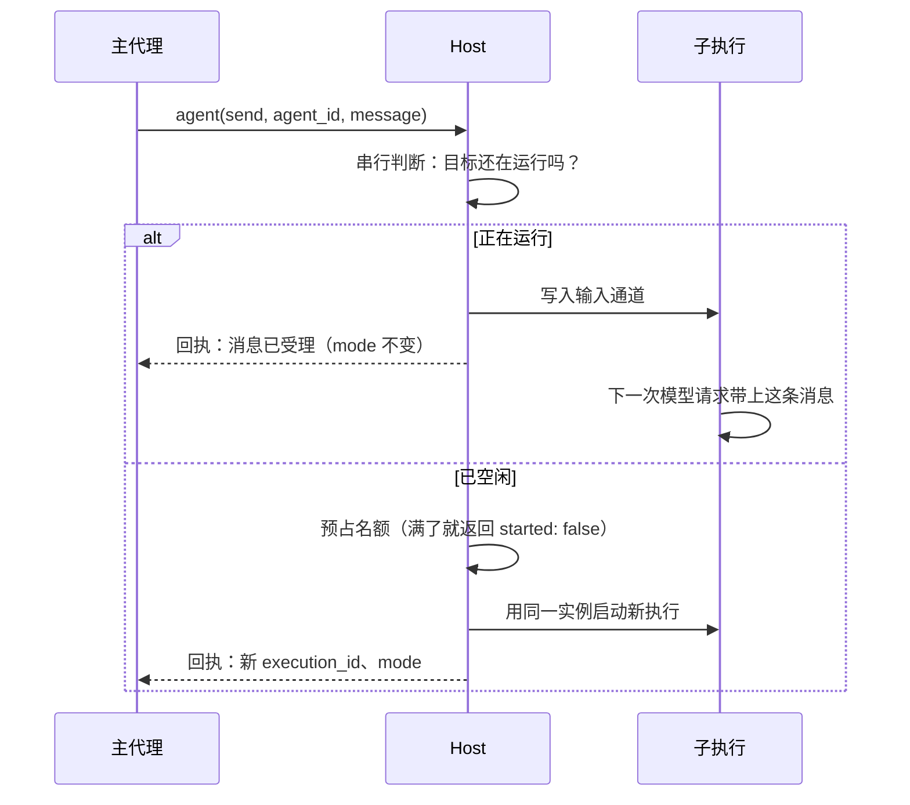
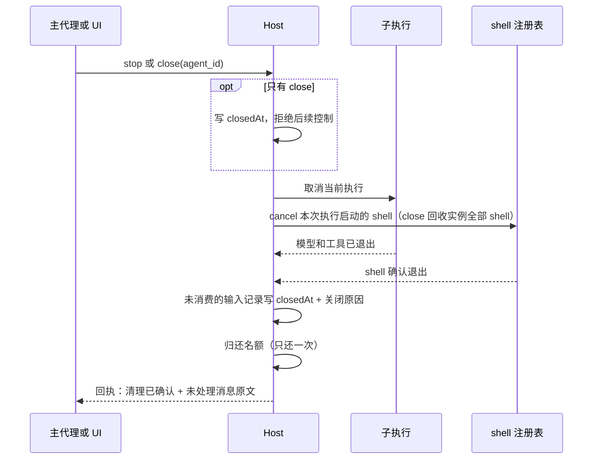
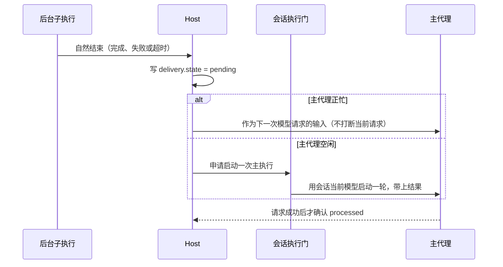

# 2. 优化方案与改动面

> 2026-10-28 定稿，2026-10-29 按 D46 拆分后重写。用户确认的行为见 [00](00-discussion.md)，现状与源码证据见 [01](01-problem-analysis-and-current-state.md)。
> 本文是 improve-1 的实施契约，只管统一 `agent` 工具和子代理生命周期。右侧栏的后端、前端和迁移分别见 [improve-2](../improve-2/02-optimization-plan-and-change-scope.md)、[improve-3](../improve-3/02-optimization-plan-and-change-scope.md)、[improve-4](../improve-4/02-optimization-plan-and-change-scope.md)。
> 字段名、函数拆分这类细节是按已确认行为做的工程细化，不算新的用户决定。

## 2.1 方案总览

一句话：后台子代理不再挂在派遣它的那一轮主 run 上，而是归主会话所有，所以能跨轮运行。

现在，原主 run（`rootRunId`）同时决定四件事：它派出的是哪一轮、后台子代理能活多久、shell 什么时候清理、结果送到哪里。主 run 一结束或被 Stop，后台子代理就跟着被取消。改造后，`rootRunId` 只用来追溯"这是哪一轮派出去的"；子代理活多久和结果送到哪里归主会话管，shell 的清理归每次执行管。

```text
主会话
  ├─ 主执行入口（只有一个）：用户消息 / 子代理结果 / 监督到期，都走同一个执行门
  ├─ 子代理实例：稳定 ID，可复用上下文；close 后不能再控制
  │    └─ 本次执行：mode、子 run、执行名额、30 分钟预算、它启动的 shell
  └─ 已有的持久存储：消息、工具记录、execution、结果交付状态
```

不新增全局代理池，不重写主代理调度器。结果、用户输入和监督三种唤醒，共用现有的 `SessionExecutionGate` 和输入请求确认机制。

### 四个 improve 的分工（D46）

| improve | 内容 | 依赖 |
| --- | --- | --- |
| **1（本文）** | 统一 `agent` 工具、执行名额、跨轮结果交付、monitor、监督；Web/TUI 同时认新旧工具名 | 无 |
| 2 | 子代理实例的读取与控制后端：实例列表快照、单实例停止、详情定位、关闭后拒读 | 1 的实例与执行模型 |
| 3 | 右侧 Tab 容器、入口页、Subagents 列表和详情的前端 | 2 的接口类型 |
| 4 | 主会话入口切到右侧栏，删除旧浮层，回归 | 3 |

improve-1 合并后，Web 还在用旧浮层。旧浮层按 execution 列出子代理，统计只覆盖当前这一轮，所以上一轮派出的后台子代理不在它的统计里。不过主会话里的旧派遣记录仍能点开，结果也照常交付。这个过渡状态由 improve-2 到 improve-4 解决。

### 设计选择与代价

| 选择 | 解决的问题 | 没采用的做法 | 代价 |
| --- | --- | --- | --- |
| 一个 `agent` 工具，按 action 校验参数 | 模型入口统一，参数可验证 | 六个独立工具；参数藏在描述文字里 | 调度器要按 action 区分只读和控制 |
| 后台执行归会话，run 只记来源 | P1–P3：跨轮存活和结果交付 | 让主 run 一直等着；全局共享代理 | 要改结果归属、shell owner、收尾和恢复 |
| 六个执行名额，异步创建前先预占 | P4：避免超卖 | 只把 dispatch 常量改成 6；满了自动排队 | 每条退出路径都要确认清理后再归还 |
| 运行中 send 进入下一次模型请求 | P5：及时补充任务信息 | 执行结束后偷偷再启动一次 | send 和收尾之间要有一小段串行判断 |
| 持久历史和可运行实例分开 | P6：close 不等于删历史 | close 后用旧 ID 重建 | 读历史和控制实例要分开授权 |

## 2.2 数据模型改动

先说结论：**持久化层基本不加新表**，主要是改查询方式、改内存里的归属关系。

| 数据 | 现在 | 改成 | 存在哪 |
| --- | --- | --- | --- |
| 实例记录 `SubagentInstanceRecord` | 有 `subagentId`、`parentSessionId`、`status`、`closedAt`，以及旧的 `pendingQueue`、`currentInput` | 字段保留。`pendingQueue` 不再写入新内容。升级后读到的旧排队项，参照 D45 的做法关闭并记录，不自动执行（这是工程细化，D45 本身没有覆盖升级场景） | 数据库（不变） |
| 执行记录 `SubagentExecutionRecord` | 有 `rootSessionId`、`rootRunId`、`requesterRunId`、`mode`、`status`、`delivery` | 字段不变。待交付结果改为按 `rootSessionId`（主会话）查询，不再要求 `rootRunId` 加 `requesterRunId` 同时匹配；如果按会话查询慢，补一个索引 | 数据库（不变，可能加索引） |
| 交付状态 `delivery` | none / foreground / pending / delivered / processed，通知 ID 为 `subagent-result:<executionId>` | 状态和通知 ID 不变，只是投递目标从原 run 换成主会话当前或下一次的主执行 | 数据库（不变） |
| 执行名额（代码里叫 lease，下文统一叫"名额"） | 没有，只有工具调用级的 dispatch 并发 | 每个主会话最多六个，每次执行持有一个，只能归还一次 | Host 内存；重启后按真实 owner 重建 |
| 后台 shell 的 owner | 原主 run（`rootRunId`） | 本次子执行；seal 和 cancel 都按执行进行 | shell job registry 内存 |
| 运行中 send 的消息 | 写进 `pendingQueue`，执行结束后再取 | 写进子 run 的输入通道（现有 current-run-inputs），下一次模型请求消费；执行非自然结束时，在输入记录上写 `closedAt` 和关闭原因 | 现有输入存储 |
| 监督计时和"连续无变化"计数 | 挂在仍活着的主 run 的 beforeFinish 上 | 归主会话，只在主代理空闲且有后台执行时计时 | 内存；重启后从零开始 |
| Host 里只增不删的表 | `executionBudgets`、`rootByExecution`、`sealedRoots`、`closedSubagents` 从不清理 | 执行收尾或实例 close 时一起清掉 | 内存 |

不为 Active/Done、工具改名或 monitor 结果建新状态表。Active/Done 是 improve-3 里 UI 自己推导的分组。

## 2.3 行为与接口契约

### A. 统一工具与参数

> **2026-10-31 修订（D54）：** 前台模式已删除。`agent` 不再有 `mode` 参数，所有执行都在后台运行；下文凡是讲前台执行、"本次执行的 mode"和主 Stop 停前台子代理的地方，都以 D54 为准，只作为历史设计保留。

对模型只注册一个 `agent` 工具，action 有六个：`spawn`、`send`、`list`、`monitor`、`stop`、`close`。参数都写进 schema，服务端再按 action 校验一遍。schema 用现有模型提供方都兼容的普通对象，动作级的校验放在运行时做，不为了复杂的 JSON Schema 分支专门加适配层。

| action | 参数 | 做什么、返回什么 |
| --- | --- | --- |
| spawn | 必填 `prompt`；可选 `name`、`description`、现有支持的角色；`mode` 默认 background | 新建一个实例并启动执行。返回稳定的 `agent_id`、本次 `execution_id`、实际 mode、是否启动；前台执行还返回结果 |
| send | 必填 `agent_id`、`message`；`mode` 同 spawn，默认 background | 目标正在运行：只投递消息。目标空闲：申请名额，用同一实例启动新执行。返回消息受理信息或新执行信息 |
| list | 无目标参数，按调用者所在主会话查询 | 返回未关闭实例的概况：ID、名称、当前状态、当前或最近一次 execution、mode、简短进度 |
| monitor | 必填非空数组 `agent_ids`，只查一个也用数组；可选续读游标 | 立即返回这些实例已有的执行记录，可以一次查多个；查不到或无权查看的目标单独报错 |
| stop | 必填 `agent_id` | 中断这个实例当前的执行，保留上下文和实例；没有活动执行时直接说明不需要中断 |
| close | 必填 `agent_id` | 拒绝后续控制，停止并清理正在跑的执行，注销实例；持久历史保留 |

几条规则：

- `mode` 只描述**这一次执行**，不是实例的固定属性。对正在运行的目标 send 时，忽略 mode 参数，回执里写明当前实际 mode。不能因为 schema 默认是 background，就把正在跑的前台执行改成后台。
- spawn 不接受已有实例 ID；send 遇到不存在的 ID 也不会顺手新建。不加 `resume`、`wait`、批量 spawn 数组或 `interrupt=true` 这类隐式操作。
- 拒绝不适用的字段、无效 ID 和跨主会话的控制。角色、超时这类配置只保留现在仍在用的字段，不恢复已经废弃的模型配置入口。
- 一轮里多个 spawn 是多个独立调用，各自成功或失败。`started: false` 和失败原因是这次调用的结果，不是一种实例状态。满额时写明"本次未启动"，不会生成一个排队等待的 execution。
- `list`、`monitor` 只读，其余四个是控制操作。不能因为都叫 `agent` 就共用只读授权，也不能让 stop、list、monitor 排在某个前台工具调用后面，等它归还 dispatch 槽位。执行名额归 Host 管，工具调度只管调用层面的并发约束。

调用示例：

```json
{"action":"spawn","name":"检查测试","prompt":"检查相关测试并汇报结果","mode":"background"}
{"action":"send","agent_id":"agent-123","message":"继续检查失败原因","mode":"background"}
{"action":"monitor","agent_ids":["agent-123","agent-456"]}
```

#### 工具说明与提示词

工具说明和系统提示要讲清这些行为：

- 默认后台；没有别的独立工作时，可以先结束本轮。
- 结果会自动送达。
- 运行中 send 不会打断当前工作。要立即打断用 stop，之后要继续再 send。
- stop 保留实例，close 不可恢复。
- monitor 返回当前已有记录的快照，不等待。需要细节时再查，不要反复轮询等它完成（D48 保留 `monitor` 这个名字，靠这句说明消除"持续监视"的字面歧义）。

**实例何时关闭（D41）：** 执行完成后默认保留实例，方便之后 send 接着做相关的事。以下情况可以 close 再 spawn 新的：确实不会再用；后续任务和之前的关联不大；经过很多轮后，旧上下文已经不适合新任务。不要为了结束本轮、已经拿到结果或腾名额而关掉已完成的实例，名额在执行清理确认后就已经还了。"很多轮"由模型自己判断，不设固定轮数，也不做定时自动关闭。

**写冲突规则（D43）：** 这一轮没有文件隔离，只靠提示词约束：

1. 调研、阅读、检查类任务可以放心并行。
2. 派遣会改文件的任务时，在 prompt 里写明它负责哪些文件或目录；同时运行的写任务范围不能重叠。
3. 主代理不改正在运行的后台子代理负责的文件。确实要改，先 stop 它，或者等结果回来。
4. spawn 和启动新执行的 send，回执里附一句提醒：该子代理在后台运行，不要同时改它负责的文件。

子代理的角色提示也补一句：工作区里可能有其他代理在改代码，只改任务指定范围内的文件。

**派遣的四条软约束（D47）：** 只写进提示词，代码不强制，也不截断结果。

1. **spawn prompt 写什么：** prompt 是子代理唯一的上下文。要写清目标、主代理已知的相关事实、负责或只读的文件范围，以及结果要包含什么。
2. **派几个：** 按任务复杂度决定。查一件具体的事，一个就够；只有真正独立的几部分才并行派多个。不要默认派满六个。
3. **满额怎么办：** spawn 返回 `started: false` 时不要马上重试。可以等运行中的结果回来，stop 或 close 不再需要的代理，或者自己做。
4. **结果多长（写在子代理提示里）：** 报告控制在约 1–2k token。完整日志、详细分析这类长内容写进文件，返回路径即可。

现有主代理提示里的 "Delegating to subagents" 一节在实施时整体改写。`subagent_run`、`subagent_status`、`subagent_close`、60/120 秒等待这些旧说法，统一换成上面的新规则，旧句子直接删除，不和新句子并存。Goal 一节里提到 `subagent_status` 的句子一起更新。

### B. 实例、执行与六个名额

**名额边界：** 每个主会话六个，前台、后台共用，主代理自己不算。现在子代理不能再派子代理（见 01），这一轮也不开放嵌套派遣。以后如果开放，孙代理也算进同一个主会话的六个名额。一个实例同一时间最多只有一次执行。

**先占名额，再做异步的事。** spawn 或对空闲实例 send 时，先在一小段同步或串行的临界区里检查状态、占住名额，然后才去做异步创建、准备上下文和启动模型。临界区里不等执行结束，不等清理，也不做外部 IO。

- 并发的多个 spawn 各自申请，满了就立即拒绝。
- 运行中的 send 不占新名额，也不新建 execution。
- 名额一占上，这个实例就有了唯一的活动执行。异步启动期间又来的 send，归入这次执行，不会因为模型还没开始跑就再抢一个名额。这不需要新增 preparing 状态。
- 如果 stop 或 close 比启动先完成，迟到的创建结果只做清理，不能再去启动模型。

**名额只能还一次。** 每次执行持有一个名额。资源准备失败时，先清理已经创建的部分，再归还。正常完成、失败、超时、stop、close 都走同一条收尾路径归还。执行结束后实例可以保留上下文，但不再占名额。

**名额覆盖什么（D42）：** 名额只管本次执行的模型循环和还在跑的工具调用。执行里用 `run_in_background` 启动的 shell，和主代理的现有规则一致，跟名额脱钩：

| 执行怎么结束 | 后台 shell 怎么办 | 什么时候还名额 |
| --- | --- | --- |
| 自然完成、失败、超时 | seal：这次执行不能再开新命令；已经在跑的继续，直到自身超时（最长 10 分钟） | 模型循环和前台工具退出后立即归还，不等后台 shell |
| stop | cancel：终止这次执行启动的 shell | 这些 shell 确认退出后归还 |
| close、会话销毁、服务退出 | 回收这个实例的全部 shell | 同上 |

所以 shell 的 owner 要从"原主 run"改成"本次子执行"。Host 里从不清理的 `executionBudgets`、`rootByExecution`、`sealedRoots`、`closedSubagents`，改为在执行收尾或实例 close 时清掉。上下文校准、MCP 已选工具、工具序列、todo 这些可重建的缓存保持现状，close 时释放。

**清理完成要有证据。** 下面这些都不能当作"可以还名额"的依据：`status=interrupted`、从 active map 删掉、主模型 Promise 返回、发出了 abort。现有 shell 的 confirmed/unconfirmed 结果要复用。`disposeScope()` 返回了也不等于清理确认，因为它允许以 unconfirmed 返回。

清理顺序：

1. 停止接收新工作。
2. 取消执行和它管的工具。
3. 等模型和工具退出、受管进程被回收。
4. 确认执行资源已解除。
5. 归还名额（幂等）。

进程终止要有超时、能升级成强杀，并确认真的退出。不能只写个 finally 就说不会泄漏。

**清理没确认怎么办：** 名额继续占着，记录可诊断的资源信息和错误，交给现有回收机制继续处理，接口不能谎报"已清理"。调用方的等待要有上限，不能把整个会话锁死。确认迟到时，由对应 execution 的回收路径自动归还，而且只还一次，不需要用户再调 stop、close 或 monitor。旧执行的确认不能归还新执行的名额。服务退出时统一回收；异常重启后按真实 owner 和恢复记录重建名额，不把旧的内存计数当成永久占用。这里不新增独立的调度服务。

### C. send、stop、close

#### send

运行中的 send 写进这个子执行的输入通道，在**下一次组装模型请求时**消费。当前请求不打断，mode 不变。消息进了哪次请求、什么时候算消费，沿用现有的请求成员和成功确认机制。

send 和执行收尾可能撞在一起，靠同一个实例上的一小段串行判断处理：

- 执行还能收消息：让它在结束前处理掉已受理的消息。
- 执行已经结束：按"启动新执行"走，重新申请名额。

不能先回"已发送"再悄悄丢掉，也不能不申请名额就偷偷续跑一次。



#### 执行非自然结束时，没消费的消息怎么办（D45）

stop、失败、超时、close 时，已受理但还没进模型请求的消息，按主代理现有的输入关闭规则处理：在输入记录上写 `closedAt` 和关闭原因（如 `stopped`），不自动续跑，也不带进下一次执行。

- 主代理调用 `stop` 或 `close` 时，回执里列出这些消息的原文。
- 用户从 UI 停止，或执行失败、超时时，这些消息记在该次执行上。list 显示"有 N 条消息未处理"，monitor 能读到原文，失败或超时的结果交付里也附上这一条。
- 主代理如果还需要这些内容，自己在新的 send 里重写。不做承接、去重或绕过历史过滤的逻辑。

#### stop 和 close

stop 中断当前执行，等必要的收尾做完，保留实例 ID、历史和上下文。这次 execution 对外显示 interrupted。取消信号只是实现手段，不存在"暂停中的模型请求"。之后的 send 是用保存的上下文开始一次新执行，不承诺接着断掉的网络请求或命令往下跑。

close 的顺序是：先拒绝新的控制，再中断、清理、注销。实例记录上保留现有的 `closedAt`，重启后也不能用旧 ID 重建。

- 完整的关闭回执要等清理确认后再返回；清理没确认就如实说明，不假报成功。
- 重复 close 直接返回"已关闭"，不重新创建。
- 对不存在或已关闭的 ID 做 send，返回"目标不可用"。
- close 后，list 看不到它，improve-2 的实例列表和详情也看不到。主代理拿着旧 ID 仍可以用 monitor 读已保存的历史。这条读取路径不加载可运行实例，不创建新 agent，也不重新激活沙箱。



### D. 主执行结束、停止与结果交付

| 事件 | 主执行 | 前台子执行 | 后台子执行 |
| --- | --- | --- | --- |
| 主代理没有独立工作，结束本轮 | 正常结束，用户目标可以还没完成 | 前台调用本来就该等它结束，不会被当成后台遗留 | 继续运行 |
| 用户停止正在运行的主执行 | 中断本轮，禁止监督定时唤醒 | 跟着停止，这个中断通知不唤醒主代理 | 继续运行，之后的结果仍可唤醒主代理 |
| 用户或主代理停止某个子代理 | 不往上影响主执行 | 只停指定的那一个 | 同左 |
| 主会话销毁或服务退出 | 按现有生命周期收尾 | 清理它实际持有的资源 | 同样清理；能跨轮不等于能跨进程永久运行 |

工具和进程的 owner 绑定到实际执行，主 run 的 seal/cancel 不再波及独立的后台执行。会话整体关闭时，仍能列出它的所有子执行并清理。审批撤销已经按实际 run 精确处理，这部分保留；后台需要审批时，仍在所属主会话里显示和操作。

**结果包含什么：** 后台执行自然结束时，生成一条结果交付记录。内容以任务结果为主，附上 `agent_id`、`execution_id`、名字、原任务摘要、终态和已有的结果文件引用，默认不附完整工具轨迹。自然失败和超时也要让主代理知道。

**怎么送到主代理：** 复用 execution 上现有的 `delivery` 状态和输入请求确认能力。要改的只是查询键和投递目标：从"原 `rootRunId` 加 `requesterRunId`"改成**按主会话查询，投给主会话当前或下一次的主执行**。不另建待交付表，也不做通用消息总线。



具体规则：

1. 后台执行结束时照旧写 `delivery.state = pending`，原 root 只用来追溯。
2. 主会话有活动执行时，结果成为它下一次模型请求的输入，不打断当前请求。
3. 主会话空闲时，经过同一个执行门启动一次主执行，用这个会话现有的模型配置和上下文组装方式。
4. 结果用稳定的来源标识，绑定到实际消费它的那次请求。请求成功才算交付完成；"发过事件"或"被 monitor 读过"都不算。
5. 忙闲切换、请求失败、主 run 被中断时，没处理的结果保留在会话的待交付记录里，不会因为原 run 关闭而丢失。同时到达的多个结果可以合并进一次请求。
6. 保留待处理的结果，不等于可以反复自动唤醒。如果某个结果触发的主轮次失败了或被用户停了，不能因为重复通知或重新扫描就立刻再开一轮。等下一次用户消息、新的子执行结果或允许的监督唤醒时，再把它带上。请求内的模型提供方重试沿用现有预算，不新增无限重试。

**前台和主动停止不走自动唤醒。** 前台结果直接作为工具结果返回，不再额外触发后台完成唤醒。主动 stop/close 的回执和自然完成的结果分开处理，免得用户刚停掉，就被同一次取消的回执唤醒。D06 规定，主 Stop 引起的前台中断严格不唤醒。后台之后真的完成了别的工作，仍按 D08 唤醒。list 和 monitor 始终能看到状态记录。

**Goal：** 只剩后台工作可等时，Goal 不能连续开主轮次空转，绕过监督。Goal 原有的推进、预算和显式终止规则保留，等待时和普通会话走同一个结果和监督入口。Goal 预算耗尽或整体终止时，按实际的 Goal 归属查找要清理的执行，不能只查最后一个 `rootRunId`。普通的主 Stop 不能被 Goal 绕过自动恢复，也不会因此取消后台执行。

### E. monitor 与结果的分工

monitor 只读已保存的会话和执行记录。每个目标返回当前或最近执行的信息、相关消息、工具名、参数和结果摘要、时间、错误。命令、文件路径这些都来自真实的工具记录，不猜测补全。模型提供方已经输出、系统也保存了的 reasoning，可以按现有展示和权限规则读取；模型没输出的内部思考不承诺能读到。

**有界读取：** 默认每个目标最近 20 条记录，一次最多 6 个目标，总文本预算 16 KiB。超出时裁剪单条大输出，并给出截断标记、已有的完整输出引用和每个目标的续读游标。游标按保存记录的稳定顺序走，续读往前翻更早的记录；不带游标重新读，拿到的是最新快照。不接受等待时长或订阅参数。

**读取没有副作用：** 不管读的是运行中、已完成、已中断，还是同一主会话里已 close 的历史，都不会调用模型、生成 artifact、改结果的已读或已交付状态，也不会恢复执行。多个目标中有一个读不了，只给它单独报错，其他照常返回；不能泄露其他主会话的记录。

这些预算是实现默认值，集中定义、有测试，不是产品状态，也不做配置页面。Web 的实时详情继续用 SDK watch，和模型的一次性 monitor 是两回事。

### F. 自动监督

**计时归主会话。** 首次 2 分钟、之后每次 5 分钟。只在主代理结束本轮、真正空闲、而且还有后台执行在跑时才开始计时。不从 spawn 时算起，也不是每个子代理各挂一个会唤醒模型的定时器。

| 情况 | 计时和模型行为 |
| --- | --- |
| 处理完用户输入或子代理结果后，主代理再次空闲，后台还在跑 | 等 2 分钟 |
| 只是因为监督被唤醒，处理完再次空闲 | 等 5 分钟，之后都是 5 分钟 |
| 主代理开始正常工作 | 取消旧的计时，忙的时候不堆积监督消息 |
| 用户中断主代理 | 禁止定时唤醒；后台结果或新用户消息仍能正常启动主代理 |
| 用户消息或结果启动了新主执行并正常结束 | 进入新的空闲计时；如果这次又被用户中断，继续禁止定时唤醒 |
| 没有运行中的后台执行 | 不计时 |
| 所有后台执行都在等用户审批，而且情况没变 | 复用现有的审批阻塞抑制，不反复调用模型复述同一件事 |
| 连续 3 次监督唤醒都没有新事实（D44） | 停止定时唤醒。等到子代理结果、用户新消息或新的子执行启动，计数清零，从 2 分钟重新开始 |

"新事实"只有三种：子执行开始或结束、有结果交付、出现新的审批请求。单纯的工具调用进度不算，既不重置计时，也不清零计数。计数和计时一样放在主会话的内存里，服务重启后从零开始。

到期时，先重新检查：主代理是否空闲、后台是否还在跑、用户是否中断过、会话是否还在，再经主会话执行门唤醒。过期的定时器不能越过新的 Stop。超时检查、资源回收、漏事件核对都由程序负责，不需要等模型醒来。

**子代理卡住了靠执行超时兜底，不靠监督。** 每次子执行默认、也最多 30 分钟（模型可以设得更短），按实际工作时间计算，等审批的时间不算（`createApprovalAwareDeadline`）。超时后执行以 `timed_out` 结束，算自然结束，结果照常交付并唤醒空闲的主代理。所以监督停了以后，子代理最多跑到超时，不会一直挂着。

内部的 `subagent-status` 是一种消息类型，不是旧工具 `subagent_status`。这个持久化名称保留，提醒正文改成引导使用 `agent` 的 list/monitor。为了名字统一去迁移持久消息类型没有实际好处，不做。新工具 schema 里不暴露叫 subagent-status 的函数。

### G. 按工具名分支的代码

improve-1 要能单独合并，所以凡是按工具名写死分支的地方，都要认识 `agent`，同时让历史记录里的旧名字照常工作。下面是核查到的全部位置：

| 位置 | 现在 | 改成 | 批次 |
| --- | --- | --- | --- |
| `core/tool-scheduler/constants.ts:27-35` | 三个旧名字的调度分类，以及子代理禁用列表 `SUBAGENT_DISABLED_TOOLS` | 按 action 分类：list/monitor 只读，其余为控制；禁用列表改成 `agent` | S1 |
| `permission/classifier.ts:32-45` | 三个旧名字的权限分类 | 改成 `agent`，按 action 区分 | S1 |
| `core/context/token-estimation.ts:24-26` | 三个旧名字 | 加上 `agent`，旧名字保留给历史消息 | S1 |
| `core/context/tool-metadata-projection.ts:163/216/256` | 按三个旧名字投影元数据 | 新增 `agent` 的投影，旧名字的分支保留给历史 | S1 |
| `adapters/ui-state/persistent-store.ts:93` | 只有 `part.tool === "subagent_run"` 时才把 `metadata.subagent.execution` 交给 UI | `agent` 的 spawn 和启动新执行的 send 也要交出这份元数据；旧浮层的 DelegationRow 靠它打开子会话 | S3 |
| Web `apps/ohbaby-web/src/ui/session/SessionConversation.tsx:56` | 只有 `call.name === "subagent_run"` 时显示 DelegationRow | `agent` 的 spawn 和启动新执行的 send 也显示派遣行；历史里的 `subagent_run` 照旧显示 | S3 |
| TUI `packages/ohbaby-cli/src/tui/components/message/parts/tool-part.tsx:60`、`tool-display.ts:66/223` | 只认 `subagent_status`，以及用 `startsWith("subagent_")` 取 `name`、`subagent_id` 字段 | 同时认 `agent`，取值字段加上 `agent_id` | S3 |

实施时再全局搜一遍旧名字，确保没有漏掉的分支。

旧浮层、它的统计方式和打开子会话时锁主输入框的行为，这一轮都不动，由 improve-4 删除。Web 目前没有单独停止某个子代理的按钮（主会话的 Stop 调用 `abortSession(主 runId)`），所以 improve-1 不需要补单实例停止接口，那个接口放在 improve-2。

## 2.4 分批实施

按 D49 在本地分支 `subagent/backend` 上实施，分支从最新 main 切出，improve-2 接在后面。每批是若干个提交，跑通这一批的定向测试再进入下一批。

| 批次 | 内容与主要文件 | 完成标准 |
| --- | --- | --- |
| S1 执行归属、名额与控制 | `agents/subagent-host.ts`、`agents/subagents/{types,in-memory-store,database-store,execution-store}.ts`、`tools/subagent.ts`、`tools/builtin.ts`、`adapters/ui-runtime/composition.ts`、`tools/shell-job-registry.ts`、tool-scheduler 的准入和分类、相关提示词 | 六个 action 可用；六个名额先占后用；stop/close 能等清理完成；运行中 send 在下一次模型请求被消费；主代理正常结束或 Stop 不再破坏后台资源。通过 A01–A11 |
| S2 跨轮结果、读取与监督 | `agents/subagents/continuation-coordinator.ts`、`runtime/prompt-scheduler/current-run-inputs.ts`、`adapters/session-execution.ts`、`core/lifecycle/lifecycle.ts`、`goals/driver.ts`、Goal 执行控制、恢复与结果 store、只读历史查询 | 经同一个主执行入口跨轮交付结果；monitor 真正只读；空闲 2/5 分钟监督和 Stop 抑制生效；Goal 等结果时不空转。通过 A12–A23 |
| S3 兼容、文档与整体验收 | G 节标为 S3 的文件；提示词、catalog、协议 fixtures；`docs/agents/`、`docs/core/tool-scheduler/`、`docs/runtime/prompt-scheduler/` | 新旧工具名都能正确显示；完成 04 的发布门槛。实现后的事实和偏差写进 05，不把规划稿改成实施日志。通过 A24 |

## 2.5 按包/目录的改动面

| 范围 | 新增或修改 | 删除或收敛 |
| --- | --- | --- |
| `packages/ohbaby-agent/src/agents/subagents/` 与 Host | 执行 lease、可确认的清理、按会话的结果归属、实例只读记录查询；尽量扩展现有类型和 store | 旧 `pendingQueue` 的自动续跑语义；原 root 独占的结果地址 |
| `packages/ohbaby-agent/src/tools/`、`core/tool-scheduler/`、提示词 | `agent` 的 schema、动作执行、分类、默认 mode、元数据和错误回执 | 旧 `subagent_run/status/close` 的注册和旧等待说法；不保留两套可调用的 API |
| `adapters/ui-runtime/`、`runtime/prompt-scheduler/`、`core/lifecycle/` | 主、子、整个会话的停止分开；资源归实际 owner；结果进入请求；会话级监督 | 主代理正常收尾时无条件取消后台；除前台外"等所有子代理"的逻辑 |
| `goals/`、`adapters/goal-execution-control.ts`、`runtime/execution-recovery/` | 等结果时让出主执行；跨轮的 Goal 归属清理；异常恢复核对 | 等后台时立即空转；只用最后一个 root 查相关执行 |
| G 节列出的按工具名分支的位置（agent 核心、`ui-state`、Web、TUI） | 认识 `agent`，历史里的旧名字照常工作 | 旧名字的注册和调度分类 |
| `docs/agents/`、`docs/core/tool-scheduler/`、`docs/runtime/prompt-scheduler/` | 实施时同步权威行为和测试说明 | 历史 00 的原话保留；不把新规则写成旧决策 |

## 2.6 API、迁移与兼容

1. 改工具要同步改这些地方：schema、provider catalog、角色和嵌套权限、system prompt、调度器的动作分类、UI 元数据。"默认后台"在 schema、解析和提示词三处必须一致。现在 `subagent_run` 的 schema 默认值写的是 foreground，和解析不一致（01 的 P9），新 schema 不能照抄。
2. 历史里的 `subagent_run` 等记录仍能显示，也能关联到已有的实例和执行，但这不是继续注册旧工具的理由。历史消息里的旧名字不做全库替换。
3. 保留 `closedAt`、execution 和消息历史。只有跨轮交付或资源归属确实需要时才加字段和迁移（见 2.2）。
4. 没交付的结果要能根据已有的 execution 和交付标记重新核对。请求失败不提前确认，monitor 读取不算确认，原 run 关闭不丢弃结果。现有"请求成员不可变""请求成功才确认"的机制不能被削弱。
5. 重启恢复按实际 worker 或进程 owner 修复执行和名额，默认不自动重放被中断的命令。已关闭的实例仍然不能恢复。能跨轮运行，不等于承诺机器休眠或服务重启后无缝接着跑。
6. 兼容会话级模型选择（[session-model](../../2026-10-25-session-model/README.md) 已落地）和 Goal 预算：
   - **主代理被结果唤醒时用哪个模型：** 走和 Goal 一样的内部提交路径，提交记录会记下会话当时选的模型，再经 `resolveRunModel({ sessionId })` 解析。唤醒逻辑自己不挑模型。
   - **子代理用哪个模型：** 现有的 `getParentRunModel` 先取父会话活动 run 的 `RunModel`，取不到再按会话解析（[composition.ts:882](/Users/hansun025/Projects/code-cli/ohbaby-agent/packages/ohbaby-agent/src/adapters/ui-runtime/composition.ts:882)）。后台子代理跨轮后，主 run 往往已经结束，这时 send 启动的新执行会按会话解析，也就是跟随会话**当前**选的模型。正在运行的执行不会因为用户中途换模型而切换。这和 session-model 的 P9/D14 一致，不新增规则。

## 2.7 风险与回滚

| 风险 | 怎么防 |
| --- | --- |
| 改 root 传播时漏掉 shell 或 Goal | 用真实的 shell、审批、Goal 等待和退出场景验证，不只测 Host 状态 |
| 清理还没确认就放进第七个执行 | lease 绑定在确认后的收尾上；保留 shell unconfirmed 的诊断和后续回收；定时器超时不能直接当清理成功 |
| 结果和用户消息同时启动主代理 | 共用现有的会话执行门；靠消费确认和来源去重；专门测收尾交界处 |
| 统一工具后子代理权限变大 | action 级校验沿用原来的角色边界，不因为改名就让原本禁止派遣的角色能派遣 |
| 改 Web/TUI 工具名时误伤历史显示 | 新旧名字都要有测试；历史记录不做文本替换 |

按批提交，合并前通过整体验收。如果要回退，先停止并确认回收新运行时持有的执行，再回退代码，不能让新旧两套 owner 同时管同一个子执行。数据库只做增量迁移，保留历史和关闭记录；回退前核对旧版本能否读新数据，不靠删表回滚。close 不可恢复是已确认的产品语义，回滚也不能重新开放旧 ID。

## 2.8 与讨论记录对齐

| 已确认的决策 | 本文对应位置 |
| --- | --- |
| D01–D09：前后台、跨轮、Stop、结果交付 | 2.3 的 A、C、D |
| D13、D25–D28、D42：六个名额、预占、清理、部分成功、遗留的后台 shell | 2.2、2.3 的 B，S1 |
| D15–D24、D29–D30、D34、D45、D48：统一工具、复用、只读历史、stop 后没消费的消息、保留 monitor 名字 | 2.3 的 A、C、E |
| D31–D33、D35、D44：监督、计时起点、只禁定时唤醒、连续无变化后停止 | 2.3 的 F，D 里的执行门 |
| D41：完成后保留，需要时关闭再新建 | A 的提示词规则、C 的控制语义 |
| D43：写冲突先靠提示词，worktree 以后再定 | A 的提示词规则、2.9 |
| D47：派遣提示词的四条软约束 | A 的提示词规则 |
| D46：拆成四个 improve | 2.1、2.4、G |
| D10–D12、D36–D40：右侧容器和 UI 范围 | improve-2、improve-3、improve-4 |
| D14：先调查、只规划 | 01、03；本次没有改实现代码 |

已经确认的行为不需要再问一遍。字段命名、函数拆分在上面的契约范围内由实施者决定。如果实施时发现必须改变产品语义，再带着证据提出来，不把普通细节升级成新一轮讨论。

## 2.9 不在 improve-1

- 右侧栏的后端、前端和迁移（improve-2 到 4）。
- 子代理的文件隔离。方向是 worktree，隔离方式、code review 顺序和合并规则以后单独讨论（D43）。
- 通用提醒工具或服务、跨主会话的全局代理、满额排队、批量原子派遣、独立的 resume/wait action。
- TUI 的布局改版。
- 跨进程恢复正在进行的模型请求或命令。
