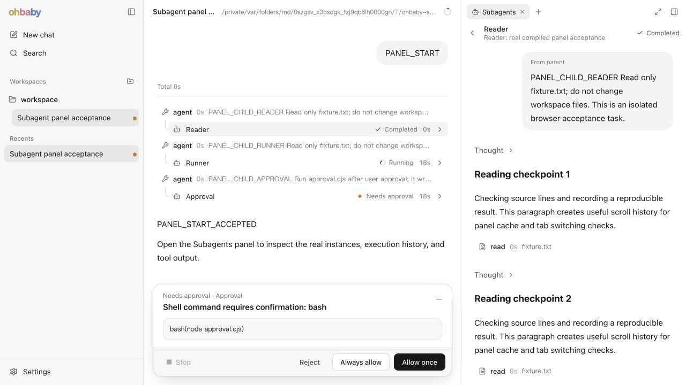
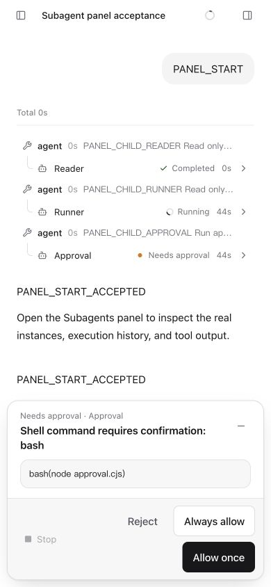

# 8. Claude 合并后优化复审

日期：2026-10-30。复审方：Codex。

**结论：主要流程和视觉调整通过，整轮复审暂不通过。** 新增的“发送即跟随”有两个 P2，均已在编译后的 Web 中复现；另确认了 07 已记录的后端中断提示排序问题。没有发现 P1。

## 范围与方法

- 固定对比：`def294b2...352971ed`，包含 `a989b727` 的实现和 `352971ed` 的验收记录。
- 18 个文件，只涉及 Web 和文档。本轮未修改产品代码，也未改写 Claude 的 05、07 或既有设计决策。
- Standards、Spec 两个独立子代理分别审查规范和需求；主代理运行全量检查，并操作实际编译的 Web。
- 对照 improve-4 的 02、04、07，以及 Web 设计文档 03 的 §4.3、§4.9。文档中的后续建议作为待核实事项，不自动视为扩大实施范围的授权。

## Standards

### R5 · P2：仅打开 slash 面板也会重置阅读位置

位置：`apps/ohbaby-web/src/ui/session/SessionScreen.tsx:231`。

`setFollowToken` 在 `submitText` 区分普通消息与 slash 命令之前执行。`/goal pause` 在没有 Goal 时只打开面板，仍触发 `ConversationStream` 清除阅读锚点、滚到底部并恢复跟随。

复现步骤：

1. 运行子代理场景，使主会话已有可滚动的历史。
2. 向上滚到顶部，在输入框填写 `/goal pause`，点击发送。
3. Goal 面板显示 `No goal to pause.`，没有新增用户消息，主消息区却跳到底部。

实测主消息区 `scrollTop` 从 **0 变为 514**，`scrollHeight=1190`、`clientHeight=676`。页面内用户消息数量前后都是 4。子代理的隔离探针也确认：当前实现滚动断言失败，只替换为基线的 `SessionScreen` 后通过。

最小修复：让跟随信号归属于真正的消息发送，打开 Goal、设置等面板的命令不触发。补一个“向上阅读 → slash 打开面板 → 位置不变”的回归用例，不引入新的滚动协调层。

依据：根 `CLAUDE.md` 的 KISS 原则；这是副作用触发范围过宽的正确性问题，不是格式或命名偏好。

[浏览器证据](evidence/codex-postmerge-slash-scroll.png)

## Spec

### R6 · P2：恢复区的 Resend 没有恢复跟随

位置：新增信号位于 `apps/ohbaby-web/src/ui/session/SessionScreen.tsx:231`；漏掉的调用路径位于 `apps/ohbaby-web/src/ui/composer/Composer.tsx:342`。

[Web 设计 03 §4.3](../../../ohbaby-web/redesign-2026-10/03-ui-layout-and-style.md) 要求：“用户发出新消息时，消息区回到底部跟随新内容，即使之前往上翻过或手动展开过折叠行。”

普通提交会递增 `followToken`，恢复区却直接调用 `client.resendSteerInput`，绕过了这条路径。重发确实产生新用户消息，但仍保留旧的非跟随状态。

复现步骤：

1. 在已有长历史的会话发送 `PANEL_FOREGROUND`，等待前台子代理运行。
2. 发送 `PANEL_FAIL` 将其排队，点击 `Steer queued prompt: PANEL_FAIL`。
3. 点击主会话 `Stop run`，生成未消费输入；展开 `1 input to review`。
4. 向上滚到顶部，再点击 `Resend steer 1: PANEL_FAIL`。
5. 后端接收重发并产生新的用户消息及回复，但视图仍停在顶部，看不到新内容。

实测 `PANEL_FAIL` 用户消息由 1 条变为 2 条。重发前后 `scrollTop` 都是 **0**；重发后 `scrollHeight=1767`、`clientHeight=676`，距底部 **1091 px**。该场景故意发送给不存在的子代理，返回的工具错误是预期结果，不影响验证“重发被接收且新增消息”。

最小修复：恢复区重发成功后，在仍属于当前会话的前提下触发与普通发送相同的跟随信号。复用现有状态即可；不要把队列编辑、重排或面板打开统一当成发送。补一个“向上阅读 → Resend 被接收 → 跟随新消息”的回归用例。

[浏览器证据](evidence/codex-postmerge-resend-scroll.png)

## 已有后端问题

### B5 · P2：中断提示排在原正文之前

此问题在 07 中已经记录，不属于本次 Claude 的 Web diff 新引入的问题。

本轮打开 Runner，发送一次 `tick`，在详情中点击 Stop。状态正确变为 `Interrupted`，流也停止，但展示顺序是：取消提示、Thought、`RUNNER_STREAM_ACTIVE`、原正文、`PANEL_STREAM_TICK_1`。停止主会话时也出现同样顺序。

代码路径吻合 07 的分析：`core/message/interruption.ts:59` 追加的事实没有 `metadata.sourceOrder`，`adapters/ui-state/source-session-projection.ts:629` 对缺失值按 0 排序，使它先于已有流式部件。`persistent-store` 有 `orderIndex` 回退，但随后的 source projection 仍会重新排序。

后续修复应在消息顺序约定内处理，不在 Web 中按文案识别和搬动提示。需要同时覆盖实时投影、刷新读取、主会话和子代理详情；还要考虑 reasoning 使用独立存储的情况，不能只看普通 text part 的顺序。

[中断提示证据](evidence/codex-postmerge-interruption.png)

## 端到端与视觉验收

本轮先完成 `pnpm test`、`pnpm typecheck`、`pnpm build`，再启动两个隔离场景。浏览器操作使用编译产物，Web、CLI、Host、SDK、SSE、SQLite 和工具均走实际实现；只有模型响应由本地 fixture 提供，没有消耗真实模型额度。

### 子代理场景

`node scripts/run-subagent-panel-e2e.mjs`：`backend-pass`、`cleanup-pass`、`verified: true`，退出码 0。实际执行了 26 次 Reader read、第二次 Reader 执行、审批 bash、UI Stop Runner、Close Reader、新会话 Other reader；额外检查了前台执行和恢复发送。

| 检查 | 实测结果 |
| --- | --- |
| 审批状态一致 | 主入口与列表均显示 `Needs approval`；Allow once 后转为 `Completed` |
| 主会话普通发送跟随 | 从上方阅读处发送 `PANEL_SEND_READER` 后到底部；测量误差约 0.5 px |
| 列表重开保留位置 | Reader 阅读位置为 1460 px，返回列表再打开仍为 1460 px |
| 同入口再次定位 | 再点第一次 Reader 入口后回到该执行锚点，位置约 20 px |
| 第二次 Reader 定位 | 新入口定位到第二次派遣；Load earlier messages 能加载前一次执行，保留第二次内容所在位置 |
| 流式更新与停止 | 实际显示 `PANEL_STREAM_TICK_1`；Stop 后详情与入口均变为 `Interrupted` |
| 关闭与刷新 | Reader 两条入口撤下；刷新后仍为 0 条，原 4 张 agent 工具卡保留，完整列表不含 Reader |
| 会话隔离 | 新会话只显示 Other reader，旧会话实例不混入 |
| 前台执行入口 | 父工具尚未结束时已出现 `Open Foreground in Subagents`；父运行停止后子执行也停止 |
| Slash 和 Resend | 分别复现 R5、R6，不能记为通过 |

场景结束时 `heldStreams=0`、`failures=[]`。daemon、监听端口和 provider 均已清理，临时数据目录已移除。

截图中重复出现的 `PANEL_START_ACCEPTED` 来自 fixture 在后续唤醒时再次返回相同固定文本（脚本第 377 行）；消息刷新和重复渲染另用下面的 E01–E05 检查。

### 编译 Web E01–E05

`node scripts/run-compiled-web-e2e.mjs` 本轮补跑通过：`E2E_UI_EVIDENCE_PASS`、`E2E_BACKEND_PASS`、`E2E_CLEANUP_PASS`、`E2E_DIAGNOSTICS_PASS`，退出码 0。

真实 read 返回 fixture 标记，工具卡 `phase=ended`、`outcome=success`。首轮与续聊回复刷新前后各 1 条，续聊用户消息刷新后 1 条，活动会话 URL 不变；页面和标题没有 runtime marker。后端核对 3 次请求的上下文键稳定、工具结果被模型请求消费。

[刷新后的页面](evidence/codex-postmerge-compiled-refresh.png)

### UI 结论

桌面 **1280 × 720**、窄屏 **390 × 844** 和 **320 × 740** 已实际查看并操作。390 px 下三个入口均无横向溢出；320 px 下 Approval 名称按可用空间省略，状态和时长仍可读，页面宽度没有超出视口。

当前留白、弱边界和少量状态色符合本轮“简约大气”的目标。建议保留这些改动，优先修复交互边界，无需为了品牌观感增加卡片、动画库或视觉层级。

| Before | After | Why |
| --- | --- | --- |
| 入口与工具卡像平级内容 | 缩进加 1 px 折角细线 | 主从关系更清楚，视觉重量低；保留 |
| 审批入口写 Running，列表写 Needs approval | 当前 execution 的入口同步显示琥珀点与 Needs approval | 同一事实使用同一反馈；保留 |
| 完成、失败、中断缺少共同的视觉位置 | 共用 StatusGlyph 和现有颜色 token | 扫读更稳定，没有引入整块状态底色；保留 |
| 历史按钮是浏览器默认灰框 | 居中的细描边胶囊 | 与现有工具行一致；实际点击加载正常，保留 |
| 普通发送不恢复跟随 | 新增发送信号 | 主路径有效，但 R5、R6 需要补齐触发边界 |

[历史按钮与第二次派遣](evidence/codex-postmerge-history.png)

“运行中入口随 Total 折叠”仍是 07 已列出的产品取舍，本轮不改变。未把 10 px spinner 与 12 px 静态图标的轻微尺寸差异列为 P2，也没有因此要求新增抽象。

## 自动检查与边界

| 检查 | 结果 |
| --- | --- |
| `pnpm test` | 642 个文件通过、6 个跳过；7525 项通过、17 项跳过，0 失败 |
| `pnpm typecheck` | 通过 |
| `pnpm build` | 通过，Web 资产已复制到 CLI dist |
| `pnpm lint` | 0 错误、109 个既有警告 |
| 子代理 Standards 聚焦测试 | DelegationRow、instance-status 共 14 项通过；另有 R5 隔离探针 |
| 子代理 Spec 聚焦测试 | App、DelegationRow、status 与恢复输入相关 9 项通过 |

测试通过不覆盖 R5、R6；现有用例缺少这两个边界。本轮没有把跳过的测试算作通过，也没有运行真实外部模型、深色模式或物理触摸设备验收。

Standards：1 项 P2，最严重为 R5。Spec：1 项 P2，最严重为 R6。B5 是已确认的既有后端问题，单独保留，不混入本次 diff 的新增缺陷计数。

## 修复记录（Claude，2026-10-30）

R5、R6 已修复，B5 仍然开着（后端消息排序，另行处理）。

**改法：** 跟随信号只在真正发出内容时触发，按 Codex 建议的最小修复做，没有新增滚动协调层。

- **R5：** 去掉 `SessionScreen` 里无条件的 `setFollowToken`。改为由 `usePromptSubmission` 在两个时机调用 `onSend`：发出普通消息之前，以及 slash 命令真正交给后端执行之前。只打开面板的命令（`openOverlayForSlashText` 返回 `true`）不触发。
- **R6：** `Composer` 新增 `onResendAccepted`。恢复区重发被接收、而且仍是当前会话时调用它，`SessionScreen` 把它接到同一个跟随信号上。重发失败，或者回执晚到、会话已经切换时，不触发。

**回归测试：** 两条新测试在旧代码上都失败，在新代码上都通过。

- `App.unit.test.tsx`："keeps the reading position when a slash command only opens a panel"。往上翻 → `/goal pause` 打开面板 → 位置不变，也没有发出消息。
- `Composer.unit.test.tsx`："reports only an accepted resend so the stream can follow it"。重发失败时不触发跟随，成功时触发一次。

**自动检查：**

- `pnpm typecheck` 通过。
- 改动文件 eslint 0 问题。
- Web 全部 70 个测试文件、835 项测试通过。
- `pnpm build` 通过。

**编译产物上的浏览器复验**（`run-subagent-panel-e2e.mjs`，1280 × 720）：

| 检查 | 修复前（Codex 实测） | 修复后 |
| --- | --- | --- |
| R5：顶部阅读时发 `/goal pause` | `scrollTop` 0 → 514 | 弹出 "No goal to pause." 面板，`scrollTop` 保持 0；用户消息数不变 |
| R6：顶部阅读时 Resend `PANEL_FAIL` | 停在顶部，距底部 1091 px | `PANEL_FAIL` 由 1 条变 2 条，视图跟到底部，距底部 0 px |
| 普通发送 `PANEL_SEND_READER` | 跟随 | 仍然跟随（`scrollTop` 425.5，正好在底部） |

390 × 844 窄屏下没有横向溢出（页面宽度 390 px）。这次复验只走了上面三段，用 `quit` 结束。所以脚本输出 `cleanup-pass`，但整套场景的 `verified` 为 false，完整场景断言没有重跑。

[R5 修复后](evidence/claude-r5-slash-keeps-position.jpg) · [R6 修复后](evidence/claude-r6-resend-follows.jpg)
