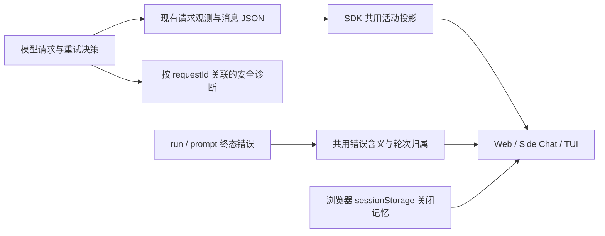

# 优化方案与改动面

本文是本轮实施契约，用户已授权先实施后端。行为约束来自 [00](00-discussion.md)，证据见 [01](01-problem-analysis-and-current-state.md)，验收见 [04](04-test-and-acceptance.md)。所有阶段属于同一轮 `improve-1`。

## 1. 总体选择

复用现有请求观测、消息 JSON、轮次投影和 Banner。补上“已安排重试”的事实，让实时事件和刷新快照都能推导连续的等待状态；统一安全错误原因，在所属轮次展示一次。详细诊断留在后端，关闭记忆留在浏览器。

daemon 连接另用现有连接与同步状态表达：短暂重连可以显示动效，持续断开改为静态提示，后台仍继续尝试。它不改变模型重试策略，也不产生对话内的模型错误。

| 选择                                    | 理由                                                 | 不采用的做法                                      |
| --------------------------------------- | ---------------------------------------------------- | ------------------------------------------------- |
| 重试安排随失败 attempt 首次结束一起保存 | 同时解决事件间隙和刷新恢复                           | 仅加内存标记；根据失败猜重试；延迟隐藏掩盖空档    |
| 提供商原因在共同底层归一化              | core 与 runtime 都可使用，含义一致                   | core 依赖 runtime；强行把所有错误对象改为一种类型 |
| 终态错误归属轮次                        | 失败提问与原因对应，旧错误不会顶住新输入             | 全局广播、只显示最新错误、到时间自动删除          |
| 关闭用 sessionStorage                   | 满足当前标签页刷新，不影响其他窗口或诊断             | 后端已读 API、跨设备同步                          |
| 连接提示有显示期限，后台重连继续        | 用户不必一直盯着无进展的动效，服务恢复后仍可自行连接 | 永久 Reconnecting；用超时断言 daemon 已停止       |

## 2. 后端事实与错误契约

### 2.1 一次保存请求结束与重试安排

在 `ModelRequestAttempt` 增加可选 `retryScheduled?: true`。含义只有一个：**该失败 attempt 结束时，后端已决定安排下一次尝试**。它不是当前运行状态，也不证明下一次请求已经发生。

沿现有 `onRequestObservation → lifecycle → messageManager` 写入 `modelRequests` JSON，并同步消息事件 schema、SDK 请求类型和投影。没有新表或 SQL 列迁移。退避时间和错误类别进入现有重试事件及诊断，不为界面另存倒计时。

必须保留以下顺序与不变量：

1. catch 中先按原规则同步计算是否安排重试及 delay；不改变重试资格和预算。
2. 将安排与 `request-ended` 一次封口、一次保存。已结束 attempt 仍不可补写；不要放宽 `applyMessagePatch / mergeModelRequests` 的终态规则。
3. `observer.flush()` 成功后才发布该观测及原 retry 事件，再等待下一次请求。持久化失败仍以 `ModelObservationError` 阻断，不能变成 provider 重试。
4. delay 只计算一次，事件、诊断与实际等待共用该值。
5. abort 先封口时保存 aborted，不附重试安排。error 已封口后才取消，则保留“曾安排重试”的历史，重新检查取消，不再启动下一请求。

原 `run.llm.retrying` 保留，表示同一次真实决定；活动展示已经能从结束事实得出，不再等这个稍后的事件补齐空白。诊断与重试策略仍归后端，前端不执行重试。

### 2.2 统一活动投影

扩展现有 `projectModelActivity`，所有读取路径共用，包括实时 adapter、持久 snapshot、source session projection，以及 legacy snapshot 的最终消息合并。继续使用现有 `UiRun.modelActivity`，以可选的 `phase: requesting | retrying` 和 `waitingStartedAt` 表达派生展示信息，不另建活动状态库。

请求本身的 `requestId / startedAt / endedAt / outcome / firstTextAt` 保留真实值。重试等待所关联的失败请求仍是 `outcome: error`，不能伪装成尚未结束的请求。

推导规则：

- 先限制为所属 session/run 的普通模型请求；摘要请求不参与。运行不再活动时清空等待。
- 先选当前最新 attempt，再判断其状态；不能先筛选所有旧 retry 记录而把过期安排重新找出来。
- 最新请求进行中：保留请求事实。若属于已经重试过的同一请求链，`phase` 继续是 retrying；收到本次模型进展后转回 requesting，运行终态时清空。请求刚发出不算恢复，避免文案来回切换。
- 最新请求已失败、带 `retryScheduled` 且没有后续请求：投影为 retrying。
- 最新请求成功、取消，或失败但没有重试安排：不往前恢复旧等待。
- `waitingStartedAt` 从同一请求链的首次请求开始计算，不叠加工具或审批时间。同一 assistant/step 中再次出现 attempt=1 代表新的请求链，不能跨压缩恢复把旧计时拼进来。
- 计时器到期不清理状态；下一次请求是否开始，以后端事实为准。run 终态是最终清理条件。

这里的“模型进展”只取 `latestRequest.messageId` 对应 assistant 消息的非空模型正文、reasoning 或可识别工具进展；不按整个 run 或仅按 step 扫描，也不取应用合成说明。当前 overflow 恢复会换新的 assistant message ID，不能把恢复前的内容算成新请求的进展。SDK 不读取 Thought 折叠、隐藏等客户端偏好，也不新增首进展时间指标。前端再按 §3.1 判断这些进展是否实际可见：例如只有被隐藏的 reasoning 时，请求已恢复，等待行继续显示普通 Thinking，而不是消失或一直写 Retrying。

消息和推理进展到达时，也要重算所属 run 的活动投影；派生活动发生变化才额外发布 run 更新，不为每个 token 重复写 run。实际运行入口使用 source projection，需补齐 `source-session-projection.commitReasoning` 的活动更新。`run-stream-adapter` 的消息投影在唯一生产入口被 `projectMessages: false` 关闭，本轮不增强这条旧路径。使用已有的最新消息/推理视图，不另建进展状态库或重复持久化 reasoning。

`ui-inprocess.readSnapshotWithPermission` 将 source 的当前 reasoning 覆盖进 sessions 后，也要用最终消息重算各 run 的活动；不能保留覆盖前的数据库投影。否则 legacy `getSnapshot` 仍会把已经恢复的 Thinking 改回 Retrying。

旧记录没有 `retryScheduled` 时不猜测历史重试。旧 snapshot 没有新增派生字段时，客户端按原有真实请求信息降级展示，不把缺失信息当作持续运行。

### 2.3 错误原因与公共字段

保留 `UiPromptError`，继续作为 prompt 和 ledger 的结构化错误。为 `UiRun` 增加可选 `error?: UiPromptError`，从已有 ledger `errorData` 投影，供无 prompt 但已有可见轮次的失败使用；不改变轮次可见性规则。实时和刷新路径均须投影这一字段。

| 字段                   | 本轮约束                                                             |
| ---------------------- | -------------------------------------------------------------------- |
| code / source          | 保留错误类型、来源；重试耗尽不抹掉下层原因。                         |
| message                | 后端生成安全说明；有限识别状态码和已知原因，不直接透传未知上游正文。 |
| providerId             | 能从本次请求确定时填真实值，未知就省略。                             |
| statusCode             | 从包装错误的 cause 正确提取；没有 HTTP 响应时不伪造。                |
| attempts               | 保持兼容，明确它是重试次数，5 次对应 6 次请求。                      |
| retryable              | 错误允许重试，不代表正在重试或可以自动重放部分输出。                 |
| terminalReason / limit | 沿用既有语义，不复制请求历史或推导字段。                             |

把 provider cause 解包与安全原因提取放在 `ohbaby-llm` 中两边可依赖的已有错误模块附近；runtime 再映射为 `UiPromptError`，core/lifecycle 再映射为现有 `MessageError`。保留 `MessageError` 的输出完整性、取消等判别类型，不改为依赖 SDK 的 UI 类型。

涉及 `providerFailure` 的合成说明也要使用同一原因。不要一处说“限流”，另一处又说“连接恢复后重试”。用户主动停止、工具局部失败、模型最终失败继续分别处理。

### 2.4 适量补诊断

通过现有请求观测/重试回调把安全失败摘要交给 agent 日志，按现有 request ID 关联 run、message、step、provider/model。现有回调尚无完整的逐次失败摘要，需要扩充可选、非持久的安全载荷；不能假定这些字段已存在，也不把诊断载荷加入公共消息快照。需要记录：失败类别、可用的 HTTP 状态、经过筛选的上游 code/type、是否安排重试及本次 delay。

不引入新的日志数据库或必填 diagnostics 大对象。沿用既有日志编码器：请求、run、消息、session、provider/model 用稳定指纹关联，有限错误类别及 code/type 保留安全标签；不为排障放宽原有日志脱敏规则。已有时间、用量、归属关系不复制到每个 error。禁止记录认证头、密钥、完整请求/响应、提示词或未经筛选的 error/cause 对象。供应商字段未知时省略；不要把简单截断误当脱敏。日志不可用不能改变请求结果；请求事实持久化失败则继续按现有可靠性规则阻断。

## 3. UI 行为

### 3.1 等待状态

| 当前阶段                                  | Web / Side Chat / TUI 的反馈                                             |
| ----------------------------------------- | ------------------------------------------------------------------------ |
| 发送、排队、启动准备                      | 复用原有提交和排队反馈，不声称模型已经开始思考。                         |
| 模型已请求，尚无可展示进展                | Web 沿用 Thinking；TUI 保留既有工作短句和轻量动效。                      |
| 自动重试等待或后续尝试仍无进展            | 同一行改为 `Retrying…`；不显示次数、倒计时、状态码或失败详情。           |
| 当前请求已有正文、可见 Thought 或工具进度 | 由对应内容承担反馈，不再叠加模型等待行。空白或被隐藏的内容不算可见进展。 |
| 审批、工具执行、等待子代理、压缩          | 由已有专属反馈承接，不挂通用 Thinking。                                  |
| 连接中断、刷新恢复                        | 按 §3.4 展示连接/恢复反馈；收到有效快照后再按后端事实展示活动。          |
| 成功、最终失败、停止                      | 结束等待动效，显示对应结果。                                             |

可见进展判断必须针对当前模型步骤，不能让上一条回答或上一个工具隐藏下一步等待。UI 的可见性判断不修改 `firstTextAt`，也不参与后端重试资格判断。

保留现有耗时样式；同一请求链不因 requestId 变化而归零。模型等待行不新增最短显示或延迟隐藏定时器；§3.4 的连接显示期限独立处理。等待行的图标占位稳定，减少动态效果时静态呈现；耗时不作为每秒重复播报的内容。修正编辑发送图标当前的 reduced-motion 例外即可，不重做动画系统。

### 3.2 错误出现、位置和消失

| 情况                    | 显示                                                     | 消失规则                                                      |
| ----------------------- | -------------------------------------------------------- | ------------------------------------------------------------- |
| 自动重试中              | 只更新等待文字                                           | 有效进展或运行终态后转换，不产生错误卡片。                    |
| 普通轮次最终失败        | 该轮内容末尾一张轻量 Banner；空回答也能依附原提问/轮次。 | 不自动超时；随历史滚动，手动关闭；Rewind 移除该轮时同步消失。 |
| 部分输出中断            | 保留部分回答，末尾说明中断及可重试。                     | 同上，不删除已有回答。                                        |
| 主动停止                | 现有简短停止结果，不使用 provider 错误卡。               | 随历史保留。                                                  |
| Fork、Edit 等操作被拒绝 | 沿用现有操作通知或编辑框内错误。                         | 沿用操作恢复/手动关闭规则，本轮不统一全部 notice 的 TTL。     |
| 页面暂时断线            | §3.4 的连接提示，不放到轮次错误卡。                      | 连接及同步恢复后清除；持续断开转静态，不反复弹新提示。        |

通过现有轮次投影，把最新错误选择扩为按轮次选择。主会话与 Side Chat 使用同一份纯选择/格式化逻辑和 Banner；TUI 在已有轮次结束行附近显示同一含义。数据源优先取该轮 prompt.error，其次 run.error，旧数据用已有安全说明兜底。

同一 run/prompt 的重复事件、快照和 message 错误不得产生多张卡片。移除主会话顶部对同一模型终态错误的重复展示；保留真正的操作/同步错误。对于应用自己生成的未完成说明，只按明确语义标记去重，不靠字符串匹配删除 AI 正文。

默认文案示例：

| 原因            | 英文文案                                                       |
| --------------- | -------------------------------------------------------------- |
| 429，请求受限   | Requests are temporarily limited. Please try again later.      |
| 认证失败        | Authentication failed. Check the model configuration.          |
| 连接失败 / 超时 | Could not reach the model. Check the connection and try again. |
| 流中断          | The response was interrupted. You can try again.               |
| 无法确定原因    | The response could not be completed. Please try again.         |

已明确识别的余额或参数配置错误使用对应安全原因，不能全部改成“稍后重试”。用户继续使用现有编辑重发、发送和模型选择入口；本轮不新增自动重跑整轮的按钮。恢复历史错误不抢焦点、不强制滚动、不重复作实时警报。

### 3.3 Web 关闭记忆

- 用浏览器 origin 内的 `sessionId + (runId ?? promptId)` 作为错误身份，放入独立命名的 sessionStorage 项；可复用现有容错读写方式，不混入 composer 草稿内容。
- 点击关闭只改变显示。关闭后当前标签页的会话切换、刷新及事件重放都不再显示同一错误；失败状态、后端错误和日志仍保留。
- 新轮次和 Fork 后的新会话使用不同身份，不继承关闭状态；主会话关闭也不影响 Side Chat。
- 不做 localStorage、后端已读字段或跨设备同步。sessionStorage 被禁用时退回本页内存，不能因此阻断输入；此时无法保证刷新记忆。
- TUI 不引入浏览器式关闭记忆或新快捷键，错误作为简短轮次结果保留。

### 3.4 daemon 连接：静态断开，后台继续重连

适用于已建立连接后的中断。复用 `ConnectionState`、当前 transport 的重连循环和已有 session sync；**10 秒从实际检测到断线开始计算，不按最后一条消息的时间计算，也不是进程退出的判据。**

| 状态                                     | 显示                                                           | 后台与操作                                                                     |
| ---------------------------------------- | -------------------------------------------------------------- | ------------------------------------------------------------------------------ |
| 刚检测到断线，尚不足约 10 秒             | `Reconnecting…`，轻量动效                                      | 沿现有退避继续连接；保留已加载历史和当前页草稿。                               |
| 连续断线达到约 10 秒                     | 静态 `Disconnected`，提供 `Reconnect`                          | 自动重连继续；每次自动尝试都保持静态，手动操作只唤醒同一个循环。               |
| Web 收到明确的认证拒绝或事件连接注册失效 | 静态 `Connection expired. Refresh to reconnect.`               | 停止旧凭据或旧注册的无效循环；不自动刷新页面，不承诺刷新一定解决所有配置问题。 |
| transport 已恢复，会话数据尚未就绪       | 维持本次连接提示，不新增 `Syncing…` 文案；期限已过继续静态显示 | 等待当前会话、当前连接代次的有效基线和操作就绪条件；不能只凭 hello 恢复发送。  |
| 会话同步进入既有 error 状态              | 静态同步失败说明和现有重试入口                                 | 不继续转圈，不把同步失败误写成 daemon 已退出。                                 |
| 连接及当前会话恢复就绪                   | 清除连接提示                                                   | 恢复可用操作；根据新状态展示运行结果。                                         |

实现约束：

1. **期限归连接所有者管理。** Web 在现有连接生命周期中记录连续失联起点，复用 store 发布展示状态，不在各展示组件另设计时器。主会话和 Side Chat 沿用各自连接 owner，复用规则而不合并客户端。重复失败、自动重试和短暂 hello 都不能重新开始 10 秒；当前恢复周期就绪才清除，没有选中会话时沿用现有连接初始化就绪条件。关闭连接或切换连接代次时清理旧计时器，迟到回调不能改写新连接。已经静态断开的周期即使进入同步也不重启动画；再次掉线时直接恢复静态 Disconnected。
2. **保留自动重连能力。** 进入静态 disconnected 不能调用 dispose，也不能让已有连接 owner 被销毁。后台沿现有退避运行，不增加“显示多久就停止重试”的预算。手动 Reconnect 不新开并行 SSE，不自动刷新整页，不重发 prompt。初次页面加载失败沿用现有启动错误和重试入口，本条不改造整个 bootstrap。
3. **区分明确拒绝与暂时不可达。** Web SSE 保留结构化 HTTP 状态，复用现有 `DaemonRequestError` 的语义，不解析错误字符串。当前认证拒绝是 401，`/v1/events` 的 409 明确表示客户端未注册；这两种情况静态提示刷新，不新增自动换凭据或重新注册流程。不能把其他接口的 409、所有 403、网络错误或解析错误都视为连接失效。失败原因留在客户端连接状态/诊断中，不写入 `UiPromptError`、run ledger 或新的后端表。daemon 已退出时不能依赖它继续记录诊断。
4. **Web 等待建立连接不能无限挂起。** 仅对 Web 重连尝试的连接建立及等待 hello 增加可取消的 10 秒期限，复用当前循环继续退避；收到有效 hello 即撤销该尝试期限。尝试超时只取消本次 fetch/reader，之后必须继续下一次尝试；在取消路径中，只有连接 owner 关闭才退出整个循环，不能沿用“任何 AbortError 都退出”的判断。它与界面连续失联期限分别管理，不能在 10 秒后截断已经正常运行的 SSE，更不能把安静的长连接或长时间思考当作断线。本轮不新增心跳或进程探测系统。
5. **统一显示，保留草稿。** MainHeader、SideChatPage 和 composer 根据同一连接含义派生文字与动效；侧聊不再把所有异常写成 Reconnecting，输入框在持续断开时使用 `Draft while disconnected…`。不为每次失败新增 toast 或错误卡，不清空已加载内容。普通重连保留现有草稿 owner；认证提示也不强制重载。现有 Side Chat 草稿仅存于内存，本条不承诺用户整页刷新后仍保留它。
6. **旧运行状态不代表当前进展。** 断线或会话恢复未就绪时，暂时屏蔽缓存快照驱动的模型等待动效和可变耗时；保留已收到的正文。不据此修改后端 run 终态，也不把断线当作模型失败。发送、停止、审批等服务操作继续受各自现有就绪条件约束；结果未知的提交通过原有回执恢复，不自动重发。
7. **TUI 沿用自身 transport。** daemon 模式复用 `runSseReconnectLoop → session.resync-required → session-recovery`，在同一个恢复状态所有者记录断线起点，将超过期限的标签改为静态 Disconnected，并屏蔽旧模型 spinner。保留现有 1/2/5/10/30 秒重连退避和错误处理，不另建一套 Web 重连循环或更改进程内独立 TUI。Web 的刷新认证入口不搬成 TUI 命令。

10 秒是内部显示规则，不新增用户配置。客户端保存的最后失败原因只用于安全提示和诊断；默认界面不显示重连次数、倒计时或 HTTP 状态码。

## 4. 实施阶段与文件级范围

| 阶段              | 目标与主要改动面                                                                                                                                                                                                                                                                                                                    | 完成条件                                                                                                 |
| ----------------- | ----------------------------------------------------------------------------------------------------------------------------------------------------------------------------------------------------------------------------------------------------------------------------------------------------------------------------------- | -------------------------------------------------------------------------------------------------------- |
| S1 事实与投影     | `ohbaby-llm/src/client/{types,streaming,request-observation}.ts`；agent `core/lifecycle`、`core/message/{types,events}.ts`；SDK `contract/{execution,snapshot}.ts`；agent 活动读取路径和 `ui-inprocess.ts` 最终快照合并                                                                                                             | 重试安排随终态事实一次保存；实时、刷新、source 和 legacy snapshot 一致；取消及持久化错误优先级不变。     |
| S2 错误含义       | LLM 安全错误提取；agent `runtime/run-manager/error-detail.ts`、`core/lifecycle/lifecycle.ts`、ledger/UI 投影及既有诊断落点                                                                                                                                                                                                          | 原因一致、必要字段保留、详细信息不泄露到默认 UI。                                                        |
| S3 客户端反馈     | Web `conversation/ExecutionProgress.tsx`、`run-process.ts`、`session/prompt-projection.ts`、`SessionScreen.tsx`、`SideChatPage.tsx`、共享 Banner 与关闭记忆；daemon `events.ts / client-sync.ts`、连接状态选择、MainHeader 与 composer；TUI `working-spinner.tsx`、transcript 投影、`prompt-completion.tsx` 和现有 session recovery | 模型等待连续；每轮一份错误；侧聊隔离；关闭后刷新保持；持续断线静态显示且后台重连；恢复就绪后再开放操作。 |
| S4 验证与文档同步 | 对应现有测试；直接命令/浏览器/TUI 走查；同步有效模块文档                                                                                                                                                                                                                                                                            | 04 的关键组通过，子代理审查无未解决阻断项，05 如实记录验收范围。                                         |

需要同步的有效文档：`docs/core/llm-client/data-model.md` 的请求观测、`docs/core/message/data-model.md` 的请求记录与错误、Web 当前交互状态文档，以及旧 TUI spinner 文档的适用性说明。历史 problem-list 的 02/05 不回写成新的通过结论。

### 4.1 关键改动清单

用户已要求附精简清单。以下只列承重入口；行号取自规划基线 `30965c23`，定位以文件和符号为准。清单不记录实施进度，实施和验收时不回写勾选状态。

| 阶段 | 关键文件与符号（行号快照）                                                                                                                                                                                                                                                                                                                                                         | 改动目的                                                                           |
| ---- | ---------------------------------------------------------------------------------------------------------------------------------------------------------------------------------------------------------------------------------------------------------------------------------------------------------------------------------------------------------------------------------- | ---------------------------------------------------------------------------------- |
| S1   | [streaming.ts](../../../../packages/ohbaby-llm/src/client/streaming.ts) `streamResponse` 的 catch（L730）；[request-observation.ts](../../../../packages/ohbaby-llm/src/client/request-observation.ts) `RequestAttemptObserver.end`（L100）                                                                                                                                        | 在首次封口时保存重试安排，保留持久化失败和取消的优先级。                           |
| S1   | [execution.ts](../../../../packages/ohbaby-sdk/src/contract/execution.ts) `projectModelActivity`（L51）                                                                                                                                                                                                                                                                            | 共用当前请求链的阶段与等待起点推导，避免旧重试复活。                               |
| S1   | [source-session-projection.ts](../../../../packages/ohbaby-agent/src/adapters/ui-state/source-session-projection.ts) `visibleRuns` / `commitReasoning`（L657 / L381）                                                                                                                                                                                                              | 请求与推理进展都能触发活动更新，实时展示不依赖下一次请求或刷新。                   |
| S1   | [persistent-store.ts](../../../../packages/ohbaby-agent/src/adapters/ui-state/persistent-store.ts) `readSnapshot`（L576）；[ui-inprocess.ts](../../../../packages/ohbaby-agent/src/adapters/ui-inprocess.ts) `readSnapshotWithPermission`（L2575）                                                                                                                                 | 持久快照及覆盖当前 reasoning 后的最终快照，均按最新消息重算活动。                  |
| S2   | [error-detail.ts](../../../../packages/ohbaby-agent/src/runtime/run-manager/error-detail.ts) `providerMessage` / `normalizeRunError`（L89 / L130）；[lifecycle.ts](../../../../packages/ohbaby-agent/src/core/lifecycle/lifecycle.ts) `providerFailure` / `markAssistantMessageError`（L117 / L318）                                                                               | 两处改用 LLM 层共用的安全原因提取，保留包装错误底层原因，避免文案分叉。            |
| S2   | [snapshot.ts](../../../../packages/ohbaby-sdk/src/contract/snapshot.ts) `UiRun`（L112）；[persistent-store.ts](../../../../packages/ohbaby-agent/src/adapters/ui-state/persistent-store.ts) `runToUiRun`（L341）                                                                                                                                                                   | 从已有 ledger 暴露可选结构化错误，覆盖无 prompt 的可见轮次。                       |
| S3   | [ExecutionProgress.tsx](../../../../apps/ohbaby-web/src/ui/conversation/ExecutionProgress.tsx) `ModelWaiting`（L7）；[working-spinner.tsx](../../../../packages/ohbaby-cli/src/tui/components/working-spinner.tsx) `WorkingSpinner`（L18）                                                                                                                                         | 保持同一请求链的状态行和计时，用当前步骤的可见进展接替等待。                       |
| S3   | [prompt-projection.ts](../../../../apps/ohbaby-web/src/ui/session/prompt-projection.ts) `selectPersistedPromptError`（L210）；[run-process.ts](../../../../apps/ohbaby-web/src/ui/conversation/run-process.ts) `projectRunProcesses`（L36）；[prompt-completion.tsx](../../../../packages/ohbaby-cli/src/tui/components/transcript/prompt-completion.tsx) `PromptCompletion`（L7） | 将最新错误选择扩为按轮次选择，Web、Side Chat 和 TUI 共用错误含义，每轮只展示一次。 |
| S3   | [draft-storage.ts](../../../../apps/ohbaby-web/src/ui/composer/draft-storage.ts) `readSessionValue` / `writeSessionValue`（L34 / L43，复用入口）                                                                                                                                                                                                                                   | 复用容错存储方式，新增独立命名的错误关闭记忆，不混入草稿或改后端记录。             |
| S3   | [events.ts](../../../../apps/ohbaby-web/src/api/daemon/events.ts) `runLoop` / `openOnce`（L160 / L200）；[client-sync.ts](../../../../apps/ohbaby-web/src/api/daemon/client-sync.ts) `doConnect`（L179）                                                                                                                                                                           | 分开显示期限和后台循环，保留安全失败分类、取消与恢复代次；认证失效停止无效尝试。   |
| S3   | [selectors.ts](../../../../apps/ohbaby-web/src/ui/session/selectors.ts) `selectViewModel`（L61）；[MainHeader.tsx](../../../../apps/ohbaby-web/src/ui/shell/MainHeader.tsx) `MainHeader`（L27）；[session-recovery.ts](../../../../packages/ohbaby-cli/src/tui/session-recovery.ts) `receive`（L461）                                                                              | 统一静态断开与同步反馈；侧聊、composer、TUI app 复用状态，屏蔽断线时旧模型动效。   |
| S4   | [LLM 数据模型](../../../core/llm-client/data-model.md)“请求尝试观测”（L50）；[消息数据模型](../../../core/message/data-model.md)“AssistantMessage / MessageError”（L84 / L130）                                                                                                                                                                                                    | 同步新增请求事实、错误归一化及兼容边界，保持有效模块文档与实现一致。               |

连带项按前文契约同步：请求类型和 `RequestRecordSchema`、安全诊断回调、主会话与 Side Chat 的共享 Banner 接入、减少动态效果样式及有效交互文档。具体测试复用 04 列出的入口，不另列全量文件表。

### 4.2 Codex / Claude 分工与交接

用户指定 Codex 做后端、Claude 做前端。给 Claude 的简短交接见 [frontend-goal-duty](frontend-goal-duty.md)，以目标和职责为主，不要求把后端字段逐项显示。以下是按当前方案划分的具体职责；不扩大功能范围。前端包含 Web 和 TUI，浏览器内部的 API 客户端也归前端负责。

| 负责人                 | 范围                                                           | 交付内容                                                                                                                                            |
| ---------------------- | -------------------------------------------------------------- | --------------------------------------------------------------------------------------------------------------------------------------------------- |
| Codex                  | `packages/ohbaby-llm/`、`packages/ohbaby-agent/`，对应 S1 / S2 | 重试安排首次封口、消息持久化与恢复、各活动投影入口、错误原因归一化和安全诊断。                                                                      |
| Codex                  | `packages/ohbaby-sdk/` 的共享契约与纯投影/选择逻辑             | 请求与活动字段、`UiRun.error`、轮次错误选择所需的共用逻辑及兼容测试；保持 SDK 单一维护责任。                                                        |
| Codex                  | 服务端协议核验、后端测试与模块文档                             | 验证既有事件和 HTTP 状态可供对接。当前方案无需新增 daemon 心跳、注册恢复接口或改造远程 TUI 的重连循环；如发现服务端缺口，由 Codex 处理。            |
| Claude                 | `apps/ohbaby-web/` 全部相关改动，对应 S3                       | 模型等待、轮次错误、关闭记忆、主会话/Side Chat 对齐、视觉与减少动态效果；包括 `api/daemon/events.ts`、`client-sync.ts` 的浏览器重连与超时逻辑。     |
| Claude                 | `packages/ohbaby-cli/src/tui/` 相关改动                        | TUI 等待和终态说明、daemon 断线显示期限、恢复就绪与旧 spinner 屏蔽，以及客户端测试。                                                                |
| 各自验证，最终联合验收 | S4 与 04                                                       | Codex 先验收后端事实和接口；Claude 验收客户端行为；前后端接通后由 Codex 复核真实端到端链路和视觉结果。各自更新对应模块文档，完整验收后统一记录 05。 |

先稳定的对接约定：

- `retryScheduled?: true` 是已结束请求的历史安排事实，不是让前端重发请求的指令。
- `modelActivity.phase` 和 `waitingStartedAt` 由共用投影提供。retrying 期间关联请求可以已有 `endedAt` 且 `outcome: error`；前端不能再用“只有未结束请求才显示等待”的旧条件屏蔽它。
- `UiRun.error?: UiPromptError` 与已有 `prompt.error` 使用相同含义；按所属轮次取值、去重所需的共用逻辑由 Codex 提供。Claude 负责展示位置、默认文案呈现和关闭记忆。
- 后端判断是否有模型输出进展，客户端判断这些内容在当前界面是否可见。Thought 折叠/隐藏、动画和 10 秒连接提示期限由 Claude 处理，不写入后端运行事实。

建议交接顺序：Codex 先完成 S1 的共享字段和投影，连同测试分批提交，再完成 S2 错误和诊断；Claude 可以先做不依赖新字段的连接反馈，模型等待与错误卡片按对应提交接入。完整 E2E 在两端接通后运行，不能用后端测试代替客户端验收。

如双方共用当前工作目录，协作期间保持同一检出分支，按上述文件归属编辑和分批提交，不同时切换分支。共享 SDK 的变更通过 Codex 收口，避免两套定义；不使用 worktree。本节是职责和交接约定，不记录进度。

## 5. 兼容、风险与回滚

- 新事实、派生字段和 `UiRun.error` 均为可选字段，继续使用现有 JSON。旧数据可读，不回填虚构的重试安排。
- 请求指标含义、复制历史、Rewind 过滤和模型输入投影不变。新观测字段不进入模型上下文；Fork 复制的历史 retry 安排不能在新会话成为活动状态。
- 新客户端对旧服务缺少字段时保守降级；完整修复需要配套版本。旧客户端仍可读原请求字段，不承诺它获得新的重试反馈。
- 回滚代码不删除已有错误历史或清库；旧程序忽略新增可选信息。若实现中引入了严格拒绝未知字段的变更，必须先补兼容验证，不能仅凭“JSON 可扩展”宣称安全。
- 主要风险是事件顺序、取消竞态、错误重复呈现、会话归属及断线状态误判；对应 04 的 T1～T5、T7。

## 6. 不在本轮

不改模型重试次数、退避算法、工具执行授权、摘要/overflow 专用恢复、部分输出后的重放策略；不复制参考项目的事件日志架构、无限模型重试或复杂恢复系统；不接通全部 `notice.emitted`、重做全局通知去重或新增错误详情弹窗。关闭状态不扩展到后端或其他设备。连接反馈不新增 daemon 心跳、进程探测、自动凭据刷新、自动重新注册或跨客户端重连框架。

以上选择覆盖 00 的 D1～D13。没有预开下一轮；如实施发现独立的新问题，先记录事实，再单独讨论范围。

2026-11-11 审查补充：运行时错误映射先保留 `ModelObservationError`、`ToolDeliveryError` 的内部归属，不能因其 cause 带 HTTP 状态或网络码而改成 provider 错误。继续使用既有 `RUNTIME_ERROR` 和 terminalReason，不增加错误框架。用户检查前保持未提交。

Pi 审查后的边界补充：适配器的本地请求构造/校验失败保留明确类型，不包装成未知 provider 错误；上游未知错误仍只给安全说明。明确的保存失败终态使用 lifecycle 摘要，状态与轮次错误文字一致；不新增重试或错误框架。

诊断收窄：经用户确认，不再提取或记录供应商请求编号，只用本地请求、run、session 等关联。错误提取只保留一个总 try/catch；已识别的畸形 provider 对象降级为固定通用说明，不再逐字段抢救精确分类。循环 cause 和深度上限仍保留。重试控制流、持久请求事实及 SDK 前端契约不变。
