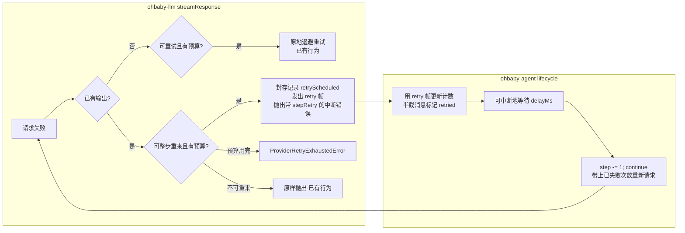

# 2. 优化方案与改动面

> 本文是交给后续开发会话的实施契约。规划会话不据此写代码。开发按本文实施，按 [04](./04-test-and-acceptance.md) 自测，结果写入 05。

## 2.1 方案总览

重试的判断全部留在 LLM 层，lifecycle 只负责执行。LLM 层在封存请求记录**之前**决定这次失败能不能重来、是第几次、要等多久，并把决定写进请求记录和抛出的错误里。lifecycle 收到“可以整步重来”的错误后，把半截消息标为“已被重试取代”，等待，再把这一步重新跑一遍。

主会话、子代理和 Side Chat 都走 `lifecycle.run`，改一处，三边同时生效。

## 2.2 设计决策表

| 决策项 | 选择 | 理由 | 放弃的选项 | 代价 |
| --- | --- | --- | --- | --- |
| 谁决定重试 | LLM 层的 `streamResponse` | 预算、编号、延迟都在这里，只有一个决策点；还能在封存请求记录前写入 `retryScheduled`，后端可以保留可追溯的请求事实（01 §1.3.3） | lifecycle 自己计数、自己算延迟 | `streamResponse` 多一个入参和一个错误字段 |
| 谁会用到整步重来 | 只有传入 `priorFailedAttempts` 的调用方，也就是 lifecycle | `streamResponse` 还有摘要（`prompt-context.ts` L83）和标题生成（`title-generator.ts` L124）两个调用方。它们不会执行重来，不能替它们做“可以重来”的决定 | 对所有调用方默认开启 | lifecycle 每次调用都要传这个值，第一次传 0 |
| 谁执行重来 | lifecycle 的步骤循环 | 只有 lifecycle 能换消息、重新准备上下文。复用 `step -= 1; continue` 先例（01 §1.4.1） | LLM 层在流内部重放 | lifecycle 多一个分支 |
| 半截输出（方案 A） | 失败消息的错误加 `retried: true`，投影时整条剔除 | 复用“错误名决定投影”的机制（01 §1.4.2），不新建排除机制；保留已完成历史作为可复用前缀 | 借用 `time.compacted`；新增错误名 | 消息错误类型多一个可选字段 |
| 预算 | 每步共用 5 次临时故障重试，压缩恢复单独保留一次 | 一个临时故障计数，压缩前后连续 | 为每类临时错误单独计数 | lifecycle 需要保留已经安排的重试次数 |
| 预算用完 | 抛 `ProviderRetryExhaustedError` | 与开始输出前用完预算的结局一致，`terminalReason` 为 `provider_retry_exhausted` | 继续沿用 `provider_stream_interrupted` | 无 |
| 流内错误的资格 | 已知网络故障、EOF、空闲超时、限流、过载和明确的服务端错误 | 三种协议复用同一判定，未知错误保留安全诊断 | 未知错误默认重试 | 新遇到的临时错误需凭证据扩展 |
| 缺终止事件 | 各协议都报成同一种 `eof` 中断 | 现在三种协议有三种写法（01 §1.3.2）。Anthropic 在 `message_delta` 时就已经给出结束原因，不能只靠 `streaming.ts` 的 `finishReason === null` 判定 | 各协议各自抛普通错误 | providers 下新增一个很小的错误类 |
| 子代理失败提示 | 结果正文加一行提示 | 成本最低，主代理有了可靠的补救线索 | 自动续跑 | 不保证主代理一定会照做 |

## 2.3 分阶段实施

四个 Stage 都属于 improve-1。Stage 1 可以单独合入。Stage 2 和 Stage 3 一起交付，确保有调用方执行 `stepRetry` 决定。

### Stage 1：流内错误与缺终止事件（ohbaby-llm）

目标是让已知临时故障进入统一判断，并保留足够的安全诊断信息。尚无有效输出时复用 LLM 层的原地重试。

1. **识别真实网络断流。** 在共享流错误路径沿 `cause` 链检查既有 SDK 类型和已知临时网络码，纳入已复现的 `UND_ERR_SOCKET`。复用现有受限的 cause 遍历和诊断字段，按明确的网络证据分类。现有安全网络码集合还包括 TLS 和代理配置错误，不能整表作为重试名单。
2. **保留流内错误的结构。** 使用 SDK 错误的状态、上游 `code` 和 `type`。Responses 的 `response.failed` 保留 `response.error`，适配器自己的 `error` 分支也保留结构。两者属于明确的失败事件。缺错误体或类型未知时按未知上游错误结束，保留可用的安全诊断。缺终止事件单独走 EOF。
   - 只放行已知的临时错误。复用已有 HTTP、SDK 和网络错误判定，用少量已知上游码或类型补齐流内限流、过载和服务端故障。已知拒绝原因和上下文超长优先判断。普通异常即使带 `code` 或 `type`，也需要已知网络证据或明确的上游错误来源。
   - 资格判定与给用户的错误归一化分开，避免 `provider-error.ts` 和重试函数互相调用。诊断沿用已有安全的上游码、类型、网络码和请求标识，可用时补充固定原因，例如 `stream_eof`。未知错误保留分类和可用字段，日志不复制原始上游消息。
3. **缺终止事件统一报 EOF。** 用一个小的共享协议错误类型，例如 `ProviderStreamEofError`，由 client 转成 `ProviderStreamInterruptedError(…, "eof")`。
   - OpenAI Responses 在没有终止事件就读到 EOF 时上报。OpenAI 兼容在缺少终止信号时由共享层判断，`ChatNativeAccumulator.finalize` 里已知的“原生推理流未结束”也用同一种 EOF。
   - Anthropic 在 `finalize` 里先检查是否收到 `message_stop`，再处理无内容块的情况。有 `stop_reason` 且缺 `message_stop` 时同样报 EOF。已经收到终止事件的协议校验错误继续按协议错误处理。
   - 在 `streaming.ts` L762 附近让 `eof` 进入有无有效输出的判断，`protocol` 和 `provider_abort` 仍直接结束。L780–785 的模型步骤分流只看已交付的正文、推理和工具片段，不把暂收到的 `finishReason`、`rawFinishReason` 或用量统计算作输出。无输出 EOF 走原地重试，有输出 EOF 交给 Stage 2。
4. **按请求用途使用新规则。** 扩展后的重试资格和 EOF 分流只用于 `purpose: "agent-step"`。摘要继续使用 `maxRetriesPerStep: 0` 和现有的 `ContextManager` 判定。保留原有 `isRetryableProviderError` 和摘要的 transport 分支，新增的嵌套网络码、EOF 及流内错误识别只在模型步骤路径参与重试决策。适配器可以保留新的诊断字段。如果错误转换会改变摘要对 transport 或上下文超长的判断，沿用摘要原有的错误分支，复用现有 `purpose` 区分。标题生成继续使用现有重试路径。

Stage 1 验证 T1–T4、T16 和 T20 的错误分类与无输出重试，并按 T17 检查摘要。T16、T20 的输出后重来在 Stage 3 验证。

### Stage 2：开始输出后的整步重来决策（ohbaby-llm）

目标：LLM 层能判断“这一步可以整个重来”，并把决定写进请求记录和错误。

1. **接收已失败次数。** `streamResponse` 的选项新增 `priorFailedAttempts?: number`。`failedAttempts`（`streaming.ts` L374）从这个值开始计数，同一条临时故障重试链的 `attempt`（L414）编号接着往下数，预算也共用。压缩恢复有独立请求 ID，保留临时故障计数。
   - **只有传了这个值，才会启用整步重来。** 不传时（摘要、标题生成），开始输出后的失败保持现状，原样抛出。lifecycle 每次都传，第一次传 0。
2. **开始输出后的分流**（`streaming.ts` L779–794，以及 Stage 1 改过的 L762 `eof` 分支）。满足以下全部条件时，算作“可以整步重来”：
   - 这是 `agent-step` 请求，调用方传了 `priorFailedAttempts`；
   - 已向调用方交付正文、推理或工具片段；
   - 原因是网络断开（`streamFailureSource` 为 `transport`）、缺终止事件（`eof`）、空闲超时（`ProviderStreamIdleTimeoutError`），或者按 Stage 1 规则可重试的流内错误；
   - 不是协议校验失败、`ToolCallParseError`、provider 自报中止、上下文超长，也不是本地取消。

   处理方式：

   | 情况 | 处理 |
   | --- | --- |
   | 可以整步重来，且 `failedAttempts + 1 <= maxRetriesPerStep` | `failedAttempts += 1`，用 `nextRetryDelayMs` 算出 `delayMs`。沿用 `onRequestObservation` 封存请求，记录 `retryScheduled: true` 和失败观测中的 `retryDelayMs`。接着发出已有的 `retry` 帧，再抛出带 `stepRetry: { delayMs }` 的 `ProviderStreamInterruptedError`，由 lifecycle 等待 |
   | 可以整步重来，但预算已用完 | 抛 `ProviderRetryExhaustedError`，`cause` 保留带来源的中断包装，其下再保留原始错误 |
   | 不可以整步重来 | 保持现状 |

3. `retry` 帧里的 `attempt` 是这一步累计安排的临时故障重试次数，也是 lifecycle 更新计数的唯一来源。请求记录中的 `attempt` 表示当前请求的尝试编号。错误上的 `stepRetry` 只携带 `delayMs`。

完成定义：04 的 T5–T7、T17 通过。

### Stage 3：lifecycle 执行整步重来与方案 A（ohbaby-agent）

主会话、子代理和 Side Chat 遇到可重试的流中断后，后端重新请求当前步骤。被取代的半截输出保存在原消息中，模型投影排除该次尝试。

1. **标记半截消息。** `core/lifecycle/lifecycle.ts` 的 `markAssistantMessageError`（L328–389）：
   - 错误带 `stepRetry` 时，不论来源，一律记为 `{ name: "MessageStreamInterruptedError", retried: true }`，保留正文部件和已有的后端中断事实。
   - 预算耗尽时，运行结局保留 `provider_retry_exhausted`。只有最后一次确实发生流中断且已有正文时，才按内层中断标记消息，保留正文并在后续模型历史附上中断说明。无正文的耗尽错误沿用普通失败投影，避免在历史里凭空多出一条中断说明。推理的结束状态按实际中断原因记录。
2. **消息类型。** `core/message/types.ts` L99 的 `MessageStreamInterruptedError` 增加可选字段 `retried?: true`，并同步到 `core/message/events.ts` L19 的 schema。这里用的是 `z.object`，没声明的字段会被悄悄丢掉，所以 schema 必须同时改。SDK 里没有这个类型的副本，不用改。
3. **投影剔除。** `core/context/failed-history.ts` 的 `selectFailedHistoryText`：`MessageStreamInterruptedError` 且 `retried === true` 时返回 `undefined`。摘要的序列化路径（`context-manager.ts` L1628、L1731 → `serializer.ts` L57）也调用这个函数，所以行为一致；实施时确认这一点。
4. **执行重来。** `runTurn` 的两处 `runModelStep` catch（L707 附近的普通步骤，以及 L826 附近的强制压缩重试）共用一个小函数：
   - 错误是带 `stepRetry` 的中断错误时，用可中断的等待 `setTimeout(delayMs, undefined, { signal })`（`node:timers/promises`，同 `context-manager.ts` L1047 的写法）。
   - 等待中被取消：走已有的取消结局，不再请求。
   - `runTurn` 持有这一逻辑步骤的累计计数。两处 `runModelStep` 都将当前值传作 `priorFailedAttempts`，并通过同一个更新回调同步计数。`runModelStep` 在收到 `response.retry` 时，用帧里的 `attempt` 更新计数，再发出已有的 `llm:retrying`。这样内部重试之后即使直接抛出上下文超长或输入快照变化，也保留已用预算。
   - 等待结束后检查取消，再回到当前步骤入口。只在进入下一逻辑步骤时清零，输入快照变化和强制压缩共享当前值。每步允许首次请求与最多 5 次临时故障重试，触发一次现有强制压缩恢复时可额外发一次步骤请求。
   - 重跑复用 `beforeStep` 和 `prepareTurn`，沿用现有的待处理输入准入和成功确认。新请求使用当前历史和已完成的工具结果。

完成标准见 04 的 T8–T13、T16、T18–T22。

### Stage 4：子代理失败提示与文档同步

1. **失败提示。** `agents/subagents/result-artifacts.ts` 生成结果正文时，如果 `status === "failed"` 且能查到实例、实例没有关闭，加一行英文提示，大意为：这个子代理实例仍然开着，历史和已完成的工具结果都还在，可以给它发后续任务让它接着做。
   - 是否关闭，在 `deliveryIdentity`（约 L48–53）里判断。`readDeliveryContext`（`adapters/ui-runtime/composition.ts` L387–395）现在只返回 `name` 和 `unprocessedMessageCount`，返回实例是否存在且开放的布尔值。
   - 只对 `failed` 加提示，`timed_out` 不加。D8 针对的是临时故障；超时说明这次任务已经用完了时间预算，要不要接着做由主代理按任务自己判断。
   - 不统计工具调用次数。
2. **文档同步**：见 2.5。

完成定义：04 的 T15 通过；2.5 列出的文档都已更新。

## 2.4 按包与目录的改动面

| 包 / 目录 | 新增 | 修改 | 删除 | 说明 |
| --- | --- | --- | --- | --- |
| `packages/ohbaby-llm/src/client/` | — | `streaming.ts`（组合判断、`eof` 分流、整步重来决定；选项类型写在函数签名里，约 L323）、`retry.ts`（`stepRetry` 字段、`retryReason` 取 `type`）、`provider-error.ts`（已知临时错误码和类型；`invalid_prompt` 等终态码的分类与安全诊断） | — | Stage 1、2 |
| `packages/ohbaby-llm/src/providers/` | `ProviderStreamEofError`（可以放进已有文件，也可以单独一个小文件） | `openai-responses-stream.ts`、`openai-compatible.ts`、`anthropic.ts` | — | Stage 1 |
| `packages/ohbaby-agent/src/core/lifecycle/` | — | `lifecycle.ts` | — | Stage 3 |
| `packages/ohbaby-agent/src/core/message/` | — | `types.ts`、`events.ts` | — | Stage 3 |
| `packages/ohbaby-agent/src/core/context/` | — | `failed-history.ts` | — | Stage 3 |
| `packages/ohbaby-agent/src/agents/subagents/` | — | `result-artifacts.ts` | — | Stage 4 |
| `packages/ohbaby-agent/src/adapters/ui-runtime/` | — | `composition.ts`（`readDeliveryContext` 多返回一个是否已关闭的字段） | — | Stage 4 |
| `packages/ohbaby-agent/src/observability/` | — | `events.ts` 的安全失败原因字段 | — | Stage 1、2 |

## 2.5 接口、协议、兼容与文档同步

**接口变化**（都是新增可选字段，向后兼容）：

| 位置 | 变化 |
| --- | --- |
| `streamResponse` 选项 | 新增 `priorFailedAttempts?: number`，传了才启用整步重来 |
| `ProviderStreamInterruptedError` | 新增 `stepRetry?: { delayMs: number }` |
| 消息错误 `MessageStreamInterruptedError` | 新增 `retried?: true` |

**兼容**：

- 旧消息没有 `retried` 字段，投影行为不变。
- 不改数据库表，也不需要迁移。消息错误存在已有的 JSON 字段里。
- 回滚到旧代码后，带 `retried` 的旧消息会被当成普通中断消息，以“回答被中断”的文本进入上下文。这样不会出错，只是多了一段文字。

**前端衔接约定**（后端实施时就要满足，前端设计依赖它们）：

- 被取代的消息不加新的 SDK 字段。前端靠这条消息自己的请求记录识别：最后一次 `agent-step` 请求的结局为 `error`，并且带 `retryScheduled: true`。所以这条请求记录必须挂在被取代的那条消息上。
- 带 `retryScheduled` 的请求记录推送到 UI 的时间，必须早于这条消息的失败状态。TUI 会在消息结束时把它打印进终端滚动区，之后就改不了了，所以提交那一刻就要能判断出它已被取代。
- 同一步的重试编号跨消息接着往下数，步骤号不变。前端靠这两点把等待行串成一条。

**必须同步的权威文档**：

| 文档 | 要改的内容 |
| --- | --- |
| `docs/core/llm-client/goals-duty.md` 的“重试边界” | 模型步骤的资格扩展到已知流内错误和 EOF。暂收到的结束原因不算有效输出，协议终止事件用于验证流结束。开始输出后由 LLM 层判断、lifecycle 重跑当前步骤，继续共用预算 |
| `docs/core/llm-client/architecture.md` L38、L50–52 | 开始输出后的空闲超时和流内错误的新去向 |
| `docs/core/llm-client/data-model.md` | `stepRetry` 字段，以及 `retryScheduled` 也可能出现在开始输出后的失败上 |
| `docs/core/llm-client/test.md` | “已有输出不重放”改为“LLM 层不重放，按资格发出整步重来的决定” |
| `docs/core/lifecycle/data-model.md` L7、L27、L44 | 被整步重来取代的失败尝试不是可信 Step；同一步可能有多条助手消息；`retried` 标记 |
| `docs/core/lifecycle/architecture.md` L36、L44 | 整步重来与“不自动续写”的区别 |
| `docs/core/message/data-model.md` L135、L651 | `retried` 字段及其投影规则 |

## 2.6 风险与回滚

| 风险 | 影响 | 防御 | 残余 |
| --- | --- | --- | --- |
| 重来时重复执行有副作用的工具 | 严重 | 工具只在流完整结束后执行（01 §1.4.1），整步重来只发生在流没有完整结束时。04 T10 专门验证 | 无，前提是以后不引入“边输出边执行工具” |
| 新的临时错误未被识别 | 中 | 记录安全错误字段和原因 | 根据实际证据补充已知类型 |
| 摘要和标题生成被意外改变 | 中 | 新资格按请求用途限定。T17 核对摘要既有的重试资格和实际 HTTP 次数 | 无 |
| 用户在退避等待时停止，半截消息已经标了 `retried` | 轻 | 那段输出本来就不完整 | 下一轮对话里，模型看不到这段半截输出 |
| 同一步出现多条助手消息 | 轻 | 请求记录保留共同的步骤号和连续的临时重试计数 | 文案和消息呈现由前端实施决定 |
| 子代理接近 30 分钟时限时，重试会占用剩余时间 | 轻 | 等待使用同一个 `signal`，时限一到立刻中断 | 无 |
| Stage 2 和 Stage 3 分开合入 | 中 | 2.3 已规定两者必须一起合入 | 无 |

**回滚**：按 Stage 回退代码即可，不需要数据迁移。只回退 Stage 3 时必须同时回退 Stage 2。

## 2.7 与 00 的对齐检查

| 00 决策 | 本文落点 |
| --- | --- |
| D1 改共享链路、LLM 层判断、lifecycle 执行 | 2.1、2.2、Stage 2、Stage 3 |
| D2 只处理网络断开、缺终止事件、空闲超时和可重试的流内错误 | Stage 2 第 2 条 |
| D3 方案 A | Stage 3 第 1–3 条 |
| D4 共用每步 5 次的预算 | Stage 2 第 1 条、Stage 3 第 4 条；预算用完时的消息标记见 Stage 3 第 1 条 |
| D5 尊重停止 | Stage 3 第 4 条 |
| D6 流内错误 | Stage 1 第 1–2 条 |
| D7 缺终止事件 | Stage 1 第 3 条 |
| D8 子代理失败提示 | Stage 4 第 1 条 |
| D9 文档落点、不建模块级文档 | 2.5 文档同步表 |
| D10 不写关键改动清单 | 本文没有关键改动清单一节 |

## 2.8 不在本轮

| 项 | 原因 | 何时再议 |
| --- | --- | --- |
| 整轮失败后自动续跑 | 00 §3 明确不做 | 本轮上线后，如果子代理仍然常因预算用完而失败，再立项 |
| Web、TUI 和 SDK 等待投影的呈现 | 当前先定义后端事实与状态，前端依赖 §2.5 的衔接约定 | 后端实施完成后另开前端设计 |
| 重试次数做成配置项 | 00 §3 不新增配置 | 有明确需求时 |
| 摘要请求改用共享预算 | 摘要重试归 `ContextManager`，与本议题无关 | 不计划 |
