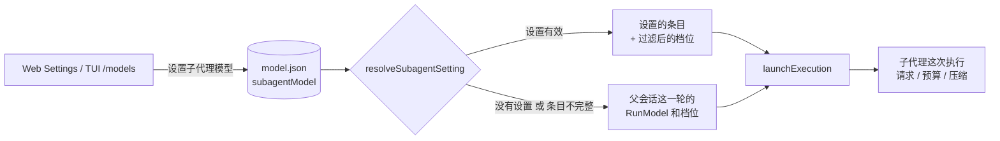

# 2. 方案与改动面

> 依据 [00](00-discussion.md) 的 D1 至 D13 和 [01](01-problem-analysis-and-current-state.md) 的现状。路径缩写同 01。改动面写到包和模块一级。

## 2.1 方案总览

在 `model.json` 里加一个可选字段 `subagentModel`，记下子代理用哪个模型条目、用什么思考档位。没有这个字段就是“跟随会话”，也就是现在的继承行为。

运行时，子代理每次开始一次新的执行（spawn，或者给空闲的子代理 send），都先看这个设置：设置有效，就用设置的模型和档位；否则照旧继承父会话。这个判断只放在 `launchExecution` 一个入口（01 §1.3.1、§1.3.5）。

界面上，Web 的 Models 页和 TUI 的 `/models` 面板各补一句 Default 说明，再加一个子代理模型入口。



## 2.2 设计决策表

| 编号 | 决策项 | 选择 | 理由 | 放弃的选项 | 代价 |
|---|---|---|---|---|---|
| P1 | 设置存在哪 | `model.json` 顶层新增可选的 `subagentModel: { entryId: string; reasoning?: ReasoningConfig }`，和 `activeProfileId` 并列。字段不存在表示跟随会话。存的是条目 id，所以改 Default 不会带动子代理 | 它引用的是模型条目，和 Default 同属模型库（01 §1.10）；删除条目时可以在同一次写入里清掉引用 | 放进通用 settings 文件；放进 Agent 配置 | 要把新字段加进 `normalizeModelDocument`，否则会被丢掉（01 §1.4） |
| P2 | 档位怎么存、怎么用 | 和条目 id 一起存在 `subagentModel.reasoning`，省略时使用模型条目的默认档位。显式档位作为一次完整选择生效 | D5：档位跟着子代理模型走，换模型时一起改；例如模型默认关闭思考，显式选 Low 时会打开思考并使用 Low | 子代理继续继承父会话的档位 | 无 |
| P3 | 生效顺序 | `subagentModel` 存在，且条目存在、配置完整 → 用它；否则继承父会话这一轮的模型和档位 | D4、D11 | 设置不可用时让子代理报错 | 设置坏了用户可能没注意到，靠 P7 的提示和 Settings 里的 “Needs setup” 补上 |
| P4 | 模型和档位在哪里决定 | `SessionSubagentHost` 的选项新增可选的 `resolveSubagentSetting?()`，返回 `{ runModel, reasoning? }` 或 `undefined`。`launchExecution`（现 `subagent-host.ts:572` 至 `:579`）先记下父会话这一轮的模型和档位，再异步解析子代理设置。没有可用的子代理设置时，使用此前记下的父会话模型和档位 | 01 §1.3.2：模型和档位要一起决定。保留旧回调，跟随会话时的代码一行不变，现有测试的搭建也不用改 | 把两个旧回调合并成一个新回调 | 选项接口多一个可选字段 |
| P5 | 解析函数放在哪 | 新文件 `agent/adapters/ui-inprocess/subagent-model.ts`，导出一个工厂，依赖模型库读取、客户端池和 `publishNotice`。`ui-inprocess.ts` 创建它，经 `composition.ts` 传给 `SessionSubagentHost` | 读模型库、取客户端、发提示的能力都在 `ui-inprocess` 这一层；`ui-inprocess.ts` 已经约 6400 行，新逻辑放进旁边的独立文件（01 §1.10） | 直接写进 `ui-inprocess.ts`；放进 `SubagentHost` | 无 |
| P6 | send 的行为 | 不单独处理。给正在运行的子代理 send：消息并入当前执行，模型和档位不变。给空闲的子代理 send：走 `launch`，和 spawn 一样经过 P4。`:1832` 的兜底实际走不到（01 §1.3.1），不改 | 所有新执行都从 `launchExecution` 进来，改一个入口就全覆盖 | 在 send 路径上另加一套判断 | 无 |
| P7 | 设置的条目不完整 | 这一次退回继承父会话，发一条 warning 提示，key 为 `model:subagent-unavailable`，文案大意是 “Subagent model needs setup. Subagents are using this chat's model.” | D11：不让主代理的任务因为设置问题中断。条目不完整只会来自手改文件或迁移来的旧条目（01 §1.4），处理保持最简 | 让子代理失败 | 后端每起一次子代理就发一次提示；TUI 按 key 替换，不会刷屏；Web 看不到后端提示（01 §1.5），靠 Settings 里这一行显示 “Needs setup” |
| P8 | 设置的条目被删 | `deleteEntries` 删到被引用的条目时，在同一次写入里删掉 `subagentModel`，回到跟随会话。这是主路径，因为它返回的文档投影不会再经过 normalize（01 §1.4）。`normalizeModelDocument` 读到指向不存在条目的 `subagentModel` 时也丢掉它，只用来兜底手改文件 | D10；只有一个全局字段，删除时顺手清掉，比运行时兜底简单 | 只在运行时兜底 | 无 |
| P9 | 档位校验 | 保存和执行使用同一套实际请求校验。模型能力未知时，可以选模型并使用默认档位。显式档位失效时，本次执行改用条目默认档位，并发送 `model:subagent-reasoning-fallback` 提示。已保存的档位保留 | D13。能力可能在保存后变化，例如重新探测 | 修改条目时顺带清掉 `subagentModel.reasoning` | 复用 LLM 的请求档位解析 |
| P10 | 生效时机 | 每次 `launchExecution`（spawn，或给空闲子代理 send 开始的新执行）都重新读设置。正在跑的那次执行不换 | D12；和“跟随默认的会话每轮重新读”一致；kimi-code 也是下一次 spawn 生效 | 子代理创建时把模型固定下来 | 改了设置后，已有子代理下一次执行会换模型，之前的 prompt cache 用不上。可以接受 |
| P11 | Web 接口 | `POST /v1/settings/models/subagent`，请求体 `{ id: string \| null; reasoning?: UiReasoningConfig }`。`id: null` 表示跟随会话，这时忽略格式正确的 `reasoning`。返回完整的 `UiSettingsModelsResponse`，写完后 `ctx.notify(["model"])` | 照抄 `POST /v1/settings/models/active` 的写法 | 用 PATCH 改整个模型库 | 无 |
| P12 | 设置的读视图 | `UiSettingsModels` 加 `subagent: { id; provider; model; label?; configurationComplete; reasoning?: UiReasoningConfig } \| null`。`null` 表示跟随会话 | Web 和 TUI 显示当前设置都靠它 | 让前端自己从 `models` 里查 | 无 |
| P13 | TUI 的后端命令 | `UiBackendClient` 加 `selectSubagentModel({ entryId: string \| null; reasoning?: UiReasoningConfig })`，返回 `UiSettingsModelsResponse`，走和 `selectDefaultModel` 一样的路（01 §1.5）。和 `selectModelEntry` 一样，设置成功后启动一次后台能力探测。`/models` 的行数据加 `subagent: boolean`，当前数据顶层加与 P12 相同的 `subagent` 设置视图 | 和设 Default 走同一条路，TUI 不用碰 Web 设置接口 | TUI 直接调 Web 设置接口 | 协议多一个命令；`CommandModelSummary` 和白名单 `sanitizeModelSummary` 都要加字段 |
| P14 | 界面文案 | Default 说明，Web 和 TUI 用同一句：“Default is used by new chats and chats that haven't picked a model.” 子代理入口统一叫 “Subagent model”，说明：“Subagents use this model. Follow chat uses the parent chat's model.” 文案可由用户在实施时微调 | D2；界面是英文 | 只加 tooltip | 无 |

## 2.3 分阶段实施

全部 Stage 都属于 improve-1。agent 负责 Stage 1、2 和前端用到的接口接线。用户负责 Stage 3、4 的界面和交互。两部分共用本地 `codex/subagent-model` 分支。

### Stage 1：模型库与接口（agent、sdk、server）

- `ModelDocument` 加 `subagentModel?`（P1、P2）。`normalizeModelDocument` 校验并保留它：
  - `entryId` 不是非空字符串、`reasoning` 不合法、或者指向不存在的条目时，丢掉整个字段，不抛错。这个字段坏了不应该让整个 `model.json` 读不出来（P8）。
  - `schemaVersion` 仍是 2，读取时不写盘。
- `writer.ts`：
  - 新增 `selectSubagentModel(id: string | null, reasoning?, options)`。`null` 删除字段；否则要求条目存在且完整，档位校验同 P9，不支持的选择返回 `VALIDATION_FAILED`。在 `coordinateModelConfig` 里写入，返回 `projectSettings`，然后像 `selectModelEntry` 一样启动后台能力探测。
  - `deleteEntries` 删到被引用的条目时清掉 `subagentModel`（P8）。单个删除和按 provider 批量删除都走这里。
- `projectSettings` 输出 `subagent`（P12）。
- SDK：`UiSettingsModels.subagent`；新增请求类型 `UiSettingsModelSubagentSelect`；`UiBackendClient.selectSubagentModel`。
- Server：新路由（P11），请求体用 zod 校验，并登记到 OpenAPI；JSON-RPC 透传新命令（P13）。
- `/models` 数据：`listModelsFromOptions` 的行加 `subagent` 标记，顶层加 `subagent` 当前设置；`CommandModelSummary` 和 `sanitizeModelSummary` 同步加字段。

**完成定义**：04 的 T1 至 T6 通过；跟随会话时运行行为没有任何变化。

### Stage 2：子代理运行时（agent）

- 新文件 `agent/adapters/ui-inprocess/subagent-model.ts`（P4、P5），解析步骤：
  1. 客户端池从同一份模型库读取子代理设置并解析指定条目的运行配置。读取不到设置时直接跟随聊天。模型库读不出，或指定条目缺少连接配置时，提示本次执行使用父会话已经确定的模型和档位。选中模型发起请求后的错误照常报告。
  2. 释放配置协调锁后，复用或创建目标客户端，再用实际条目 id 和客户端创建 `RunModel`。如果删除先于读取生效，使用父会话模型。已经取到完整配置的执行继续使用该快照。
  3. 有显式档位时，按实际请求校验并生成 intent。如果能力变化导致档位失效，发 P9 的提示，本次使用该条目的默认档位。
  4. 返回 `{ runModel, reasoning }`。
- `ui-inprocess.ts`：创建解析函数，并在组装运行时传给 `composition.ts`。
- `composition.ts`：把解析函数作为 `resolveSubagentSetting` 传给 `SessionSubagentHost`。
- `subagent-host.ts`：`launchExecution` 在接收新执行请求时取父会话快照并开始解析设置。得到显式设置时选用它，否则使用父会话快照。活动执行的 `send` 继续使用已选模型。

**完成定义**：04 的 T7 至 T13 通过；session-model 的 T11 不改断言也能通过。

### Stage 3：Web

- `ModelsSection.tsx`：
  - 标题下加一行 Default 说明（P14），用次要文字样式。
  - 在模型分组上方加一行 “Subagent model”，值显示 “Follow chat”，或者 “模型名 · 档位”（没设档位时只显示模型名）。引用的条目不完整时，显示 “Needs setup”，点击打开这个条目的编辑器。
  - 点击这一行打开菜单：第一项 “Follow chat”，下面列出所有配置完整的模型，当前选择打勾。选了模型以后，如果这个模型有可选档位，菜单里再列出 “Model default” 和它支持的档位。档位选项用 `UiSettingsModel.reasoning` 能力视图生成，规则和 prompt 框的档位控件一致。
  - 按用户的 Web 偏好：用普通行和自然的图标，不用卡片和胶囊按钮。
- 删除确认文案（D10）：删除的条目正被子代理设置引用时，加一句 “Subagents will follow the chat's model.”。两个确认框都要改：删单个模型的（`web/ui/settings/model-form.ts:259` 至 `:271`）和删整个 provider 的（`ModelsSection.tsx:381` 至 `:395`）。
- 后端阶段提供 `runtime.settings.selectSubagentModel({ id, reasoning? })`，由 `SettingsLayer` 的现有写入队列更新缓存。同步 Web 客户端与开发用 mock。
- 错误处理照 “Set as default”：`MODEL_CONFIG_INCOMPLETE` 打开编辑器，其他错误显示简短的失败提示。

**完成定义**：04 的 T14 至 T17、T17a 通过。

### Stage 4：TUI

- `models-panel.tsx` 主视图：
  - 第一行（This chat / Next chat）下面加一行 “Subagent model”，后面显示 “Follow chat” 或者 “模型 · 档位”。
  - 列表里，子代理用的那一行加暗色的 ` · subagent` 标记，和 ` · default` 并列。
  - 提示行加一行暗色的 Default 说明（P14），按键提示加 `s subagent model`。新增的行要算进 `MODELS_PANEL_EXTRA_ROWS`。
- 按 `s` 进入子代理设置子视图，交互借鉴 kimi-code 的 `/subagent-model`：
  1. 标题 “Subagent model”，第一行 “Follow chat”，下面是模型列表，当前选择打勾。
  2. 在 “Follow chat” 上按 Enter：保存为跟随会话，回到主视图。
  3. 在某个模型上按 Enter：调 `getCurrentModel({ modelEntryId })`（不带 `sessionId`，01 §1.7）取这个模型的档位能力。核对返回的 id 等于选中的 id，再展示档位。若条目已删除，刷新列表。有可选档位时进入档位列表，第一项 “Model default”，其余选项复用 `effort-panel.tsx` 的 `choicesFor`（要先导出）。能力还在探测（`detecting`）时，照 `effort-panel.tsx` 的做法轮询。没有可选档位时直接保存。
  4. 返回上一步：Esc 现在由 `command-panel-manager.tsx` 统一处理，按下会关掉整个面板（01 §1.7）。子视图要先拿到 Esc，用来逐级返回；在第一步按 Esc 回到主视图。
- 保存调用 `client.selectSubagentModel`，成功后刷新面板数据。

**完成定义**：04 的 T18 至 T20 通过。

## 2.4 按包和目录的改动面

| 包或目录 | 新增 | 修改 | 说明 |
|---|---|---|---|
| `agent/config/llm/` | `selectSubagentModel` | `model-document.ts`（类型、normalize）、`writer.ts`（删除联动、投影） | Stage 1 |
| `agent/adapters/` | `ui-inprocess/subagent-model.ts` | `ui-inprocess.ts`（创建解析函数、复用 `compatibleReasoning`、`/models` 数据、后端命令）、`ui-runtime/composition.ts`、`ui-persistent.ts` | Stage 1、2 |
| `agent/agents/` | 无 | `subagent-host.ts`（选项接口、`launchExecution`） | Stage 2 |
| `agent/commands/` | 无 | `types.ts`（`CommandModelSummary`）、`builtin.ts`（`sanitizeModelSummary`） | Stage 1 |
| `agent/host/` | 无 | `command-record.ts`、`ui-command-gateway.ts` | Stage 1 |
| `sdk/contract/` | `UiSettingsModelSubagentSelect` | `settings.ts`、`client.ts` | Stage 1 |
| `server/` | 新路由 | `protocols/web/routes/global-settings.ts`、`app/openapi.ts`、`app/create-app.unit.test.ts`（路由清单）、`protocols/jsonrpc/`（`protocol.ts`、`rpc-route.ts`、`client.ts`） | Stage 1 |
| `web/` | 无 | `ui/settings/ModelsSection.tsx`、`ui/settings/model-form.ts`、`api/daemon/settings-client.ts`、`api/daemon/client.ts`、`api/daemon/client-commands.ts`、`dev/mock-runtime.ts` | Stage 3 |
| `cli/tui/` | 无 | `components/dialog/models-panel.tsx`、`effort-panel.tsx`（导出 `choicesFor`）、`command-panel-manager.tsx`（Esc 交给子视图） | Stage 4 |
| `docs/` | 无 | 见 2.5.5 | 跟随各 Stage |

## 2.5 接口、迁移与兼容

### 2.5.1 `model.json`

```json
{
  "schemaVersion": 2,
  "activeProfileId": "work",
  "subagentModel": {
    "entryId": "fast",
    "reasoning": { "enabled": true, "effort": "low" }
  },
  "models": [ ... ]
}
```

没有迁移。旧文件没有这个字段，读出来就是跟随会话。

### 2.5.2 向旧版本兼容

旧版本的 `normalizeModelDocument` 不认识 `subagentModel`：读的时候忽略，写回时丢掉。所以降级后子代理回到继承，用户回到新版本后要重新设一次。不会读坏文件，也不需要备份，这一步可逆。

### 2.5.3 Web 设置接口

| 方法 | 路径 | 请求体 | 返回 | 错误 |
|---|---|---|---|---|
| POST | `/v1/settings/models/subagent` | `{ id: string \| null; reasoning?: UiReasoningConfig }` | `UiSettingsModelsResponse`（含 `subagent`） | `MODEL_NOT_FOUND`、`MODEL_CONFIG_INCOMPLETE`；档位不支持时为 `VALIDATION_FAILED` |

### 2.5.4 TUI 后端命令

`selectSubagentModel({ entryId: string | null; reasoning?: UiReasoningConfig }): Promise<UiSettingsModelsResponse>`。`/models` 展示数据每一行加 `subagent: boolean`，顶层加与 P12 相同的设置视图。

### 2.5.5 需要同步的权威文档

| 文档 | 改什么 |
|---|---|
| `docs/config/llm/data-model.md` | `ModelDocument` 加 `subagentModel` 的说明和示例；删除条目时的联动 |
| `docs/config/llm/dfd-interface.md` | “接口定义”里补上 `selectSubagentModel` 和 `POST /v1/settings/models/subagent`；`GET /v1/settings/models` 的返回说明加上子代理设置 |
| `docs/agents/context-isolation.md` | “空闲实例的新执行重新解析当前会话模型”改为“先看子代理模型设置，跟随会话时用当前会话模型” |
| `docs/agents/test.md` 开头说明 | “子代理继承 host 模型”改为“未设置子代理模型时继承” |
| `docs/problem-lists/2026-10-25-session-model/README.md` | 相关文档里加一行指向本议题，说明 D14 只在跟随会话时适用 |

## 2.6 风险与回滚

| 风险 | 影响 | 应对 |
|---|---|---|
| 子代理换了模型，档位还是父会话的 | 请求报错 | P4 让设置一次给出模型和档位；P9 运行时过滤；04 T9、T13 |
| 设置的模型上下文窗口比父会话小 | 子代理更早触发压缩 | 子代理的预算按自己的 `RunModel` 算（01 §1.3.4），超了走现有的自动压缩。这是用户自己的选择，不特殊处理 |
| 设置的模型不可用，用户没察觉 | 以为在用便宜模型，实际在用主模型 | P7 的提示（TUI 可见）；Settings 里这一行显示 “Needs setup”（Web 和 TUI 都可见） |
| 设置的模型 key 失效 | 子代理请求鉴权失败，主代理收到一次工具失败 | 条目仍然算完整（01 §1.4），不退回继承。主代理能看到失败原因，用户去 Settings 修 key。可以接受 |
| 跟随会话时的行为被意外改掉 | 回归 | P4 保留旧回调，跟随会话时走原来的代码；session-model T11 原样通过是 Stage 2 的完成条件 |
| `normalizeModelDocument` 漏掉新字段 | 设置写进去又被丢掉 | 04 T1 测读写往返，并测修改其他条目后设置仍在 |

回滚：撤回代码即可。旧代码会忽略 `subagentModel` 字段（2.5.2），不需要处理数据。

## 2.7 与 00 的对齐检查

| 00 | 02 的落点 |
|---|---|
| D1、D2 | Default 语义不动；P14，Stage 3、4 |
| D3、D4 | P1、P3，Stage 2 |
| D5 | P2、P9，Stage 3、4 的档位选择 |
| D6 | 01 §1.3.4，不新增参数 |
| D7 | P11、P13 只写 `model.json`，不碰会话 |
| D8 | Stage 3、4 |
| D9 | 本文不列关键改动清单 |
| D10 | P8，Stage 3 的删除确认文案 |
| D11 | P7 |
| D12 | P6、P10 |
| D13 | P9 |

## 2.8 不在本轮

见 00 §4：按角色配模型、工具参数选模型、后台小模型、按会话的子代理模型、Agent 配置的 `model` 字段。这些只是登记，不满足分轮条件，不预开 improve-2。
