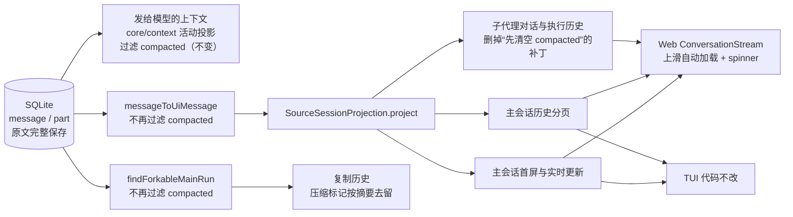

# 2. 优化方案与改动面

> 本文是交给实施会话的契约。实施按本文改代码，按 [04](./04-test-and-acceptance.md) 验证，结果写入 05。行号是 `e9c6c3c8` 时的快照，定位以符号为准。

## 2.1 方案总览

后端的主改动只有一条规则：`time.compacted` 只决定发给模型的内容，不再决定给人看的内容。改的位置是 UI 投影的唯一入口 `messageToUiMessage`。主会话的首屏、实时更新、历史分页和 TUI 会一起变好，子代理那两处绕路的补丁也就可以删掉了。分叉判断跟着放开，和界面看到的保持一致。

放开分叉以后，后端还要补两处小改：

- 复制历史时，压缩标记的去留改成看对应的摘要有没有一起复制，不再比较时间先后。
- `commitReasoning` 只在消息不在热窗口里时才发“历史失效”。

前端主要改 `ConversationStream` 这一个组件，主会话、Side Chat 和子代理对话一起生效：

- 上滑接近顶部时自动加载上一页，去掉按钮和全部文字。
- 只有游标真的往前走了，才自动接着拉下一页。
- 加载中只显示一个小 spinner。
- 什么都没有的消息行不占位置。
- 压缩分隔线之前的用户消息不显示编辑按钮。

Web store 也有小改：消息只是被挤出热窗口时，不再清掉已经翻出来的页；热窗口外的旧消息真被改了，或者重新拉了基线，才标记失效。



## 2.2 设计决策表

| 决策项 | 选择 | 理由 | 放弃的选项 | 代价 |
| --- | --- | --- | --- | --- |
| 已压缩内容怎么显示 | 显示原文，摘要照旧显示为分隔线（00 D1） | 原文本来就在库里；[dfd-interface](../../../core/context/dfd-interface.md) 早就规定原文可读；opencode、codex、pi-web、dsh、kimi-code、ZCode 都这样做（见 03） | B：显示“已压缩”占位或折叠块；C：后端不改，前端把空壳藏起来 | 压缩点之前的消息也会显示分叉和编辑按钮，需要另外处理（下面两行） |
| 改在哪一层 | `messageToUiMessage` 去掉过滤（00 D2） | 一处改动，所有 UI 读取路径一起对齐；子代理的两处补丁变成多余代码，可以删掉 | 照搬子代理的做法，只在 `history()` 里先清空 `compacted` | 无 |
| 旧回答能否分叉 | 后端放开，`findForkableMainRun` 去掉过滤（00 D3） | 复制历史那一层已经支持切到压缩点之前，并有测试覆盖；界面显示了按钮，后端就应该接得住 | 前端在压缩点之前隐藏分叉按钮 | 复制历史的压缩标记判断有同毫秒漏洞，放开后能碰到，要一起修（下面“分叉时的压缩标记”一行） |
| 分叉时的压缩标记 | 被复制的消息里找最后一条压缩摘要，压缩时间比它晚的标记去掉（00 D15） | 标记留下却没有摘要，模型就看不到这段内容。摘要总是在自己的压缩时间之后创建（`context-manager.ts` L1105 先取 `compactedAt`，再分配摘要消息），所以这个判断不受同一毫秒影响。前提是两边用同一个时钟：上下文管理器的 `options.now`（L271）和消息管理器的 `now`（`core/message/manager.ts` L142）在生产环境都是 `Date.now`，测试里注入时钟也要注入同一个 | 把 `>` 改成 `>=`：同一毫秒时会反过来错，摘要和原文都留在上下文里 | 历史数据里如果有不带摘要的压缩标记，分叉后这些标记会被去掉，新会话的上下文变大，但内容不丢 |
| 旧用户消息能否编辑 | 不能。前端隐藏按钮，后端拒绝规则不变（00 D4） | 回退到压缩点之前要重建模型上下文，不属于本议题范围；前端按后端的规则提前隐藏，用户就不会点了才报错 | 后端放开回退 | 规则在前后端各写了一份，见 §2.6 |
| 加载触发方式 | 在已有的滚动和输入处理里判断位置；请求装进新页、游标往前走了，下一帧再判断一次（00 D5、D14） | 逻辑都放在已有的处理函数里；请求后的复查覆盖“内容填不满一屏”和“一页里可见内容很少”两种情况；opencode、claude-code、ZCode、pi p2 都这样做 | IntersectionObserver 哨兵（讨论初期推荐过） | 无 |
| 什么时候接着拉 | `onLoadHistory` 返回 `Promise<boolean>`，游标前进了（或已确认没有更多）才返回 `true`，只有 `true` 才自动续拉（00 D14） | 加载函数有几种“什么都没做就返回”的情况（没有游标、页被丢掉）。只看请求结束就复查，会立刻再调、再立刻返回，形成死循环。加载函数自己最清楚有没有装进新页 | 前端比较请求前后最早一条可见消息：整页都是不显示的空消息时，会误判成没进展 | 加载函数的几处实现和透传都要改返回值，见 Stage 2 第 3 项 |
| 触发阈值 | 不贴底时，距顶部不超过一屏（`element.clientHeight`）；贴底时，只在内容不满一屏时补页 | 留出一屏的滚动时间让请求先回来，用户基本感觉不到等待。贴底说明用户在看最新消息，这时只补到一屏为止，打开长会话不会多拉页；opencode 跟随底部时也只做补页 | opencode 用 200px 固定值，ZCode 用 max(64px, 2 屏) | 网络慢、用户又滚得快时，会在顶部看到 spinner 转一会儿 |
| 位置保持 | 按用户最后一次滚动时记下的阅读行恢复，删掉 `anchorRef` | `anchorRef` 记的是请求发起那一刻的位置，请求途中用户又滚动过，恢复时会被拉回去。阅读行跟着用户走，现有的 `ResizeObserver` 已经在用这套逻辑 | 继续用 `anchorRef` 的高度差补偿 | 无 |
| 加载中显示 | 顶部一个高度固定的槽位，加载时显示共享的 `Spinner` 组件，没有可见文字（00 D6） | 用户要求；高度固定，spinner 出现或消失时内容不跳；共享组件在“减少动态效果”设置下照样转 | pi p2 的“按钮 + spinner + Start of conversation” | 无 |
| 加载失败 | 不提示。冷却 2 秒，之后用户再往上滑时重试。子代理详情原有的通用错误条保留（00 D7） | 用户选择静默重试；冷却时间沿用 opencode。子代理的错误条也管定位失败、刷新失败，不属于历史槽位 | 显示错误文字和重试按钮 | 网络持续不通时，用户只会觉得“上面没有更多了”；已经停在顶部时，要再往上滑一下才会重试 |
| 历史失效 | 去掉提示和刷新按钮。消息只是被挤出热窗口（事件带 `evictedMessageIds`）时，不清页、不改游标；热窗口外的旧消息真被改了、视图换代、重新拉了基线，才标记失效，接近顶部时自动重拉（00 D8） | 被挤出的消息本来就留在前端，旧页仍然有效；运行中每一步都可能挤出消息，每次都清页会让视图反复跳。旧消息真被改时，留着旧页就会显示错的内容。后端事件本来就能区分这两种 | 一律保留页（会显示过期内容）；不改 store，接受旧页被反复清掉 | 真改动发生时，下次接近顶部会清页重拉，阅读位置可能跳一下。改动后这种情况很少（见下一行） |
| 后端少发失效 | `commitReasoning` 只在消息不在热窗口里时才带 `historyInvalidated`（00 D8） | 热窗口里的消息改动已经随视图一起推给了前端，历史页里没有这条消息。现在每保存一次思考内容都发失效，运行中几乎每一步都会触发 | 只在前端过滤 | TUI 收到的失效会变少，少清几次页。这是改进，由 T18 验收 |
| 每页大小 | 本轮不加大小上限，只在验收时测量（00 D16） | 每页 50 条限制的是条数。工具输出在 UI 投影里原样传（`persistent-store.ts` 的 `toolResultPart`），单个输出写入时一般截到约 8000 token，一页里可能有很多个。Codex 量出第一页约 165 KiB，方案 A 之后还会更大。先拿数据再决定 | 这一轮就按字节截断每页：要改分页游标，超出“不改接口”的边界 | 第一页可能有几百 KiB，T17 测出问题再开下一轮 |
| 空消息 | `MessageRow` 返回 `null`，外层 div 为空时用 CSS 隐藏（00 D9） | 耗时行、错误行挂在消息 id 上，不能从数据里删消息；`:empty` 只会命中真正什么都没有的那一层 | 在数据层过滤空消息 | 无 |

## 2.3 分阶段实施

两个 Stage 可以合成一个 PR。建议先做 Stage 1：不改后端，自动加载翻上来的也只是空壳，没法验收。

### Stage 1：后端显示原文、放开分叉（ohbaby-agent）

**目标**：主会话的历史分页、首屏和实时更新都能看到压缩前的原文；旧回答可以分叉，分叉后模型上下文不丢内容；模型上下文不变；运行中不再因为保存思考内容而频繁发失效。

**改动**：

1. `persistent-store.ts` 的 `messageToUiMessage`：删掉 `.filter(isActivePart)`，保留排序。摘要消息的投影不变。`isActivePart` 的 import 如果没有别的用处，一并删掉。
2. `source-session-projection.ts`：
   - 删掉 `projectComplete`。
   - `project` 从 `private` 改为公开方法。
   - `executionHistory` 里先清空 `compacted` 的那段（L605–610）改成直接调用 `this.project(record)`。
3. `subagent-conversation.ts` L77、L471：`projectComplete` 改成 `project`。
4. `copy-history.ts` 的 `findForkableMainRun`：删掉 `parts.filter(isActivePart)`，后面的工具检查和正文检查直接用 `parts`。
5. `copy-history.ts` 复制历史里去掉压缩标记的那段（L353–364）：
   - 在被复制的 `parts` 里找出压缩摘要（复用文件里已经导入的 `isContextSummaryPart`），取它们所属消息的最大 `created_at`，记为 `lastSummaryAt`。
   - 没有摘要，或者 `time.compacted > lastSummaryAt` 的标记，去掉。
   - `lastMessageAt`（L262）还要写进新会话的 `session` 行（L316），保留。
6. `source-session-projection.ts` 的 `commitReasoning`（L426）：`historyInvalidated` 加一个条件，只有这条消息不在当前视图里（`current` 为空）时才为真。
7. 测试：
   - `persistent-store.integration.test.ts` L785–843：L838–842 的断言反过来，用例名同步改。期望值见 04 T1。
   - `ui-inprocess/subagent-compaction-history.integration.test.ts` L247、`ui-state/interruption-projection.integration.test.ts` L81：`projectComplete` 换成 `project`，断言不改。
   - `copy-history.integration.test.ts` 已有的两个用例不用改：L667 的压缩标记用例在新规则下照样通过；L429 用例里的 `compacted-final` 只有推理、没有正文，去掉过滤后仍然不能分叉。
   - 补齐 04 中 Stage 1 的用例。

**完成定义**：04 的 T1–T6、T20 通过；除第 7 项列出的测试以外，已有的回退拒绝、复制历史、子代理对话测试不改也能通过；TUI 验收 T18 通过（TUI 只依赖后端改动）。

### Stage 2：Web 自动加载、spinner、空行和编辑按钮（ohbaby-web、ohbaby-sdk）

**目标**：三处对话上滑都能自动加载历史，界面上没有任何按钮或文字，只在加载时出现小 spinner；没有进展时不会空转；运行中往上翻，已经翻出来的内容不会被清掉；没有空白占位；压缩点之前没有编辑按钮。

**改动**：

1. `ConversationStream.tsx` 的历史区块（L788–820）换成一个槽位：
   - `historyHasMore || historyStale` 为真时渲染，高度固定。四种状态（`ready`、`loading`、`error`、失效）下都是同一个元素。
   - 槽位里常驻一个 `ohb-visually-hidden` 的 `role="status"` 节点：加载时文本是 `Loading earlier messages`，其他时候为空。节点一直挂着、只换文字，读屏软件才会播报。
   - 加载时在槽位里放共享组件 `Spinner`（`ui/shared/Spinner.tsx`），不传 `label`，所以它是 `aria-hidden`。不要自己拼 `LoaderCircle` 加 `ohb-spin`：`base.css` L133–143 只对 `.ohb-spinner` 做了“减少动态效果”的豁免。
   - 删除失效提示、错误文本和按钮。
2. 在 `ConversationStream.tsx` 里加一个 `maybeLoadEarlier`，规则和四个调用点见 §2.5。
3. `onLoadHistory` 改成返回 `Promise<boolean>`，含义见 §2.5“什么时候接着拉”。要改的地方：
   - `ConversationStream.tsx` L81 的 prop 类型。
   - `apps/ohbaby-web/src/store/store.ts` 的 `installSessionHistory`（L484–541）返回 `boolean`：前面两处提前返回（版本不匹配、页被丢掉）返回 `false`，装进去返回 `true`。L51 的接口类型同步改。
   - `client-sync.ts` 的 `loadEarlierHistory`（L629–671）：装进了页，并且游标变了（`page.before !== before`）或已经没有更多（`!page.hasMore`），返回 `true`；提前返回、页被丢掉、出错都返回 `false`。另外处理“失效了却没有游标”：`historyStale` 为真而 `state.view.history.before` 为空，说明热窗口已经包含整段会话，用当前视图构造一个空的最后一页交给 `installSessionHistory`：`version` 和 `bindingGeneration` 取视图的，`messages`、`runs`、`prompts` 都是空数组，`hasMore: false`，`reasoningMissing: false`，不带 `before` 和 `serverNow`。这样复用现有的清页路径，不给 store 加新方法，清掉旧页和失效标记，返回 `true`。
   - `packages/ohbaby-sdk/src/sync/subagent-conversation-reader.ts` 的 `loadPage`（L639–678）和 `loadEarlier`（L42、L743）：合并了新页并且游标变了（或已没有更多）返回 `true`，其他情况返回 `false`。`loadLater` 的对外类型保持 `Promise<void>`，内部调 `loadPage` 后丢掉返回值。
   - 透传的几处跟着改类型：`api/daemon/client.ts` L105、`runtime/index.ts` L60 和 L237、`runtime/side-chat.ts` L46 和 L137、`dev/mock-runtime.ts` L335（返回 `false`）。
4. 位置保持：删掉 `anchorRef`、它的 `useLayoutEffect`（L631–638）以及 L497、L508 的清空。把 `ResizeObserver` 回调里按阅读行恢复的那段（L741–753）提成一个函数，`ResizeObserver` 和一个新的 `useLayoutEffect` 共用。规则见 §2.5。
5. `ConversationStream.tsx` 的 `editablePrompt`（L303–314）加一个条件：这条用户消息在列表里排在最后一条压缩分隔线之前时，返回 `undefined`。在渲染前算一次“最后一条压缩分隔线的位置”，不要每条消息都扫描一遍列表。
6. `MessageRow.tsx` L40–46：去掉 `props.message.parts.length > 0` 这个前提。改成没有推理、也没有可见 part 时返回 `null`。
7. `messages.css`：
   - 加一条 `.ohb-stream-inner > [data-message-id]:empty { display: none; }`。
   - 删掉 `.ohb-history-more` 的胶囊样式（L489–520），换成槽位样式：固定高度，内容居中。spinner 的样式和动画由共享组件自带，不另写。
8. `historyError` 不再显示，删掉 `ConversationStream` 的这个 prop，以及三个调用方的传参。store 和 `wire.ts` 里的 `historyError` 字段保留不动。子代理详情自己的错误条（`SubagentConversationBody.tsx` L62–69）不动。它的现有行为是：重试一开始，阅读器会清掉 `error`（L652），错误条随之消失；重试再失败，错误条重新出现。
9. `apps/ohbaby-web/src/store/store.ts`：
   - `invalidateSessionHistory`（L544–571）：事件带非空的 `evictedMessageIds` 时，说明只是挤出热窗口，这时不改 `invalidatedAt`、不标记 `historyStale`、不改 `historyBefore` 和 `historyHasMore`。其他带 `historyInvalidated` 的事件保持现有行为（L563–570）。这条规则有个前提：现在挤出窗口是单独一次提交（`source-session-projection.ts` L567–584），带 `evictedMessageIds` 的事件不会同时带真改动。实施时在这个分支旁写一行注释说明这个前提，以后如果把挤出和真改动合进一次提交，要回来改这里。删除消息、回退的 prompt 的处理不变。
   - `setSessionSync`（L401–470）：同一个作用域下，状态从非 `ready` 变回 `ready`（断线重连、事件序号有缺口、视图无法应用事件后重新拉的基线），并且已经加载过历史时，标记 `historyStale`，同时把 `invalidatedAt` 设成新视图的 `sessionRevision`。后一步是为了丢掉断线前发出、断线后才回来的翻页请求：不设的话，这一页能通过版本检查，装入时会清掉失效标记，把断线前的旧内容和旧游标留下来。视图换代时标记失效（L462–464）不变。
   - `store.unit.test.ts` L296 和 `session-recovery.integration.test.ts` L892 的用例发的是不带 `evictedMessageIds` 的失效，按新规则照旧标记失效，不用改。挤出窗口和重新拉基线的用例按 04 T19 新增。
10. 文档：更新 [03-ui-layout-and-style.md](../../../ohbaby-web/redesign-2026-10/03-ui-layout-and-style.md) L197，见 §2.9 K10。

**完成定义**：04 的 T7–T16、T19、T21 通过；浏览器验收 T17 通过。

## 2.4 按包与目录的改动面

| 包或目录 | 新增 | 修改 | 删除 | 说明 |
| --- | --- | --- | --- | --- |
| `packages/ohbaby-agent/src/adapters/ui-state/` | 无 | `persistent-store.ts`、`source-session-projection.ts` | `projectComplete`，`executionHistory` 里的清空代码 | UI 投影规则；`commitReasoning` 少发失效 |
| `packages/ohbaby-agent/src/adapters/ui-inprocess/` | 无 | `subagent-conversation.ts` | 无 | 换一个方法名 |
| `packages/ohbaby-agent/src/services/session/` | 无 | `copy-history.ts` | 无 | 分叉判断；压缩标记按摘要去留 |
| `packages/ohbaby-sdk/src/sync/` | 无 | `subagent-conversation-reader.ts` | 无 | `loadEarlier` 返回是否前进 |
| `apps/ohbaby-web/src/ui/conversation/` | 无 | `ConversationStream.tsx`、`MessageRow.tsx`、`messages.css` | 历史按钮和胶囊样式 | 前端主体 |
| `apps/ohbaby-web/src/ui/session/`、`ui/side-chat/` | 无 | 三个调用方 | `historyError` 传参 | 连带 |
| `apps/ohbaby-web/src/api/daemon/`、`runtime/`、`dev/` | 无 | `client-sync.ts`、`client.ts`、`runtime/index.ts`、`runtime/side-chat.ts`、`dev/mock-runtime.ts` | 无 | `loadEarlierHistory` 返回是否前进 |
| `apps/ohbaby-web/src/store/` | 无 | `store.ts` | 无 | 挤出窗口不清页；重新拉基线时标记失效；装页返回是否装入 |
| `docs/ohbaby-web/redesign-2026-10/` | 无 | `03-ui-layout-and-style.md` | 无 | 权威文档同步 |
| `packages/ohbaby-cli/`（TUI） | 无 | 无 | 无 | 只验收 |

## 2.5 前端加载规则（契约）

```ts
// 伪代码，表达规则，不限定写法
const HISTORY_RETRY_COOLDOWN_MS = 2000;
const latestProps = useRef(props);
useLayoutEffect(() => {
  latestProps.current = props; // 监听函数和请求回调里都读最新的 props
});

function maybeLoadEarlier(element: HTMLElement, userInput: boolean) {
  const p = latestProps.current;
  if (!(p.historyHasMore || p.historyStale)) return;
  if (requestPendingRef.current) return;               // 同一时刻只发一个请求
  if (p.historyState === "loading") return;
  if (p.historyState === "error") {
    if (!userInput) return;                            // 出错后只由用户操作触发重试
    if (Date.now() - requestEndedAtRef.current < HISTORY_RETRY_COOLDOWN_MS) return;
  }
  const shouldLoad = stickToBottomRef.current
    ? element.scrollHeight <= element.clientHeight + 1 // 贴底：只在内容不满一屏时补页
    : element.scrollTop <= element.clientHeight;       // 不贴底：距顶部不超过一屏
  if (!shouldLoad) return;
  requestPendingRef.current = true;
  void p
    .onLoadHistory()
    .catch(() => false)
    .then((advanced) => {
      requestPendingRef.current = false;
      requestEndedAtRef.current = Date.now();
      if (!advanced) return;                           // 游标没动：停下，等用户再滑
      requestAnimationFrame(() => {                    // 等新消息画好、位置恢复后再查
        const current = streamRef.current;
        if (current) maybeLoadEarlier(current, false);
      });
    });
}
```

| 规则 | 说明 |
| --- | --- |
| 四个调用点 | ① `onScroll`，`userInput` 取现有的 `userScroll` 标记（要在它被清零之前读）。② 往上的 wheel、touchmove 和 ArrowUp、PageUp、Home 按键，也就是现在调用 `leaveBottom` 的三处，传 `true`。已经停在顶部时浏览器不会再发 `scroll` 事件，靠这一路，用户再往上滑才能触发重试。③ 依赖 `messagesSignature`、`historyHasMore`、`historyStale` 的 `useEffect`，传 `false`，覆盖首屏挂载、新消息到达和状态变化。依赖里不放 `historyState`，否则页被丢掉、状态从 `loading` 变回 `ready` 时，③ 会在没有进展的情况下再发请求。④ 请求返回 `true` 后的下一帧，传 `false` |
| 什么时候接着拉 | 只有加载函数返回 `true` 才由 ④ 接着拉。`true` 的意思是：装进了新页，并且游标变了，或者已经确认没有更多。没有游标、页被丢掉、出错，一律返回 `false`，这时停下，等用户下一次滚动或新消息到达再判断。等一帧是为了让 React 先提交新消息、`useLayoutEffect` 先恢复阅读位置，④ 读到的才是恢复后的 `scrollTop` |
| 为什么 ③ ④ 都要 | 装进新页后，React 重新渲染和请求回调谁先执行不固定。渲染先到：③ 看到请求还没结束，跳过，由 ④ 在下一帧复查。回调先到：请求标记已经清掉，③ 可能先于 ④ 触发，④ 再查时请求已在途中，也会跳过。两处调用同一个函数，`requestPendingRef` 保证不会重复发请求 |
| 读最新 props | 监听 effect 的依赖只有 `[readingPosition, props.onNearEnd]`（effect 从 L640 开始，依赖在 L734），监听函数里直接读 `props` 可能是旧的。`maybeLoadEarlier` 一律从 `latestProps` 读，`latestProps` 在 `useLayoutEffect` 里更新 |
| 防重复 | `requestPendingRef` 管住同一时刻只有一个请求。`client-sync.ts` 的 `loadEarlierHistory` 没有防重入：第二次调用会让第一次的结果作废，只是浪费一次请求，但不应依赖它 |
| 贴底 | 只做补页：内容不满一屏才加载。新加载的历史出现在上方，视图仍停在最新消息。首屏挂载时 `stickToBottomRef` 为真，这时 `scrollTop` 还是 0（贴底滚动在 `setTimeout(0)` 里才执行），用补页判断就不会把它误当成“在顶部” |
| 不贴底与位置保持 | 不再记 `anchorRef`。`onScroll` 已经把用户正在看的那条消息和它到顶部的距离记在 `readingPosition` 里。新增一个依赖 `messagesSignature` 的 `useLayoutEffect`：不贴底时，按 `readingPosition` 把这条消息挪回原来的距离，公式和 `ResizeObserver` 回调（L741–753）相同，两处共用一个函数。请求途中用户滚动过，`readingPosition` 已经跟着更新，不会被拉回请求发起时的位置。展开或折叠消息会清掉 `readingPosition.messageId`（L450）。所以 `maybeLoadEarlier` 在调用 `onLoadHistory` 之前检查一次：`messageId` 为空时，先把当前第一条可见的消息和它到顶部的距离记进 `readingPosition`。必须在发请求前记，新页插到上面以后，第一条可见的消息就变了 |
| 失败 | 出错时 ③ ④ 都不重试，避免死循环。离上次请求结束满 2 秒后，由 ① ② 的用户操作触发 |
| 失效 | `historyStale` 在三种情况下为真：视图换代；热窗口外的旧消息真被改了（事件带 `historyInvalidated` 但不带 `evictedMessageIds`）；重新拉了基线（Stage 2 第 9 项）。为真时同样走这套规则，数据层换游标重拉，装入时清掉旧页，前端不区分。失效了却没有游标时，由 `loadEarlierHistory` 装一个空的最后一页收尾，见 Stage 2 第 3 项 |
| 没有更多 | `historyHasMore` 和 `historyStale` 都为假时，槽位不渲染，也不再触发 |

不新增 store 字段、接口或数据结构。`onLoadHistory`、`installSessionHistory`、`loadEarlier` 只是把返回值从 `void` 改成 `boolean`，不在乎返回值的调用方不受影响。

## 2.6 风险与回滚

| 风险 | 应对 | 回滚 |
| --- | --- | --- |
| 编辑按钮的判断在前后端各写了一份，以后后端规则变了，前端可能忘记跟着改 | 前端规则写在 `editablePrompt` 一处，旁边注释写明对应的是 `session-rewind.ts` 的 `REWIND_BEFORE_COMPACTION`。后端拒绝和错误文案保留，前端漏判时用户仍然能看到原因 | 无需回滚 |
| 同一时刻的边界：后端规则是摘要“晚于或等于”目标消息就拒绝，前端按列表顺序判断 | 摘要消息总是在被压缩的消息之后才创建，同一毫秒的情况可以忽略。后端兜底 | 无需回滚 |
| 连续好几页的消息全都不可见，复查会一页接一页地往前拉 | 每次都要等网络返回，而且只有游标前进了才接着拉，不会空转；拉到 `hasMore` 为假就停。不设页数上限 | 无需回滚 |
| 显示原文后，长会话的首屏和每页内容变多 | 热窗口和分页条数都不变，但每页 50 条限制的是条数，工具输出原样传，一页可能有几百 KiB。T17 测量第一页、第二页的响应大小和滚动流畅度，测出问题再开下一轮 | 无需回滚 |
| 有人依赖“UI 里看不到已压缩内容” | 已核查：`messageToUiMessage` 的结果只用于 UI 视图、历史分页和旧版完整快照，不会进入模型上下文 | 后端回滚：把过滤加回去 |
| 请求途中刚好收到真改动的失效，`invalidatedAt` 会把这一页丢掉 | `loadEarlierHistory` 把状态改回 `ready` 并返回 `false`，④ 不续拉。用户下一次滚动或新消息到达时，③ 或 ① 会按失效的游标重新请求。挤出窗口的事件不再改 `invalidatedAt`，运行中这种情况很少 | 无需回滚 |
| 历史数据里有不带摘要的压缩标记 | 现在唯一的压缩提交路径（`context-manager.ts` L1106）总是带摘要。旧数据如果有这种标记，分叉后会被去掉，新会话上下文变大，内容不丢 | 无需回滚 |
| 压缩标记的去留靠时间先后判断 | 判断依赖“摘要在自己的压缩时间之后创建”。两次取时间在同一进程里先后执行，正常情况下不会反过来；只有系统时钟在这几毫秒里往回拨，才可能把标记错留或错删。dsh、ZCode 用序号或消息 id 关联，不受时钟影响，但要改存储格式，本轮不做（03 §3.3） | 无需回滚 |
| `commitReasoning` 少发失效后，TUI 收到的失效也变少 | 热窗口里的消息改动已随视图推送，历史页里没有这条消息，少发是对的。TUI 会少清几次页，由 T18 验收 | 后端回滚：去掉新加的条件 |
| jsdom 不支持布局，单元测试拿不到真实的 `scrollTop`、`clientHeight`、`scrollHeight` 和元素位置 | 测试里手动定义这些属性，元素位置用 `getBoundingClientRect` 的替身，`requestAnimationFrame` 用假计时器推进（Vitest 2 默认不替换它，要在 `toFake` 里显式列出）。真实滚动由浏览器验收 T17 兜底 | 无需回滚 |

整体回滚：两个 Stage 都没有改存储格式或数据结构，接口只把几个返回值从 `void` 改成 `boolean`，直接 revert 提交即可。

## 2.7 与 00 的对齐检查

| 00 决策 | 本文落点 |
| --- | --- |
| D1 显示原文 | Stage 1 第 1 项 |
| D2 改在投影入口，删掉子代理补丁 | Stage 1 第 1–3 项 |
| D3 分叉放开 | Stage 1 第 4 项 |
| D4 编辑隐藏 | Stage 2 第 5 项 |
| D5 自动加载 | Stage 2 第 2、4 项，§2.5 |
| D6 spinner | Stage 2 第 1 项 |
| D7 静默重试，子代理错误条保留 | §2.5 失败规则，Stage 2 第 8 项 |
| D8 挤出窗口不清页，真改动和重新拉基线时标记失效 | Stage 1 第 6 项，Stage 2 第 1、9 项，§2.5 失效规则 |
| D9 空消息 | Stage 2 第 6、7 项 |
| D10 三处一起生效 | 只改 `ConversationStream`，§2.4 |
| D11 TUI 只验收 | §2.4，04 T18 |
| D12 不建模块级文档 | 本文不列模块级 improve 目录 |
| D13 关键改动清单 | §2.9 |
| D14 游标前进才续拉 | Stage 2 第 3 项，§2.5 |
| D15 分叉时压缩标记按摘要去留 | Stage 1 第 5 项 |
| D16 每页大小只测量 | §2.6，04 T17 |

## 2.8 不在本轮

- 虚拟列表、换渲染方式。
- 回退到压缩点之前。
- 给 `UiMessage` 加“已压缩”标记，或者在 UI 上区分已压缩和未压缩的消息。
- TUI 的加载方式和样式。
- 加载失败的提示、按钮或文字。子代理详情原有的错误条保持原样。
- TUI 在失效时清掉已加载历史的行为。
- 按字节限制每页大小。T17 测出问题再议。

以上都不登记为下一轮候选。只有“按字节限制每页大小”是有条件的：T17 测出超标时，再登记为下一轮候选。

## 2.9 关键改动清单

> 行号是规划时的快照，定位以符号为准。本表不是进度表，实施时不勾选、不回写。

| ID | 类型 | 路径 | 符号或小节 | 行号快照 | 要改什么 | 为何承重 |
| --- | --- | --- | --- | --- | --- | --- |
| K1 | 代码 | `packages/ohbaby-agent/src/adapters/ui-state/persistent-store.ts` | `messageToUiMessage` | L252–327（过滤在 L255–257） | 删掉 `isActivePart` 过滤 | 根因所在，所有 UI 读取路径都经过这里 |
| K2 | 代码 | `packages/ohbaby-agent/src/adapters/ui-state/source-session-projection.ts` | `projectComplete`、`project`、`executionHistory`、`commitReasoning` | L152–160、L248、L589–626（清空在 L605–610）、L385–432（失效在 L426） | 删 `projectComplete`；`project` 改为公开；`executionHistory` 直接调 `project`；`commitReasoning` 只在消息不在视图里时发失效 | 去掉子代理一侧的补丁；不改的话运行中几乎每一步都会让前端标记失效 |
| K3 | 代码 | `packages/ohbaby-agent/src/services/session/copy-history.ts` | `findForkableMainRun`、复制历史里去掉压缩标记的循环 | L66–111（过滤在 L93）、L353–364 | 删掉 `isActivePart` 过滤；压缩标记改成按被复制的最后一条摘要去留 | 不改前者，旧回答点分叉会报错；不改后者，同一毫秒时分叉出的会话会丢上下文 |
| K4 | 代码 | `apps/ohbaby-web/src/ui/conversation/ConversationStream.tsx` | `onLoadHistory` 类型、历史区块、滚动和输入处理、`anchorRef` 及其 effect、`ResizeObserver` 恢复 | L81、L788–820、L640–734、L631–638、L741–753 | 换成 spinner 槽位；加 `maybeLoadEarlier` 和四个调用点；删 `anchorRef`，阅读行恢复提成函数，新增一个 `useLayoutEffect` 调用 | 前端主体；位置保持和加载判断的先后顺序都在这里 |
| K5 | 代码 | 同上 | `editablePrompt` | L303–314 | 压缩分隔线之前的用户消息不可编辑 | 不改的话，方案 A 之后会大量出现“点了才报错” |
| K6 | 代码 | `apps/ohbaby-web/src/ui/conversation/MessageRow.tsx` | `MessageRow` 的提前返回 | L40–46 | 去掉 `parts.length > 0` 前提 | 空白的来源之一 |
| K7 | 代码 | `apps/ohbaby-web/src/ui/conversation/messages.css` | `.ohb-stream-inner`、`.ohb-history-more` | L18–25、L489–520 | 加 `:empty` 隐藏；胶囊样式换成固定高度的槽位样式，spinner 用共享组件自带的样式 | 空白的来源之二；去掉胶囊 |
| K8 | 代码 | `apps/ohbaby-web/src/store/store.ts` | `invalidateSessionHistory`、`setSessionSync`、`installSessionHistory` | L544–571、L401–470、L484–541 | 挤出窗口的事件不标失效、不改游标和 `invalidatedAt`；重新拉基线时标记失效；装页返回是否装入 | 不改的话，运行中每次滑到顶部附近都会清掉翻出来的页，视图反复跳 |
| K9 | 测试 | `packages/ohbaby-agent/src/adapters/ui-state/persistent-store.integration.test.ts` | “omits compacted message parts …” | L785–843（断言在 L838–842） | 断言反过来，期望值见 04 T1 | 固定了旧行为，不改会挡住 Stage 1 |
| K10 | 文档 | `docs/ohbaby-web/redesign-2026-10/03-ui-layout-and-style.md` | §4.3 “更早的历史” | L197 | 改成“上滑接近顶部自动加载，加载中顶部居中一个小 spinner，没有按钮和文字；主会话、Side Chat、子代理详情一样” | 权威设计文档 |
| K11 | 代码 | `apps/ohbaby-web/src/api/daemon/client-sync.ts` | `loadEarlierHistory` | L629–671 | 返回是否前进；失效却没有游标时装一个空的最后一页 | 自动续拉的停止条件靠它；不改会死循环 |
| K12 | 代码 | `packages/ohbaby-sdk/src/sync/subagent-conversation-reader.ts` | `loadPage`、`loadEarlier` | L639–678、L42、L743 | 返回是否前进 | 子代理详情的停止条件 |

### 连带影响面（不逐行列出）

- `packages/ohbaby-agent/src/adapters/ui-inprocess/subagent-conversation.ts`：L77、L471 换方法名。
- `packages/ohbaby-agent/src/adapters/ui-inprocess/subagent-compaction-history.integration.test.ts` L247、`packages/ohbaby-agent/src/adapters/ui-state/interruption-projection.integration.test.ts` L81：`projectComplete` 换成 `project`。
- `apps/ohbaby-web/src/api/daemon/client.ts`、`runtime/index.ts`、`runtime/side-chat.ts`、`dev/mock-runtime.ts`：`loadEarlierHistory` 的返回类型跟着改。
- `apps/ohbaby-web/src/ui/session/SessionConversation.tsx`、`SubagentConversationBody.tsx`、`ui/side-chat/SideChatPage.tsx`：删掉 `historyError` 传参。
- `apps/ohbaby-web/src/ui/conversation/ConversationStream.unit.test.tsx`：补测试，见 04。
- `apps/ohbaby-web/src/store/store.unit.test.ts`、`apps/ohbaby-web/src/api/daemon/session-recovery.integration.test.ts`：已有用例不改，按 04 T19、T21 新增。
- `packages/ohbaby-agent/src/services/session/copy-history.integration.test.ts`、`packages/ohbaby-agent/src/adapters/ui-state/session-run-window.integration.test.ts`：按 04 T5、T20 新增（T5 放前一个文件，T20 放后一个）。
