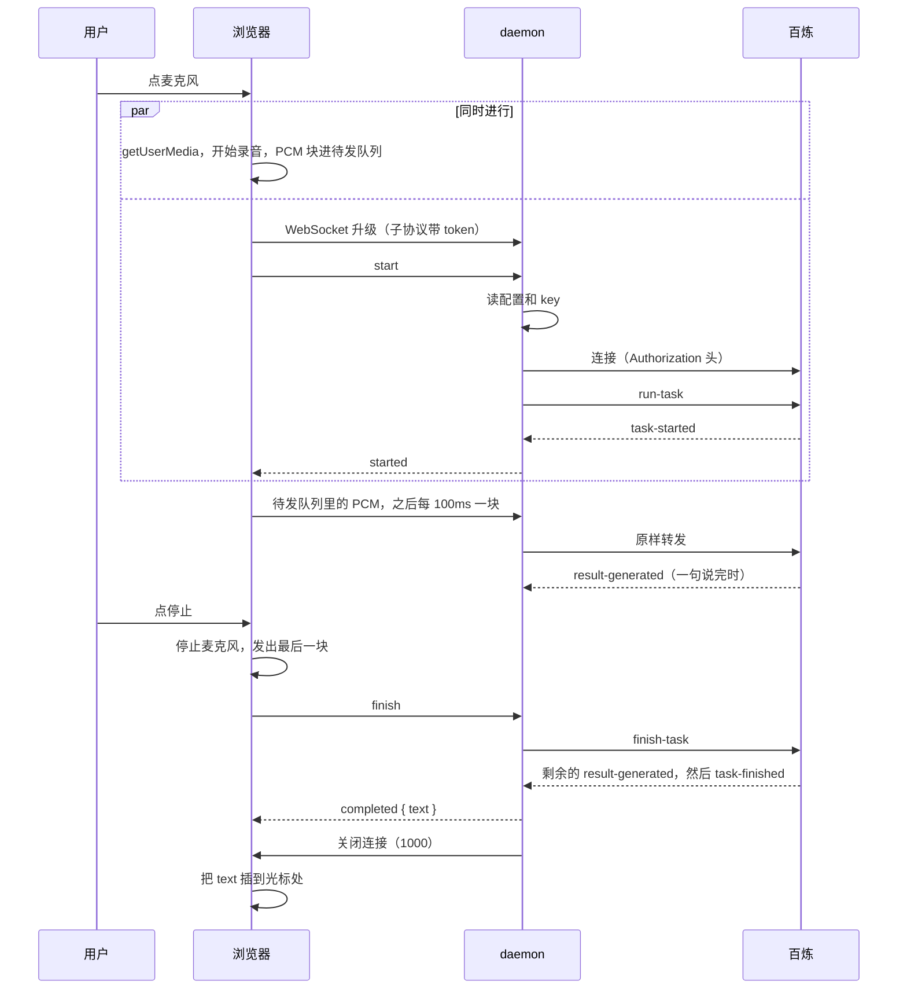

# 语音输入：数据流与接口

## 1. Context & Scope

本模块和外界有三条通道：

| 通道 | 两端 | 传什么 |
|---|---|---|
| 设置接口（HTTP） | Web 设置页 ↔ daemon | 读写语音配置 |
| 语音连接（WebSocket，本模块自定义协议） | Web 输入框 ↔ daemon | 音频进，文字出 |
| 识别服务连接（WebSocket，百炼协议） | daemon ↔ 阿里云百炼 | 音频进，识别结果出 |

不在本文范围：输入框草稿的保存和发送（输入框模块负责，语音只调用草稿的写入方法）；百炼协议本身的完整定义（以阿里云文档为准，本文只写用到的部分）。

## 2. Data Flow Description

### 2.1 配置流

```
设置 › Audio 分区 ──PUT /v1/settings/audio──▶ daemon 设置路由
                                                 │ updateAudioSettings()
                                                 ▼
                                   audio.json + .env（原子写，失败一起回滚）
                                                 │
                                   settings.changed { domains: ["audio"] }
                                                 ▼
                              所有打开的页面重新读取 audio 设置
```

- 写 key 时只写不读：响应里只有 `apiKeyConfigured`，没有 key。
- 写完后 daemon 发 `settings.changed` 事件（SSE），其他标签页和输入框据此刷新"是否已配置"。
- 用户在别处改了 `.env`（`env` 域变化）时，也要让 audio 重新读取，因为 key 有没有值可能变了。

### 2.2 录音主流程



录音和建连同时开始：用户一点就能说，建连这段时间（通常几百毫秒）录到的音频先放进浏览器的待发队列，收到 `started` 后按原来的顺序逐块发出（每块仍是一个 3200 字节的帧，不合并成大帧）。

### 2.3 取消和出错

| 情况 | 流向 |
|---|---|
| 用户按 Esc 取消 | 浏览器停麦克风，发 `cancel`，然后关闭连接。daemon 收到 `cancel` 或连接关闭，都取消识别任务（直接断开和百炼的连接，不发 `finish-task`），不回任何消息 |
| 浏览器连接意外断开（刷新页面、切会话） | 同上，daemon 当作取消 |
| 未配置 | daemon 收到 `start` 后发现没配置，回 `error { code: "not_configured" }` 并关闭连接 |
| 百炼拒绝 key | 连接百炼时握手返回 401 或 403，回 `error { code: "provider_auth_failed" }` |
| 连不上百炼 | 网络、DNS、TLS 出错，或握手返回 401、403 以外的状态（多半是 Base URL 填错，例如 404），回 `error { code: "provider_unreachable" }`，`message` 里带上状态码 |
| 百炼任务失败 | 收到 `task-failed`，回 `error { code: "provider_failed", message }`，`message` 带上百炼的 `error_code` 和 `error_message` |
| 超时 | 见 [non-functional §2](non-functional.md)，回 `error { code: "timeout" }` |
| 录音太长 | daemon 收到的音频超过上限，回 `error { code: "too_long" }` |
| 浏览器发错消息 | 顺序不对、格式不支持、`started` 之前发音频，回 `error { code: "bad_request" }` |

所有 `error` 之后 daemon 都会关闭连接，并取消还在进行的识别任务。

## 3. Interface Definition

### 3.1 设置接口（HTTP）

照现有的 `/v1/settings/search`（`packages/ohbaby-server/src/protocols/web/routes/global-settings.ts`）。

| 接口 | 请求 | 响应 |
|---|---|---|
| `GET /v1/settings/audio` | 无 | `UiSettingsAudio` |
| `PUT /v1/settings/audio` | `UiSettingsAudioUpdate` | `UiSettingsAudioResponse`；校验失败返回 400 和错误说明 |

类型定义见 [data-model §4](data-model.md)。鉴权和其他设置接口一样，用 Bearer 头。

SDK 里的设置变更事件（`packages/ohbaby-sdk/src/contract/events.ts` 的 `UiSettingsChangedEvent.domains`）新增 `"audio"`。Web 的 `settings-layer.ts` 里，`DOMAIN_KINDS` 的 `audio` 映射到 `["audio"]`，`env` 的映射里也加上 `"audio"`。

### 3.2 语音连接（浏览器 ↔ daemon）

常量放在 `packages/ohbaby-sdk/src/contract/voice.ts`，照 `contract/terminal.ts`。

**建立连接**

| 项 | 值 |
|---|---|
| 地址 | `ws(s)://<daemon 地址>/v1/voice/transcribe` |
| 子协议 | `["ohbaby.voice.v1", "ohbaby.bearer.<base64url(token)>"]`，daemon 选中 `ohbaby.voice.v1` |
| 升级前检查 | 和终端完全相同：Host 检查、daemon 必须只绑定本机回环地址、Origin 检查（`auth/host-check.ts`）。不通过就拒绝升级 |
| 鉴权失败 | 升级后用 4401 关闭，和终端一致 |
| 单帧上限 | 语音路由自己设 `maxPayload`（例如 64KB），和终端一样防止超大帧；正常的音频帧只有 3200 字节 |

**浏览器 → daemon**

| 消息 | 形式 | 何时发 |
|---|---|---|
| `{"type":"start","format":"pcm_s16le","sampleRate":16000,"channels":1}` | 文本帧 | 连接建立后第一条，只发一次 |
| PCM 音频 | 二进制帧，16kHz、单声道、16 位小端，每帧约 100ms（3200 字节） | 收到 `started` 之后 |
| `{"type":"finish"}` | 文本帧 | 用户停止录音，最后一块音频发完之后 |
| `{"type":"cancel"}` | 文本帧 | 用户取消。发完浏览器自己关闭连接 |

`format`、`sampleRate`、`channels` 本轮只接受上面这一组值，其他值回 `bad_request`。把它们写进 `start`，是为了以后换格式时不用改协议版本。

**daemon → 浏览器**

| 消息 | 含义 |
|---|---|
| `{"type":"started"}` | 识别任务已就绪，可以发音频 |
| `{"type":"completed","text":"…"}` | 识别完成。`text` 可能是空字符串，表示没听到内容。发完 daemon 用 1000 关闭连接 |
| `{"type":"error","code":"…","message":"…"}` | 出错。`code` 给程序判断，`message` 只用于日志和提示里的补充说明。发完 daemon 用 1000 关闭连接 |

**错误码**

| `code` | 含义 |
|---|---|
| `not_configured` | 语音输入还没配置好 |
| `provider_auth_failed` | 识别服务拒绝了 API key |
| `provider_unreachable` | 连不上识别服务 |
| `provider_failed` | 识别服务报告任务失败 |
| `timeout` | 等待识别服务超时 |
| `too_long` | 录音超过上限 |
| `bad_request` | 浏览器发的消息不符合协议 |

**关闭码**：`1000` 正常结束（包括出错后），`4401` 鉴权失败。浏览器没收到 `completed` 或 `error` 就看到连接关闭，一律按"连接断开"处理。

### 3.3 识别引擎接口（daemon 内部）

放在 `packages/ohbaby-server/src/voice/engine.ts`。

```ts
interface SpeechEngine {
  /** 准备好识别任务后才 resolve；失败时 reject 一个带错误码的 VoiceError。 */
  start(options: { signal: AbortSignal }): Promise<SpeechTask>;
}

interface SpeechTask {
  /** 送一块 16kHz 单声道 16 位 PCM。 */
  sendAudio(chunk: Uint8Array): void;
  /** 告诉引擎音频结束，等最终文字。 */
  finish(): Promise<string>;
  /** 丢弃这次识别，释放连接。可以重复调用。 */
  cancel(): void;
}
```

`VoiceError` 带一个上面错误码表里的 `code`。`VoiceSession` 只认这个接口，不知道背后是百炼还是本地模型。每次 `start` 时按当时的配置创建引擎，所以用户改了设置，下一次录音就生效。

### 3.4 百炼引擎的对接（daemon ↔ 百炼）

依据阿里云文档"Qwen-Audio-ASR-Message WebSocket API"（2026-11-20 查阅）。

| 引擎动作 | 对百炼做什么 |
|---|---|
| `start` | 连接 `wss://<baseUrl 的主机名>/api-ws/v1/inference`，请求头 `Authorization: Bearer <key>`。连上后发 `run-task`（见下），等到 `task-started` 才 resolve |
| `sendAudio` | 把 PCM 原样作为二进制帧发出 |
| `finish` | 发 `finish-task`，收集结果，收到 `task-finished` 时 resolve 拼好的文字 |
| `cancel` | 直接关闭连接 |

`run-task` 的内容：

```json
{
  "header": { "action": "run-task", "task_id": "<32 位随机 ID>", "streaming": "duplex" },
  "payload": {
    "task_group": "audio",
    "task": "asr",
    "function": "recognition",
    "model": "<配置的 model>",
    "parameters": {
      "format": "pcm",
      "sample_rate": 16000,
      "vad_model": "near_meeting_16k",
      "disfluency_removal_enabled": true,
      "language_hints": ["zh", "en"]
    },
    "input": {}
  }
}
```

`disfluency_removal_enabled` 取配置里的 `disfluencyRemoval`；`language_hints` 取配置里的 `languageHints`，空数组时整项不传。

`finish-task`：`{"header":{"action":"finish-task","task_id":"<同一个 ID>","streaming":"duplex"},"payload":{"input":{}}}`。

几个取值的理由：

| 参数 | 取值 | 理由 |
|---|---|---|
| `vad_model` | `near_meeting_16k` | 用户对着电脑麦克风说话，属于近场。默认的 `far_field_meeting_16k` 是给会议室的 |
| `intermediate_result_enabled` | 不传（默认关） | 不显示中间结果 |
| `max_sentence_silence` | 不传（默认 800ms） | 只影响断句，不影响最终文字是否完整，因为我们等 `task-finished` 才交结果 |

收结果：只取 `result-generated` 里 `output.sentence.sentence_end = true` 且不是心跳的句子，按 [data-model §6](data-model.md) 的规则拼接。

## 4. Data Ownership & Responsibility

| 数据 | 谁产生 | 谁负责 | 去向 |
|---|---|---|---|
| 语音配置 | 用户在设置页填 | ohbaby-agent `config/audio/` 校验和保存 | `audio.json` |
| API key | 用户填 | ohbaby-agent 写入 `.env`；daemon 用的时候按 `apiKeyEnv` 从运行时环境或 `.env` 读（和搜索工具读 Tavily key 的方式一样） | 只发给百炼的请求头，不进日志、不回浏览器 |
| PCM 音频 | 浏览器 | 浏览器负责格式正确；daemon 只转发、只数字节 | 百炼；用完即丢 |
| 识别文字 | 百炼 | 百炼引擎负责拼接；浏览器负责插入 | 输入框草稿 |
| 错误码 | daemon | daemon 把各种底层错误归到错误码表；浏览器把错误码翻译成界面文案 | 界面提示 |
