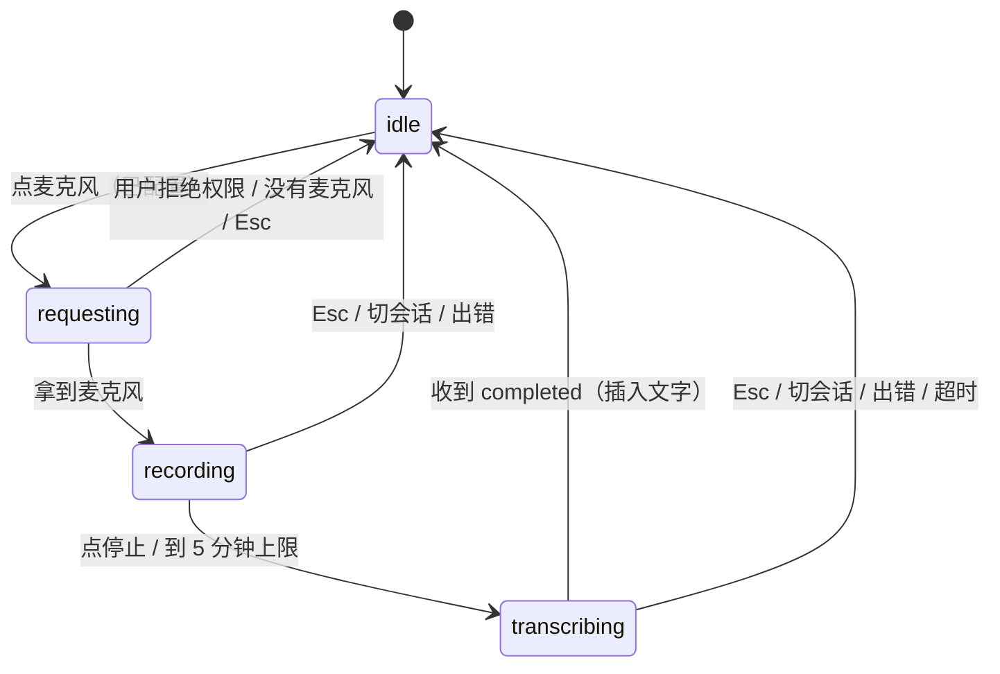

# 前端 04：交互与状态

## 1. 录音状态机（组件级）

状态由 `useVoiceInput` 管理，`VoiceButton` 和 `VoiceWaveform` 只负责显示。

| 状态 | 含义 | 麦克风按钮 | 底部空白处 | 后台在做什么 |
|---|---|---|---|---|
| `unavailable` | 不是安全上下文，浏览器不给用麦克风 | 不可用，悬停说明原因 | 空 | 无 |
| `idle` | 空闲 | 🎙 | 空 | 无 |
| `requesting` | 等浏览器给麦克风权限（第一次会弹授权框） | ■（已经可以点来取消） | 空 | 同时开始建立语音连接 |
| `recording` | 录音中 | ■ 深色实心 | 波形 | 音频进待发队列；收到 `started` 后按顺序发出 |
| `transcribing` | 已停止，等识别结果 | ◌ 不能点 | `Transcribing…` | 已发 `finish`，等 `completed` |

`unavailable` 是页面打开时就定下的，不参与上面的转换。

几个转换的细节：

| 转换 | 细节 |
|---|---|
| `idle` → `requesting` | 申请麦克风和建立连接同时开始，不等其中一个完成 |
| `requesting` → `recording` | 拿到麦克风就进入，不等连接建好。这时说的话进待发队列 |
| 连接在 `recording` 期间失败 | 例如收到 `not_configured`、`provider_auth_failed`：立刻停麦克风，回到 `idle`，显示对应提示。已录的音频丢弃 |
| `recording` → `transcribing` | 停麦克风，把最后一块音频发出去，再发 `finish`。如果这时还没收到 `started`，先等 `started`，把队列发完再发 `finish` |
| 任何状态回到 `idle` | 都要停麦克风轨道、关 `AudioContext`、关连接（[non-functional §3.1](../non-functional.md)） |
| 取消和结果撞车 | 用户按 Esc 时 `completed` 可能已经在路上。取消后立刻解绑这条连接的所有监听，之后到达的任何消息都忽略，文字不会再插进来 |
| 录音中改了设置 | 本次录音照旧用开始时的配置，改动从下一次录音生效 |

## 2. 页面级状态矩阵

麦克风只在主输入框里出现（会话页和新对话页的输入框）。下表是"语音配置情况 × 录音状态"在输入框里的表现：

| 语音配置 | 点麦克风 | 说明 |
|---|---|---|
| 已配置（`configured = true`） | 开始录音 | 正常流程 |
| 未配置（`configured = false`） | 直接打开设置的 Audio 分区（**待用户确认**） | 按钮悬停文字是 `Set up voice input`。不弹麦克风授权框 |
| 还没读到配置（设置还在加载或读取失败） | 照常开始录音 | 由 daemon 判断。如果 daemon 回 `not_configured`，提示并打开 Audio 分区 |
| 不是安全上下文 | 按钮不可用 | 见 §5 |

输入框自身的状态和录音的关系：

| 输入框状态 | 录音时的表现 |
|---|---|
| 有草稿 | 草稿不动；识别结果插到光标处 |
| 正在运行（显示"停止运行"按钮） | 可以录音。识别结果照常插进草稿，用户之后自己决定是排队发送还是插话 |
| 输入框不可用（例如会话正在加载） | 麦克风按钮也不可用 |
| 斜杠命令面板打开 | 可以录音；Esc 先关面板 |

## 3. 交互语义

| 操作 | 结果 |
|---|---|
| 点麦克风 | 按 §2 的配置情况开始录音或打开设置 |
| 点停止（■） | 停止录音，进入识别 |
| `Esc` | `requesting`、`recording`、`transcribing` 三种状态下都表示取消：丢掉这次录音和结果，回到 `idle`，不提示。优先级见下 |
| 录音时在输入框打字、移动光标、选择文字 | 照常。识别结果插入时以那一刻的光标为准 |
| 录音时改权限、换模型、改思考强度 | 照常 |
| 发送按钮和回车（**待用户确认**） | `recording` 和 `transcribing` 期间不可用：发送按钮变灰，悬停文字 `Finish voice input first`；回车不发送，也不换行（换行仍用 Shift+Enter）。识别完成后恢复 |
| 切换会话、离开页面、输入框卸载 | 取消录音，不提示 |
| 到 5 分钟上限 | 自动停止，照常识别插入，同时提示 `Recording stopped at the 5-minute limit.` |

**Esc 的优先级**（从高到低）：

1. 打开着的菜单、斜杠命令面板、对话框：它们自己先处理 Esc，录音不受影响。
2. 正在录音或识别：取消录音。这一下不计入"连按两次 Esc 停止运行"的次数。
3. 原有的行为：退出排队消息的编辑、连按两次停止运行。

录音期间焦点可能在麦克风按钮或底部其他控件上，而不在输入框里，所以 Esc 要在整个页面上都能取消录音，不能只在输入框里监听。但有两种情况不取消：Esc 已经被别的组件处理过（`event.defaultPrevented`，现有的 `Menu` 就会这样做）；或者当时打开着对话框（例如从侧栏打开的设置），这时 Esc 只关对话框。

**键盘**：麦克风按钮可以用 Tab 选中，Enter 或空格开始和停止。本轮不加全局快捷键。

## 4. 插入规则

| 规则 | 说明 |
|---|---|
| 插在哪 | 识别完成那一刻输入框记住的光标位置。输入框失去焦点后浏览器仍然记得光标，所以用户点了麦克风按钮也不影响。本次打开会话后用户还没点过输入框，就接在末尾 |
| 选中了文字 | 用识别结果替换选中的部分，和打字一样 |
| 前后空格 | 插入点左边是拉丁字母或数字、识别结果以拉丁字母或数字开头时，前面补一个空格；右边同理。中文前后不加空格 |
| 撤销 | 插入时先让输入框获得焦点，用浏览器的"插入文本"命令写入，这样 Ctrl/Cmd+Z 能撤销这次插入。浏览器不支持这个命令时，退回直接改草稿（这时不能撤销） |
| 插入后 | 焦点留在输入框，光标在插入的文字后面。草稿照常自动保存 |
| 空结果 | 不改输入框，提示 `Didn't catch that. Try again.` |

## 5. 错误与不可用表现

提示用应用已有的 Notice（`ui/shared/Notice.tsx`，默认 6 秒后消失，鼠标悬停时不消失）。`NoticeItem` 支持 error 和 info 两类，但 `AppController` 现在只有推 error 的 `pushError`，要新增推 info 的方法（见 [architecture §3.4](../architecture.md)）。出错时输入框里的文字一律不动。

| 情况 | 怎么发现 | 提示文案 | 之后 |
|---|---|---|---|
| 不是安全上下文 | 页面打开时检查 `window.isSecureContext` 和 `navigator.mediaDevices` | 不弹提示；按钮不可用，悬停 `Voice input needs localhost or HTTPS` | 一直不可用 |
| 用户拒绝麦克风权限 | `getUserMedia` 报 `NotAllowedError` | `Microphone access is blocked. Allow it in your browser's site settings.` | `idle` |
| 没有麦克风 | `NotFoundError` | `No microphone found.` | `idle` |
| 麦克风被别的程序占用 | `NotReadableError` | `The microphone is in use by another app.` | `idle` |
| 未配置 | `not_configured` | `Set up voice input first.` | 打开 Audio 分区 |
| key 被拒绝 | `provider_auth_failed` | `The voice input API key was rejected. Check it in Settings › Audio.` | `idle` |
| 连不上识别服务 | `provider_unreachable` | `Can't reach the speech service. Check your network and the Base URL.` | `idle` |
| 识别失败 | `provider_failed` | `Transcription failed.`，后面附上 daemon 给的 `message` | `idle` |
| 超时 | `timeout`，或浏览器自己等了 20 秒 | `Transcription timed out. Try again.` | `idle` |
| 太长 | `too_long` | `Recording is too long.` | `idle`（正常不会出现，浏览器 5 分钟先停） |
| 连接断开 | 没收到 `completed` 或 `error` 连接就关了 | `Voice input disconnected. Try again.` | `idle` |
| 协议错误 | `bad_request` | `Voice input failed.` | `idle`（说明前后端代码不一致，控制台记录详情） |
| 没听清 | `completed` 但 `text` 为空 | `Didn't catch that. Try again.`（info 类型） | `idle` |

错误码的来源见 [dfd-interface §3.2](../dfd-interface.md)。
