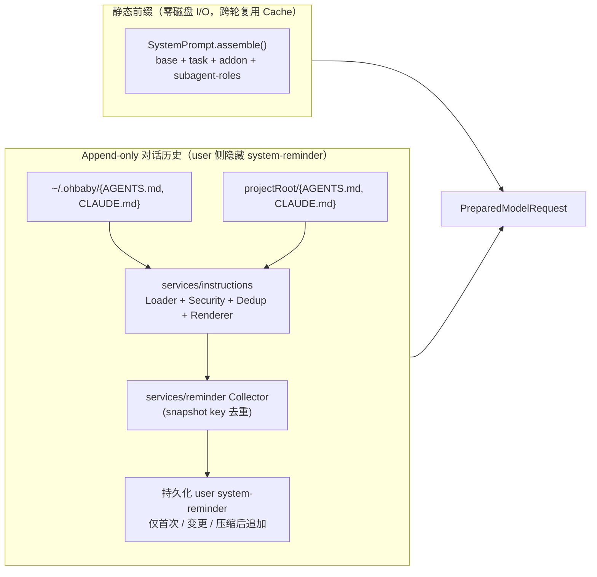

# 2. 优化方案与改动面

> 本文件是面向**后续实施会话**的执行契约。新增 `services/instructions` 模块的详细规格见 [docs/services/instructions/](../../../services/instructions/goals-duty.md)；验收与测试要求见 [04-test-and-acceptance.md](./04-test-and-acceptance.md)。

---

## 2.1 方案总览

本方案通过「**纯净化静态 System Prompt + 复用 Reminder 管道承载指令 + 全链路清除 Memory 残留**」三步协同，一次性解决 KV Cache 击穿、私有约定冗余与长期记忆概念污染问题：

1. **System Prompt 与磁盘指令文件解耦**：删除 `core/system-prompt/services/custom-instruction-loader.ts` 与 `core/system-prompt/layers/custom.ts`，`SystemPrompt.assemble()` 不再接收或拼装任何用户/项目指令，指令文件改动不再影响 `system` 消息字节。
2. **新增 `services/instructions` 模块并接入 `services/reminder`**：以标准 `ReminderProvider`（`type: "instructions"`、`kind: "snapshot"`、`audience: "both"`）身份运行于 `REMINDER_ORDER` 首位；从用户全局 `~/.ohbaby/` 与会话项目根同时读取 `AGENTS.md` 和 `CLAUDE.md`，按 `trim()` 后的内容哈希去重，仅对 `<system-reminder>` 边界标签做转义，经持久化、只追加的 `user` 侧 reminder 注入历史。
3. **彻底清除 A/B 类长期记忆残留**：确认 `resolveLegacyGlobalMemoryPath` 与旧全局记忆迁移逻辑已由前置专题删除（见 §2.3 前置条件），删除 `docs/core/memory/` 与幽灵 `memory_*` 工具测试；将 `ToolCategory`、`PermissionToolCategory`、`PermissionCallKind` 与 `goals/tools.ts` 中借用的 `"memory"` / `"memory-write"` 统一正名为 `"internal-state"`。

---

## 2.2 设计决策表

| 决策项 | 选择 | 理由 | 放弃的选项 | 代价 |
| --- | --- | --- | --- | --- |
| 指令注入载体 | 接入现有 `services/reminder`（`user` 侧持久化 `<system-reminder>`） | 直接复用持久化、锚定排序、压缩后重建、UI 隐藏与 Cache 前缀不变性，零新增消息协议 | 留在 `SystemPrompt.assemble()`；或另造一套独立消息注入通道 | `ReminderContext` 需新增 `directory` / `projectRoot` 字段，且 `Lifecycle` 的每步 `stepInput` 需透传 `projectRoot` |
| 文件名与共存策略 | 仅 `AGENTS.md` + `CLAUDE.md`；两者都读并按 `trim()` 后 SHA-256 去重（项目内同目录软链别名直接跳过） | 对齐 2026 行业标准（AAIF `AGENTS.md` + Anthropic `CLAUDE.md`）；既兼容互补配置又避免 symlink/副本双倍 token | 保留 `OHBABY.md` 或 `AGENT.md`；或二选一 fallback | 依赖旧 `OHBABY.md` 或单数 `AGENT.md` 的用户需重命名文件 |
| 软链与读取边界 | 项目作用域先 `lstat`，只读普通文件：软链一律不读，仅当 `readlink` 字面目标为同目录另一固定文件名（`AGENTS.md` ↔ `CLAUDE.md`）且该兄弟文件经 `lstat` 为普通文件时静默跳过，其他软链（无论指向根内还是根外、悬空或循环）跳过并告警；全局作用域用 `stat` 跟随软链（前提是全局根只来自宿主环境：项目 `.env` 不能写入 `OHBABY_HOME` / `HOME` / `USERPROFILE`，由前置专题在 `utils/project-env.ts` 落地）。两者都在 `open` **之前**确认是普通文件，打开时沿用仓内平台 flags（POSIX 项目 `O_RDONLY \| O_NOFOLLOW \| O_NONBLOCK`、POSIX 全局 `O_RDONLY \| O_NONBLOCK`、Windows `O_RDONLY`），`open` 后对句柄 `stat()` 复核仍是普通文件，再有界读取 | 项目根内也有不该自动上传的文件（未提交的 `.env`），“真实路径在根内”拦不住 `AGENTS.md -> .env`；`readlink` 字面匹配足够覆盖常见 `ln -s AGENTS.md CLAUDE.md` 双向别名，免去 `stat` 跟链与 `ENOENT`/`ELOOP` 边角；全局根防劫持放在 `project-env.ts` 一处，能同时保护指令和全部全局配置，不用层层透传参数，且和前置专题改的是同一个函数；仓内 `read-file-page.ts` 与 `shell-jobs/reader.ts` 已有成熟的平台 `O_NONBLOCK` / `O_NOFOLLOW` 分支，可直接堵上 POSIX 检查到 `open` 之间的 FIFO 阻塞窗口 | 按 `realpath` 前缀限定在作用域根内（拦不住根内私密文件，且要处理大小写、盘符、UNC、junction）；用 `stat(候选)` + `dev/ino` 判别名（复杂度高且易误判悬空/循环链）；跨层透传 `trustedOhbabyHome`；全平台放弃 `O_NONBLOCK`；打开后再比对 `dev` / `ino`（`O_NOFOLLOW` 加句柄 `isFile()` 已挡住换成软链或 FIFO，换成另一个普通文件要本地进程配合，不在威胁模型内） | 把 `AGENTS.md` 软链到 `docs/` 等位置（或 `./AGENTS.md` 这类带前缀相对别名）的项目会拒读并告警（但合法普通文件仍正常加载）；项目 `.env` 中的 `OHBABY_HOME` 不再生效；用户不应在宿主环境里把 `$OHBABY_HOME` 指到陌生仓库 |
| 单文件与合并总预算 | 单文件上限 `32 * 1024`、合并总预算 `64 * 1024` UTF-8 字节（与有界读取同一单位，参考 Codex `project_doc_max_bytes`；截断退到完整字符边界）；超限时按「项目优先于全局、`AGENTS.md` 优先于 `CLAUDE.md`」截断或省略并告警；被截断的文件在正文末尾加一行 `[Truncated: …]` 提示，让模型知道规则不完整（借鉴 dsh、ZCode） | 防止 4 个文件合计达 200KB 撑爆小窗口模型，同时保持简单无多档复杂预算引擎 | 仅限制单文件 50KB 不设总预算；或照搬 `dsh` 多档渐进省略引擎 | 极小窗口模型若叠加历史仍超限，仍由 `Lifecycle` 既有 `context_overflow` 显式报错 |
| 文本编码 | 先看 BOM（UTF-8 / UTF-16 LE / UTF-16 BE）；没有 BOM 时先严格 UTF-8，失败再 GB18030；都失败才拒读（`INVALID_ENCODING`）。全部用 Node 24 自带的 `TextDecoder`，读取边界用 `stream: true` 处理；长度在解码后按 UTF-8 字节计 | 用户不需要手动转换：覆盖 Windows PowerShell 5.1 / 记事本 “Unicode” 写出的 UTF-16 和老版中文记事本的 GBK；识别顺序借鉴 ZCode `text-metadata.ts`，UTF-16BE 借鉴 kimi-code `encoding.ts`；零新依赖 | 只认 UTF-8、让用户手动转换；有损 UTF-8 解码（ZCode、kimi-code、Claude Code 的指令加载器都这样做，GBK 中文会变成乱码发给模型）；引入 iconv-lite / chardet；无 BOM UTF-16 的 0 字节猜测 | 无 BOM 的 UTF-16 仍会被拒；Shift-JIS、Latin-1 等其他旧编码可能被按 GB18030 解成乱码而不报错；原始读取上限放宽到约 `2 * maxFileBytes` |
| 作用域与扫描深度 | 全局 `resolveOhbabyHome()`（`~/.ohbaby/`）+ 项目根（`projectRoot ?? directory`）两层 | 满足用户个人默认规范与项目团队规范，同时遵循 KISS 不引入目录树递归复杂度 | 仅项目级；或项目根到 `cwd` 链式 + tool touch 子目录动态发现 | 超大 monorepo 子目录独立 `AGENTS.md` 暂不自动发现（可逆，后续易补） |
| 变更刷新、读错与压缩协同 | 每步按需探测 4 路径，只采用本步验证通过的文件；变更追加统一固定头注的全量快照；读错的文件告警并用上次成功读到的内容顶替（进程内 `lastGoodReads`，被删除或被拒时清掉）；历史有旧快照而本步一份可用的都没有时，发一次 `cleared` 通知（不推测原因）；`compression-prompt.ts` 提示模型不抄录外部指令文件，压缩后由 loader 按活跃历史与磁盘现态重新决定 | 无需脆弱的 `fs.watch`；最多 4 个固定路径的小文件探测开销低；一个持续读错的文件不会冻结其他文件的刷新，也不会压住另一份文件被安全拒绝的公告；短暂锁文件不会让模型误以为规则作废 | 后台 `fs.watch`；仅 run 启动读一次；逐文件持久化 delta 状态机；任一读错就整体保留旧快照（会冻结刷新）；读错就本步拿掉（固定头注会让模型误以为规则作废） | 单文件修改会重发其余未变文件；读错期间文件若被改过，模型暂时看到旧版本；进程重启后首次读取就读错时那份指令暂时缺席；追加通知不会从历史删除已发出的旧正文；压缩提示词只能降低复述概率，不能保证模型绝不复述 |
| 边界标签转义策略 | 仅定向转义 `<system-reminder>` / `</system-reminder>` 标签（含大小写、空白、属性变体）；来源只写固定标签 `global/AGENTS.md` 等，不插入绝对路径 | 阻止外部仓库破坏宿主 reminder 正文结构，同时保留 Markdown 代码块、泛型与 `&&` 命令可读性 | 对整份正文调用 `escapeReminderValue` 全量转义 | 需针对最终包装后文本单测覆盖各类变体；模型看不到指令文件所在的具体目录 |
| 告警去重与 `omit` 通知数 | 在 `reminder.ts` 内按生效项目根（`projectRoot ?? directory`）记一份上一步仍存在的诊断签名集合（`filePath + kind + detailKey`），每步只上报新出现的，再用本步结果替换；集合为空即删除条目。安全 `omit` 仅发 `onSecurityFinding`，不重复发 `onWarning`。通知保持工作区级（不填 `UiNotice.sessionId`，与 `prompt-security:` 一致） | 借鉴 Codex 的 `active_warnings`：十几行代码覆盖多步循环、同一步压缩二次收集和“修好后再坏重新上报”；诊断只取决于项目里的文件，同一项目的主会话、子代理和并发会话看到的是同一批文件，按项目根分组后去重口径和工作区级通知一致，子代理不会重复广播；条目数以项目根个数为上限，长驻 `ohbaby-server` 下也不会无限增长，不需要 FIFO 上限、销毁钩子或定时器 | 单独的 `diagnostic-deduper.ts`；按 `sessionId` 分组（每个子代理各报一次，长驻 daemon 还要另加 FIFO 上限）；改通知路由为按 `sessionId` 投递；依赖 `composition` 额外销毁钩子 | TUI 按 `notice.key` 合并只显示一条；Web 前端当前未消费 `notice.emitted`；进程重启后重新报一次；长驻 daemon 中后打开的会话不会再收到已报过的同一告警（通知是工作区级广播，TUI 已显示过） |
| B 类 `memory` 命名清理 | `ToolCategory` / `PermissionToolCategory` / `PermissionCallKind` 统一正名为 `"internal-state"`；`todo_write` 保持注册 `category: "write"`、仅将分类 `kind` 改为 `"internal-state"`；`evaluator.ts` 改为 `never` 穷尽检查 | 与现有测试语义 `"internal state update"` 一致，彻底消灭伪记忆命名，同时不扩大 `todo_write` 注册类别改动面 | 保留 `"memory"` / `"memory-write"`；或把 `todo_write` 注册类别也改成 `"internal-state"` | 需同步更新 `goals`、`permission`、`tool-scheduler` 少量测试与文档 |
| 旧路径与迁移 | 作为前置条件，由独立专题先删除整个 `migration/` 模块与 `resolveLegacy*` 旧路径工具；本轮不改 `migration/`，不加任何旧路径跳过规则 | `~/.ohbaby-agent/` 已废弃，不再兼容；给要删除的模块加逻辑是浪费；“一个功能一个专题”，迁移删除涉及启动路径与会话数据，需单独规划 | 本轮内只删 `legacyMemoryPath` 分支并在 `migrateConfigTree()` 加跳过规则；或本轮顺手删整个迁移模块 | 本轮实施依赖前置专题先合入 |
| `prompt-security` 位置 | 保留在 `core/system-prompt/security/index.ts`，由 `services/instructions` 与 `mcp` 共同复用 | 避免无收益的文件搬迁与大面积 import 抖动（KISS） | 把 `security/` 拆到新的顶层目录 | 路径名略带历史印记，但不影响边界清晰度 |

---

## 2.3 分阶段实施

> 2026-11-25 确认的执行顺序：先完成旧目录退役专题，再做本轮 Stage 3 的 memory cleanup（含 Stage 4 的记忆文档清理），最后做 Stage 1、2 的 instructions 接入及其余文档。保留 Stage 编号供验收表交叉引用。
>
> Stage 4 里**可以随 Stage 3 提前做**的只有和 `OHBABY.md` 无关的记忆文档清理：删除 `docs/core/memory/`；`docs/core/tool-scheduler/`、`docs/permission/`、`docs/goals/` 的 `"internal-state"` 命名同步；`docs/tools/architecture.md` 移除 `memory_*` 示例；`docs/core/tool-scheduler/goals-duty.md`、`docs/tools/goals-duty.md` 的 `MemoryLoader` 描述。其余各项（删除根目录 `OHBABY.md`、改写三份 README 的指令章节、`.gitignore`、`docs/core/system-prompt/`、`docs/project/`、`docs/core/context/`、`docs/config/agents/`）**必须等 Stage 2 完成后再做**：旧 loader 在那之前仍靠 `OHBABY.md` 提供指令，提前删会让中间版本丢指令。

> **前置条件**：[删除 `~/.ohbaby-agent` 旧路径专题](../../2026-11-24-legacy-home-removal/README.md)必须先落地。它负责删除整个 `migration/` 模块及其调用方、`OHBABY_LEGACY_*` 常量、全部 `resolveLegacy*` 旧路径工具（含 `resolveLegacyGlobalMemoryPath`），以及旧 loader `custom-instruction-loader.ts` 里的旧路径探测；旧 loader 文件本身留给本轮 Stage 2 删除。本轮不再修改 `migration/`，也不为旧路径新增任何代码。前置专题还负责让项目 `.env` 无法写入 `OHBABY_HOME` / `HOME` / `USERPROFILE`，这是本模块全局作用域跟随软链的安全前提，开工前确认它的 AC-12 已通过。开工前在仓库根执行 `rg -n "migrateOhbaby|OHBABY_LEGACY|resolveLegacy" packages/ --glob "!**/dist/**"`，结果应为空；否则先完成前置专题。

### Stage 1：搭建 `services/instructions` 模块并打通完整路径透传
- **目标**：在不破坏现有运行路径的前提下，建立新增模块并打通 `Lifecycle` → `ContextManager` → `ReminderCollector` 的 `projectRoot` / `directory` 透传链路。
- **改动文件清单**：
  - 新增 `packages/ohbaby-agent/src/services/instructions/`（`types.ts`、`loader.ts`、`renderer.ts`、`reminder.ts`、`index.ts` 及 `__tests__/{loader,renderer,reminder}.unit.test.ts`）
  - 修改 `packages/ohbaby-agent/src/services/reminder/index.ts`（`REMINDER_ORDER` 首项加入 `"instructions"`；`ReminderContext` 新增 `directory?: string`、`projectRoot?: string`；`ReminderProvider.collect` 扩为 `collect(context, previousKey?)`，由 collector 直接传入当前 provider 对应的 `latest.get(provider.type)`，消除各 provider 重复扫描 `context.history`）
  - 修改 `packages/ohbaby-agent/src/core/context/context-manager.ts`（`collectReminders()` 透传 `directory: input.directory`、`projectRoot: input.projectRoot`）
  - 修改 `packages/ohbaby-agent/src/core/context/compression-prompt.ts`（补充一条规则：不要把系统提醒注入的外部项目/全局指令文件内容抄录进压缩摘要）
  - 修改 `packages/ohbaby-agent/src/core/lifecycle/lifecycle.ts`（在每步构造 `stepInput` 时透传 `projectRoot: params.projectRoot`，确保主代理、子代理与强制压缩重试均拿到正确的会话项目根）
  - 修改 `packages/ohbaby-agent/src/core/system-prompt/security/index.ts`（`lineForIndex` 现在对每次命中都从字符串开头数换行，多命中时是平方级开销；改为随匹配位置单向推进行号，或预先建一次换行索引。这是旧问题，每步扫描会放大它；MCP 也用这个扫描器，一并受益），并在 `security/prompt-security.unit.test.ts` 补多命中时行号正确的用例
- **完成定义（DoD）**：
  - `services/instructions` 所有单元测试（对应 `docs/services/instructions/test.md` I-01 至 I-18 的单元部分）全部通过。I-12 和 I-13 中“经真实 `Lifecycle` + `composition`”“不出现在最终请求中”的部分依赖 Stage 2 的接线，放进 Stage 2 的 `tests/integration/adapters/ui-runtime/custom-instructions.integration.test.ts`。
  - `services/reminder/reminder.unit.test.ts` 通过，且 `"instructions"` 排序位于 `"environment"` 之前。

### Stage 2：切换注入通道并纯净化 `core/system-prompt`
- **目标**：将指令注入正式切换到 `services/instructions` reminder，彻底剥离 `SystemPrompt.assemble()` 与磁盘指令文件的耦合，更新所有锁定旧契约的根级集成测试与 KV Cache 契约测试。
- **改动文件清单**：
  - 修改 `packages/ohbaby-agent/src/adapters/ui-runtime/composition.ts`（在 `createReminderCollector` 中注册 `createInstructionsReminderProvider({ onSecurityFinding, onWarning })`，`onWarning` 经 `noticeFromInstructionWarning()` 转为 `instructions:${sourcePath}:${kind}` 通知；从 `createSystemPromptProvider` 移除 `onSecurityFinding`）
  - 修改 `packages/ohbaby-agent/src/adapters/ui-runtime/prompt-context.ts`（在 `noticeFromPromptSecurityFinding()` 旁新增 `noticeFromInstructionWarning()`，映射规则见 `docs/services/instructions/dfd-interface.md` §3.5）
  - 删除 `packages/ohbaby-agent/src/core/system-prompt/services/custom-instruction-loader.ts`
  - 删除 `packages/ohbaby-agent/src/core/system-prompt/layers/custom.ts`
  - 删除 `packages/ohbaby-agent/src/core/system-prompt/__tests__/custom-instruction-loader-service.unit.test.ts` 与 `custom.test.ts`
  - 修改 `packages/ohbaby-agent/src/core/system-prompt/assembler.ts`、`types.ts`、`index.ts`、`layers/index.ts`（移除 `customInstructions`、`customInstructionLoader`、只供旧 loader 用的 `onWarning`、`LayerType` 的 `"custom"`、`CustomInstructionScope`、`generateCustomInstructionsPrompt`、`loadCustomInstructions` 及所有 `CUSTOM_INSTRUCTIONS_*` / `get*CustomInstructionsPath` 导出）
  - 修改 `packages/ohbaby-agent/src/core/system-prompt/prompts/subagents/base.md`（删除第 21 行要求子代理遵守 `"in this system prompt"` 指令的过时条目，与 `primary/base.md` 保持精简一致，由第 14 行及 `instructions` reminder 自身优先级声明承载约束），并运行 `pnpm --filter ohbaby-agent prompt:generate` 同步更新 `prompts/templates.generated.ts`
  - 更新 `packages/ohbaby-agent/src/core/system-prompt/__tests__/assembler.test.ts`、`provider.test.ts`、`security/prompt-security.unit.test.ts`（夹具改为 `AGENTS.md` / `CLAUDE.md`，断言 `SystemPrompt.assemble()` 不含任何用户/项目指令）
  - 更新 `packages/ohbaby-agent/src/adapters/ui-inprocess.contract.test.ts`（安全拦截 notice 测试改用 `AGENTS.md` / `CLAUDE.md`，验证 `prompt-security:*` notice 路由且 `omit` 不重发通用 `onWarning`；新增 AC-20 的“非别名软链只出一条 `instructions:*` 通知、多步不重复”）
  - 更新 `packages/ohbaby-agent/src/adapters/ui-runtime/prompt-context.unit.test.ts`（覆盖 `noticeFromInstructionWarning()` 的 key / title / level 映射）
  - 在 `services/session-export/collect.ts` 的共享导出投影中复用 `isSystemReminderPart`，逐 part 过滤所有隐藏 reminder。HTML 和 JSONL 共用这一处；用户或助手主动写的同名标签按普通正文导出。验收见 AC-22。
  - 更新根目录 3 份锁定旧契约的集成测试：
    - `tests/integration/adapters/ui-runtime/custom-instructions.integration.test.ts`（利用三协议 HTTP 夹具验证指令位于 `user` reminder、同 run 改写文件实时尾部追加且历史前缀字节不变、主/子代理隔离读项目根）
    - `tests/integration/core/context/project-instructions.integration.test.ts`（改测新 reminder 注入与移除/压缩重建语义）
    - `tests/integration/core/context/environment-reminders.integration.test.ts`（移除已删 `customInstructionLoader` 依赖并验证 `instructions` 与 `environment` 顺序）
  - 扩展 `packages/ohbaby-agent/src/core/context/prompt-cache-wire.contract.test.ts`（新增“中途修改 `AGENTS.md`/`CLAUDE.md` 时 `system` 与旧历史前缀字节不变”契约测试）
- **完成定义（DoD）**：
  - `SystemPrompt.assemble()` 不再受指令文件影响，不再读取任何用户或项目 `.md` 文件。
  - 全量 `core/system-prompt`、`core/context`、`adapters/ui-inprocess`、`prompt-cache-wire` 与根级 `tests/integration/` 测试通过。

### Stage 3：彻底清理 A 类与 B 类长期记忆残留
- **目标**：消除运行态代码中的 `"memory"` / `"memory-write"` 命名残留，并移除幽灵记忆测试。
- **改动文件清单**：
  - 删除 `packages/ohbaby-agent/src/tools/memory-surface.unit.test.ts`
  - 修改 `packages/ohbaby-agent/src/core/tool-scheduler/types.ts`（`ToolCategory` 中 `"memory"` → `"internal-state"`）
  - 修改 `packages/ohbaby-agent/src/permission/types.ts`（`PermissionToolCategory` 中 `"memory"` → `"internal-state"`）
  - 修改 `packages/ohbaby-agent/src/permission/classifier.ts`（`PermissionCallKind` 中 `"memory-write"` → `"internal-state"`；`todo_write` 保持 `category: "write"`、仅将 `kind` 改为 `"internal-state"`；`category === "internal-state"` 直接保持）
  - 修改 `packages/ohbaby-agent/src/permission/evaluator.ts`（`case "memory-write"` → `case "internal-state"`，并将末尾 `default` 改为 `never` 编译期穷尽检查同时保留异常运行时值的 fail-closed 拒绝，既防编译期漏分支又守住运行期底线）
  - 修改 `packages/ohbaby-agent/src/goals/tools.ts`（4 个真实工具 `CreateGoal` / `UpdateGoal` / `GetGoal` / `SetGoalBudget` 的 `category: "memory"` → `category: "internal-state"`）
  - 更新 `packages/ohbaby-agent/src/permission/classifier.unit.test.ts` 及 `packages/ohbaby-agent/src/permission/evaluator.unit.test.ts`（更新 `todo_write` 期望为 `{ category: "write", kind: "internal-state" }`，删除幽灵 `memory_*` 断言块，补充 4 个真实 goal 工具在 `default` level 放行、显式 session deny 优先、未知工具回落写入审批测试）
  - 更新 `packages/ohbaby-agent/src/core/tool-scheduler/scheduler.unit.test.ts`、`capacity.integration.test.ts`（将测试中 `category: "memory"` 更新为 `"internal-state"`，顺手清理 `scheduler.unit.test.ts:2227-2326` 中 `callId: "memory_1"`、`makeEnvironment("D:/workspace/memory")` 等测试夹具命名）
  - 更新 `packages/ohbaby-cli/src/cli/stdout-renderer.contract.test.ts`、`packages/ohbaby-cli/src/tui/store/events.unit.test.ts`（将告警示例中的 `OHBABY.md` 替换为 `AGENTS.md` / `CLAUDE.md`）
- **完成定义（DoD）**：
  - 生产代码中不再存在 `resolveLegacyGlobalMemoryPath`、`memory-write` 或 `ToolCategory`/`PermissionToolCategory` 里的 `"memory"`。旧 loader 仍通过 `OHBABY.md` 提供当前指令能力；其文件名和仓库根入口在 instructions 切换时一起退出，届时再验收生产代码的 `OHBABY.md` 零残留。
  - `CreateGoal` / `UpdateGoal` / `GetGoal` / `SetGoalBudget` 与 `todo_write` 的调度和免审批行为保持 100% 等价；根目录 `pnpm test`（核对执行用例数 > 0）与 `pnpm typecheck` 通过。

### Stage 4：同步权威文档与仓库根入口文件
- **目标**：消除文档与实现漂移，规范本仓库自身的根目录指南文件。
- **改动文件清单**：
  - 删除 `docs/core/memory/` 整个目录（含其中的 `improve-1/`：模块已不存在，历史记录留在 git 里；历史专题如 `2026-10-18-subagent-system-prompt/05-implementation-acceptance.md:109` 对它的链接会失效，属于预期，不改历史专题）
  - 删除根目录 `OHBABY.md`
  - 根目录 `AGENT.md` 与 `CLAUDE.md` 是被 `.gitignore` 忽略的本地个人文件，不进仓库。`.gitignore` 的 `/AGENT.md` 改为 `/AGENTS.md`；本地把 `AGENT.md` 改名为 `AGENTS.md`（这一步只在开发者本机做，不提交）
  - 更新 `README.md:156`、`README.zh.md:156` 与 `packages/ohbaby-cli/README.md`（更新自定义指令章节：说明读取 `~/.ohbaby/` 与项目根下的 `AGENTS.md` / `CLAUDE.md`，经由低优先级 reminder 注入；不写 `OHBABY.md` 已废弃之类的提示，否则会被 04 §4.5 的 `rg` 门禁误报）
  - 更新 `docs/core/system-prompt/{goals-duty,architecture,data-model,dfd-interface,test}.md`（删除 custom instructions 职责与层顺序，添加指向 `docs/services/instructions/` 的说明）
  - 更新 `docs/project/{architecture,data-model,dfd-interface,goals-duty}.md`（清理过期的「Memory 模块管理 OHBABY.md」引用）
  - 更新 `docs/core/tool-scheduler/{architecture,data-model,dfd-interface}.md`、`docs/permission/{architecture,data-model,dfd-interface,test}.md`、`docs/goals/{data-model,dfd-interface}.md`（同步 `"internal-state"` 命名）
  - 定点更新 `docs/core/context/architecture.md`（§96 附近“指令变更仅在下一 run 生效”改为 reminder 实时追加语义）与 `docs/tools/architecture.md`（§460 附近移除 `memory_*` 工具示例）
  - 定点更新 `docs/core/context/test.md:89`（`OHBABY.md` 路径边界）、`docs/core/tool-scheduler/goals-duty.md:58,207` 与 `docs/tools/goals-duty.md:20`（`MemoryLoader`）、`docs/config/agents/goals-duty.md:101-103`（“`OHBABY.md` 由 system-prompt 加载”改为指向 `services/instructions`）。`improve-N/` 等历史讨论记录不改
- **完成定义（DoD）**：
  - 所有权威文档与最新代码契约一致；权威文档无死链（历史专题 `docs/problem-lists/**` 与各模块 `improve-*/` 不在检查范围内）、无过期 `OHBABY.md` / `MemoryLoader` 活跃契约描述。

---

## 2.4 按包/目录的改动面

| 包 / 目录 | 新增 | 修改 | 删除 | 说明 |
| --- | --- | --- | --- | --- |
| `packages/ohbaby-agent/src/services/instructions/` | `index.ts`, `types.ts`, `loader.ts`, `renderer.ts`, `reminder.ts`, `__tests__/*` | — | — | 新建指令加载、去重、渲染与 reminder 适配模块 |
| `packages/ohbaby-agent/src/services/reminder/` | — | `index.ts`, `reminder.unit.test.ts` | — | 注册 `"instructions"` 顺序、扩展 `ReminderContext` 并向 `collect` 传入 `previousKey?` |
| `packages/ohbaby-agent/src/core/context/` & `core/lifecycle/` | — | `core/context/{context-manager.ts,compression-prompt.ts,prompt-cache-wire.contract.test.ts}`, `core/lifecycle/lifecycle.ts` | — | 透传 `directory`/`projectRoot`、更新压缩摘要规则与 Cache 契约测试 |
| `tests/integration/` | — | `adapters/ui-runtime/custom-instructions.integration.test.ts`, `core/context/{project-instructions,environment-reminders}.integration.test.ts` | — | 更新 3 份锁定旧行为的根级集成测试，并复用三协议 HTTP 夹具验证新行为 |
| `packages/ohbaby-agent/src/core/system-prompt/` | — | `assembler.ts`, `types.ts`, `index.ts`, `layers/index.ts`, `prompts/subagents/base.md`, `prompts/templates.generated.ts`, `__tests__/{assembler,provider}.test.ts`, `security/index.ts`, `security/prompt-security.unit.test.ts` | `services/custom-instruction-loader.ts`, `layers/custom.ts`, `__tests__/{custom-instruction-loader-service.unit,custom}.test.ts` | 彻底静态化 system prompt、同步子代理静态模板；修复扫描器行号计算的平方级开销 |
| `packages/ohbaby-agent/src/adapters/ui-runtime/` & `adapters/` | — | `composition.ts`, `prompt-context.ts`, `prompt-context.unit.test.ts`, `ui-inprocess.contract.test.ts` | — | 将指令 provider 挂进 reminder collector 并保持 notice 路由 |
| `packages/ohbaby-agent/src/core/tool-scheduler/`, `permission/`, `goals/`, `tools/` | — | `core/tool-scheduler/{types.ts,scheduler.unit.test.ts,capacity.integration.test.ts}`, `permission/{types.ts,classifier.ts,evaluator.ts,classifier.unit.test.ts,evaluator.unit.test.ts}`, `goals/tools.ts` | `tools/memory-surface.unit.test.ts` | 清理 A/B 类残留，统一正名为 `"internal-state"` |
| `packages/ohbaby-cli/` | — | `README.md`, `src/cli/stdout-renderer.contract.test.ts`, `src/tui/store/events.unit.test.ts` | — | 仅更新文档与测试夹具，无运行逻辑变动 |
| 仓库根 & `docs/` | — | `.gitignore`, `README.md`, `README.zh.md`, `docs/core/system-prompt/*`, `docs/project/*`, `docs/core/tool-scheduler/*`, `docs/permission/*`, `docs/goals/*`, `docs/core/context/{architecture,test}.md`, `docs/tools/{architecture,goals-duty}.md`, `docs/config/agents/goals-duty.md` | `OHBABY.md`, `docs/core/memory/*` | 同步根指南与全部受影响权威文档 |

---

## 2.5 API / 协议 / 迁移与兼容

- **公开包根 Breaking Change（有意为之，已确认）**：
  1. **文件与迁移规则变更**：不再读取 `OHBABY.md`、单数 `AGENT.md`、`<project>/.ohbaby/*`、`~/.ohbaby-agent/*` 与 `~/.config/ohbaby-agent/OHBABY.md`；`~/.ohbaby-agent/` 旧路径与自动迁移由前置专题整体删除，不再兼容。仍使用 `OHBABY.md` 的用户需手动重命名为 `AGENTS.md` 或 `CLAUDE.md`。
  2. **npm 公开包根（`ohbaby-agent`）移除的导出**：`packages/ohbaby-agent/src/index.ts` 通过 `export * from "./core/system-prompt/index.js"` 对外公开导出，本轮将从公开包根移除以下符号与类型（`paths/index.ts` 的旧路径导出已由前置专题移除）：
     - 值导出：`CUSTOM_INSTRUCTIONS_FILE_NAME`、`PROJECT_CUSTOM_CONFIG_DIR`、`GLOBAL_CUSTOM_CONFIG_DIR`、`MAX_CUSTOM_INSTRUCTION_CHARS`、`getProjectCustomInstructionsPath`、`getProjectConfigCustomInstructionsPath`、`getGlobalCustomInstructionsPath`、`loadCustomInstructions`、`generateCustomInstructionsPrompt`、`SystemPrompt.loadCustomInstructions`。（`CUSTOM_INSTRUCTIONS_FALLBACK_FILE_NAMES` 只从 `layers/index.ts` 导出，不在包根；`resolveLegacyGlobalMemoryPath` 由前置专题移除，列在它的 Breaking Change 里。）
     - 类型/字段变更：`CustomInstruction`、`CustomInstructionScope`、`CustomInstructionLoadOptions`、`LayerType` 联合值 `"custom"`、`AssembleOptions.customInstructions`、`SystemPromptProviderOptions.customInstructionLoader`、`SystemPromptProviderOptions.onSecurityFinding`、`SystemPromptProviderOptions.onWarning`（只供旧 loader 使用，`assembler.ts:42,191`）。
     - 仓内类型变更（不从包根导出，不算公开 Breaking Change）：`ToolCategory` / `PermissionToolCategory` 联合值 `"memory"` 与 `PermissionCallKind` 联合值 `"memory-write"` 替换为 `"internal-state"`。
     - 不提供替代入口：包根不新增 `services/instructions` 的导出。仓内 `ohbaby-cli`、`ohbaby-sdk`、`ohbaby-server` 都没有引用上述旧符号；现有 reminder provider（environment、todo、mode 等）和 `ReminderProvider` 类型本来就不从包根导出，instructions 保持一致。以后确有外部需求再单独加。
     - 版本发布说明需显式标注上述 Breaking Change，避免下游将其误判为仅限仓内变更。
- **既有会话历史兼容（冷恢复）**：
  - 老会话数据库中若存在历史消息（不含 `instructions` reminder），冷恢复后的下一次 `prepareTurn()` 会检测到活跃历史中没有 `reminderType === "instructions"`，自动在末尾追加一条基线 `instructions` reminder，不影响历史消息反序列化或回放。
  - 若老会话历史消息中残留字面文本 `<memory>`，保持原样不被改写。
- **UI/CLI Notice 兼容**：
  - `noticeFromPromptSecurityFinding()` 继续使用 `prompt-security:${source}:${finding.patternId}` 键格式，`packages/ohbaby-cli/src/tui/store/events.ts:1535` 的过滤与展示逻辑无需改动。

---

## 2.6 风险与回滚

| 风险 | 影响 | 缓解措施 |
| --- | --- | --- |
| 快照 `key` 计算不稳定导致重复注入 | 相同文件内容在连续步骤中被重复追加 reminder | 取消双模式渲染，所有非空快照使用同一固定头注，`key` 仅由去重后的 `sources` 元数据与 `contentHash` 计算；单测显式验证“更新后连续 3 步只注入一次” |
| 瞬时 I/O 错误（如编辑器原子写、Windows 上文件被短暂锁住） | 若直接拿掉那份文件，模型会被告知规则作废，并多追加两份快照 | 用上次成功读到的内容顶替，`key` 不变、不追加；只有进程重启后首次读取就读错时才会缺席，`cleared` 正文只说“当前没有已验证可用的指令”，不说“已删除”；恢复后按正常更新自动补回 |
| 多步工具循环中安全扫描告警或截断告警反复触发 | UI/CLI 通知栏刷屏 | `reminder.ts` 按项目根只上报新出现的诊断；集合为空即删除条目，无需会话释放钩子 |
| 恶意仓库在 `AGENTS.md` / `CLAUDE.md` 中写入 `</system-reminder>` | 闭合提醒框架并伪造后续指令 | Renderer 定向转义所有大小写与变体的 `<system-reminder>` / `</system-reminder>` 标签，并配专门对抗测试 |
| `goals` 或 `todo_write` 权限重命名漏改一处分支 | 触发意外弹窗审批或拒绝执行 | Stage 3 完成后对全仓执行 `rg '"memory"|memory-write'` 核查，并跑通 `permission`、`goals`、`tool-scheduler` 全部测试 |

- **回滚策略**：本改造完全属于可逆代码重构，不涉及数据库 schema 变更或外部不可逆数据迁移；任一 Stage 若出现异常，可直接通过 git revert 回退对应提交。

---

## 2.7 与 00 边界对齐检查

- 静态化 `SystemPrompt.assemble()` → Stage 2 ✅
- 删除 `custom-instruction-loader.ts` → Stage 2 ✅；旧全局记忆路径与迁移 → 前置专题 ✅
- 清理 A/B 类长期记忆残留 → Stage 3 & Stage 4 ✅
- 复用 `reminder` 机制，仅支持 `AGENTS.md`（复数）+ `CLAUDE.md`，共存全读按内容去重，不支持 `OHBABY.md` 与 `AGENT.md` → Stage 1 & Stage 2 ✅
- 全局级（`~/.ohbaby/`）+ 项目根级（选项 A）→ Stage 1 ✅
- 主/子代理统一注入 → Stage 1 ✅
- 本轮不写代码，仅产出文档并送外部模型审查 → 符合 ✅

---

## 2.8 不在本轮

以下事项明确不纳入本轮 `improve-1`，未来若需要，须在本轮闭环后按需另行评估：

1. 长期记忆系统重新设计（独立仓库）。
2. Monorepo 子目录递归扫描与工具访问（`read`/`write`/`edit`）动态发现子目录 `AGENTS.md`。
3. 文件系统 watcher 与 `/reload` 手动热刷新命令。
4. Claude Code `@path` 导入、`.claude/rules/*.md` 与 `*.local.md` 本地 overlay。
5. 按子代理角色（如 `explore`）差异化关闭指令注入。
6. 为既有 `services/reminder/` 补写历史设计文档（本轮仅覆盖新增模块 `docs/services/instructions/`）。
