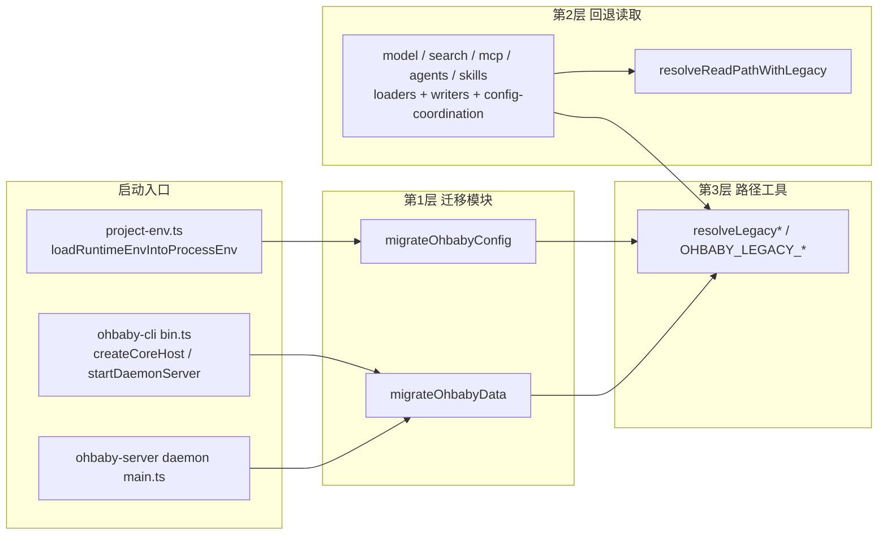

# 1. 问题基线与当前实施状态

> 时间口径：基于 `main` 分支提交 `9c43e13f`（2026-11-24）。行号是这个基线的快照，定位以符号为准。
> 落地顺序：本专题先落地，是指令提醒化专题的前置条件。旧的 `custom-instruction-loader.ts` 由那边的 Stage 2 整个删除；本专题只删掉它里面的旧路径探测，以及 `resolveLegacyGlobalMemoryPath`。

## 1.1 问题陈述

旧路径兼容一共有三层，比“删一个迁移模块”的范围大：

1. **迁移模块**：启动时把旧配置根和旧数据根复制到新位置。
2. **旧路径回退读取**：迁移之外，9 个配置读写点还在做“新路径没有文件，就去读旧路径”。
3. **旧路径工具**：`paths/` 里给前两层提供路径的函数和常量，从 npm 包根公开导出。

如果只删第 1 层，第 2 层照样会读旧目录，“不再兼容”就没有真正做到。三层要一起删。

## 1.2 已确认的产品 / 技术分界

- 旧目录（`~/.ohbaby-agent/`、`<project>/.ohbaby-agent/`、旧数据根）一律视为不存在：不读、不删、不提示。
- 新路径的解析规则保持不变：`OHBABY_HOME`、`~/.ohbaby/`、`<project>/.ohbaby/`、各平台数据根。

## 1.3 现状（ohbaby-agent / ohbaby-cli / ohbaby-server）

### 1.3.1 第 1 层：迁移模块（goals-duty / architecture）

- [migration/ohbaby-home.ts](../../../../packages/ohbaby-agent/src/migration/ohbaby-home.ts)（707 行），对外只有两个函数：
  - `migrateOhbabyConfig`（L479–516）：先把 `~/.ohbaby-agent/` 合并进 `~/.ohbaby/`，再处理旧全局记忆文件，有项目目录时再合并 `<project>/.ohbaby-agent/`。`.env` 和 `mcp/settings.json` 按键合并，其他文件冲突时另存一份 `*.migrated-from-ohbaby-agent.*`。有改动就写 `.migrated-from-ohbaby-agent.json` 标记。
  - `migrateOhbabyData`（L651–707）：把旧数据根复制到新数据根，并把 `ohbaby-agent.db(-wal/-shm)` 改名为 `ohbaby.db(-wal/-shm)`。为此带了进程锁、存活 daemon 检查、原子复制、逐字节比较和 `.migrated-from-ohbaby-agent-data.json` 标记。
  - 两者都认 `.skip-auto-migrate` 跳过标记。
- [migration/index.ts](../../../../packages/ohbaby-agent/src/migration/index.ts) 导出这两个函数和 `OhbabyMigrationOptions`、`OhbabyMigrationReport` 两个类型；[index.ts:172](../../../../packages/ohbaby-agent/src/index.ts#L172) 用 `export *` 把它们挂到 npm 包根。
- 单测 [migration/ohbaby-home.unit.test.ts](../../../../packages/ohbaby-agent/src/migration/ohbaby-home.unit.test.ts)（419 行）。

### 1.3.2 第 1 层的调用方（dfd-interface）

| 调用点 | 代码锚点 | 做什么 |
| --- | --- | --- |
| 运行时环境加载 | [utils/project-env.ts:45-52](../../../../packages/ohbaby-agent/src/utils/project-env.ts#L45-L52) | 每次 `loadRuntimeEnvIntoProcessEnv` 都调 `migrateOhbabyConfig`，结果放进返回值 `configMigrationReport`。`onWarning` 选项只给迁移用。 |
| CLI 启动提示 | [ohbaby-cli/src/bin.ts:880-884](../../../../packages/ohbaby-cli/src/bin.ts#L880-L884) | 把迁移警告推进 `startupNotices`，在 TUI 里显示。`startupNotices` 本身还被更新提示使用，要保留。 |
| CLI 非 TUI 路径 | [bin.ts:541-543](../../../../packages/ohbaby-cli/src/bin.ts#L541-L543) | 建 core host 前调 `migrateOhbabyData`。 |
| CLI TUI 路径 | [bin.ts:566-582](../../../../packages/ohbaby-cli/src/bin.ts#L566-L582) | 发 `configMigrationCompleted` 诊断事件，调 `migrateOhbabyData`，再发 `dataMigrationCompleted`。 |
| CLI serve 路径 | [bin.ts:684-702](../../../../packages/ohbaby-cli/src/bin.ts#L684-L702) | 发配置迁移诊断事件，并通过 `onDataMigrationReport` 回调发数据迁移诊断事件。 |
| CLI 动态导出探测 | [bin.ts:215-229](../../../../packages/ohbaby-cli/src/bin.ts#L215-L229)、[bin.ts:252-266](../../../../packages/ohbaby-cli/src/bin.ts#L252-L266)、[bin.ts:443-452](../../../../packages/ohbaby-cli/src/bin.ts#L443-L452) | 运行时模块类型里的 `migrateOhbabyData`、`configMigrationCompleted`、`dataMigrationCompleted` 字段，`MigrationCounts` 和 `migrationCounts()`，以及用 `optionalRuntimeExport` 探测 `migrateOhbabyData`。`emitWithoutAffectingProduct` 还被 `durationClockAnomaly` 使用，要保留。 |
| daemon 启动 | [ohbaby-server/src/runtime/daemon/main.ts:735-748](../../../../packages/ohbaby-server/src/runtime/daemon/main.ts#L735-L748) | 打开 SQLite 前调 `AgentRuntime.migrateOhbabyData`；`onDataMigrationReport` 选项定义在 L107。 |
| 诊断事件 | [observability/events.ts:98-117](../../../../packages/ohbaby-agent/src/observability/events.ts#L99-L117)、[observability/index.ts:14-15](../../../../packages/ohbaby-agent/src/observability/index.ts#L14-L15)、[observability/logger.ts:17,89](../../../../packages/ohbaby-agent/src/observability/logger.ts#L17) | `migration.config.completed`、`migration.data.completed` 两个事件和 `"migration"` 日志组件。`"migration"` 也是公开类型 `DiagnosticsComponent` 联合里的一员。 |

### 1.3.3 第 2 层：旧路径回退读取（data-model / dfd-interface）

[paths/read-fallback.ts](../../../../packages/ohbaby-agent/src/paths/read-fallback.ts) 的 `resolveReadPathWithLegacy(preferred, legacyPaths)` 逻辑是：新路径存在就用新路径，否则按顺序找第一个存在的旧路径。用到它的地方：

| 配置域 | 代码锚点 | 旧路径 |
| --- | --- | --- |
| model | [config/llm/loaders.ts:33-35, 78-83](../../../../packages/ohbaby-agent/src/config/llm/loaders.ts#L78-L83)（`getLegacyModelJsonPath`、`resolveModelJsonReadPath`） | `~/.ohbaby-agent/model.json` |
| model 写入 | [config/llm/writer.ts:351-356](../../../../packages/ohbaby-agent/src/config/llm/writer.ts#L351-L356) | 经 `resolveModelJsonReadPath` 读旧文件做备份来源 |
| 配置版本快照 | [config/llm/config-coordination.ts:96-135](../../../../packages/ohbaby-agent/src/config/llm/config-coordination.ts#L96-L135)（`settingsConfigVersion`） | 全局和项目旧根下的 `model.json`、`*/settings.json` |
| search | [config/tools/search/loaders.ts:23-40](../../../../packages/ohbaby-agent/src/config/tools/search/loaders.ts#L23-L40)；[writer.ts:123-128](../../../../packages/ohbaby-agent/src/config/tools/search/writer.ts#L123-L128) | `~/.ohbaby-agent/` 下的 search 配置和 `model.json` |
| mcp | [config/mcp/loaders.ts:51-65, 133-145](../../../../packages/ohbaby-agent/src/config/mcp/loaders.ts#L51-L65)；[config/mcp/writer.ts:50-55, 167-173](../../../../packages/ohbaby-agent/src/config/mcp/writer.ts#L50-L55) | 全局和项目旧根下的 `mcp/settings.json` |
| agents | [config/agents/loaders.ts:50-64, 128-140](../../../../packages/ohbaby-agent/src/config/agents/loaders.ts#L50-L64) | 全局和项目旧根下的 agents 配置 |
| skills | [config/skill/loaders.ts:82-96, 300-312, 348-360](../../../../packages/ohbaby-agent/src/config/skill/loaders.ts#L82-L96) | 全局和项目旧根下的 skills 配置 |
| 自定义指令 | [core/system-prompt/services/custom-instruction-loader.ts:5-7, 166, 189-199](../../../../packages/ohbaby-agent/src/core/system-prompt/services/custom-instruction-loader.ts#L166) | `<project>/.ohbaby-agent/`、`~/.ohbaby-agent/` 下的指令文件，以及 `resolveLegacyGlobalMemoryPath` 指向的旧全局记忆文件。这里不走 `resolveReadPathWithLegacy`，而是把旧路径直接拼进候选列表 |

`getLegacyGlobalMcpConfigPath` 和 `getLegacyProjectMcpConfigPath` 虽然写成 `export function`，但只在 `config/mcp/` 内部使用，没有经包根导出；`resolveModelJsonReadPath` 同理，只在 `config/llm/` 内部使用。

### 1.3.4 第 3 层：旧路径工具

[paths/ohbaby-home.ts](../../../../packages/ohbaby-agent/src/paths/ohbaby-home.ts)：

- 常量 `OHBABY_LEGACY_DIR_NAME`、`OHBABY_LEGACY_DATA_APP_NAME`、`OHBABY_LEGACY_DATABASE_FILE_NAME`（L9–11）。
- `resolveLegacyOhbabyHome`（L73–79）、`resolveLegacyProjectOhbabyRoot`（L88–93）、`resolveLegacyOhbabyDataRoot`（L130–138）。
- `platformDataBase(input, legacy)`（L95–123）的 `legacy` 参数只为旧数据根服务。
- `resolveLegacyGlobalMemoryPath`（L140–152）：指向 `~/.config/ohbaby-agent/OHBABY.md`（Windows 为 `%APPDATA%\ohbaby-agent\OHBABY.md`），只被迁移模块和旧指令 loader 使用。
- [paths/index.ts](../../../../packages/ohbaby-agent/src/paths/index.ts) 把以上全部和 `resolveReadPathWithLegacy` 一起导出。

### 1.3.5 use-case：删除后用户看到什么

| 用户情况 | 删除后的表现 |
| --- | --- |
| 已经迁移过（绝大多数，包括用户自己的机器） | 没有变化。新目录里已经有完整数据，旧目录只是没人读的残留。 |
| 从改名前的版本直接升级 | 读不到旧的 `model.json`，界面显示“未配置模型”；会话列表为空。旧文件仍在磁盘上。 |
| 新用户 | 没有变化。 |

### 1.3.6 non-functional：平台差异

| 平台 | 旧配置根 → 新配置根 | 旧数据根 → 新数据根 |
| --- | --- | --- |
| macOS | `~/.ohbaby-agent/` → `~/.ohbaby/` | `~/Library/Application Support/ohbaby-agent` → `.../ohbaby`（设了 `XDG_DATA_HOME` 时以它为基准） |
| Linux | `~/.ohbaby-agent/` → `~/.ohbaby/` | `$XDG_DATA_HOME` 或 `~/.local/share` 下的 `ohbaby-agent` → `ohbaby` |
| Windows | `%USERPROFILE%\.ohbaby-agent\` → `%USERPROFILE%\.ohbaby\` | `%APPDATA%\ohbaby-agent`（Roaming）→ `%LOCALAPPDATA%\ohbaby`（Local） |

- Windows 是唯一一个旧、新数据根基准目录不同的平台。删除后 `platformDataBase` 只剩 `LOCALAPPDATA` 分支；`resolveLegacyGlobalMemoryPath` 也一起删掉，生产代码就不再读 `APPDATA` 了。
- 迁移代码里最容易出平台问题的部分都会一起消失：跨目录 `rename`、SQLite 文件被占用时的复制、`process.kill(pid, 0)` 的存活检查、锁文件。删除只会减少平台差异，不会新增。
- CI（[.github/workflows/ci.yml](../../../../.github/workflows/ci.yml)）在 `ubuntu-latest`、`windows-latest`、`macos-latest` 上跑 typecheck、lint、`pnpm test:unit`（只跑 `*.unit.test.*`）、几组点名的集成测试和 build。**CI 不跑全量 `pnpm test`**：`global-single-serve`、`settings-refresh`、`command-record-terminal`、`prompt-process`、`model-settings`、`session-model-config` 这些集成测试不在三平台矩阵里，只能在本地跑。
- 路径单测（`paths/ohbaby-home.unit.test.ts`）通过 `platform` 参数切换 `path.win32` / `path.posix`，属于 `test:unit`，三个系统上都会跑。删除后剩下的 Windows 专属逻辑只有 `LOCALAPPDATA` 分支，正好被它覆盖。
- 测试和脚本给子进程设置的 `APPDATA` 环境变量属于通用的 Windows 环境搭建，不是专为旧路径设的，保持不动。

### 1.3.7 test：现有测试里依赖旧路径的部分

| 类别 | 位置 | 删除后 |
| --- | --- | --- |
| 迁移单测 | `migration/ohbaby-home.unit.test.ts` | 整个删除 |
| 路径单测 | [paths/ohbaby-home.unit.test.ts](../../../../packages/ohbaby-agent/src/paths/ohbaby-home.unit.test.ts) L51–100 里的旧路径断言 | 删除旧路径断言，保留三个平台的新路径断言 |
| 运行时环境单测 | [utils/project-env.unit.test.ts](../../../../packages/ohbaby-agent/src/utils/project-env.unit.test.ts) L69–74 的 `configMigrationReport`；L85 起的“migrates legacy …”用例 | 改断言；删用例 |
| 回退读取用例 | `config/mcp/__tests__/loaders.unit.test.ts` L127；`config/tools/search/__tests__/writer.unit.test.ts` L102、L127；`config/llm/__tests__/model-settings.integration.test.ts` L330；`config/llm/__tests__/session-model-config.integration.test.ts` L367；`adapters/settings-refresh.integration.test.ts` L255、L427（旧 `~/.ohbaby-agent/` 下的 search 配置） | 删除这些专测旧路径的用例；mcp 那一个改成负例（04 AC-06） |
| 旧指令 loader 用例 | `core/system-prompt/__tests__/custom-instruction-loader-service.unit.test.ts` L105（“preserves global instructions from the legacy home directory”） | 改成负例：旧指令目录的内容不再被加载（04 AC-08） |
| **断言迁移诊断事件的测试和脚本** | [tests/integration/cli/command-record-terminal.integration.test.ts:326-327](../../../../tests/integration/cli/command-record-terminal.integration.test.ts#L326-L327)；[scripts/run-compiled-web-e2e.mjs:587-588](../../../../scripts/run-compiled-web-e2e.mjs#L587-L588) | 期望日志里出现 `migration.config.completed` 和 `migration.data.completed`，找不到就失败。**必须删掉这两项期望**，否则 Stage 1 一删就挂 |
| **靠迁移才能通过的测试** | [tests/integration/cli/prompt-process.integration.test.ts:82, 92](../../../../tests/integration/cli/prompt-process.integration.test.ts#L82)；[tests/smoke/tui-real-provider.smoke.test.tsx:64-66](../../../../tests/smoke/tui-real-provider.smoke.test.tsx#L64-L66) | 把 `model.json` 写进 `.ohbaby-agent/`，靠迁移或回退读取才生效。**必须改成 `.ohbaby/`**，否则删除后会挂 |
| CLI 单测 | [ohbaby-cli/src/bin.unit.test.ts](../../../../packages/ohbaby-cli/src/bin.unit.test.ts) L194–272（数据迁移调用顺序）、L407–446（迁移警告进 TUI）、L448–476（解析失败时 stderr 只打一次提示） | 全部删除或清理（删掉迁移 `onWarning` 后，参数解析前已无任何 `startupNotices` 生产者；`presentStartupNotices` 与解析前 `.middleware(...)` 一并删除，仅保留 `startupNotices` 缓冲供 TUI 重显自动更新提示） |
| daemon 单测 / 集成 | `ohbaby-server/src/runtime/daemon/main.unit.test.ts` L288 等 mock 里的 `migrateOhbabyData`；`global-single-serve.integration.test.ts` L646–690 的“migrates legacy platform data …”用例 | 删 mock 字段；该用例改写成负例（04 AC-02） |
| `.skip-auto-migrate` 标记 | `tests/smoke/{formal-cache-session.ts,process-tools.real.e2e.test.ts,real-web-dev.ts}`、`tests/integration/cli/packaging-smoke.integration.test.ts:681`、`scripts/run-*-e2e.mjs`（7 个）、`ohbaby-server/src/runtime/daemon/{model-idle.e2e,background-tasks-process.integration,goal-execution.e2e}.test.ts` | 写入这个标记的行全部删掉 |

`app.contract.test.tsx` L460 的 `"Legacy configuration needs attention."` 只是一段普通提示文案，用来测 `initialNotices` 机制，不依赖迁移，可以保留。

## 1.4 跨模块一致性：文档

| 文档 | 现状 | 处理 |
| --- | --- | --- |
| `README.md:173`、`README.zh.md:173`、`packages/ohbaby-cli/README.md:173` | 承诺首次启动自动复制旧配置和数据，并说旧路径“一个 minor 版本内仍兼容读取” | 删除该段（见 02） |
| [docs/ohbaby-server/hono-app/04-multi-project-runtime.md:98](../../../ohbaby-server/hono-app/04-multi-project-runtime.md) | “版本检查与各加载器使用相同的目录和旧路径回退规则” | 去掉“和旧路径回退” |
| `docs/core/system-prompt/{goals-duty,dfd-interface}.md` | 提到“旧路径回退” | 指令提醒化专题 Stage 4 会整体重写；本专题删掉旧 loader 的旧路径探测后，顺手删掉这句，保持文档和代码一致 |
| `docs/core/memory/` | 提到“旧文件迁移” | 指令提醒化专题 Stage 4 整个删除 |
| [2026-07-14-ohbaby-home-unification/README.md](../../2026-07-14-ohbaby-home-unification/README.md) | 原改名议题 | 正文不改，只在开头加一行“兼容窗口已结束，见本议题” |
| `docs/services/instructions/{goals-duty,test}.md` | 写的是“不支持 `.ohbaby-agent/`” | 本来就正确，不改 |
| `docs/releases/*`、`docs/plans/*`、ADR、其他历史问题清单、`tutorials/` | 历史记录或早期设计草稿（如 `tutorials/conversation/conversation-design.md:96`） | 不动 |

顺带发现但不属于本议题的过期路径：`docs/core/tool-scheduler/goals-duty.md:227-228` 和 `docs/config/tools/{exa,tavily}/` 里的 `ohbaby-agent/tools` 配置目录，记入 02 §2.8。

## 1.5 改动影响面

- 生产代码：`ohbaby-agent` 的 `migration/`、`paths/`、`utils/project-env.ts`、`observability/`、5 个配置域的 loader/writer、旧指令 loader `core/system-prompt/services/custom-instruction-loader.ts`；`ohbaby-cli` 的 `bin.ts`；`ohbaby-server` 的 `runtime/daemon/main.ts`。
- 公开 API：`ohbaby-agent` npm 包根少掉一批导出（见 02 §2.5）。
- 测试和脚本：见 §1.3.7。
- 数据库 schema、协议、Web 前端：不涉及。

## 1.6 SWE 原则审视摘要

- **YAGNI**：过渡期已过，迁移和回退读取对现有用户已经没有价值，却在每次启动时运行，属于“为已经过去的场景”背着的复杂度。
- **复杂度没被管理，而是被摊开**：回退读取分散在 9 处，每个配置域都要同时知道新旧两套路径；`settingsConfigVersion` 还要对旧路径算哈希。删掉后，每个配置域只认一个路径。
- **信息隐藏**：旧路径细节从 `paths/` 漏到了各配置域和 CLI 的诊断事件里。删除后 `paths/` 只描述当前布局。
- **可逆性**：代码删除可以用 `git revert` 回退。用户磁盘上的旧文件不会被改动；但若升级后新目录已产生新的会话数据，不能直接覆盖或混用两个库，回退代码后旧迁移器也会按设计拒绝覆盖分叉库。
