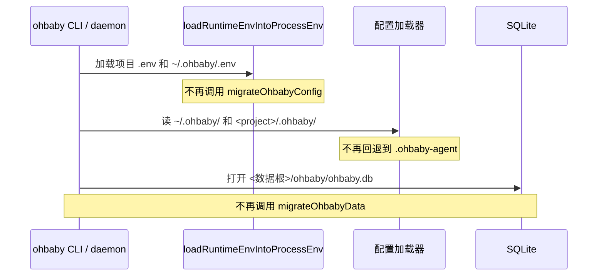

# 2. 优化方案与改动面

> 本文是交给实施会话的执行契约。实施会话按本文动手，按 [04](./04-test-and-acceptance.md) 自测。本规划会话不写代码。

## 2.1 方案总览

一句话：**删掉三层旧路径兼容，让每个配置和数据位置只认一个路径。** 旧目录不读、不删、不提示。

- 删除整个 `migration/` 模块，以及 CLI、daemon、运行时环境加载里对它的调用和两个诊断事件。
- 删除 `resolveReadPathWithLegacy`，每个配置域直接读新路径；旧指令 loader 去掉旧路径候选。
- 删除 `paths/` 里的全部旧路径函数和常量。
- 测试、e2e 脚本、README 和权威文档同步更新。

删完后的启动路径：



## 2.2 设计决策表

| 决策 | 选择 | 理由 | 放弃的方案 | 后果 |
| --- | --- | --- | --- | --- |
| 删除范围 | 三层一起删 | 只删迁移、留回退读取，旧目录照样会被读到，“不兼容”没有真正做到 | 只删迁移模块 | 代码里不再有旧路径概念 |
| 会话数据迁移 | 一起删（用户确认） | 过渡期已过，用户自己的机器都迁完了 | 保留 `migrateOhbabyData` | 没迁过的机器升级后看不到历史会话，旧文件仍在磁盘上 |
| 旧目录 | 不读、不删、不提示（用户确认） | KISS；自动删除用户文件不可逆，提示需要保留一份检测代码 | 启动时提示一次 | 产品 README 只介绍当前路径 |
| 与指令提醒化专题的顺序 | 本专题先落地（用户确认） | 那边的文档已按这个顺序写好；先删迁移，那边就不用给要删的模块加逻辑 | 那边先做 | 本专题要顺手处理旧 loader 里的旧路径探测 |
| 旧 loader 里的旧路径探测 | 本专题删掉三类旧候选路径和 `resolveLegacyGlobalMemoryPath`，loader 文件留给那边删 | 一次清干净，`paths/` 不留任何 legacy 函数；改动只有几行 | 保留 `resolveLegacyGlobalMemoryPath` 等那边删 | 旧 loader 在两个专题之间这段时间只读新路径 |
| CLI 的版本兼容探测 | 直接删掉 `optionalRuntimeExport("migrateOhbabyData")` | 新 CLI 不需要这个导出；老 CLI 遇到新 agent 包时本来就按“导出不存在”跳过 | 保留探测代码 | CLI 和 agent 包版本不一致时也不会报错 |
| `LoadRuntimeEnvOptions.onWarning` | 删除 | 它只给迁移警告用 | 保留空选项 | `startupNotices` 机制仍保留给更新提示用 |

## 2.3 分阶段实施

三个 Stage 都属于同一轮 `improve-1`。每个 Stage 结束后都能独立通过 `pnpm typecheck`、`pnpm lint` 和相关测试，可以分别提交。

本专题没有前置依赖，可以直接开工。它是指令提醒化专题的前置条件：Stage 2 完成后，`rg -n "migrateOhbaby|OHBABY_LEGACY|resolveLegacy" packages/ --glob "!**/dist/**"` 必须为空，且 Stage 1 的 AC-12 通过，那边才能开工。

### Stage 1：删除迁移模块及其调用

- **目标**：启动时不再做任何迁移，不再发迁移诊断事件。
- **改动**：
  - 删除 `packages/ohbaby-agent/src/migration/` 整个目录（`index.ts`、`ohbaby-home.ts`、`ohbaby-home.unit.test.ts`）。
  - `packages/ohbaby-agent/src/index.ts`：删掉 `export * from "./migration/index.js";`。
  - `packages/ohbaby-agent/src/utils/project-env.ts`：删除 `migrateOhbabyConfig` 调用、`configMigrationReport` 返回字段和 `onWarning` 选项。
  - `packages/ohbaby-agent/src/utils/project-env.ts`：同一个函数里顺手堵住全局根劫持。现在 L44 先按 `override: false` 加载项目 `.env`，L54 才算 `globalEnvPath`，之后所有 `resolveOhbabyHome()` 也都读 `process.env`。陌生仓库只要在 `.env` 里写 `OHBABY_HOME=<任意绝对路径>`，就能把整个全局配置根（model、mcp、skills、指令）换成它控制的目录；写相对路径（如 `OHBABY_HOME=.`）则会让 `resolveOhbabyHome()` 抛错（`paths/ohbaby-home.ts:58-60`），启动直接失败。改法：用 `dotenv.parse` 解析项目 `.env`，所有平台仅在比对保留键时将键名转大写，静默跳过 `OHBABY_HOME`、`HOME`、`USERPROFILE`。在加载处用一条注释解释全局根由宿主决定。其余键保留原名，按“不覆盖已有值”写入 `process.env`。宿主环境里已设的值本来就不会被覆盖，行为不变。
  - `packages/ohbaby-agent/src/utils/project-env.unit.test.ts`：去掉对 `configMigrationReport` 的断言，删除“migrates legacy global and project configuration …”用例；新增 04 的 AC-12 用例。
  - `packages/ohbaby-agent/src/observability/`：删除 `events.ts` 里的 `migrationFields`、`configMigrationCompleted`、`dataMigrationCompleted`，以及 `index.ts` 里对应的导出；`logger.ts` 的 `DiagnosticsComponent` 联合类型和组件列表去掉 `"migration"`。
  - `packages/ohbaby-cli/src/bin.ts`：
    - 运行时模块类型里删除 `migrateOhbabyData`、`configMigrationCompleted`、`dataMigrationCompleted` 三个字段；
    - 删除 `MigrationCounts`、`migrationCounts()`，以及 `OhbabyMigrationReport` 的导入（L48）；
    - 删除 `migrateOhbabyData` 的探测和三处调用（非 TUI、TUI、serve），以及 `onDataMigrationReport` 回调和仅被它读取的 `diagnosticsHandle`（L665、L683）；
    - `loadRuntimeEnvIntoProcessEnv` 调用不再传 `onWarning`（L882–886）；
    - 删除已无解析前生产者的 `presentStartupNotices`（L875–879）、解析前 `.middleware(...)`（L908–912）及 `finally` 块中的 `presentStartupNotices();` 调用（L934，避免在 `createCoreHost` 抛错时把自动更新已输出到 stderr 的提示重复打印；**保留 `finally` 块本身**，它仍负责释放 proxy）；顺手清理 L275 过时的 migration 注释；
    - 保留 `emitWithoutAffectingProduct`（`durationClockAnomaly` 还在用）、`startupNotices` / `takeStartupNotices`（供 TUI 清屏后重显自动更新提示）和 `runtimeEnvResult`（还要用它的 `projectRoot`）。
  - `packages/ohbaby-cli/src/bin.unit.test.ts`：
    - 删除数据迁移调用顺序的断言和 `dataMigrationCompleted` mock；
    - 删除“presents config migration warnings inside the terminal UI once”用例；
    - 删除“falls back to one stderr warning when parsing fails before a presenter”用例（对应的 `presentStartupNotices` 与解析前 middleware 已一并删除）。
  - `packages/ohbaby-server/src/runtime/daemon/main.ts`：删除 `"migrateOhbabyData" in AgentRuntime` 整段、`onDataMigrationReport` 选项和 `OhbabyMigrationReport` 导入。
  - `packages/ohbaby-server/src/runtime/daemon/main.unit.test.ts`：删除各 mock 里的 `migrateOhbabyData` 字段。
  - `packages/ohbaby-server/src/runtime/daemon/global-single-serve.integration.test.ts`：把“migrates legacy platform data before a direct server start opens SQLite”用例改写成 04 的 AC-02 负例（旧库不被复制、改名或删除，新库为空）。这个用例本来就搭好了真实 daemon 和临时数据根，改写比另起一个省事。
  - **删除对迁移诊断事件的期望**（不删就会挂）：
    - `tests/integration/cli/command-record-terminal.integration.test.ts` L326–327 的 `"migration.config.completed"`、`"migration.data.completed"`；
    - `scripts/run-compiled-web-e2e.mjs` L587–588 的同名两项。
  - 删除所有写 `.skip-auto-migrate` 的行：`tests/smoke/formal-cache-session.ts`、`tests/smoke/process-tools.real.e2e.test.ts`、`tests/smoke/real-web-dev.ts`、`tests/integration/cli/packaging-smoke.integration.test.ts`、`scripts/run-*-e2e.mjs`（7 个）、`packages/ohbaby-server/src/runtime/daemon/{model-idle.e2e,background-tasks-process.integration,goal-execution.e2e}.test.ts`。
- **DoD**：
  - `rg -n "migrateOhbaby|MigrationReport|MigrationCompleted|migration\.(config|data)\.completed|skip-auto-migrate|migrated-from-ohbaby" packages tests scripts apps --glob '!**/dist/**'` 为空；
  - typecheck、lint 通过；`bin.unit.test.ts`、`project-env.unit.test.ts`、daemon 测试、`command-record-terminal.integration.test.ts` 通过。

### Stage 2：删除旧路径回退读取和旧路径工具

- **目标**：每个配置域只读新路径；`paths/` 只描述当前布局。
- **改动**：
  - 删除 `packages/ohbaby-agent/src/paths/read-fallback.ts`。
  - `paths/ohbaby-home.ts`：删除 `OHBABY_LEGACY_*` 三个常量、`resolveLegacyOhbabyHome`、`resolveLegacyProjectOhbabyRoot`、`resolveLegacyOhbabyDataRoot`、`resolveLegacyGlobalMemoryPath`；`platformDataBase` 去掉 `legacy` 参数，Windows 分支只剩 `LOCALAPPDATA`。
  - `paths/index.ts`：删除以上符号和 `resolveReadPathWithLegacy` 的导出。
  - `paths/ohbaby-home.unit.test.ts`：删除旧路径断言，保留 Linux、macOS、Windows 三个平台的新数据根断言，并补齐 AC-09 要求的两个 fallback 用例（Linux 未设 `XDG_DATA_HOME` 回落到 `~/.local/share/ohbaby`；Windows `LOCALAPPDATA` 为空而 `APPDATA` 有值时回落到 `~\AppData\Local\ohbaby` 且不受 `APPDATA` 影响）。Windows 用例的标题从“…and Roaming for legacy data”改成只描述新路径。
  - 各配置域改为直接使用新路径：
    - `config/llm/loaders.ts`：删除 `getLegacyModelJsonPath`；`resolveModelJsonReadPath` 改为直接返回 `options.modelJsonPath ?? getModelJsonPath()`，顺手清理 L77 过时的 home migration 注释。
    - `config/llm/writer.ts` 的 `persistDocument`（L351–356）：`resolveModelJsonReadPath` 简化后，`originalModel ?? …readOptionalConfigFile(await resolveModelJsonReadPath(options))` 这个兜底只会把同一个文件再读一遍，属于死分支。删掉兜底，直接用 `originalModel`。`resolveModelJsonReadPath` 删掉后只剩 `loaders.ts` 一个调用点，可以内联，由实施者判断。
    - `config/llm/config-coordination.ts`：`settingsConfigVersion` 里的 `read()` 去掉 `legacyRoot` 参数，直接读 `join(root, ...segments)`，清理 L96 过时的 legacy 注释。**保持各配置域的哈希输入顺序不变**。注意 L130 的 `resolveSearchJsonPath().then(readOptionalConfigFile)`：如果下面把 `resolveSearchJsonPath` 改为同步返回 `string`（或直接用 `getSearchJsonPath()`），须同步改成 `readOptionalConfigFile(getSearchJsonPath())`。
    - `config/tools/search/loaders.ts`、`config/tools/search/writer.ts`：删除旧路径函数和回退。
    - `config/mcp/loaders.ts`、`config/mcp/writer.ts`：删除 `getLegacyGlobalMcpConfigPath`、`getLegacyProjectMcpConfigPath` 和回退。
    - `config/agents/loaders.ts`、`config/skill/loaders.ts`：删除旧路径函数和回退。
    - `core/system-prompt/services/custom-instruction-loader.ts`：删掉 L5–7 的三个导入、L166 的项目旧根候选、L188–199 的全局旧根候选和旧全局记忆文件候选。其他逻辑不动，整个文件由指令提醒化专题 Stage 2 删除。
  - 测试：
    - 改为负例测试（验证旧目录存在时完全不读取，见 04 AC-06、AC-08）：
      - `config/mcp/__tests__/loaders.unit.test.ts`（L127 “reads legacy global and project paths only when new paths are absent” 改为负例 AC-06）；
      - `core/system-prompt/__tests__/custom-instruction-loader-service.unit.test.ts`（L105 “preserves global instructions from the legacy home directory” 改为负例 AC-08）。
    - 在 `config/llm/__tests__/settings-version.unit.test.ts` 补齐 AC-07（旧根有文件时与两根皆空同哈希；改旧文件不触发版本变化，改当前有效文件仅影响对应域，特别覆盖 `search` 间接路径）。
    - 删除其余专测回退读取的用例：
      - `config/tools/search/__tests__/writer.unit.test.ts`（两个 legacy 用例）；
      - `config/llm/__tests__/model-settings.integration.test.ts`（“default first write migrates the effective legacy file …”）；
      - `config/llm/__tests__/session-model-config.integration.test.ts`（“backs up bytes read from the legacy home …”）；
      - `adapters/settings-refresh.integration.test.ts`（L255“preserves effective legacy search fields …”、L427“applies a legacy-only search file …”）。
    - 如果某个用例同时覆盖了别的行为（比如“显式路径互相隔离”），只删旧路径部分，保留其余断言。
    - **必须修改**：`tests/integration/cli/prompt-process.integration.test.ts` 和 `tests/smoke/tui-real-provider.smoke.test.tsx` 把 `.ohbaby-agent` 改成 `.ohbaby`。它们现在靠回退读取才能拿到 `model.json`。
- **DoD**：
  - `rg -n "migrateOhbaby|OHBABY_LEGACY|resolveLegacy|resolveReadPathWithLegacy|getLegacy" packages --glob "!**/dist/**"` 为空。这也是指令提醒化专题的开工检查；
  - `rg -n "\.ohbaby-agent|ohbaby-agent\.db" packages tests scripts apps --glob '!**/dist/**' --glob '!**/*.md'` 只命中 04 §4.2 列出的负例测试文件；
  - 全量 `pnpm test` 通过。

### Stage 3：同步 README 和权威文档

- **改动**：
  - 从 `README.md`、`README.zh.md`、`packages/ohbaby-cli/README.md` 直接删除旧迁移段落。用户文档只介绍当前有效路径。
  - `docs/ohbaby-server/hono-app/04-multi-project-runtime.md:98`：“使用相同的目录和旧路径回退规则”改为“使用相同的目录规则”。
  - `docs/core/system-prompt/dfd-interface.md:72` 和 `docs/core/system-prompt/goals-duty.md:53`：删掉“旧路径回退”的说法，让文档和 Stage 2 之后的旧 loader 一致。这两份文档稍后会被指令提醒化专题 Stage 4 整体重写，这里只改这一句。
  - `docs/problem-lists/2026-07-14-ohbaby-home-unification/README.md`：开头加一行“兼容窗口已于 2026-11 结束，迁移与回退读取已删除，见 `2026-11-24-legacy-home-removal`”。正文不改。
  - 下一版 release notes 写明：旧路径兼容已移除，并列出 §2.5 删掉的公开导出。release notes 的撰写跟随发版流程，不在本专题里预写。
- **DoD**：下面的检索应无匹配：

  ```bash
  rg -n "ohbaby-agent\.db|\.ohbaby-agent|旧路径回退|legacy paths remain" README.md README.zh.md packages/ohbaby-cli/README.md docs/ohbaby-server docs/core/system-prompt --glob '!**/improve-*/**'
  ```

  只检索这几处要改的文档，不扫整个 `docs/`。`docs/services/instructions/` 里“不支持 `.ohbaby-agent/`”的说法本来就正确；ADR、`docs/plans/`、`tutorials/` 和历史问题清单不动。

## 2.4 按包 / 目录的改动面

| 包 / 目录 | 删除 | 修改 | 说明 |
| --- | --- | --- | --- |
| `ohbaby-agent/src/migration/` | 整个目录 | — | Stage 1 |
| `ohbaby-agent/src/paths/` | `read-fallback.ts` | `ohbaby-home.ts`、`index.ts`、`ohbaby-home.unit.test.ts` | Stage 2 |
| `ohbaby-agent/src/utils/` | — | `project-env.ts`、`project-env.unit.test.ts` | Stage 1 |
| `ohbaby-agent/src/observability/` | — | `events.ts`、`index.ts`、`logger.ts` | Stage 1 |
| `ohbaby-agent/src/config/` | — | llm、search、mcp、agents、skill 的 loader/writer 和 `config-coordination.ts`，以及对应测试 | Stage 2 |
| `ohbaby-agent/src/core/system-prompt/` | — | `services/custom-instruction-loader.ts`、`__tests__/custom-instruction-loader-service.unit.test.ts` | Stage 2 |
| `ohbaby-agent/src/adapters/` | — | `settings-refresh.integration.test.ts` | Stage 2 |
| `ohbaby-agent/src/index.ts` | migration 导出行 | — | Stage 1 |
| `ohbaby-cli/src/` | — | `bin.ts`、`bin.unit.test.ts` | Stage 1 |
| `ohbaby-server/src/runtime/daemon/` | — | `main.ts`、`main.unit.test.ts`、`global-single-serve.integration.test.ts`，以及 3 个写跳过标记的测试 | Stage 1 |
| `tests/`、`scripts/` | — | 跳过标记行；迁移诊断事件期望；2 个写旧路径 `model.json` 的测试 | Stage 1、2 |
| 根 README、CLI README、`docs/` | — | 见 Stage 3 | Stage 3 |

## 2.5 API / 协议 / 迁移与兼容

1. **`ohbaby-agent` npm 包根移除的导出**（破坏性变更，release notes 要写）：
   - 迁移：`migrateOhbabyConfig`、`migrateOhbabyData`、`OhbabyMigrationOptions`、`OhbabyMigrationReport`。
   - 路径：`resolveLegacyOhbabyHome`、`resolveLegacyProjectOhbabyRoot`、`resolveLegacyOhbabyDataRoot`、`resolveLegacyGlobalMemoryPath`、`OHBABY_LEGACY_DIR_NAME`、`OHBABY_LEGACY_DATA_APP_NAME`、`OHBABY_LEGACY_DATABASE_FILE_NAME`、`resolveReadPathWithLegacy`。
   - 诊断：`configMigrationCompleted`、`dataMigrationCompleted`；公开类型 `DiagnosticsComponent` 少了 `"migration"` 这个成员。
   - `LoadRuntimeEnvResult.configMigrationReport` 字段和 `LoadRuntimeEnvOptions.onWarning` 选项。
2. **包之间的版本不一致**：新 CLI 不再引用迁移导出；老 CLI 搭配新 agent 包时，`optionalRuntimeExport` 找不到 `migrateOhbabyData` 会直接跳过。两个方向都不会报错。
3. **用户数据**：程序不再读写旧目录。旧文件留在原处。没有数据库 schema 变更。
4. **自定义指令**：`~/.ohbaby-agent/`、`<project>/.ohbaby-agent/` 和 `~/.config/ohbaby-agent/OHBABY.md` 里的指令文件不再被读取。这和指令提醒化专题的最终行为一致，只是提前生效。
5. **诊断日志**：日志里不再出现 `migration.config.completed`、`migration.data.completed`。已有的日志文件不受影响。

## 2.6 风险与回滚

| 风险 | 影响 | 应对 |
| --- | --- | --- |
| 还有测试或脚本悄悄依赖迁移、回退读取或迁移诊断事件 | 删除后某个测试挂掉 | 01 §1.3.7 已列出审查找到的全部依赖；Stage 1、2 的 DoD 都有全仓 `rg` |
| CI 三平台矩阵只跑单测和几组点名的集成测试 | Windows 上的集成测试行为没有 CI 兜底 | 删除后剩下的 Windows 专属逻辑只有 `LOCALAPPDATA` 分支，由 `test:unit` 里的路径单测在三平台覆盖；集成测试在本地跑全量 `pnpm test` |
| 有人在别的项目里直接用了被删的公开导出 | 升级后编译失败 | release notes 列出删掉的导出；目前已知的使用方只有本仓库的 CLI 和 server |
| 从很老的版本直接升级的用户 | 看不到旧配置和旧会话 | 用户已接受；旧文件留在原处 |
| 有人把 `OHBABY_HOME` 写在项目 `.env` 里 | 升级后这一项不再生效，回到默认 `~/.ohbaby/` | release notes 说明：改在 shell 或系统环境变量里设置 |
| 两个专题之间的空档期，旧 loader 仍在 | 无风险，旧 loader 只是少读几个旧路径 | — |

**回滚**：纯代码删除，按 Stage 分别提交，出问题可直接 `git revert` 对应提交。用户磁盘上的旧文件不会被本改动修改；但若升级后新目录已经产生了新的会话数据，回退代码后旧迁移器会按设计拒绝覆盖分叉的数据库，不会自动合并两边数据。

## 2.7 与 00 边界对齐检查

| 00 中的确认 | 落点 |
| --- | --- |
| 三层一起删 | Stage 1（迁移）、Stage 2（回退读取和路径工具） |
| 数据迁移一起删 | Stage 1 删除 `migrateOhbabyData` 及 CLI、daemon 调用 |
| 旧目录不读、不删、不提示 | 全文没有检测或删除旧目录的代码；Stage 3 删除产品 README 的旧迁移段落 |
| 本专题先做，顺手删旧 loader 的旧路径探测和 `resolveLegacyGlobalMemoryPath` | §2.3 开头、Stage 2 |
| 不删旧 loader 文件本身 | Stage 2 只改三处候选路径 |
| 完整改动清单 | §2.3、§2.4、§2.9 |
| 不动名字带 legacy 但无关的代码 | §2.8 |

## 2.8 不在本轮

- 删除旧指令 loader `custom-instruction-loader.ts` 本身：由指令提醒化专题 Stage 2 负责。
- `assertNoLiveLegacyDaemon` 和 `legacyStateFilePath`（旧的“每个项目一个 daemon”）、`backupLegacyModelDocument`（旧版 `model.json` 格式）、model 配置里的 legacy connect 和 legacy id，都和目录改名无关。
- 和迁移无关的过期路径描述：`docs/core/tool-scheduler/goals-duty.md:227-228`（`~/.config/ohbaby-agent/…`、`.ohbaby-agent/tools/`）、`docs/config/tools/{exa,tavily}/data-model.md`（`USER_CONFIG_DIR = 'ohbaby-agent/tools'`）和 `docs/config/tools/tavily/test.md:205`。可以另开一个文档清理的小任务。
- 测试和脚本给子进程设置的 `APPDATA` 环境变量：属于通用的 Windows 环境搭建，不动。
- 把更多集成测试加进 CI 三平台矩阵：属于 CI 策略调整，不在本专题范围内。

## 2.9 关键改动清单

> 行号是规划基线 `9c43e13f` 的快照，定位以符号为准。本表不是进度表，实施中不勾选、不回写。

| ID | 类型 | 路径 | 符号 / 小节 | 行号快照 | 要改什么 | 为什么承重 |
| --- | --- | --- | --- | --- | --- | --- |
| C1 | 代码 | `packages/ohbaby-agent/src/migration/` | 整个模块 | 全部 | 删除 | 迁移主体 |
| C2 | 代码 | `packages/ohbaby-agent/src/index.ts` | `export * from "./migration/index.js"` | L172 | 删除 | 公开 API |
| C3 | 代码 | `packages/ohbaby-agent/src/utils/project-env.ts` | `loadRuntimeEnvIntoProcessEnv`、`LoadRuntimeEnvOptions.onWarning`、`LoadRuntimeEnvResult.configMigrationReport` | L4–7、L16、L22、L44、L45–52、L64 | 删除迁移调用和相关字段；项目 `.env` 不再接受 `OHBABY_HOME` / `HOME` / `USERPROFILE` | 每次启动都走 |
| C4 | 代码 | `packages/ohbaby-cli/src/bin.ts` | 运行时模块类型、`OhbabyMigrationReport`、`MigrationCounts`、`migrationCounts`、`migrateOhbabyData` 探测、三处调用、`diagnosticsHandle`、`onDataMigrationReport`、`onWarning`、`presentStartupNotices`、解析前 `.middleware(...)` | L48、L215–229、L244、L251–266、L443–452、L541–543、L566–582、L665、L683–702、L875–886、L908–912、L934 | 删除 | CLI 启动主路径 |
| C5 | 代码 | `packages/ohbaby-server/src/runtime/daemon/main.ts` | `onDataMigrationReport`、`migrateOhbabyData` 调用 | L29、L107、L736–748 | 删除 | daemon 打开 SQLite 前的路径 |
| C6 | 代码 | `packages/ohbaby-agent/src/observability/events.ts`、`index.ts`、`logger.ts` | `configMigrationCompleted`、`dataMigrationCompleted`、`DiagnosticsComponent` 的 `"migration"` | events L98–117；index L14–15；logger L17、L89 | 删除 | 公开 API 和日志组件 |
| C7 | 代码 | `packages/ohbaby-agent/src/paths/ohbaby-home.ts` | `OHBABY_LEGACY_*`、`resolveLegacy*`、`platformDataBase(legacy)` | L9–11、L73–79、L88–93、L95–123、L130–138、L140–152 | 删除；Windows 只剩 `LOCALAPPDATA` | 三平台路径解析 |
| C8 | 代码 | `packages/ohbaby-agent/src/paths/read-fallback.ts`、`paths/index.ts` | `resolveReadPathWithLegacy` | 全文件 | 删除 | 回退读取的入口 |
| C9 | 代码 | `packages/ohbaby-agent/src/config/llm/config-coordination.ts` | `settingsConfigVersion` | L96–135 | 去掉旧根，哈希顺序不变 | 配置热更新的版本判断 |
| C10 | 代码 | `packages/ohbaby-agent/src/core/system-prompt/services/custom-instruction-loader.ts` | 导入、`loadProjectInstructions` 和 `loadCustomInstructions` 的旧候选 | L5–7、L166、L188–199 | 删除旧路径候选 | 指令提醒化专题的开工检查 |
| C11 | 测试 | `tests/integration/cli/command-record-terminal.integration.test.ts`；`scripts/run-compiled-web-e2e.mjs` | 诊断事件期望列表 | L326–327；L587–588 | 删掉两个迁移事件 | 不改 Stage 1 一删就挂 |
| C12 | 测试 | `tests/integration/cli/prompt-process.integration.test.ts`；`tests/smoke/tui-real-provider.smoke.test.tsx` | `tempHome`、`writeModelConfig`；`writeZhipuModelConfig` | L82、L92；L64–66 | `.ohbaby-agent` → `.ohbaby` | 不改 Stage 2 一删就挂 |
| D1 | 文档 | `README.md`、`README.zh.md`、`packages/ohbaby-cli/README.md` | 路径说明段 | L173 | 整段删除 | 面向用户的兼容承诺 |
| D2 | 文档 | `docs/ohbaby-server/hono-app/04-multi-project-runtime.md` | 配置版本检查 | L98 | 去掉“旧路径回退” | 权威设计文档 |

### 连带影响面（不逐行列出）

- `config/{llm,tools/search,mcp,agents,skill}/` 的 loader/writer：按 Stage 2 删除各自的 `getLegacy*` 函数和 `resolveReadPathWithLegacy` 调用。
- 上述配置域、`paths/`、`adapters/settings-refresh` 和旧 loader 的测试：删除专测旧路径的用例。
- 写 `.skip-auto-migrate` 的 14 个测试和脚本文件：删掉那一行。
- `docs/core/system-prompt/{dfd-interface,goals-duty}.md`：删一句“旧路径回退”。
