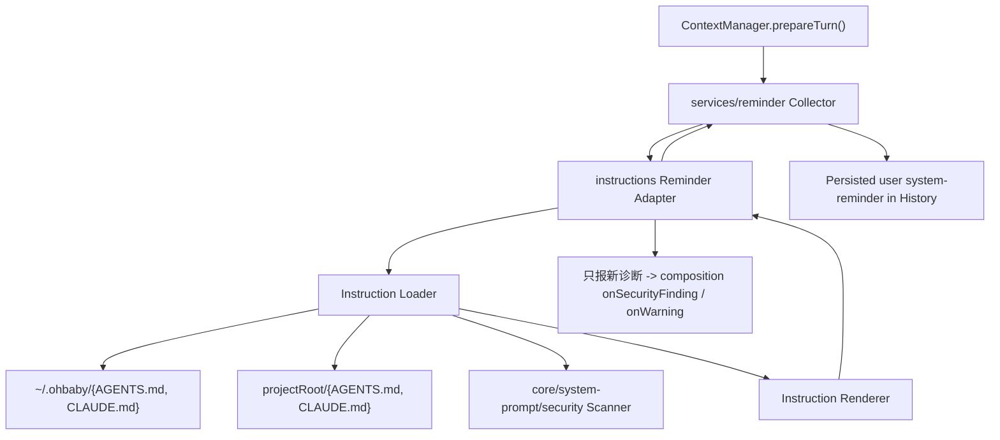

# instructions 模块 architecture.md

本文档描述 `services/instructions` 模块的内部结构、组件协作方式及关键架构权衡。所有设计均服务于 [goals-duty.md](./goals-duty.md) 中定义的边界。

---

## 1. Architecture Overview（总体架构）

[Context](../../core/context/architecture.md) 负责将提醒追加到模型可见历史。[System Prompt](../../core/system-prompt/architecture.md) 负责组装稳定的系统消息。

`services/instructions` 位于 `packages/ohbaby-agent/src/services/instructions/`，作为应用服务层的独立子模块，直接挂接在现有 `services/reminder` 管道之下，与 `core/system-prompt` 彻底解耦。

模块内部只保留三个职责单一的子组件，没有后台状态机或独立持久化层：

- **Loader（发现与安全加载）**：根据全局目录和项目根目录探测候选文件（`AGENTS.md`、`CLAUDE.md`），项目作用域用 `lstat` 只认普通文件（软链不读），全局作用域用 `stat` 跟随软链；打开后复核句柄仍是普通文件，再执行有界读取、总预算控制、prompt-security 扫描、读错区分（读错时用上次成功读取顶替），以及按内容哈希的同作用域/跨作用域去重。
- **Renderer（安全渲染）**：将加载结果格式化为带优先级声明的纯文本正文，仅对 `<system-reminder>` / `</system-reminder>` 边界标签做转义，来源只写固定标签，并计算确定性快照 `key`。
- **Reminder Adapter（提醒适配器）**：实现 `ReminderProvider` 契约，直接消费 collector 传入的 `previousKey`，决定静默、追加统一头注快照或发送移除通知；同时负责诊断去重：按生效项目根记住上一步仍然存在的诊断签名集合，本步只上报集合里没有的新诊断，再用本步结果替换旧集合；集合为空即删除该条目。条目数以项目根个数为上限，不需要 FIFO 上限、外部销毁钩子或定时器。另持有 `lastGoodReads`（每个候选文件上次成功读到的正文），传给 Loader 在读错时顶替。



---

## 2. Design Pattern & Rationale（设计模式与理由）

### Adapter（适配器模式）
`Reminder Adapter` 将“读取并渲染指令文件”的业务能力适配为 `services/reminder` 定义的 `ReminderProvider` 契约。这样 `ContextManager` 和 `Lifecycle` 无需新增任何专用指令注入通道，直接复用既有的持久化、锚定排序、去重与 compaction 重检能力（直接服务 G1、G4）。

### Pipeline（单向数据管道）
模块内部采用纯单向流程：`发现候选 → 读取与扫描 → 内容去重 → 渲染与哈希 → 与历史快照比对`。每一步输入输出明确、无双向回调，单元测试可以独立验证每一层行为。

### 刻意不使用的模式
- **不使用 Observer / File Watcher**：参考 `deepseek-harness` 与 `ZCode` 的取舍，文件 watcher 在跨平台（尤其是 macOS/Windows 文件句柄、临时原子写文件、远程工作区）上容易引入泄漏与竞态。本模块每次最多探测 4 个固定路径，直接按步读取的开销极低（毫秒级），远比维护 watcher 状态简单可靠。
- **不引入独立持久化存储**：模块不自建“已公告状态表”或数据库表。所有已发送状态以 `context.history` 中的持久化 `system-reminder` 记录为唯一真源（Single Source of Truth），天然支持会话冷恢复、rewind 与 compaction。

---

## 3. Module Structure & File Layout（模块结构与文件组织）

```text
packages/ohbaby-agent/src/services/instructions/
  index.ts                 # 模块入口：导出提醒工厂和告警类型
  types.ts                 # 领域概念与配置类型定义
  loader.ts                # 候选路径解析、文件读取、截断、安全扫描与去重
  renderer.ts              # 正文渲染、边界标签转义与快照 key 计算
  reminder.ts              # ReminderProvider 适配、历史状态判断、移除通知与诊断去重
  __tests__/
    loader.unit.test.ts    # 发现、去重、截断、安全扫描、读错区分测试
    renderer.unit.test.ts  # 渲染顺序、优先级声明、标签转义、key 稳定性测试
    reminder.unit.test.ts  # 首次注入、不变静默、更新覆盖、删除通知、读错只影响单个文件且用上次成功读取顶替测试
```

对外边界：
- 仅 `index.ts` 作为外部依赖入口，由 `adapters/ui-runtime/composition.ts` 注册工厂，`prompt-context.ts` 使用告警类型；包根 `src/index.ts` 不导出本模块，与其他 reminder provider 一致。
- `services/reminder/index.ts` 只在 `REMINDER_ORDER` 中登记 `"instructions"` 类型，并在 `ReminderContext` 中补充 `directory` / `projectRoot` 字段，不直接依赖 `services/instructions/`，保持依赖方向单向指向 `services/reminder` 抽象契约。
- `loader.ts` 复用 `core/system-prompt/security` 的纯扫描函数，不引入反向依赖。

---

## 4. Architectural Constraints & Trade-offs（约束与权衡）

### 权衡 1：全量快照追加 vs 按文件增量 Diff
- **选择**：变更时追加**当前完整有效快照**（附“替换先前指令”头注），而非维护逐文件增删改的细粒度 diff 状态机。
- **被放弃的方案**：`deepseek-harness` / `ZCode` 的多文件 delta 对账（按单文件分别发送 `Updated` / `Removed`）。
- **理由与代价**：本模块最多只涉及 4 个文件（全局 2 个 + 项目 2 个），且用户中途改文件的频率极低。使用全量快照直接契合现有 `ReminderProvider` 的 `kind: "snapshot"` 机制，零额外元数据 schema 改动，代码复杂度降低一个量级；代价是用户中途修改其中一个文件时，新追加的那一条 reminder 会重发其他未变文件，但在 4 文件规模下 token 开销完全可接受，且不影响之前全部历史前缀的 KV Cache。

### 权衡 2：按步按需读取 vs 仅在 Run 启动时读取
- **选择**：在 `prepareTurn()` 的 reminder 收集阶段读取这 4 个固定路径，由 Reminder Adapter 只上报新出现的诊断，消除重复告警。
- **被放弃的方案**：只在 `createRunPromptSnapshot()` 读一次、整轮冻结。
- **理由与代价**：如果 agent 自己在工具调用中修改了 `AGENTS.md`（例如用户让它更新项目规范）或者发生了自动 compaction，按步读取能在下一步立刻生效，且不需要在 `AgentRunPromptSnapshot` 上再耦合指令字段。代价是每步增加最多 4 次本地小文件 stat/read 与哈希开销，并在内存里按项目根记一份当前诊断集合，防止告警刷屏。

### 权衡 3：定向转义 `<system-reminder>` 标签 vs 全量 HTML 实体转义
- **选择**：只转义正文中的 `<system-reminder>` / `</system-reminder>` 标签（忽略大小写）。来源只写固定标签 `global/AGENTS.md` 等，不插值路径，所以路径不需要转义。
- **被放弃的方案**：对整份 Markdown 正文调用 `escapeReminderValue`（把所有 `<`、`>`、`&` 全转成实体）。
- **理由与代价**：项目 `AGENTS.md` / `CLAUDE.md` 中普遍包含代码片段、TypeScript 泛型、JSX 与 `&&` 命令，全量转义会严重破坏可读性与模型理解；定向转义既阻止了闭合宿主标签的逃逸攻击，又完整保留了 Markdown 语义。

### 权衡 4：读错时按文件顶替 vs 本步拿掉 vs 整体保留旧快照
- **选择**：读错的文件用它上次成功读到的内容顶替（`lastGoodReads`，进程内存），其他文件照常更新；被拒或被安全省略的文件本步不进快照；一份可用的都没有、而历史里有旧快照时，发 `cleared` 通知。不设 `hadReadError` 之类的整体保底开关。
- **被放弃的方案一**：任一候选读错就整体返回 `undefined`、保留旧快照（dsh、ZCode 的思路）。一个持续读错的文件会冻结其他文件的刷新，连另一份文件刚被安全扫描拒绝这件事也公告不出去。
- **被放弃的方案二**：读错的文件本步直接拿掉。快照头注写着“先前未列来源不再适用”，于是文件被短暂锁一下就等于告诉模型“这份规则作废了”，这是错误的陈述；一来一回还要多追加两份全量快照。
- **代价**：多一份进程内缓存（每个项目根最多 2 条，全局共 2 条，总量随访问过的项目根数线性增长，文件正常时不回收）；读错期间文件若被改过，模型暂时看到旧版本；读错持续存在时（比如用户故意收回读权限、全局软链变成循环链 `ELOOP`），旧内容会一直顶替到读成功或进程重启，同一进程里新开的会话也会拿到它，用户能从读错告警里知道；进程重启后首次读取就读错时，仍退回为本步拿掉。

### 权衡 5：项目作用域不跟随软链 vs 按真实路径限定在项目根内
- **选择**：项目作用域只读普通文件；同目录 `CLAUDE.md` / `AGENTS.md` 互为别名时静默跳过，其他软链跳过并告警。全局作用域跟随软链。
- **被放弃的方案**：解析 `realpath` 后要求落在作用域根内。项目根内也有不该自动上传的文件（未提交的 `.env`），这条检查拦不住 `AGENTS.md -> .env`；而且路径前缀比较要处理大小写、Windows 盘符、UNC、junction 等差异，三个系统各有坑。
- **代价**：把 `AGENTS.md` 软链到 `docs/` 等其他位置的项目会被拒读并告警，需要改成普通文件。全局作用域信任用户自己设置的 `$OHBABY_HOME`，用户不应把它指到陌生仓库里。

### 权衡 6：固定顺序的简单总预算 vs 多档渐进省略引擎
- **选择**：在单文件上限之外增加合并总预算（默认单文件 `32 * 1024`、总计 `64 * 1024` UTF-8 字节，先按识别出的编码解码再计数，截断时退到完整字符边界）。单位统一用字节，与有界读取一致，也与 Codex `project_doc_max_bytes` 相同；中英文按字节计时与 token 数大致成比例，比按字符计更能反映实际占用。超限时按「项目优先于全局，同作用域 `AGENTS.md` 优先于 `CLAUDE.md`」的固定顺序分配剩余额度，放不下的低优先级文件截断或省略并上报 warning。
- **代价**：不照搬参考项目复杂的分段重排/引言降级引擎；对于极小上下文窗口模型，若加上对话历史后仍超出模型输入预算，仍由 `Lifecycle` 既有的 `context_overflow` 显式报错终止。
