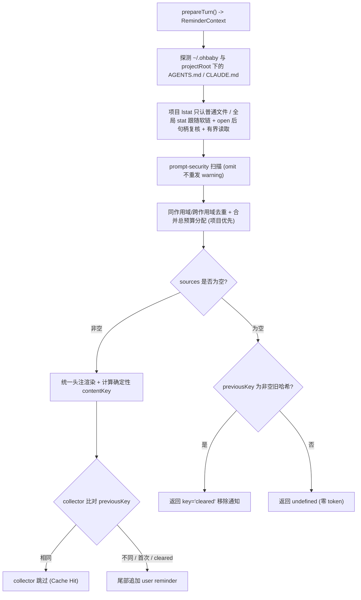

# instructions 模块 dfd-interface.md

本文档描述 `services/instructions` 模块的数据流转路径、对外契约及数据归属责任。

---

## 1. Context & Scope（上下文与范围）

`services/instructions` 位于 `ContextManager.prepareTurn()` 与宿主文件系统之间，作为 `services/reminder` 的一个标准 `ReminderProvider` 运行：

- **上游触发方**：`services/reminder`（`createReminderCollector`），由 `core/context/context-manager.ts` 在准备每一步模型请求时调用。
- **外部读取源**：宿主文件系统中的全局目录（`paths/ohbaby-home.ts` 的 `resolveOhbabyHome()`）和会话项目根目录（`ReminderContext.projectRoot ?? ReminderContext.directory`）。
- **外部复用依赖**：`core/system-prompt/security`（`scanPromptLikeContent` / `shouldLoadPromptLikeContent`）。
- **下游消费方**：
  - `services/reminder` → `core/context` → `core/message`（将返回的 `ReminderBody` 包装为 `<system-reminder>` 持久化为 `user` 侧隐藏消息，随对话历史投影给模型）。
  - `adapters/ui-runtime/composition.ts`（通过 `onSecurityFinding` / `onWarning` 回调，将安全跳过与读取告警转为 UI/CLI notice：安全发现沿用 `noticeFromPromptSecurityFinding()`，普通 warning 经 `noticeFromInstructionWarning()` 转换，见 §3.5）。

---

## 2. Data Flow Description（数据流描述）

### 2.1 主数据流：收集与快照决策

1. **上下文传入**：`ContextManager.prepareTurn()` 将当前步的 `sessionId`、`contextScopeId`、`directory`、`projectRoot`、`isSubagent` 以及当前活跃历史 `history` 封装为 `ReminderContext`，传给 `createReminderCollector`。
2. **定位候选目录**：`instructions` Reminder Adapter 从 `context` 提取：
   - 全局目录：`resolveOhbabyHome({ homeDirectory })`（`$OHBABY_HOME` 或 `~/.ohbaby`）。
   - 项目目录：`context.projectRoot ?? context.directory`（两者均缺失时跳过项目作用域）。
3. **并行探测候选文件**：Loader 在每个作用域内按固定顺序 `["AGENTS.md", "CLAUDE.md"]` 检查候选文件。两个作用域的信任程度不同，检查规则也不同：
   - **项目作用域：只读普通文件**。先调用 `fs.lstat()`，它不跟随软链，也不打开文件：
     - `ENOENT` / `ENOTDIR`：文件不存在，静默跳过。
     - 普通文件：进入有界读取。
     - 软链：一律不读取。若它是同目录另一个固定文件名的别名（如 `CLAUDE.md -> AGENTS.md` 或 `AGENTS.md -> CLAUDE.md`），静默跳过，内容以那份普通文件为准。判定方法：调用 `fs.readlink(候选)`，**仅当字面目标严格等于同目录另一个固定文件名**（`"AGENTS.md"` 或 `"CLAUDE.md"`）且该兄弟文件经 `fs.lstat()` 确认是普通文件时静默跳过，不调用 `fs.stat()` 跟随目标。其他一切软链（包括指向项目根内 `.env`、`docs/...`、带 `./` 前缀、悬空链或循环链）一律跳过并上报去重后的 `onWarning`。原因是项目根里也有不该自动发给模型的文件，比如没提交进 Git 的本地 `.env`，而 `readlink` 字面匹配既覆盖正反向常见别名，又彻底避免跟随任意目标带来的 `ENOENT` / `ELOOP` 复杂度。
     - 目录、FIFO、设备节点等其他类型：跳过并上报 `onWarning`。`lstat` 不打开文件，所以遇到 FIFO 也不会阻塞。
   - **全局作用域：跟随软链**。安全不变量为：**加载项目 `.env` 前后，实际用于发现全局指令的根目录保持不变**。这一点由前置专题保证：`utils/project-env.ts` 的 `loadRuntimeEnvIntoProcessEnv()` 不让项目 `.env` 写入 `OHBABY_HOME`、`HOME`、`USERPROFILE`（所有平台按大小写无关匹配，Windows 的环境变量名本来就不分大小写），不受信的项目 `.env` 无法把全局目录改指到仓库或任意路径；本模块只调用 `resolveOhbabyHome()`，不重复防护；用户自己设置的宿主环境与受信全局配置允许跟随软链，兼容 dotfiles 工具（如 GNU Stow）。先调用 `fs.stat()`（跟随软链，看最终目标）：`ENOENT` / `ENOTDIR` 静默跳过；`isFile()` 为假时跳过并上报 `onWarning`；不检查目标位于哪个目录。用户文档写明：不要在宿主环境里把 `$OHBABY_HOME` 指到陌生仓库。全局目录解析失败（如 `resolveOhbabyHome()` 因 `$OHBABY_HOME` 是相对路径而抛错）时只跳过全局作用域，上报 `sourcePath: "global"`、`kind: "read-error"`、`code: "HOME_UNRESOLVED"` 的 warning，项目作用域照常加载；`loadInstructions()` 不向外抛错。
   - **有界读取、平台打开标志与句柄复核**：通过上面的检查后才调用 `fs.open()`，沿用仓内 `read-file-page.ts` / `shell-jobs/reader.ts` 的平台 flags 分支：
     - POSIX（macOS / Linux）：项目作用域用 `O_RDONLY | O_NOFOLLOW | O_NONBLOCK`（禁止跟链且防检查到 `open` 之间被换成 FIFO 阻塞）；全局作用域用 `O_RDONLY | O_NONBLOCK`（允许跟链，防 FIFO 阻塞）。
     - Windows：使用 `O_RDONLY`（Windows 无 POSIX FIFO 与 `O_NONBLOCK` 常量）。
     读第一个字节前，对句柄调用 `fileHandle.stat()`，确认它仍是普通文件；不是就跳过并告警（`NOT_REGULAR_FILE`）。不比对 `dev` / `ino`：POSIX 上 `O_NOFOLLOW`、`O_NONBLOCK` 加句柄 `isFile()` 已挡住检查之后被换成软链或 FIFO 的情况；换成另一个普通文件需要本地进程在极短窗口内配合，不在静态仓库的威胁模型内，Windows 上同样作为残余风险接受。无论走哪个分支都要关闭句柄。随后使用短读循环反复调用 `handle.read()`，直到遇到 EOF 或累计读满 `2 * maxFileBytes + 8` 个原始字节为止（不假设单次 `read()` 即返回全部字节），不用无界 `readFile`。原始读取上限放宽到约两倍，是因为同样的英文内容 UTF-16 要占两倍字节；在支持的编码里，原始字节最多是解码后 UTF-8 字节的 2 倍（UTF-16 里的 ASCII、GB18030 用 4 字节表示的少数拉丁字符都是这个比例），`+ 8` 留给 BOM 和解码器暂存的半个字符。所以读满上限时解码结果一定超过单文件上限，“是否超限”统一看解码后的长度。
   - **非缺失读错**：`lstat` / `stat` / `open` / `read` 抛出 `ENOENT`、`ENOTDIR` 以外的错误（如 `EACCES`、`EPERM`、`EBUSY`），只影响出错的那一份文件，其他候选照常处理。上报 `onWarning`（由 Reminder Adapter 去重，见第 6 步）。读错表示“这次没读到”，不表示“文件没了或变了”，所以按下面的“上次成功读取”规则处理，不从快照里拿掉它。不存在“任一读错就整体保留旧快照”的规则。
   - **上次成功读取（`lastGoodReads`）**：Reminder Adapter 持有一个 `Map<候选文件绝对路径, { content, truncated }>`，作为参数传给 Loader（见 §3.1）。借鉴 dsh `state.ts` 的“回退到上次读成功的内容”和 ZCode `context-refresh.ts` 的“读不到不算删除”，但只按文件生效，不整体冻结：
     - **写入**：本步解码、单文件裁剪、`trim()` 后得到非空正文，就用它覆盖该路径的条目（`truncated` 记录是否触发了 `FILE_LIMIT`）。
     - **删除**：本步对该路径得出确定结论时删除条目：不存在（`ENOENT` / `ENOTDIR`）、被拒（软链、不是普通文件、`INVALID_ENCODING`）、或 `trim()` 后为空。这些情况说明文件确实没了或变坏了，不能拿旧内容顶上。
     - **替代**：只有非缺失读错时才查条目。查到就把缓存正文当作本步读到的正文，照常进入第 4 步安全扫描和第 5 步去重与总预算（`truncated` 为真时重新上报 `FILE_LIMIT`，签名不变，不会重复打扰用户）；读错 warning 照常上报。查不到（比如进程刚重启）就跳过这份文件。
     - 被安全扫描 `omit` 的正文也会写入缓存，但替代时会再走一遍扫描，结果仍是 `omit`，所以不会因此漏网；不为此单独加清理规则。
     - 全局目录解析失败（`HOME_UNRESOLVED`）没有文件路径，不查缓存。
     - 文件在读错期间被改过时，模型看到的仍是改之前的版本，直到下一次读成功。这与 dsh、ZCode 一致，可以接受。
   - **三系统适配**：上面的判断不比较路径字符串，规避了 macOS 与 Windows 的大小写不敏感、Windows 盘符、UNC 和 junction 差异；三系统采用相同拒读策略。另有一点：
     - Git for Windows 没开启软链支持时，会把仓库里的 `CLAUDE.md -> AGENTS.md` 检出成内容为 `AGENTS.md` 的普通小文件。它按普通文件加载，只多几个 token，不做特殊处理。
   - **长度单位**：本模块所有长度上限都按 **UTF-8 字节数**计算，即解码后的正文按 UTF-8 编码后占多少字节（`Buffer.byteLength(text, "utf8")`），与文件在磁盘上用什么编码无关。只算文件正文，不算渲染时加的优先级声明和来源标签。参考 Codex `project_doc_max_bytes`（默认 32 KiB）。
   - **编码识别、解码与长度裁剪**：用户不需要手动转换编码。识别顺序借鉴 ZCode `text-metadata.ts`，UTF-16BE 借鉴 kimi-code `encoding.ts`，全部使用 Node 24 自带的 `TextDecoder`（`fatal: true`），不引入新依赖：
     1. 开头是 `EF BB BF`：按 `utf-8` 解码；开头是 `FF FE`：按 `utf-16le` 解码；开头是 `FE FF`：按 `utf-16be` 解码。`TextDecoder` 默认会去掉 BOM，正文里不会留下 `U+FEFF`。Windows PowerShell 5.1 的 `>` / `Out-File` 和记事本另存为 “Unicode” 写出的就是带 BOM 的 UTF-16 LE。
     2. 没有 BOM：先按严格 `utf-8` 解码；抛错再按 `gb18030` 解码（兼容 GBK，覆盖 2019 年以前中文版 Windows 记事本默认的 “ANSI” 保存）。顺序不能反：合法 UTF-8 字节按 GB18030 解码也不报错，只会变成乱码。GB18030 兜底成功时不告警，用户没做错什么。
     3. 都抛错：按 `kind: "rejected"`、`code: "INVALID_ENCODING"` 跳过该文件，并上报去重后的 `onWarning`。
     - 读取边界：没读到 EOF（读满原始上限）时用 `decode(bytes, { stream: true })`，被截成半个的末尾字符留在解码器里，不当作非法编码；读到 EOF 时用普通 `decode(bytes)`，文件本身以半个字符结尾仍按非法编码处理。这样不必在解码前手动回退到字符边界。
     - 长度裁剪：解码后的正文超过单文件上限（默认 `32 * 1024` UTF-8 字节）时，截到上限并往回退到最近一个完整字符的边界（不切开多字节字符，也不切开 UTF-16 代理对），标记 `truncated = true`，上报 `kind: "truncated"`、`code: "FILE_LIMIT"`。
     - 最后执行 `trim()`，结果为空则静默跳过。去重哈希基于解码后的正文，所以内容相同、编码不同的 `AGENTS.md` 与 `CLAUDE.md` 也会去重。
     - 不做的事：没有 BOM 的 UTF-16 不猜（常见 Windows 工具写 UTF-16 都带 BOM）；不识别 Shift-JIS、Latin-1 等其他旧编码，它们可能被 GB18030 解成乱码而不报错，作为已知代价接受。
4. **安全扫描**：对每个非空文件内容调用 `scanPromptLikeContent(content, { kind: "custom-instructions", label: fileName, path })`：
   - 每条 finding 通过 `onSecurityFinding` 上报（由 Reminder Adapter 去重）。
   - 若 `shouldLoadPromptLikeContent(scanResult)` 为 `false`（存在 `omit` 级别风险），丢弃该文件。**不再额外调用 `onWarning`**（因为 `noticeFromPromptSecurityFinding()` 已按 `action === "omit"` 生成“已跳过”告警，避免同一文件向 UI 发双条重复通知）。
5. **去重与总预算分配**：
   - **同作用域去重**：同一作用域内 `AGENTS.md` 与 `CLAUDE.md` 的 `contentHash` 相同时，丢弃后者，保留 `AGENTS.md`。同一物理文件读出来的内容必然相同，所以不再额外比较真实路径（对于超长文件，该哈希代表单文件有界裁剪后的可见正文，仅修改不可见后缀不会触发新快照）。
   - **跨作用域去重**：项目条目与全局条目的 `contentHash` 相同时，移除全局侧副本，保留更具体的项目侧条目。
   - **合并总预算控制**：对去重后各文件 `trim()` 后正文的 UTF-8 字节数求和，实施合并总预算（默认 `64 * 1024` 字节）。优先保障更具体的项目作用域（`project AGENTS.md` → `project CLAUDE.md`），再将剩余配额分配给全局作用域（`global AGENTS.md` → `global CLAUDE.md`）；超出剩余配额的条目按剩余字节截断（同样退到完整字符边界）并上报 `kind: "truncated"`、`code: "TOTAL_LIMIT"`，重算 `contentHash` 且置 `truncated = true`。若剩余配额为 0 或不足以容纳该条目的第一个完整 UTF-8 字符（或截断后 `trim()` 为空），整份按 `kind: "budget-omitted"`、`code: "TOTAL_LIMIT"` 跳过，不生成空 `InstructionSource`，也不扣减剩余字节（后续更短条目仍可使用剩余配额）。
   - 最终渲染输出顺序仍固定为：`global (AGENTS.md → CLAUDE.md)` 在前，`project (AGENTS.md → CLAUDE.md)` 在后。
6. **比对活跃历史并产出决策**：Reminder Adapter 直接消费 collector 传入的 `previousKey`（即 `services/reminder/index.ts` 已按 `isSystemReminderMessage`、`text` part、未 `ignored`、正文非空规则算好的 `latest.get("instructions")`，取值为 `undefined` | `"cleared"` | `<sha256>`），不再重复扫描 `context.history`：
   - **采用哪些来源**：`sources` 只包含本步成功读取（或因非缺失读错按第 3 步用上次成功读取替代）并通过扫描的文件。被拒或被省略的文件不进入本步快照，也不沿用旧版本。所以一次瞬时读错（比如 Windows 上文件被编辑器或杀毒软件短暂锁住）不会改变 `key`，不追加新快照，也不会向模型发出“规则已作废”的错误声明；只有进程重启后缓存为空时，读错的文件才会暂时缺席。
   - **分支 A · 有有效指令（`sources.length > 0`）**：
     - Renderer 不区分首次或更新，所有非空快照统一使用同一句固定头注（声明以本快照为最新完整指令、先前未列来源不再适用，且不得覆盖系统指令、宿主权限规则与用户当前直接要求），依据 `sources` 的 `(scope, displayPath, contentHash, truncated)` 序列计算确定性 `contentKey`（SHA-256），返回 `{ key: contentKey, text }`。
     - 若 `previousKey === contentKey`，collector 按 key 去重后**不追加任何消息**；否则在尾部追加新快照。
   - **分支 B · 无有效指令（`sources.length === 0`）**：
     - 若 `previousKey` 为某个非空哈希：本步没有任何可用指令（文件被删除、清空、读取失败、被拒或被安全策略省略），返回 `{ key: "cleared", text }`。正文是 `renderer.ts` 导出的固定常量 `INSTRUCTIONS_CLEARED_TEXT`，只说明“当前没有已验证可用的指令，之前的指令快照不再适用”，不推测具体原因。
     - 若 `previousKey` 为 `undefined` 或 `"cleared"`：返回 `undefined`（零 token 注入）。
   - **追加通知能保证什么**：更新快照和 `cleared` 都是追加在后面的说明，不会从历史里删掉已经发出的旧正文；旧正文在被压缩掉之前仍会随请求发送。模块能保证两件事：被拒或被省略的内容不进入新快照；最新快照明确替代旧快照。从未被接纳的内容（读取前被拒、扫描时被 `omit`）则从不进入历史和请求。
   - **诊断去重**：Reminder Adapter 把自己的收集回调传给 Loader，先收齐本步全部诊断（warning 与 security finding），再和同一项目根（`projectRoot ?? directory`）上一步的诊断签名集合对比，只把新出现的转发给外部 `onWarning` / `onSecurityFinding`，然后用本步集合替换旧集合；集合为空时删除该条目。Loader 返回后，“对比 + 替换”要在同一段同步代码里完成，中间不能有 `await`，否则共用 provider 的两个并发会话可能各报一次同一条诊断。同一项目的主会话、子代理和并发会话共用这份集合，同一问题在整个项目里只报一次。文件持续出问题只报一次；同一步压缩前后两次收集结果相同，不会重复报；文件修好后签名自然消失，之后再坏会重新上报。
   - **同一步 Compaction 两次收集说明**：`ContextManager.prepareTurn()` 在触发自动压缩时会先收集一次，压缩替换活跃历史后再收集一次，并仅持久化第二次结果。压缩摘要提示词（`compression-prompt.ts`）会提示模型不要抄录外部指令文件内容（提示词可降低复述概率，但不构成对模型输出的绝对撤回保证）；压缩后的第二次收集直接以压缩后活跃历史为真源：若旧快照仍保留则按变更与否决定静默或更新；若旧快照已被压缩且磁盘仍有文件则本次最终请求直接重建快照；若旧快照已被压缩且文件已删、或读错且没有可顶替的上次成功读取，则静默，不再由 loader 重新注入失效来源；读错但有上次成功读取时，按第 3 步顶替后照常重建快照。
7. **持久化与投影（模块外）**：`createReminderCollector` 拿到非空 `ReminderBody` 后，由 `ContextManager` 调用 `renderReminderText()` 包裹 `<system-reminder>`，持久化到当前 `anchorAssistantId` 对应的历史位置，再由 `serializer.ts` 投影为 `user` 消息发送给模型。

---

## 3. Interface Definition（接口定义）

### 3.1 `loadInstructions(options)`（异步加载入口）
- **语义**：执行一次完整的两层作用域探测、文件类型与软链检查、有界读取、安全扫描、去重与总预算分配，返回本步验证通过的指令列表。
- **输入**：`projectDirectory?`（会话项目根）、`homeDirectory?`（测试注入覆盖）、`maxFileBytes?`（默认 `32 * 1024`）、`maxTotalBytes?`（默认 `64 * 1024`），单位均为 UTF-8 字节、`securityScanner?`（默认 `scanPromptLikeContent`）、`lastGoodReads?`（上次成功读取的缓存，由调用方持有，Loader 按第 3 步规则读写；不传则读错的文件直接跳过）、`onSecurityFinding?`、`onWarning?`。其中 `onWarning(warning: InstructionWarning)`，参数为结构化对象 `{ sourcePath, kind, code, message }`（见 data-model）。
- **输出**：`Promise<readonly InstructionSource[]>`。
- **特性**：对文件系统只读；副作用只有诊断回调和更新调用方传入的 `lastGoodReads`；单文件异常不抛出中断整个加载。

### 3.2 `renderInstructionsReminder(sources)`（纯渲染函数）
- **语义**：将 `InstructionSource[]` 渲染为可直接放进 `<system-reminder>` 的正文文本，并计算稳定快照 `key`。
- **输入**：`sources: readonly InstructionSource[]`（不再区分首次/更新模式）。
- **输出**：`{ key: string; text: string }`。
- **关键不变式**：
  - 所有非空快照共用同一固定头注（以本快照为准、未列先前来源不再适用、低优先级声明），`key` 仅取决于 `sources` 内容与元数据，天然无重复发射振荡风险。
  - 正文对 `<system-reminder>` / `</system-reminder>` 标签（含大小写、空白与属性变体）做定向转义；Markdown 代码正文不被全量 HTML 转义。
  - 来源只写固定标签（`global/AGENTS.md`、`project/CLAUDE.md` 等），不插入绝对路径，所以路径不需要转义，也不会把本机目录名发给模型。
  - `truncated = true` 的来源在其正文末尾追加一行固定提示 `[Truncated: <displayPath> exceeds the size limit; the rest is not included.]`（`displayPath` 是固定标签，提示文本不需要转义）。提示文本不计入单文件上限和合并总预算；`truncated` 已参与 `key` 计算，所以提示不影响快照去重。

### 3.3 `createInstructionsReminderProvider(options)`（Reminder 适配器工厂）
- **语义**：创建可注册进 `createReminderCollector([...])` 的 `ReminderProvider`。
- **静态契约**：`type: "instructions"`、`kind: "snapshot"`、`audience: "both"`。
- **输入**：`homeDirectory?`、`maxFileBytes?`、`maxTotalBytes?`、`securityScanner?`、`onSecurityFinding?`、`onWarning?`（签名同 §3.1）。
- **输出**：`ReminderProvider` 实例（内部按项目根记一份当前诊断集合用于去重，另持有一份 `lastGoodReads` 传给 Loader；都不要求调用方接入额外销毁钩子）。

### 3.4 上游扩展契约（对 `services/reminder`、`core/context` 与 `core/lifecycle` 的最小依赖）
- `services/reminder/index.ts`：
  - `REMINDER_ORDER` 首项新增 `"instructions"`（位于 `"environment"` 之前）。
  - `ReminderContext` 新增可选只读字段 `directory?: string` 与 `projectRoot?: string`。
  - `ReminderProvider.collect` 签名扩展为 `collect(context, previousKey?)`，collector 将 `latest.get(provider.type)` 传给对应 provider（既有 provider 忽略该参数，向后兼容）。
- `core/context/context-manager.ts`：
  - `collectReminders()` 将 `input.directory` 与 `input.projectRoot` 透传给 `options.collectReminders(...)`。
- `core/lifecycle/lifecycle.ts`：
  - 构造每步 `stepInput` 时透传 `projectRoot: params.projectRoot`（与 `createRunPromptSnapshot()` 保持一致，确保每步执行与强制压缩重试均拿到正确的会话项目根）。

### 3.5 warning 到 UI notice 的映射（`adapters/ui-runtime`）
- 在 `adapters/ui-runtime/prompt-context.ts` 新增 `noticeFromInstructionWarning(warning)`，放在现有 `noticeFromPromptSecurityFinding()` 旁边；`composition.ts` 注册 provider 时用它把 `onWarning` 转给 `options.onNotice`。
- 映射规则，沿用仓库里 skill 配置、todo 恢复、context 告警等通知的写法（保持工作区级广播，不填 `UiNotice.sessionId`，与现有 `prompt-security:` 一致）：
  - `key`：`instructions:${sourcePath}:${kind}`。在 TUI 中同一文件、同类问题的新通知替换旧的，不叠加（headless CLI 的 `stdout-renderer.ts` 逐条写 stderr，不按 key 去重；Web 前端当前未消费 `notice.emitted`）。
  - `level`：`"warning"`。
  - `title`：`sourcePath === "global"`（如 `HOME_UNRESOLVED`）时是 `"global instructions skipped"`；否则 `kind` 为 `read-error` / `rejected` 时是 `` `${fileName} skipped` ``，为 `truncated` 时是 `` `${fileName} truncated` ``，为 `budget-omitted`（整份被总预算省略）时是 `` `${fileName} skipped` ``。
  - `message`：`warning.message`（英文，与其他通知一致）；`source`：`sourcePath`。
- 安全发现继续走 `prompt-security:` 前缀通道，在 TUI 中常驻；指令 warning 属于临时通知。诊断持续存在时不重复报（见 §2.1 第 6 步与 `data-model.md` §4），被清掉后不会再刷出来，不另做常驻。

---

## 4. Data Ownership & Responsibility（数据归属与责任）

| 数据 / 行为 | 归属模块 | 责任说明 |
| --- | --- | --- |
| 候选文件定义（`AGENTS.md`、`CLAUDE.md`）、去重规则、优先级声明与正文转义 | `services/instructions` | 唯一真源；其他模块不得硬编码文件名或拼接指令文本 |
| 用户全局根目录路径解析（`$OHBABY_HOME` / `~/.ohbaby`）与防项目 `.env` 劫持 | `paths/ohbaby-home.ts` + `utils/project-env.ts` | `project-env.ts` 不让项目 `.env` 写入 `OHBABY_HOME` / `HOME` / `USERPROFILE`（前置专题落地）；本模块只消费 `resolveOhbabyHome()`，不自行解析环境变量 |
| Prompt 注入模式识别规则 | `core/system-prompt/security` | 本模块调用扫描并执行 `omit` 策略，不维护第二套安全正则 |
| 会话级 `projectRoot` / `directory` 解析 | `adapters/ui-runtime` → `core/lifecycle` → `core/context` | 上游负责正确传递项目根；本模块不自行向上探测 `.git` |
| Reminder 持久化、锚定排序、压缩后保留与重建 | `services/reminder` + `core/context` + `core/message` | 本模块不直接写数据库，也不缓存已发送历史 |
| 告警向 TUI / CLI 通知管道投递（工作区级；Web 暂未消费 `notice.emitted`） | `adapters/ui-runtime/composition.ts` | 本模块只通过回调上报去重后的 finding / warning，不依赖任何 UI 类型 |
