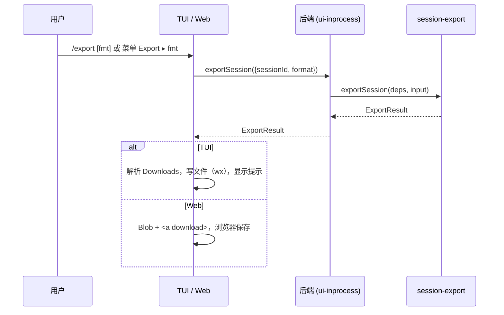

# session-export 模块 dfd-interface.md

前置文档：[goals-duty.md](./goals-duty.md)、[architecture.md](./architecture.md)、[data-model.md](./data-model.md)。

---

## 一、Context & Scope（上下文与范围）

本模块位于 `ohbaby-agent` 的 services 层，被 UI 后端适配层 `adapters/ui-inprocess.ts` 调用。

| 方向 | 对方 | 交互内容 |
|---|---|---|
| 输入 | `services/session` 的 `SessionManager` | 按 id 读会话元数据 |
| 输入 | `core/message` 的 `MessageManager` | 读主上下文里的全部消息和 part |
| 输入 | `package-version.ts` | 应用版本号，写进 JSONL 头部 |
| 输出 | `adapters/ui-inprocess.ts` | ExportResult，再经 SDK 的 `exportSession` 交给 TUI 或网页端 |

本文只写数据怎么进出本模块，以及调用方怎么使用结果。下面这些属于改造内容，见 [improve-1/02](./improve-1/02-optimization-plan-and-change-scope.md)：SDK、JSON-RPC、REST、TUI、网页各层具体改哪些文件。

---

## 二、Data Flow Description（数据流描述）

### 2.1 核心流：一次导出（模块内）

1. 调用方传入 `sessionId` 和 `format`（`html` 或 `jsonl`）。
2. 【模块内】入口检查 `format`。不合法时抛出 `INVALID_FORMAT`。sessionId 不是非空字符串时抛出 `INVALID_ARGUMENT`。
3. 【模块外 → 内】Collector 调 `SessionManager.get(sessionId)`。
   - 找不到会话：抛出 `SESSION_NOT_FOUND`。
   - 会话 `isSubagent` 为 true：抛出 `SUBAGENT_SESSION`。
4. 【模块外 → 内】Collector 调 `MessageManager.listBySession(sessionId, { contextScopeId: undefined })`，取主上下文里的全部消息（含 compact 掉的）。
5. 【模块内】Collector 按 [data-model §二](./data-model.md) 过滤、标注、排序、汇总，得到 ExportDocument。
   - 过滤后一条消息都没有：抛出 `EMPTY_SESSION`。
6. 【模块内】入口按 format 调 JSONL Renderer 或 HTML Renderer，得到文件内容（字符串）。
7. 【模块内】入口生成建议文件名 `ohbaby-<本地时间 YYYYMMDD-HHmmss>-<id 随机段>.<ext>`。
   - 随机段取 id 中最后一个 `_` 之后的部分，id 里没有 `_` 时取最后 8 个字符。
   - 随机段只保留 `[A-Za-z0-9-]`，其他字符都去掉，所以不可能出现路径分隔符。
   - 去掉之后如果是空的，就用 `session` 代替。
8. 【模块 → 外】返回 ExportResult：`filename`、`mimeType`、`content`、`messageCount`。

整个过程**只读**，不写数据库，不写文件，不发事件。消息读取使用一次主上下文持久化快照；运行中的会话保留已持久化片段与状态，不等待任务结束，不承诺尚未落库的流式尾部。

### 2.2 调用流 A：TUI 的 `/export [html|jsonl]`（模块外）

1. 用户输入 `/export` 或 `/export jsonl`，TUI 按后端命令目录解析出命令 id `export`。
   - 这个命令的 `surfaces` 只有 `tui`。
   - 它声明了 `acceptsArguments: true`，否则解析器会拒绝带参数的写法。
2. TUI 在本地拦下这个命令，不发给后端执行，做法和 `/effort` 一样。参数这样处理：
   - 没有参数：导出 HTML。
   - `html` 或 `jsonl`：导出对应格式。
   - 其他值，或者参数多于一个：直接报用法错误。
3. TUI 调 `client.exportSession({ sessionId: 当前会话, format })`。
   - 本机模式：经过 RPC 代理到达 `ui-inprocess`。
   - 远程模式：经过 JSON-RPC 到达远程后端。
4. 后端调用本模块（核心流 2.1），把 ExportResult 返回给 TUI。
5. TUI 解析本机的 Downloads 目录（见 2.4），选一个不冲突的文件名，写入文件。
6. TUI 显示提示：`Exported N messages to <path>`，下面再加一行敏感内容提醒。任何一步失败都显示错误提示。

### 2.3 调用流 B：网页端菜单 Export ▸ HTML / JSONL（模块外）

1. 用户在会话菜单里选 Export ▸ HTML 或 JSONL。
2. 网页端请求 `GET /v1/sessions/:id/export?format=…`，请求头带 Bearer token 和 clientId。
3. server 做和 archive 相同的校验：token 有效、clientId 存在、client 已注册。然后调 `backend.exportSession`。
4. 后端调用本模块，server 返回 `{ ok: true, export: ExportResult }`。
5. 网页端用 `content` 和 `mimeType` 生成 Blob，再用一个带 `download=filename` 的临时 `<a>` 触发下载，由浏览器保存到它的下载目录。
   - 这里不能直接把 `<a href>` 指向 REST 地址，因为请求必须带 Bearer token。

### 2.4 Downloads 目录解析（TUI 侧，模块外）

| 平台 | 规则 |
|---|---|
| macOS | `<homedir>/Downloads` |
| Windows | `<homedir>\Downloads`，也就是 `%USERPROFILE%\Downloads`，默认在 C 盘 |
| Linux | 先读环境变量 `XDG_DOWNLOAD_DIR`。没有的话，读 `${XDG_CONFIG_HOME:-~/.config}/user-dirs.dirs` 里的 `XDG_DOWNLOAD_DIR="…"`。还是没有，就用 `~/Downloads`。规则见下 |

**Linux 取值规则**（参照 XDG 规范）：

- 只展开开头的 `$HOME`。其他 `$变量`、`~`、反引号、命令替换都不展开，也绝不交给 shell 求值。
- 值为空、展开后不是绝对路径、或包含无法解析的变量时，**忽略这个值**，继续往下一级回退。
- `XDG_CONFIG_HOME` 本身也要是绝对路径，否则按 `~/.config` 处理。
- `user-dirs.dirs` 读取失败或格式不对时，静默回退，不报错。

**Windows 已知限制**：按已经确认的规则，固定用 `%USERPROFILE%\Downloads`，不查询系统的 Known Folder。用户把下载文件夹挪到别的盘时，文件仍然会写到 `C:\Users\<user>\Downloads`，必要时这个目录会被新建。这一点要写进用户提示文档。

- 目录不存在时，自动创建（递归）。
- 目标文件已存在时，在扩展名前依次加 `-1`、`-2`……
- 写文件用排他模式（`wx`），不覆盖任何已有文件。

---

## 三、Interface Definition（接口定义）

### 3.1 模块对外接口（`services/session-export/index.ts`）

| 接口 | 输入 | 输出 | 特性 |
|---|---|---|---|
| `exportSession(deps, input)` | `deps`：`{ sessionManager.get, messageManager.listBySession, appVersion, now? }` `input`：`{ sessionId, format: "html" \| "jsonl" }` | `Promise<ExportResult>` | 异步，只读，可以重复调用 |
| `SessionExportError` | — | 带 `code` 的错误：`INVALID_FORMAT`、`INVALID_ARGUMENT`、`SESSION_NOT_FOUND`、`SUBAGENT_SESSION`、`EMPTY_SESSION` | `code` 是稳定的，调用方据此显示提示 |

`now` 用来在测试里固定时间，影响 `exportedAt` 和文件名。

### 3.2 本模块要求调用方提供的接口

| 调用方 | 接口 | 语义 |
|---|---|---|
| SDK `UiBackendClient` | `exportSession(input: { sessionId, format })` → `{ filename, mimeType, content, messageCount }` | TUI 和网页端共用的唯一入口 |
| REST | `GET /v1/sessions/:id/export?format=html\|jsonl` | 200 返回 `{ ok, export }`。错误码复用现有约定：400 参数错误，401 未授权，404 会话不存在，409 client 未注册 |
| JSON-RPC | method `exportSession` | 远程模式下 TUI 使用 |

`SessionExportError` 的 `code` 要原样传到 SDK 层，和现有的 `stableErrorCode` 机制保持一致，这样 TUI 和网页端能显示具体的错误原因。

**后端不支持导出时的判断**：

- 不能用 `typeof client.exportSession === "function"` 来判断。RPC 代理对任何方法名都会返回一个函数，所以这个判断永远为真。
- 调用方直接调用，**按错误来判断**：
  - JSON-RPC 返回"未知方法"。
  - REST 返回 404，并且响应体里没有 `code`，说明路由不存在。
  - 本机后端抛出 "not available"。
- 以上三种情况统一提示 "Export is not supported by this backend"。不额外做能力协商。
- 旧版 daemon 的命令目录里没有 `export`。这时 TUI 输入 `/export` 会走现有的"未知命令"提示，这是可以接受的。

---

## 四、Data Ownership & Responsibility（数据归属与责任）

| 数据 | 谁创建 | 谁修改或销毁 | 本模块的责任 |
|---|---|---|---|
| session、message、part | session 和 message 模块 | 同上 | **只读**，不修改 |
| ExportDocument | 本模块 Collector | 用完就丢 | 负责保证它的内容符合 data-model |
| ExportResult（文件内容） | 本模块 | 调用方 | 交给调用方之后就不再管 |
| 磁盘上的导出文件 | TUI，或用户的浏览器 | 用户 | 不负责 |
| 权限和会话归属判断 | server、ui-inprocess | — | 不负责，只拒绝子代理会话 |
