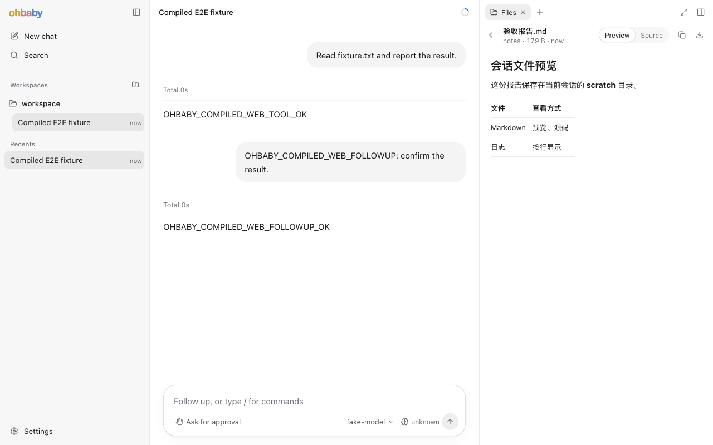

# 会话存储区：Files 页前端实施记录

2026-11-05。会话存储区第二期 b 的前端部分已实现：Web 右侧面板新增 Files 页，列出根会话 `scratch/` 下的文件，可以预览文本、Markdown 和图片。自动化测试、子代理审查和浏览器走查都已完成，等用户审查。本记录接着 [backend-implementation](backend-implementation.md)。

## 分支

- 后端分支 `codex/session-storage-subagent-output-backend` 已快进合并到主题分支 `codex/session-storage-subagent-output`，然后删除。
- 前端分支 `codex/session-storage-subagent-output-frontend` 从合并后的主题分支建立，分批提交，没有合并或推送。

提交按批次分开：先是数据层（客户端、runtime、mock），再是 Files 页界面，最后是文档。

## 已落地的行为

路径缩写同 [architecture](architecture.md)：`W/` = `apps/ohbaby-web/src/`。

| 部分 | 位置 | 说明 |
| --- | --- | --- |
| 传输 | `W/api/daemon/http.ts` | 新增 `listSessionFiles`、`readSessionFile`。原来的 `request` 拆成 `send`（返回原始响应，错误照旧解析成 `DaemonRequestError`）加 JSON 解析，已有调用方的行为不变 |
| 绑定 | `W/api/daemon/client.ts` | `BrowserDaemonClient` 注入 `runtimeEpoch`、`bindingGeneration`，请求期间绑定变了就报错，写法和 `listSubagentInstances` 一样 |
| 接口 | `W/api/daemon/session-files.ts` | `SessionFilesApi` 只收根会话 ID；`image/*` 响应转成 object URL，其他按文本处理 |
| runtime | `W/runtime/index.ts` | 新增 `sessionFiles`，交给当前连接的客户端处理，和 `terminals` 并列，不改 SDK 契约 |
| 页面 | `W/ui/side-panel/files/` | `FilesPage`、`FileList`、`FilePreview`、`use-session-files`；登记在 `side-pages.ts`，跟会话走 |
| mock | `W/dev/mock-files.ts` | `?mock=typical` 下有 5 个示例文件，覆盖文本、Markdown、图片和不支持的类型 |

页面行为写在 `docs/ohbaby-web/redesign-2026-10/03-ui-layout-and-style.md` §4.9 的 Files 页，组件约定写在 `05-components.md` 的 FilesPage。要点：

- 平铺列表，每行一个文件：文件名、淡色文件夹、大小和修改时间。大小按 1,024 字节进位，和服务端 1 MB、10 MB 的预览上限用同一种单位。
- 刷新时机：打开页面时，`run.updated`（400ms 内的合并成一次）和 `session.resync-required` 之后，以及手动刷新。不轮询。
- 预览：文本带 CSS 行号；Markdown 默认渲染，可切换到源码，经 `MarkdownBlock`（marked 加 DOMPurify）；图片在棋盘格底上按面板宽度缩放。不支持的类型、过大和已删除各有说明，都不用红色。
- 读到 404 时会刷新列表，返回后焦点落在列表上。预览只在列表里这个文件的大小或修改时间变了才重新读，列表加载完成本身不触发重读。

## 参考项目

一个子代理勘察了 `code-cli/` 下的本地检出代码：

| 项目 | 借鉴 |
| --- | --- |
| opencode `packages/gui-plugins/src/file/` | Markdown 的 Preview/Source 切换；复制内容、下载；不能预览时显示名字和大小 |
| ZCode `packages/ui/src/` | 手动刷新按钮转动表示进行中；“文件已不存在”单独说明；超过上限时给出上限 |
| pi-web `FileViewer.tsx` | 图片用棋盘格背景显示透明部分 |
| deepseek-harness `ui-sidebar-files` | 读取失败时给原因加 Retry |

没有照搬的：目录树、虚拟列表、语法高亮、缩放平移、“在编辑器中打开”。scratch 里通常只有几个文件，侧栏也窄，平铺加同一个 Tab 里切换就够了，和 Subagents 页一致。

## 验证

| 检查 | 结果 |
| --- | --- |
| `pnpm test:unit` | 396 个文件；4,932 项通过，2 项跳过 |
| Web 集成测试（`apps/ohbaby-web` 下非 unit 的用例） | 22 个文件；248 项全部通过，包括 `FilesPage.integration.test.tsx` 的 9 项 |
| `tsc -b`（`apps/ohbaby-web`）、改动文件的 ESLint 和 Prettier | 通过 |
| 子代理审查 | 没有阻塞问题。已修：已删除文件返回后焦点丢失、404 后列表没刷新、预览多读一次、首次加载失败时 Retry 没有反馈、大小单位不一致、SVG 图标、共用样式放错文件 |

**S17 浏览器走查**用了两个环境：

- mock（`?mock=typical`）：1100×720 和 375×812 两种视口。
- 真实 daemon（`ohbaby serve`）：打开一个已有会话，往它的 `scratch/` 临时放了 Markdown、日志、PNG 和二进制文件。依次确认了：
  - 空状态
  - 列表
  - Markdown 渲染和源码
  - 图片
  - 415 不支持的说明
  - 删除文件后的 404 说明，以及列表自动刷新
  
  请求都带了正确的 `runtimeEpoch`、`bindingGeneration`，控制台只有浏览器自己记录的那条预期 415。走查后临时目录已删掉。

## 留给后续的事项

- 没有过滤 `run.updated` 的会话归属。事件流只发当前实例的运行，代价最多是一次多余的列表读取。
- Markdown 里的远程图片会自动加载，链接在当前页打开，和聊天里的 Markdown 一样。如果要单独收紧，应该在 `MarkdownBlock` 统一处理。
- 一个 1 MB、约 3 万行的日志会生成同样多的行节点。目前能接受，真慢了再做虚拟化。
- 没有在 Windows 上实际测试。

## 2026-11-06 独立端到端复验

从前端提交 `7c104652` 开始，使用编译后的 Web、隔离的本地 daemon、真实文件系统和本地脚本模型。桌面（1280 × 800）和窄屏（375 × 812）均在 Codex 内置浏览器实际操作。测试文件放在临时会话 scratch 中。

- 未选聊天和会话无文件时分别有对应提示；刷新后列出 8 个普通文件，未列出指向目录外的符号链接。中文名、空格、嵌套目录和长文件名都可打开。
- Markdown 可切换渲染与源码，表格、代码块、透明 PNG、空文本和带空行的中文日志均可预览。下载的 Markdown 与磁盘原文逐字节一致。窄屏长名称会省略，仍可点击和返回。
- 超出文本上限、不支持的二进制文件和列表加载后才被删除的文件都有对应提示。删除后返回列表，条数从 8 变为 7，焦点回到列表。修改磁盘日志再触发聊天运行，页面无需手动刷新就显示了新增的一行。
- 子代理发现文件响应头到达后，会话绑定仍可能在读取正文期间变化。已在正文读完时再次校验绑定；过期图片释放其 object URL。未在正常切换聊天时复现跨会话泄露。新增 4 项客户端测试及 2 项页面测试，覆盖正文读取、迟到结果清理和重连刷新。另一名子代理独立复审通过。
- `pnpm exec vitest run apps/ohbaby-web`：75 个文件、886 项通过。Web 构建、类型检查及改动文件的 lint、格式检查通过。
- 首次聊天走查跨过台北午夜，SQLite 留下两天的环境提醒，而脚本模型要求整段历史只有一条工作目录提醒；该次续聊收到 500，未计为通过。未修改脚本断言。随后在同一天用 Playwright 连接全新的隔离 daemon，按标准顺序完成 E01–E05：读取 fixture、续聊、刷新，会话 ID 不变，刷新前后两条回答与用户续问各出现一次。`node scripts/run-compiled-web-e2e.mjs` 的 UI、后端、清理、诊断四项均通过，退出码 0。
- 最后在真实页面从有文件的会话切到新聊天，旧预览消失；重新选择原会话后，Files 重新列出该会话的两个文件。模型服务用的是本地测试替身，本次没有执行真实 provider 的子代理长报告 T17。

