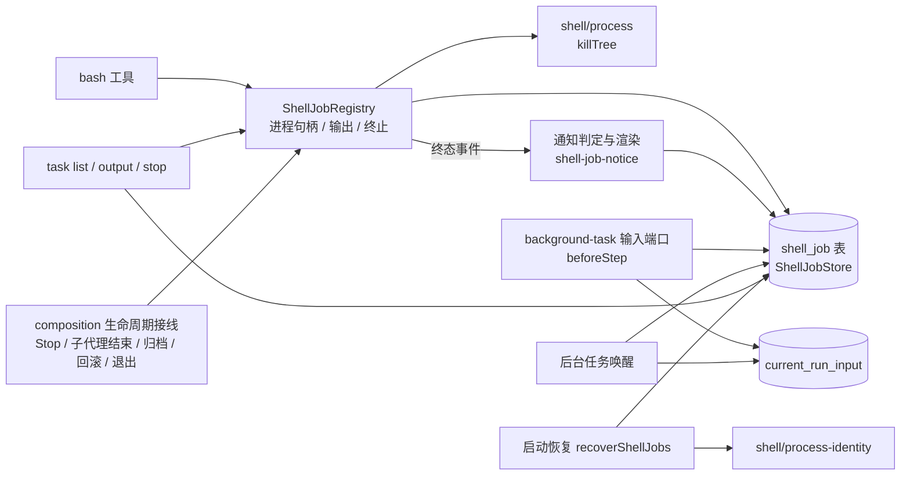

# 模块架构

状态：待实施设计。职责见 [goals-duty](goals-duty.md)，数据含义见 [data-model](data-model.md)，接口见 [dfd-interface](dfd-interface.md)。

已纳入输出尾部持久化、实际请求消费、统一输入协调及保守恢复契约。当前仅完成后端规划，整体尚未实施；前端展示另行交付。

## Overview

沿用现有分层，不新建服务：进程启动和整树终止在 `shell/`，任务生命周期在 `ShellJobRegistry`，生命周期接线在 `adapters/ui-runtime/composition.ts`。本议题在这套分层里补上四块：持久记录、新的状态与归属规则、结束通知、崩溃恢复。

## Pattern and Rationale

**记录是唯一事实来源，内存保留尚有责任的对象。** `ShellJobStore` 保存任务状态；`ShellJobRegistry` 持有运行中、停止处理中、输出收尾或资源释放未完成任务的句柄和等待者。逻辑终态先保存，晚到退出事实再补齐；进程清理确认、输出关闭、最终事实持久成功、资源释放成功后才能移除内存对象。历史查询读库，不能用终态写库代替资源回收完成。

**按归属方回收，而不是按轮次回收。** 后台任务的归属方是 `(sessionId, contextScopeId)`。现在的 `cancelByRootRun` 只保留给前台任务和回滚使用；Stop、轮次失败都不再碰后台任务。

**通知复用运行时输入，但有自己的来源和端口。** 结束通知写成一条来源为 `background-task-result` 的运行时输入，复用现有的接收、尝试、成功确认和 `beforeFinish` 拦截。它和子代理不共享执行记录、认领字段或防抖计数，只共享输入存储、会话闸门和提交入口。

**模式在启动时确定。** 本轮只接受显式 `run_in_background: true` 派发后台任务，前台到达 timeout 仍停止。轮次的中止路径只停止本轮前台任务；后台任务依归属方和单独的停止请求回收。自动转换留 improve-2，不预建转换接口。

**崩溃恢复是保守的。** 核实原 owner 已退出、目标 OS 出生身份与进程组归属后才发信号；无法核实就保留 unconfirmed。只将旧启动占位或 running 转 lost，已有终态不覆盖。

## Module Structure and File Layout

路径相对于 `packages/ohbaby-agent/src`。

| 文件 | 新增或修改 | 职责 |
| --- | --- | --- |
| `tools/shell-job-registry.ts` | 修改 | 状态保留 timed_out/cancelled 并新增 lost，合计六态；按归属方的查询与停止；显式后台名额；1GB 兜底；分开操作反馈与结束结果，事实补齐和清理完成后释放内存；任务管理工具 |
| `tools/shell-job-store.ts` | 新增 | `ShellJobStore` 接口，`DatabaseShellJobStore` 和测试用的内存实现；写法参考 `agents/subagents/execution-store.ts` |
| `tools/shell-job-notice.ts` | 新增 | 纯函数：根据终态判断是否需要通知、是否允许唤醒；渲染通知正文和 task(output) 的状态行 |
| `tools/shell-job-recovery.ts` | 新增 | 扫描启动占位、运行中及所有清理/结果责任未完成记录，仅旧启动占位或 running 转 lost；核对身份后有界清理 |
| `shell/process-identity.ts` | 新增 | 读取 OS 出生身份和进程组，显式区分 present/absent/unknown；平台能力和安全边界见 dfd-interface，不以秒级 ps 授权恢复信号 |
| `tools/bash.ts` | 修改 | 新增 `description`；前后台分开的时限；前台到时停止；中止处理改为只停前台任务 |
| `adapters/ui-runtime/background-task-inputs.ts` | 新增 | `beforeStep` 时把归属于本轮的待送通知写成运行时输入 |
| `adapters/ui-inprocess/background-task-wakeup.ts` | 新增 | 主代理空闲时唤醒一轮；复用会话闸门和 `prepareSession` 准入 |
| `adapters/ui-runtime/composition.ts` | 修改 | 生命周期接线改为按归属方；组合子代理与后台任务两个输入端口 |
| `adapters/ui-inprocess.ts` | 修改 | 归档时停止任务；回滚改用任务记录；接入唤醒 |
| `adapters/ui-persistent.ts` | 修改 | `startupReady` 调用 `recoverShellJobs` |
| `services/database/migrations.ts`、`schema.ts` | 修改 | 新迁移建立 shell_job；后续迁移放宽 current_run_input 来源 CHECK，编号实施时取当前下一个可用值 |
| `core/message/types.ts`、`events.ts` | 修改 | 运行时输入来源新增 `background-task-result` |
| `runtime/run-ledger/types.ts`、`runtime/run-manager/policy.ts` | 修改 | 触发来源新增 `background-task` |
| `core/tool-scheduler/{constants,concurrency,types}.ts` | 修改 | 删除 `maxSubagentConcurrency` 和 `dispatch` 名额类别（D14） |
| `core/system-prompt/prompts/primary/base.md` | 修改 | 新增主代理 Background jobs 一节；子代理提示词另补 D07/D08 的交付与回收规则 |
| `config/tools/shell/` | 新增 | 读取 `~/.ohbaby/tools/shell.json` 的主代理与子代理独立配额 |
| `services/session/rewind-shell.ts` | 修改 | 改为查询 `shell_job`；旧会话没有记录时保留现有推断作为兜底 |

## Constraints and Tradeoffs

| 取舍 | 选择 | 代价 |
| --- | --- | --- |
| 记录前台任务 | 记录（D15），启动、停止意图、结果收尾及晚到事实按实际阶段更新 | 先提交启动占位，再 spawn 并补写状态；纯前台不周期写输出尾部 |
| 写库时机 | 先提交同一 shell_job 表中的启动占位，再在事务外 spawn | spawn 至 PID/出生身份补写之间崩溃，可能有占位却无法定位进程 |
| 进程身份核对 | 启动时捕获 OS 出生身份；未知或不匹配不发信号 | 不提供系统托管级零竞态保证，组长消失后不凭数字 PGID 重获信号权 |
| 输出量统计 | 内存统计输出；仅后台写尾部检查点，前台只保存必要结果元数据 | 崩溃只能恢复检查点下界，必须标采集不完整 |
| 唤醒防抖 | 每条通知最多自动唤醒一次 | 唤醒那一轮失败后，要等用户或新通知才会处理 |
| 名额配置 | `ShellJobRegistry` 按可信 owner 独立计数；主代理 `maxRunningBackgroundJobs` 默认 10，子代理 `maxRunningSubagentBackgroundJobs` 默认 5；同在 `~/.ohbaby/tools/shell.json`，加载方式参考 `config/tools/search/` | 新增一个小配置文件和加载器；不做界面设置 |
| 和子代理分开 | 不复用子代理的执行记录与认领字段 | 唤醒相关的少量逻辑（闸门预留、准入）要再接一次 |

不可逆的部分只有数据库迁移：新表和 `current_run_input` 的 `CHECK` 重建。迁移按现有方式在事务里执行，旧数据保持不变。
