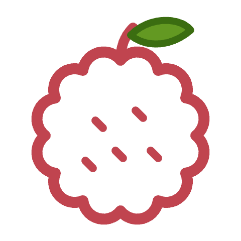
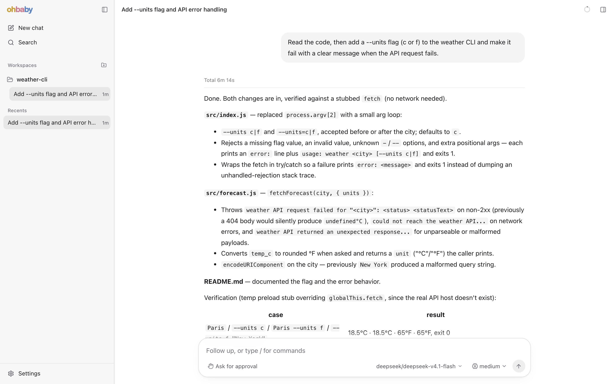
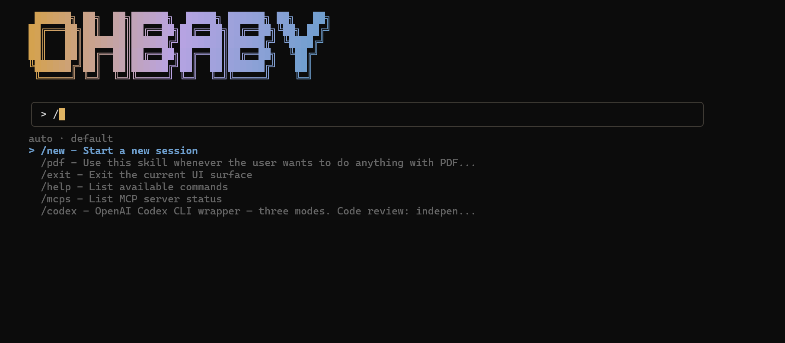

<div align="center">



# ohbaby-agent

### An open-source AI coding agent, in your terminal and your browser.

**Bring your own model. Extend it with MCP and skills. Approve every risky step.**

<a href="https://github.com/diverHansun/ohbaby-agent/actions/workflows/ci.yml"></a>
<a href="https://www.npmjs.com/package/ohbaby-cli"></a>
<a href="https://github.com/diverHansun/ohbaby-agent/blob/v0.1.17/LICENSE"></a>


**[Install](#install)** &nbsp;·&nbsp; **[Quick start](#quick-start)** &nbsp;·&nbsp; **[Web UI](#web-ui)** &nbsp;·&nbsp; **[Docs](https://github.com/diverHansun/ohbaby-agent/tree/v0.1.17/docs)** &nbsp;·&nbsp; **English** · [简体中文](https://github.com/diverHansun/ohbaby-agent/blob/v0.1.17/README.zh.md)

<br>



</div>

## Highlights

- **Any model**: OpenAI, Anthropic, Zhipu, DeepSeek, Qwen/DashScope, or any OpenAI-compatible endpoint, local ones included.
- **Two interfaces, one agent**: a fast [Ink](https://github.com/vadimdemedes/ink) terminal UI, and a local web UI started with `ohbaby serve`.
- **Built-in tools**: read and edit files, run shell commands, search the web, and keep a todo list.
- **Permissions**: risky actions wait for your approval; switch to Full access with `/permission` when you trust the task.
- **MCP and skills**: connect [MCP](https://modelcontextprotocol.io) servers, and add skills that show up as slash commands.
- **Subagents**: hand larger, multi-step work to focused subagents.

## Install

Requires **Node.js 24** or later.

```bash
npm install -g ohbaby-cli
```

This installs the `ohbaby` command.

## Quick start

```bash
ohbaby
```

1. Type `/connect`, fill in the provider, base URL and model name, and save.
2. Describe what you want done. That's it.

<p align="center">
  
</p>

<details>
<summary><b>/connect fields and argument mode</b></summary>

<br>

| Field | Description |
| --- | --- |
| Provider | `openai`, `anthropic`, `zhipu`, … |
| Base URL | The SDK base URL, without a `/chat/completions` suffix |
| API key env | Optional. The environment variable that holds the key, such as `OPENAI_API_KEY` |
| API key value | Optional. Leave it blank for keyless local endpoints such as LM Studio |
| Model name | Such as `gpt-5.5`, `claude-sonnet-4-5`, `glm-5.1`, or your provider's model id |
| Context window / Max output tokens | Optional |

Keys you enter here are saved to `~/.ohbaby/.env`.

Argument mode skips the panel. It reads the key from an environment variable and never takes it inline:

```bash
/connect --provider openai --base-url https://api.openai.com/v1 --model gpt-5.5 --api-key-env OPENAI_API_KEY --interface-provider openai-responses
```

`--interface-provider` takes `openai-compatible`, `openai-responses` or `anthropic`. Leave it out and ohbaby infers it from the URL; OpenAI URLs default to Chat Completions.

</details>

## Web UI

Run this from your project root:

```bash
ohbaby serve
```

It starts a local daemon and opens the URL it prints, usually `http://127.0.0.1:4096`.

```bash
ohbaby serve status  # show the daemon status and URL
ohbaby serve stop    # stop the daemon
```

<details>
<summary><b>Ports</b></summary>

<br>

Port `4096` is the default. If it's taken, ohbaby picks a free port and prints the URL. An explicit `--port` is strict: `ohbaby serve --port 4096` fails if that port is in use.

</details>

## Configuration

<details>
<summary><b>Web search</b></summary>

<br>

Get a free API key from [Tavily](https://tavily.com), type `/connect-search` and paste the key. ohbaby saves it as `TAVILY_API_KEY` in `~/.ohbaby/.env`.

You can also put the key in `~/.ohbaby/.env` (global) or `<your-project>/.env` (project):

```dotenv
TAVILY_API_KEY=tvly-...
```

Shell environment variables win over the project `.env`, which wins over the global one.

</details>

<details>
<summary><b>MCP and skills</b></summary>

<br>

Configure MCP servers globally or per project under `.ohbaby/mcp/`. Skills are found in ohbaby-compatible skill directories and show up as slash commands. Use `/mcps` to see connected servers and `/skills` to list skills.

</details>

<details>
<summary><b>Instruction files</b></summary>

<br>

ohbaby reads one global file from `~/.ohbaby/` and one project file from the project root (or `<project>/.ohbaby/`). In each place it takes the first it finds: `OHBABY.md`, then `AGENTS.md`, then `CLAUDE.md`. The main agent and subagents both read them, and the project file takes precedence. These files are instructions, not long-term memory.

</details>

<details>
<summary><b>Config and data locations</b></summary>

<br>

Configuration lives in `~/.ohbaby` (`%USERPROFILE%\.ohbaby` on Windows): models, keys, MCP, skills, agents, tools and daemon state. Set `OHBABY_HOME` to an absolute path to move all of it. Project configuration lives in `<project>/.ohbaby`.

Runtime data lives in the platform data directory:

- Linux: `${XDG_DATA_HOME:-~/.local/share}/ohbaby`
- macOS: `~/Library/Application Support/ohbaby`
- Windows: `%LOCALAPPDATA%\ohbaby`

On first start, ohbaby copies legacy `.ohbaby-agent` configuration and `ohbaby-agent` data to the new locations and leaves the originals in place. New paths win on conflicts, and legacy paths are still read for one minor release. If a running daemon blocks the SQLite migration, run `ohbaby serve stop` and start again.

</details>

## Development

```bash
git clone https://github.com/diverHansun/ohbaby-agent.git
cd ohbaby-agent
pnpm install
pnpm build
pnpm start       # run the built CLI
pnpm test        # run tests
pnpm preflight   # format + lint + typecheck + test + build
```

| Package | What it is |
| --- | --- |
| `ohbaby-cli` | The terminal UI and bundled web UI; installs the `ohbaby` command |
| `ohbaby-agent` | The runtime: adapters, tools, sessions, policy, MCP, skills |
| `ohbaby-llm` | Provider-neutral LLM clients, streaming and configuration |
| `ohbaby-server` | The local server and remote client transport |
| `ohbaby-sdk` | Stable TypeScript contracts shared by the runtime and its interfaces |

Design notes and module docs live in [`docs/`](https://github.com/diverHansun/ohbaby-agent/tree/v0.1.17/docs).

## License

[MIT](https://github.com/diverHansun/ohbaby-agent/blob/v0.1.17/LICENSE)
